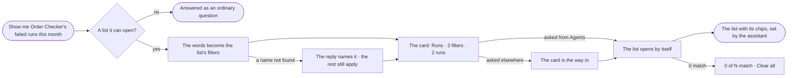

# EX-28 · The assistant opens a list

**As** an agent builder **I want** to ask the assistant for a list — *show me Order Checker's failed runs this month* —
and have it open that list with its filters set **so that** I read the rows instead of building the filter by hand,
and trust what the list leaves out because its chips say so.

Tasks: [task.md](task.md) · Feature: [EX-F03](../../feature.md)

## Who can

| Lens | Can | Otherwise sees |
|---|---|---|
| Admin | Ask for Runs, Agents, Inbox › Needs you or Inbox › History with filters, and open it | — |
| Operator | The same, through the agents they may use — the list opens with what they may read, counted under their rights; a Modeller the same | A name they cannot see is said as not found, never as forbidden; a run whose content they may not read lists with *withheld* (CP-F10) |

## Flow

## Acceptance criteria

| # | Given | When | Then |
|---|---|---|---|
| EX-28.1 | *Show me Order Checker's failed runs this month* | the person asks | the reply carries a card — the list's name, a chip per filter and the row count, *Runs · 3 filters · 2 runs* |
| EX-28.2 | The card | the person opens it | Control Plane › Runs opens with the agent, *failed* and the last 30 days applied, each chip marked *set by the assistant* |
| EX-28.3 | The question asked from Agents | it is answered | the list opens by itself, and the card stays in the thread as the way back |
| EX-28.4 | The words *this week*, *today*, *didn't serve* | they are asked | they become the last 7 days, the last 24 hours and *not served* |
| EX-28.5 | *Order Chekcer*, an agent name that does not exist | the person asks | the reply says *No agent named "Order Chekcer"* and the card carries the filters that did resolve |
| EX-28.6 | Filters nothing matches | the card is drawn | it reads *0 runs*, and the list opens on *0 of N match* with *Clear all* |
| EX-28.7 | A list the assistant opened | the person reloads it or clears a chip | it behaves as a list a person filtered |
| EX-28.8 | A list the assistant opened | its count is compared with the list | the card's count is the list's own total |
| EX-28.9 | A request for something that is not a list it can open | the person asks | it is answered as an ordinary question |
| EX-28.10 | An Operator asking for an agent they cannot see | the person asks | the agent is said as not found, and the count is of what they may read |
| EX-28.11 | Any list the assistant opens | it opens | nothing in the Graph or the list changes |
| EX-28.12 | A card the assistant drew | the person opens *How it got here* | its steps and sources are shown — the words it read and the filter each became |

## Screens

| Surface | Lens | First use | Empty after a filter | Loading | Has data | Failed | Agent working or proposing | No access |
|---|---|---|---|---|---|---|---|---|
| The card in the thread | Admin | — | explore.board · List card, 0 rows | explore.board · Working | explore.board · List card | explore.board · Name not found | explore.board · Working | — |
| The card in the thread | Operator | — | explore.board · List card, 0 rows | explore.board · Working | explore.board · List card | explore.board · Name not found | explore.board · Working | explore.board · Name not found |
| The list it opens | Admin | — | agents.runs · 0 match | agents.runs · Loading | agents.runs · Set by the assistant | — | — | — |
| The list it opens | Operator | — | agents.runs · 0 match | agents.runs · Loading | agents.runs · Set by the assistant | — | — | — |
