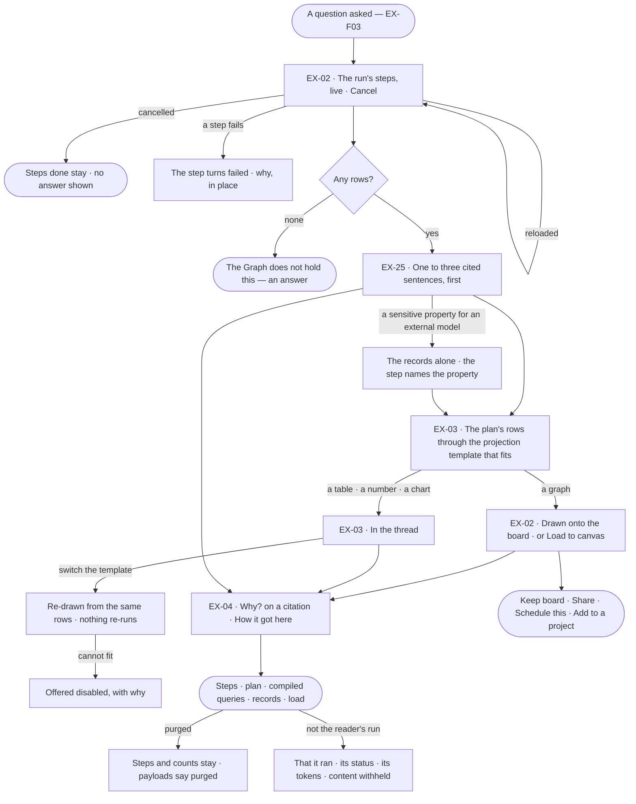
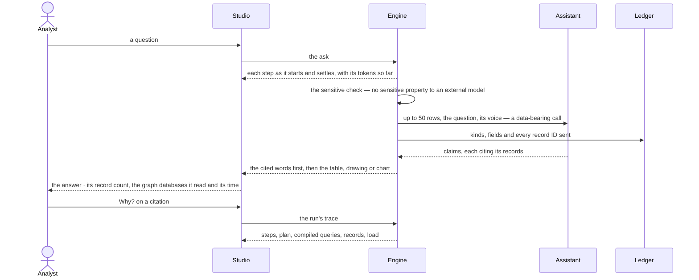

# The answer

> What a question gives back: a few cited words, then the drawing, table, number or chart the records call for —
> projected from the typed query plan's rows through a **projection template** — watched as it is worked out and
> traceable to every record behind it, in whichever graph database it lives — so the person can judge whether to act
> on it.
> The decision it helps make: *does this answer hold up well enough to act on?*

## User journey

Journeys this feature is a step of: [J01 · From a fresh deployment to a first answer](../../../../journeys/J01-from-a-fresh-deployment-to-a-first-answer.md) · [J02 · Ask and trust the answer](../../../../journeys/J02-ask-and-trust-the-answer.md)

## Stories

| ID | Story | Status |
|---|---|---|
| EX-02 | [Watch the answer arrive on the board](stories/EX-02-watch-the-answer-arrive-on-the-board/story.md) | idea |
| EX-25 | [The answer in words](stories/EX-25-the-answer-in-words/story.md) | idea |
| EX-03 | [The answer in the shape that fits](stories/EX-03-the-answer-in-the-shape-that-fits/story.md) | idea |
| EX-04 | [See how the answer got here](stories/EX-04-see-how-the-answer-got-here/story.md) | idea |

## Access

Who may do what is the [role table](../../../../os/access/features/AC-F02-access-policies/feature.md#the-role-table):
*the answer* is *Acts* for Operator, Modeller and Admin. Projection templates are authored with skills in Agents ›
Skills, so authoring them follows *skills* — *Acts* for Modeller and Admin, *Reads* for Operator. An answer's content
is its run's: run privacy is [CP-F10](../../../../os/control/features/CP-F10-runs-and-how-the-agents-are-doing/feature.md).

| Act | Who | Everyone else sees |
|---|---|---|
| Read an answer, watch its steps, cancel or re-run their own run | The person behind the run; those an answer is shared with read it; an Admin reads every one | Another person's run: that it ran, its status and its tokens — content withheld |
| Load an answer to the board · switch its template | The person behind the run | — |
| Open *Why?* and *How it got here* — prompts, plan, compiled queries, records | Whoever may read the answer | Content withheld |
| Keep board · Share | The person behind the run ([EX-F02](../EX-F02-share-and-present-an-answer/feature.md)) | — |
| Schedule this · Add to a project | The person behind the run — *Schedules* and *Projects* are *Acts* for every role ([AG-F07](../../../agents/features/AG-F07-schedules/feature.md) · [PJ-F03](../../../projects/features/PJ-F03-branches-findings-and-decisions/feature.md)) | — |
| Author, change, publish and delete projection templates | Modeller · Admin | The templates read; *+* disabled — *Needs the Modeller role — ask an Admin* |

## States

| State | What the person sees |
|---|---|
| First use | No answer yet: the question box (EX-F03); the five built-in projection templates are the only ones |
| Empty after a filter | Zero rows: *The Graph does not hold this*, a sentence in the reading order — never an empty table or a zeroed chart |
| Loading | A row per step as it starts — running · done · failed · retrying 2/3 · repairing — with time and tokens; a table paints while the next step runs; *Writing the answer…* over it |
| Has data | Cited words, then the records' shape, then the meta line — *195 records · sales, crm · 9 ms* — and its acts |
| Failed | The failed step, why, in place; a failed Answer step leaves the records as the answer |
| Agent working or proposing | The live steps, with the agent and its plan named, and *Cancel* |
| No access | Another person's answer: that it ran, its status and its tokens; template authoring disabled, naming *Modeller* |

## Rules

| Rule | Detail |
|---|---|
| An answer is a sequence | Cited words, a drawing, a table, a number, a chart — each of a declared kind, in the order the steps made them, nothing merged into a summary |
| Words lead | The cited sentences come first; the records they cite follow |
| Everything cites | Every part names the compiled query, its graph database and the records behind it, one click away. A sentence with no record behind it is dropped before it ships |
| The plan picks the shape | The shape is read from the typed query plan and its rows — whole records and hops are a graph, returned properties are rows, one aggregate is a number, one aggregate per group is a category and a number, nothing is nothing — then a projection template is ranked by the visual asked for (*as a chart*) and the kind of question. The AI model classifies the question and writes the words; it never picks a template, and templates are never in the prompt |
| Projection templates are one home | Every way rows become a part — the answer in the thread, a part on a task, a scheduled answer, a question asked back — is a projection template here; nothing else draws an answer |
| Asking for a visual ranks, never forces | *As a chart* over one number still shows the number; the chart is offered disabled with its reason |
| A drawing adds | A graph answer adds to what is on the board, never replaces it; it is counted as drawn — each node and relationship once, a record linked across graph databases once |
| A reload reads the record | Opening a conversation, switching a tab or reloading shows what is stored and asks no graph database; reading again is the person's *Re-run* |
| A re-run is a new run | It leaves the earlier answer in place; a re-run that fails shows beside the answer it re-checked |
| The time is the run's | The meta line's time is the run's work, stored by the engine when it settles; each compiled query's own time is its step's |
| Sensitive never leaves for an external model | Writing the words sends rows to the agent's AI model; a sensitive property bound for an external model refuses the call before it leaves, naming the property, and the records stand alone ([AC-F09](../../../../os/access/features/AC-F09-what-left-the-platform/feature.md)) |
| Templates own the markup | A template maps fields that exist; the AI model never writes markup. An HTML template has no script, no network and no outside assets |
| The trace is part of the answer | Whoever may read the answer reads how it was reached; nobody else reads either |
| Leans on | EX-F01 — the board answers draw on, the Element panel a record opens in · EX-F03 — the question and its typed plan · EX-F05 — cannot answer, third-party and predicted claims, *Fork from here* · runs and run privacy (CP-F10) · the ledger and the sensitive check (AC-F09) · sensitive properties (SE-F03) · AI models, local or external (CP-F01) · provenance — the load behind a record (RC-F06) |

## Data touched

| Record | Read or write |
|---|---|
| Run and its steps — state, time, tokens, prompt, rationale, plan, compiled queries, rows read, skills offered and applied, rules cited | Write (the engine) · read ([CP-F10](../../../../os/control/features/CP-F10-runs-and-how-the-agents-are-doing/feature.md)) |
| The answer's parts — kind, order, template, citation | Write (the engine) · read |
| Projection templates — name, kind, surface, shape it accepts, its definition, intent, version, status, origin | Read · write (Modeller · Admin) |
| A question asked back and its answer, as a value | Write · read |
| Records and the loads that wrote them | Read |
| Ledger rows — the Answer step's data-bearing call | Write, by the engine ([AC-F09](../../../../os/access/features/AC-F09-what-left-the-platform/feature.md)) |

## Engine

The low-level design: what this feature stores, serves and refuses. Conventions — naming, errors, lists, events — are
[system-design.md](../../../../system-design.md) §§ 6–8; this section only fills them in.

### Records

| Table | Columns | Notes |
|---|---|---|
| `explore_emissions` | `run_id` · `message_id?` · `step_run_id?` · `seq` (reading order) · `kind` (`subgraph` · `table` · `metric` · `chart` · `prose` · `link` · `assumptions` · `empty`) · `payload` · `template_id?` (null: the kind's default) · `citation` (each compiled query with its graph database and language, the record IDs behind the part, the record count, when) · `evidence` (`observed` · `predicted` · `third_party`) | An answer part, written by the `project` step. `assumptions` is EX-24's; `link` is EX-28's; `predicted` is EX-33's |
| `explore_projection_templates` | `name` · `origin` (`builtin` · `custom`) · `kind` (`result` · `prompt`) · `surface` · `accepts` (the shape it renders) · `spec` · `intent` · `version` · `status` (`draft` · `published`) · `created_by_id` | A projection template. A published version never changes; a change is a new draft version. A `builtin` template is written from code |

### Reads

| Record | Owner |
|---|---|
| The run, its steps, `work_ms`, its stream (`control_run_stream`) and its trace · cancel · resume · `may_read_run()` | [CP-F10](../../../../os/control/features/CP-F10-runs-and-how-the-agents-are-doing/feature.md#engine) |
| A plan step's `optional` flag | [AG-F06](../../../agents/features/AG-F06-plans-and-workflows/feature.md#engine) |
| The turn, its typed plan and compiled queries — *Load to canvas* and the `load` turn | [EX-F03 › Engine](../EX-F03-ask-a-question/feature.md#engine) |
| Sensitive properties | [SE-F03](../../../semantics/features/SE-F03-meaning/feature.md#engine) |
| The sensitive check and the ledger row of the Answer step's call | [AC-F09](../../../../os/access/features/AC-F09-what-left-the-platform/feature.md#engine) |
| The agent's AI model and its local or external mark | [CP-F01](../../../../os/control/features/CP-F01-ai-models/feature.md#engine) |
| The load behind a record — its stamps and lineage | [RC-F06](../../../records/features/RC-F06-provenance/feature.md#engine) |

### Routes

| Route, after `/api/v1/explore` | Does | Story |
|---|---|---|
| `GET /runs/{run}/emissions` | An answer's parts in reading order; *Not found* to a reader who may not read the run | EX-02 · EX-03 |
| `POST /runs/{run}/emissions/{emission}/template` | Switch a part's template — the same rows re-drawn, written on the part | EX-03 |
| `GET /projection-templates` · `POST /projection-templates` | Every template, built-in and custom, with how many answers each drew · author one | EX-03 |
| `GET /projection-templates/{template}` · `PATCH /projection-templates/{template}` · `DELETE /projection-templates/{template}` | Read · change (a published one makes a new draft version) · delete a draft that never published | EX-03 |
| `POST /projection-templates/{template}/publish` | Publish a draft | EX-03 |
| `POST /projection-templates/{template}/copy` | A custom draft from a built-in or custom template, owned by the copier | EX-03 |
| `GET /projection-templates/{template}/usage` | Every answer it drew that the reader may read | EX-03 |

### Events

| Event | When |
|---|---|
| `explore.emissions.produce` | An answer part is written |
| `explore.projection_templates.create` · `update` · `publish` · `delete` | A template is authored · changed · published · deleted |

### Refusals

| Status | When | Sentence | Criterion |
|---|---|---|---|
| 404 | The parts or the trace of a run the reader may not read | *Not found.* | EX-04.13 |
| 422 | A template whose `spec` names a field its `accepts` shape lacks | *{field} is not in the shape this template accepts.* | EX-03.11 |
| 422 | A template switch to one that does not accept the part's shape | *{template} cannot draw {shape} — {why}.* | EX-03.6 |
| 409 | Deleting a published or built-in template | *Answers read {template} — publish a new version instead.* | EX-03.15 |
| 422 | Changing a built-in template in place | *{template} is built in — copy it to change it.* | EX-03.14 |
| 403 | Authoring, changing, publishing or deleting a template by a person whose role does not hold *skills* | *Skills needs the Modeller role.* | EX-03.12 |
| step | The Answer step's call would carry a sensitive property to an external model — refused before it leaves; the run is still answered | *{property} is sensitive — it never goes to an external model.* | EX-25.7 |

### CLI

| Command | Does |
|---|---|
| — | No command of its own |

### Mechanisms

| Mechanism | How |
|---|---|
| A part is a record | `project` writes `explore_emissions`; a reload reads them and asks no graph database. A reply with no run — one whose run was pruned — renders one part folded from the result it carries, naming no template |
| The plan's shape | `project` reads the shape from the typed plan before it reads a row: `targets` and `hops` returned whole → `graph`; `returns` of properties → `rows`; one aggregate, no `group_by` → `single_value`; one aggregate and one `group_by` → `categorical`; zero rows → `empty` whatever the plan. A typed query (EX-08) has no plan; its shape is read from its rows |
| Surface → kind | The chosen template's surface is the part's kind: `subgraph` → `subgraph` · `table` → `table` · `metric` → `metric` · `chart` → `chart` · `markdown` → `prose`. Zero rows is `empty` whatever the surface. `html` renders as a table until it is built |
| `answer_in_words` | The Answer step, bound to the agent's AI model and `optional`. In: the ask, the intent, up to 50 rows with their record IDs, the agent's voice. Out: claims, each citing record IDs, or carrying a third-party reference or a prediction (EX-F05). `project` reserves `seq` 1 for it. Before the call the sensitive check runs; a sensitive property for an external model skips it, naming the property. Failing, it marks its step and never the run. Its call is a data-bearing ledger row keeping every record ID sent |
| The words part | A `prose` part, payload `{claims}`; its citation is the union of the record IDs its claims cite |
| On the board is the turn's fact | Whether a graph part is drawn is read from the turn — *Load to canvas*, or the `load` turn of a new conversation's first answer — never from the part |
| The stream | Server-sent events per run, replayed from the last delivered `seq` after a reload; a frame (`step.*`, a diagnosis, a part arriving) is not a part. Every `step.finished` frame carries `run_tokens`, the run's tokens so far. A reader who may not read the run gets status and tokens frames only |
| The time is the run's | The meta line reads `work_ms`, stored when the run settles: the steps summed, without the time a person spent answering |
| Ranking templates | Among published templates that accept the shape: by `prefer`, then the intent `kind`, then specificity, then name; an ask with no intent ranks by specificity alone. `prefer` `graph` · `table` · `chart` ranks `subgraph` · `table` · `chart` first; `aggregate_and_chart` ranks `chart` then `metric`, `exploration` ranks `subgraph`, other kinds rank nothing |
| Specificity | Weighted: `single_value` · `categorical` · `empty` 4 · `columns` 2 · `min_rows` · `result_type` 1 — so `single-value` beats `records-table` on a one-cell result |
| Templates never enter the prompt | `prefer` is a fixed enum in the classifier's tool schema, so the schema is a constant in the cacheable prefix whatever templates exist |
| Template kinds | `result` templates draw rows — surface `table` · `metric` · `chart` · `subgraph` · `markdown` · `html`. `prompt` templates draw a question asked back — `choice` · `multi-choice` · `boolean` · `pick-from-graph` · `value` · `confirm` |
| Built-in templates | Five, written from code and owned by the system user: `records-table` · `single-value` · `category-bars` · `graph` · `nothing-held`. *Copy* makes a custom draft owned by the copier |
| Publishing | *Publish* in Studio is a create, then the draft's publish, so every published template passed through a draft |

## System impact

| HLD section | Change | NFRs |
|---|---|---|
| § 6 Data and storage | Two tables in Postgres; no new store | — |
| § 8 APIs and events | The routes and events above; the parts are read under the run's privacy | — |
| § 10 AI and agents | Projection from the typed plan's shape; an optional Answer step whose failure never fails the run; templates kept out of the prompt; the sensitive check before the Answer step's call | NFR-SEC-5 · NFR-SEC-8 · NFR-PERF-5 |

## Decisions

| Decision | Detail |
|---|---|
| Everything answers in the thread | Answers, the words of a chart, refusals, cannot answer, traces and confirmations arrive as the assistant's messages; the question is a bubble on the right |
| A reply | The assistant's mark, the cited words, the parts; under them the meta line — record count · the graph databases read · time — then *Load to canvas* (a graph not yet drawn, or a table whose rows are things in the Graph) · *Keep board* · *Share* · *Fork from here* · *Schedule this* · *Add to a project*, folding into *⋯* by width; *How it got here* pinned first. No labelled button row under the answer |
| One offer, from the result | *Load to canvas* is the only offer, at most one per reply, never on a number, a chart or a total; it runs the drawing as its own read in the same conversation |
| A graph part has no card | In the thread it is the reply's sentence and meta line; on the board it is the drawing. Every other part is a card: its kind, the template drawing it, the citation |
| Switching the template is the answer's | A switch re-draws the same rows and is kept on the answer, so everyone who may read it sees the shape chosen |
| Five templates are built in | Records table · single value · category bars · graph · nothing held — competing with custom ones on the same terms. Between eligible ones: the visual asked for, then the kind of question, then the most specific shape |
| A published template never changes | A change is a new draft version; only a template that never published is deleted, because answers keep reading the version that drew them |
| Templates are published from use | A shape that read well is published as a template and picked next time the rows match |
| The answer reads a sample past 50 rows | And the words say they spoke from a sample |
| The Answer step fails soft | A model error, a timeout, a sensitive property for an external model, or no claim that could be cited leaves the records as the answer and marks the step, never the run |
| Offered and applied are two counts | Each with what it means beside it |
| Purging keeps the shape | Payloads purge with their window; the steps and their counts stay |

## Open questions

| Question | Who answers |
|---|---|
| Does a `pick-from-graph` question asked back refresh its options when it is asked again, or keep the options of its first ask? Recommend: refresh — the options are read from the Graph under the agent's Access Policies, and a frozen list can offer what the Graph does not hold now | Ravi |
| The home's composer showing the skill as its first chip (*Explain*) is drawn and not built. Build it, or drop it — the composer offers no skill picker (EX-F03 › Not building)? Recommend: drop it, unless the chip only names the agent's skill and picks nothing | Ravi |
| *Loads behind the records* under a trace's steps is drawn and not built: it needs each record's load on the reply. Build it with EX-04, or leave the load to the record's panel (RC-F06)? Recommend: build it with EX-04 — the trace is where a person checks where an answer came from | Ravi |

## Not building

| Item | Why not |
|---|---|
| An uncited summary over the parts | It would restate without citing; the words are written claim by claim |
| Markup or script written by the AI model | Rendering belongs to a template |
| Comparing answers across runs | Compare (CP-F10) and a schedule's history do that |
| Text streaming word by word | The parts are structured; a half-drawn table is not useful |
| Pausing and resuming a run · editing a step mid-run | Cancel and ask again is honest; the plan is checked before it runs |
| Editing a trace or an answer in place | It is a record; asking again is a new question |
| Showing a trace to someone who may not read the answer | The trace is the answer's content; run privacy covers both |
| The model's internal reasoning tokens | The trace records what each step reported, not what cannot be checked |
| A second model call to check the words | The citations are the check |
| Per-answer styling | A template is chosen, not restyled |
| Matching the question's words to a template | Picking a shape is read from the plan, not a substring match |
