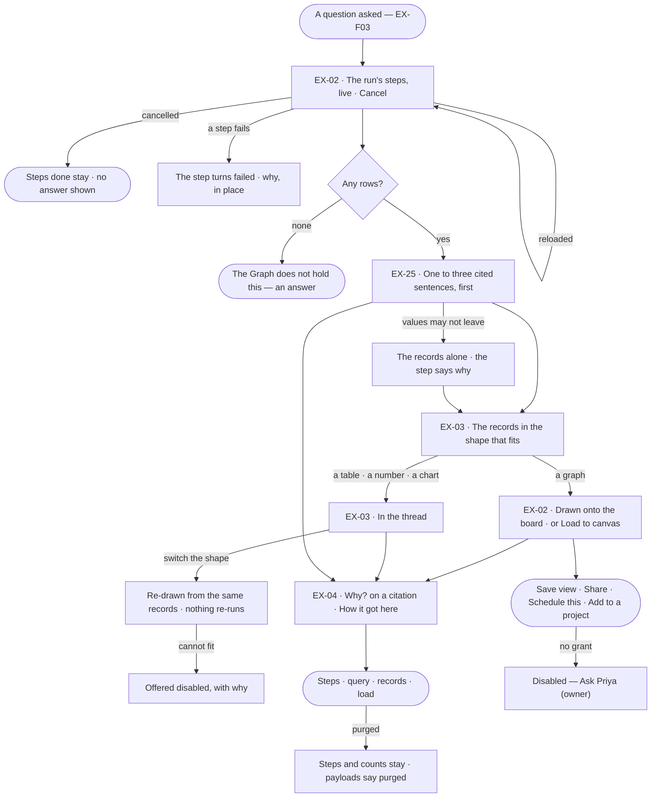
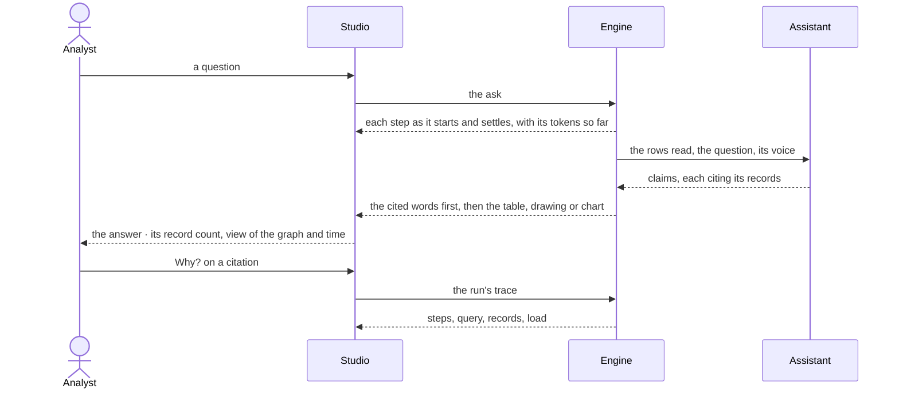

# The answer

> What a question gives back: a few cited words, then the drawing, table, number or chart the records call for —
> watched as it is worked out and traceable to every record behind it — so the person can judge whether to act on it.
> The decision it helps make: *does this answer hold up well enough to act on?*

## User journey

Journeys this feature is a step of: [J01 · From an empty install to a first answer](../../../../journeys/J01-from-an-empty-install-to-a-first-answer.md) · [J02 · Ask and trust the answer](../../../../journeys/J02-ask-and-trust-the-answer.md)

## Stories

| ID | Story | Status |
|---|---|---|
| EX-02 | [Watch the answer arrive on the board](stories/EX-02-watch-the-answer-arrive-on-the-board/story.md) | idea |
| EX-25 | [The answer in words](stories/EX-25-the-answer-in-words/story.md) | idea |
| EX-03 | [The answer in the shape that fits](stories/EX-03-the-answer-in-the-shape-that-fits/story.md) | idea |
| EX-04 | [See how the answer got here](stories/EX-04-see-how-the-answer-got-here/story.md) | idea |

## Access

| Act | Role (`.claude/team/TEAM.md` §7) | Everyone else sees |
|---|---|---|
| Read an answer, watch its steps, cancel or re-run their own run | Operator — every member | Another member's run: read, not cancelled |
| Load an answer to the board · switch its shape | Operator — every member | — |
| Open *Why?* and *How it got here* — prompts, queries, records | Operator — every member who can read the answer | — |
| Save view · Share | Operator — every member | — |
| Schedule this · Add to a project | `contributor` · shown as *Can work on projects* | Disabled — *Ask Priya (owner)* |
| Author, change, publish and delete answer templates | `builder` · shown as *Can build agents* | The templates are listed read-only; *+* hidden |

## States

| State | What the person sees |
|---|---|
| First use | No answer yet: the question box (EX-F03); a Graph with no templates of its own uses the five that ship |
| Empty after a filter | Zero rows: *The Graph does not hold this*, a sentence in the reading order — never an empty table or a zeroed chart |
| Loading | A row per step as it starts — running · done · failed · retrying 2/3 · repairing — with time and tokens; a table paints while the next step runs; *Writing the answer…* over it |
| Has data | Cited words, then the records' shape, then the meta line — *195 records · Everything · 9 ms* — and its acts |
| Failed | The failed step, why, in place; a failed Answer step leaves the records as the answer |
| Agent working or proposing | The live steps, with the agent and its plan named, and *Cancel* |
| No access | Every member reads an answer and its trace; *Schedule this* and *Add to a project* without the grant say *Ask Priya (owner)* |

## Rules

| Rule | Detail |
|---|---|
| An answer is a sequence | Cited words, a drawing, a table, a number, a chart — each of a declared kind, in the order the steps made them, nothing merged into a summary |
| Words lead | The cited sentences come first; the records they cite follow |
| Everything cites | Every part names the query and the records behind it, one click away. A sentence with no record behind it is dropped before it ships |
| Code picks the shape | The assistant classifies the question and writes the words; the shape is chosen from what the records are — a graph, rows, one number, a category and a number, nothing — then ranked by the visual asked for (*as a chart*) and the kind of question. Templates are never in the prompt |
| Asking for a visual ranks, never forces | *As a chart* over one number still shows the number; the chart is offered disabled with its reason |
| A drawing adds | A graph answer adds to what is on the board, never replaces it; it is counted as drawn — each node and relationship once |
| A reload reads the record | Opening a conversation, switching a tab or reloading shows what is stored and asks the graph nothing; reading again is the person's *Re-run* |
| A re-run is a new run | It leaves the earlier answer in place; a re-run that fails shows beside the answer it re-checked |
| The time is the run's | The meta line's time is the run's work, stored by the engine when it settles; the query's own time is its step's |
| Templates own the markup | A template maps fields that exist; the assistant never writes markup. An HTML template has no script, no network and no outside assets |
| The trace is part of the answer | Not an admin view: whoever can read the answer reads how it was reached |
| Leans on | EX-F01 — the board answers draw on, the Element panel a record opens in · EX-F03 — the question · EX-F05 — cannot answer, third-party claims, *Fork from here* · Records — the load behind a record (RC-F06) |

## Data touched

| Record | Read or write |
|---|---|
| Run and its steps — state, time, tokens, prompt, rationale, query, rows read, skills offered and applied, rules cited | Write (the engine) · read |
| The answer's parts — kind, order, template, citation | Write (the engine) · read |
| Answer templates — name, kind, shape it accepts, its definition, intent, version, status | Read · write (Can build agents) |
| A question asked back and its answer, as a value | Write · read |
| Graph records and the loads that wrote them | Read |

## Engine

### Records

| Table | Columns | Notes |
|---|---|---|
| `explore_emissions` | `run_id` · `message_id?` · `step_run_id?` · `seq` (reading order) · `kind` (`subgraph` · `table` · `metric` · `chart` · `prose` · `link` · `assumptions` · `empty`) · `payload` · `template_id?` (null: the kind's default) · `citation` (the query, its language, the record ids behind the part, the record count, when) | An answer part, written by the `project` step. `assumptions` is EX-24's; `link` is EX-28's |
| `explore_projection_templates` | `graph_id?` (null: shipped) · `name` · `kind` (`result` · `prompt`) · `surface` · `accepts` (the shape it renders) · `spec` · `intent` · `version` · `status` (`draft` · `published`) | An answer template. A published version never changes; a change is a new draft version |

### Reads

| Record | Owner |
|---|---|
| The run, its steps, `work_ms`, its stream (`agents_run_stream`) and its trace · cancel · resume | [AG-F03](../../../agents/features/AG-F03-runs-and-how-the-agents-are-doing/feature.md#engine) |
| A plan step's `optional` flag | [AG-F06](../../../agents/features/AG-F06-plans-and-functions/feature.md#engine) |
| The turn — *Load to canvas* and the `load` turn | [EX-F03 › Engine](../EX-F03-ask-a-question/feature.md#engine) |
| What may cross to an AI model (`property_values`) | [SE-F09](../../../semantics/features/SE-F09-views-of-the-graph/feature.md#engine) |
| The load behind a record — its stamps | [RC-F02 › Engine](../../../records/features/RC-F02-bring-records-in/feature.md#engine) |

### Routes

| Route, after `/api/v1/u/{u}/{g}` | Does | Story |
|---|---|---|
| `GET /agents/runs/{run}/emissions` | An answer's parts in reading order | EX-02 · EX-03 |
| `POST /agents/runs/{run}/emissions/{emission}/template` | Switch a part's template — the same records re-drawn, written on the part | EX-03 |
| `GET /explore/projection-templates` · `POST /explore/projection-templates` | The Graph's templates and the five shipped · author one | EX-03 |
| `GET /explore/projection-templates/{template}` · `PATCH /explore/projection-templates/{template}` · `DELETE /explore/projection-templates/{template}` | Read · change (a published one makes a new draft version) · delete a draft that never published | EX-03 |
| `POST /explore/projection-templates/{template}/publish` | Publish a draft | EX-03 |

### Events

| Event | When |
|---|---|
| `explore.emissions.produce` | An answer part is written |
| `explore.projection_templates.create` · `update` · `publish` · `delete` | A template is authored · changed · published · deleted |

### Refusals

| Status | When | Sentence | Criterion |
|---|---|---|---|
| 422 | A template whose `spec` names a field its `accepts` shape lacks | *{field} is not in the shape this template accepts.* | EX-03.11 |
| 422 | A template switch to one that does not accept the part's shape | *{template} cannot draw {shape} — {why}.* | EX-03.6 |
| 409 | Deleting a published or shipped template | *Answers read {template} — publish a new version instead.* | EX-03.15 |
| 403 | Authoring, changing, publishing or deleting a template without *Can build agents* | *This needs Can build agents — ask {owner}.* | EX-03.12 |
| 404 | Another Graph's template | *Not found.* | API only — Studio lists the Graph's own and the shipped |

### CLI

| Command | Does |
|---|---|
| — | No command of its own |

### Mechanisms

| Mechanism | How |
|---|---|
| A part is a record | `project` writes `explore_emissions`; a reload reads them and asks the graph nothing. A reply with no run — an older turn, or one whose run was pruned — renders one part folded from the result it carries, naming no template |
| Surface → kind | The chosen template's surface is the part's kind: `subgraph` → `subgraph` · `table` → `table` · `metric` → `metric` · `chart` → `chart` · `markdown` → `prose`. Zero rows is `empty` whatever the surface. `html` renders as a table until it is built |
| `answer_in_words` | The Answer step, bound to an AI model and `optional`. In: the ask, the intent, up to 50 rows with their record ids, the agent's voice. Out: claims, each citing record ids or carrying a third-party reference (EX-F05). `project` reserves `seq` 1 for it. Skipped when `property_values` may not cross; failing, it marks its step and never the run |
| The words part | A `prose` part, payload `{claims}`; its citation is the union of the record ids its claims cite |
| On the board is the turn's fact | Whether a graph part is drawn is read from the turn — *Load to canvas*, or the `load` turn of a new conversation's first answer — never from the part |
| The stream | Server-sent events per run, replayed from the last delivered `seq` after a reload; a frame (`step.*`, a diagnosis, a part arriving) is not a part. Every `step.finished` frame carries `run_tokens`, the run's tokens so far |
| The time is the run's | The meta line reads `work_ms`, stored when the run settles: the steps summed, without the time a person spent answering |
| Ranking templates | Among templates that accept the shape: by `prefer`, then the intent `kind`, then specificity, then name; an ask with no intent ranks by specificity alone. `prefer` `graph` · `table` · `chart` ranks `subgraph` · `table` · `chart` first; `aggregate_and_chart` ranks `chart` then `metric`, `exploration` ranks `subgraph`, other kinds rank nothing |
| Specificity | Weighted: `single_value` · `categorical` · `empty` 4 · `columns` 2 · `min_rows` · `result_type` 1 — so `single-value` beats `records-table` on a one-cell result |
| Templates never enter the prompt | `prefer` is a fixed enum in the classifier's tool schema, so the schema is a constant in the cacheable prefix whatever a Graph's templates |
| Template kinds | `result` templates draw records — surface `table` · `metric` · `chart` · `subgraph` · `markdown` · `html`. `prompt` templates draw a question asked back — `choice` · `multi-choice` · `boolean` · `pick-from-graph` · `value` · `confirm` |
| Publishing | *Publish* in Studio is a create, then the draft's publish, so every published template passed through a draft. Scope: a Graph's own plus the shipped five |

## System impact

| HLD section | Change | NFRs |
|---|---|---|
| § 6 Data and storage | Two tables in Invana's own store; no new store | — |
| § 8 APIs and events | The routes and events above; the parts are read under the run's routes | — |
| § 10 AI and agents | An optional Answer step whose failure never fails the run; templates kept out of the prompt | — |

## Decisions

| Decision | Detail |
|---|---|
| Everything answers in the thread | Answers, the words of a chart, refusals, cannot answer, traces and confirmations arrive as the assistant's messages; the question is a bubble on the right |
| A reply | The assistant's mark, the cited words, the parts; under them the meta line — record count · view of the graph · time — then *Load to canvas* (a graph not yet drawn, or a table whose rows are things in the graph) · *Save view* · *Share* · *Fork from here* · *Schedule this* · *Add to a project*, folding into *⋯* by width; *How it got here* pinned first. No labelled button row under the answer |
| One offer, from the result | *Load to canvas* is the only offer, at most one per reply, never on a number, a chart or a total; it runs the drawing as its own read in the same conversation |
| A graph part has no card | In the thread it is the reply's sentence and meta line; on the board it is the drawing. Every other part is a card: its kind, the template drawing it, the citation |
| Switching the shape is the answer's | A switch re-draws the same records and is kept on the answer, so everyone opening it sees the shape chosen |
| Five templates ship | Records table · single value · category bars · graph · nothing held — competing with a Graph's own on the same terms. Between eligible ones: the visual asked for, then the kind of question, then the most specific shape |
| A published template never changes | A change is a new draft version; only a template that never published is deleted, because answers keep reading the version that drew them |
| Templates are promoted from use | A shape that read well is published as a template and picked next time the records match |
| The answer reads a sample past 50 rows | And the words say they spoke from a sample |
| The Answer step fails soft | A model error, a timeout, values that may not leave, or no claim that could be cited leaves the records as the answer and marks the step, never the run |
| Offered and applied are two counts | Each with what it means beside it |
| Purging keeps the shape | Payloads purge with their window; the steps and their counts stay |

## Open questions

| Question | Who answers |
|---|---|
| Does a `pick-from-graph` question asked back refresh its options when it is asked again, or keep the options of its first ask? Recommend: refresh — the options are read from the graph under the run's view, and a frozen list can offer what the graph does not hold now | Ravi |
| The home's composer showing the skill as its first chip (*Explain*) is drawn and not built. Build it, or drop it — the composer offers no skill picker (EX-F03 › Not building)? Recommend: drop it, unless the chip only names the agent's skill and picks nothing | Ravi |
| *Loads behind the records* under a trace's steps is drawn and not built: it needs each record's load on the reply. Build it with EX-04, or leave the load to the record's panel (Records)? Recommend: build it with EX-04 — the trace is where a person checks where an answer came from | Ravi |

## Not building

| Item | Why not |
|---|---|
| An uncited summary over the parts | It would restate without citing; the words are written claim by claim |
| Markup or script written by the model | Rendering belongs to a template |
| Comparing answers across runs | Compare and a schedule's history do that |
| Text streaming word by word | The parts are structured; a half-drawn table is not useful |
| Pausing and resuming a run · editing a step mid-run | Cancel and ask again is honest; the plan is checked before it runs |
| Editing a trace or an answer in place | It is a record; asking again is a new question |
| Hiding prompts from members | Whoever can see the answer can see how it was reached |
| The model's internal reasoning tokens | The trace records what each step reported, not what cannot be checked |
| A second model call to check the words | The citations are the check |
| Per-answer styling | A template is chosen, not restyled |
| Matching the question's words to a template | Picking a shape is a classification, not a substring match |
