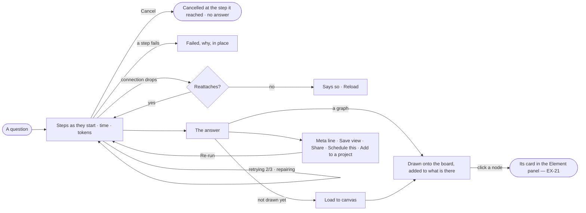

# EX-02 · Watch the answer arrive on the board

**As** an analyst waiting on an answer **I want** to watch what the assistant is doing, stop it if it goes the wrong
way, and see the answer drawn on the board with every record one click away **so that** I see the answer rather than
just read it, and never stare at a spinner deciding whether to reload.

Tasks: [task.md](task.md) · Feature: [EX-F04](../../feature.md)

## Who can

| Lens | Can | Otherwise sees |
|---|---|---|
| Admin | Watch, cancel and re-run their own runs; load an answer to the board; *Save view* · *Share* · *Schedule this* · *Add to a project* | Another member's run: watched, not cancelled |
| Operator | Watch, cancel and re-run their own runs; load to the board; *Save view* · *Share* | *Schedule this* and *Add to a project* disabled — *Ask Priya (owner)*. With *Can work on projects*: as Admin |

## Flow

## Acceptance criteria

| # | Given | When | Then |
|---|---|---|---|
| EX-02.1 | A question sent | its run starts | each step shows as it starts — running, done, failed, retrying with its attempt, repairing — with its time and the run's tokens so far |
| EX-02.2 | A table part settles while a later step runs | the person watches | the table paints at once, before the run ends |
| EX-02.3 | A run on its way | the person clicks *Cancel* | it is marked cancelled at the step it reached, the steps done stay, and nothing partial is shown as an answer |
| EX-02.4 | A run on its way | the person reloads | the steps reattach and the thread is intact |
| EX-02.5 | The connection drops and cannot reattach | it fails | the thread says so and offers *Reload* |
| EX-02.6 | The first answer of a new conversation is a graph | it settles | it is drawn onto the conversation's new board and offers no *Load to canvas* |
| EX-02.7 | A graph answer not yet drawn, or a table whose rows are things in the graph | the person clicks *Load to canvas* | what it holds is added to the board, never replacing what is there, and the reply's offer is answered |
| EX-02.8 | A drawn answer with a hub on every route | it is counted | each node and relationship counts once; the reply's counts, its record count and the board agree |
| EX-02.9 | An answer | the person clicks *Re-run* | a new run reads again and the earlier answer stays; a re-run that fails shows beside it |
| EX-02.10 | A conversation with answers | the person reopens or reloads it | every answer shows as stored and the graph is asked nothing |
| EX-02.11 | A settled answer | the person reads its meta line | it shows the record count, the view of the graph and the run's time, with *How it got here* first and the acts after it folding into *⋯* by width |
| EX-02.12 | An Operator without *Can work on projects* | they open *Schedule this* or *Add to a project* | it is disabled with *Ask Priya (owner)* |
| EX-02.13 | A drawn answer | the person clicks a node | it is selected and its card opens in the Element panel |
| EX-02.14 | Two tabs on one conversation | a run streams | both show it; neither drives it |

## Screens

| Surface | Lens | First use | Empty after a filter | Loading | Has data | Failed | Agent working or proposing | No access |
|---|---|---|---|---|---|---|---|---|
| The reply and its steps | Admin | — | explore.board · Nothing held | explore.board · Working | explore.board | explore.board · Step failed | explore.board · Working | — |
| The reply and its steps | Operator | — | explore.board · Nothing held | explore.board · Working | explore.board | explore.board · Step failed | explore.board · Working | explore.board · Acts need a grant |
| The answer on the board | Admin | explore.board · Load to canvas | — | explore.board · Drawing | explore.board | — | — | — |
| The answer on the board | Operator | explore.board · Load to canvas | — | explore.board · Drawing | explore.board | — | — | — |
