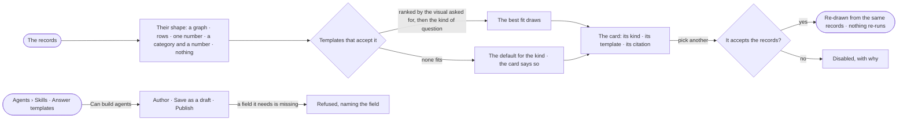

# EX-03 · The answer in the shape that fits

**As** an analyst **I want** the answer in the shape the records call for — a number when I asked for a number, a chart
when the shape calls for one, a graph when I asked what connects — and to switch it in one click **so that** I see the
answer at a glance instead of parsing rows.

Tasks: [task.md](task.md) · Feature: [EX-F04](../../feature.md)

## Who can

| Lens | Can | Otherwise sees |
|---|---|---|
| Admin | Switch an answer's shape; author, change and publish answer templates | — |
| Operator | Switch an answer's shape; read the answer templates | The templates read-only, *+* hidden. With *Can build agents*: as Admin |

## Flow

## Acceptance criteria

| # | Given | When | Then |
|---|---|---|---|
| EX-03.1 | A result of one number | it is shown | it reads as a number with its unit, not a one-row table |
| EX-03.2 | A result of one number per category | it is shown | it reads as a chart, with Graph and Table one click away |
| EX-03.3 | A chart result with a single point | it is shown | it reads as a number, not a dot |
| EX-03.4 | *As a chart* asked over one number | it is shown | the number shows, and the chart is offered disabled with its reason |
| EX-03.5 | An answer's card | the person picks another template that accepts the records | it re-draws from the same records without running the query again, and everyone opening the answer sees that shape |
| EX-03.6 | An answer's card | the person opens the template picker | every template is listed, those that cannot take the records disabled with why |
| EX-03.7 | No template fits | the answer is shown | it uses the default for its kind and the card says so; it names no template it did not use |
| EX-03.8 | Thousands of rows | the table is shown | it is counted, paged and the cap stated |
| EX-03.9 | A Graph with no templates of its own | the person opens Agents › Skills | the five that ship are listed — records table · single value · category bars · graph · nothing held |
| EX-03.10 | A person with *Can build agents* | they author a template and *Publish* | it is saved and published, and picked next time the records match |
| EX-03.11 | A template whose definition names a field the shape lacks | it is saved | it is refused, naming the field |
| EX-03.12 | An Operator without *Can build agents* | they open the answer templates | they read them; *+* is hidden |
| EX-03.13 | An HTML template | it draws | it runs no script, reaches no network and loads no outside asset |

## Screens

| Surface | Lens | First use | Empty after a filter | Loading | Has data | Failed | Agent working or proposing | No access |
|---|---|---|---|---|---|---|---|---|
| The answer's card | Admin | — | explore.board · Nothing held | explore.board · Working | explore.board.chart | explore.board.chart · Shape refused | — | — |
| The answer's card | Operator | — | explore.board · Nothing held | explore.board · Working | explore.board.chart | explore.board.chart · Shape refused | — | — |
| The template picker | Admin | — | — | — | explore.board.chart · Picker | — | — | — |
| The template picker | Operator | — | — | — | explore.board.chart · Picker | — | — | — |
| Answer templates | Admin | agents.skills · Shipped templates | agents.skills · No template matches | agents.skills · Loading | agents.skills · Answer templates | agents.skills · Template refused | — | — |
| Answer templates | Operator | agents.skills · Shipped templates | agents.skills · No template matches | agents.skills · Loading | agents.skills · Answer templates | — | — | agents.skills · Read only |
