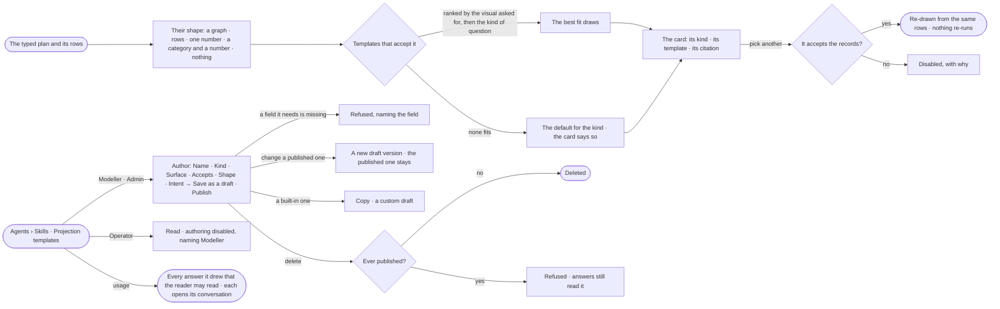

# EX-03 · The answer in the shape that fits

**As** an analyst **I want** the answer in the shape the question and its records call for — a number when I asked for a number, a chart
when the shape calls for one, a graph when I asked what connects — and to switch it in one click **so that** I see the
answer at a glance instead of parsing rows.

Tasks: [task.md](task.md) · Feature: [EX-F04](../../feature.md)

## Who can

| Lens | Can | Otherwise sees |
|---|---|---|
| Admin | Switch an answer's template; author, copy, change, publish and delete projection templates | — |
| Operator | Switch the template of an answer of theirs; read the projection templates. A Modeller also authors them, as Admin ([role table](../../../../../../os/access/features/AC-F02-access-policies/feature.md#the-role-table) › *skills*) | *+* and each authoring act disabled — *Needs the Modeller role — ask an Admin* |

## Flow

## Acceptance criteria

| # | Given | When | Then |
|---|---|---|---|
| EX-03.1 | A result of one number | it is shown | it reads as a number with its unit, not a one-row table |
| EX-03.2 | A result of one number per category | it is shown | it reads as a chart, with Graph and Table one click away |
| EX-03.3 | A chart result with a single point | it is shown | it reads as a number, not a dot |
| EX-03.4 | *As a chart* asked over one number | it is shown | the number shows, and the chart is offered disabled with its reason |
| EX-03.5 | An answer's card | the person picks another template that accepts the rows | it re-draws from the same rows without running any query again, and everyone who may read the answer sees that shape |
| EX-03.6 | An answer's card | the person opens the template picker | every published template is listed, those that cannot take the rows disabled with why |
| EX-03.7 | No template fits | the answer is shown | it uses the default for its kind and the card says so; it names no template it did not use |
| EX-03.8 | Thousands of rows | the table is shown | it is counted, paged and the cap stated |
| EX-03.9 | A deployment with no custom templates | the person opens Agents › Skills › Projection templates | the five built-in ones are listed — records table · single value · category bars · graph · nothing held — each *built-in* |
| EX-03.10 | A Modeller or an Admin | they author a template and *Publish* | it is saved and published, and picked next time the rows match |
| EX-03.11 | A template whose definition names a field the shape lacks | it is saved | it is refused, naming the field |
| EX-03.12 | An Operator | they open the projection templates | they read them; *+* and every authoring act are disabled — *Needs the Modeller role — ask an Admin*; the engine refuses an authoring call — *Skills needs the Modeller role.* |
| EX-03.13 | An HTML template | it draws | it runs no script, reaches no network and loads no outside asset |
| EX-03.14 | A published template, or a built-in one | a Modeller or an Admin changes it | a published custom template's change is a new draft version and answers keep reading the published one; a built-in one is not changed — *{template} is built in — copy it to change it*, and *Copy* makes a custom draft they own |
| EX-03.15 | A template | a Modeller or an Admin deletes it | a draft that never published is deleted; a published or built-in one is refused, saying answers read it |
| EX-03.16 | The projection templates | anyone reads them | each shows how many answers it drew |
| EX-03.17 | A projection template | a person opens its usage | every answer it drew that they may read is listed, each opening the conversation it is in; the rest are counted, content withheld |
| EX-03.18 | A Modeller or an Admin | they author a template | the form asks Name · Kind · Surface · Accepts — one constraint per line, filled from the surface until edited (a table: `result_type tabular` · `min_rows 1`) · Shape, one `key: value` per line · Intent; it ends *Save as a draft* or *Publish* |
| EX-03.19 | A plan that returns whole records and their hops | the answer is shaped | it is a graph, whatever the row count, and *Load to canvas* draws it; a plan returning one count per category is a chart |

## Screens

| Surface | Lens | First use | Empty after a filter | Loading | Has data | Failed | Agent working or proposing | No access |
|---|---|---|---|---|---|---|---|---|
| The answer's card | Admin | — | explore.board · Nothing held | explore.board · Working | explore.board.chart | explore.board.chart · Shape refused | — | — |
| The answer's card | Operator | — | explore.board · Nothing held | explore.board · Working | explore.board.chart | explore.board.chart · Shape refused | — | — |
| The template picker | Admin | — | — | — | explore.board.chart · Picker | — | — | — |
| The template picker | Operator | — | — | — | explore.board.chart · Picker | — | — | — |
| Projection templates | Admin | agents.skills · Shipped templates | agents.skills · No template matches | agents.skills · Loading | agents.skills · Answer templates | agents.skills · Template refused | — | — |
| Author a template | Admin | agents.skills · Author template | — | — | agents.skills · Author template | agents.skills · Template refused | — | — |
| Author a template | Operator | — | — | — | — | — | — | agents.skills · Read only |
| Projection templates | Operator | agents.skills · Shipped templates | agents.skills · No template matches | agents.skills · Loading | agents.skills · Answer templates | — | — | agents.skills · Read only |
