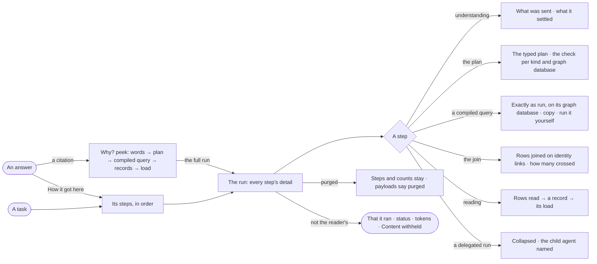

# EX-04 · See how the answer got here

**As** an analyst deciding whether to act on an answer **I want** to trace it from its words to the typed plan, the
query compiled for each graph database, the records and the load they came from **so that** I trust a chain I can check, and can defend it.

Tasks: [task.md](task.md) · Feature: [EX-F04](../../feature.md)

## Who can

| Lens | Can | Otherwise sees |
|---|---|---|
| Admin | Open *Why?* and *How it got here* on any answer; copy a compiled query and run it in the composer through the Query console | — |
| Operator | The same on an answer they may read — their own, or one shared with them; running a copied query needs the Query console; a Modeller the same ([role table](../../../../../../os/access/features/AC-F02-access-policies/feature.md#the-role-table) › *the answer*) | Another person's answer: that it ran, its status and its tokens — the trace reads *Content withheld* ([CP-F10](../../../../../../os/control/features/CP-F10-runs-and-how-the-agents-are-doing/feature.md)) |

## Flow

## Acceptance criteria

| # | Given | When | Then |
|---|---|---|---|
| EX-04.1 | A cited answer | the person clicks a citation | *Why?* opens beside it: the words, the typed plan, the query compiled for the graph database the records are in, the records and the load each came from |
| EX-04.2 | A part's card | the person opens its citation | the trace opens on that part's compiled queries and records |
| EX-04.3 | An answer | the person opens *How it got here* | it shows every step in order with its state, time and tokens, and the full run one click further |
| EX-04.4 | A step that talked to an AI model | the person opens it | it shows what was sent and the model's rationale, a very long prompt truncated with a full view on demand |
| EX-04.5 | A compiled query | the person opens it | it shows exactly as run, naming its graph database and language, and can be copied into the composer to run by hand through the Query console |
| EX-04.6 | The reading step | the person opens a row | it leads to the record and the load that wrote it |
| EX-04.7 | A step offered skills | the person opens it | it shows the skills offered and the skills it reports applied as two counts, each saying what it means, and the rules it cites |
| EX-04.8 | A run | the person reads the trace | it names the workflow and its version it reused, or says the plan was drafted for this question, and shows the typed query plan with the check's verdict per kind and graph database |
| EX-04.9 | A step repaired once | the person opens it | both attempts show with the error between them |
| EX-04.10 | A run that delegated to another agent | the person reads the trace | the child run nests under the step that started it, collapsed, the child agent named |
| EX-04.11 | A run older than its payloads' window | the person opens it | the steps and their counts show, and each payload says it was purged |
| EX-04.12 | A task an agent ran | the person opens it in Projects | the same trace is reached from the task |
| EX-04.13 | A person who may read the answer | they open the trace | they see its prompts, plan and queries; nothing in it can be edited. A person who may not read it gets *Content withheld* in Studio and *Not found* from the API |
| EX-04.14 | An answer joined across two graph databases | the person opens the join step | it shows each step's graph database and row count, the identity links that joined them and how many rows crossed |
| EX-04.15 | A step that called an AI model | the person opens it | it says whether the call was schema-only or data-bearing, whether the model is local or external, and what it recorded in *What left the platform* ([AC-F09](../../../../../../os/access/features/AC-F09-what-left-the-platform/feature.md)) |

## Screens

| Surface | Lens | First use | Empty after a filter | Loading | Has data | Failed | Agent working or proposing | No access |
|---|---|---|---|---|---|---|---|---|
| Why? | Admin | — | — | explore.board.why · Loading | explore.board.why | explore.board.why · Purged | — | — |
| Why? | Operator | — | — | explore.board.why · Loading | explore.board.why | explore.board.why · Purged | — | — |
| The run's trace | Admin | — | — | agents.run.answer · Loading | agents.run.answer | agents.run.answer · Step failed | agents.run.answer · Running | — |
| The run's trace | Operator | — | — | agents.run.answer · Loading | agents.run.answer | agents.run.answer · Step failed | agents.run.answer · Running | agents.run.answer · Content withheld |
| The trace on a task | Admin | — | — | projects.task.thinking · Loading | projects.task.thinking | projects.task.thinking · Step failed | projects.task.thinking · Working | — |
| The trace on a task | Operator | — | — | projects.task.thinking · Loading | projects.task.thinking | projects.task.thinking · Step failed | projects.task.thinking · Working | — |
