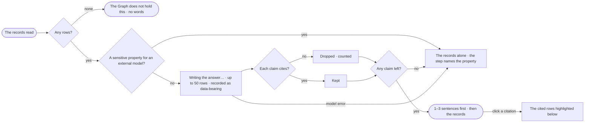

# EX-25 · The answer in words

**As** an analyst asking *which customer ordered the most last quarter?* **I want** to be told — *Acme Ltd placed the
most orders last quarter: 412, worth 1.8 million* — with every claim cited to its record **so that** I get an answer,
not a table I have to read one from.

Tasks: [task.md](task.md) · Feature: [EX-F04](../../feature.md)

## Who can

| Lens | Can | Otherwise sees |
|---|---|---|
| Admin | Read the words of any answer, open a citation | — |
| Operator | The same, on answers they may read — their own, or one shared with them; a Modeller the same ([role table](../../../../../../os/access/features/AC-F02-access-policies/feature.md#the-role-table) › *the answer*) | Another person's answer: that it ran, its status and its tokens — content withheld ([CP-F10](../../../../../../os/control/features/CP-F10-runs-and-how-the-agents-are-doing/feature.md)) |

## Flow

## Acceptance criteria

| # | Given | When | Then |
|---|---|---|---|
| EX-25.1 | An answer with rows | it settles | one to three sentences in the agent's voice come first, and the records they cite follow |
| EX-25.2 | The words being written | the person watches | the records paint as soon as they are read, with *Writing the answer…* above them |
| EX-25.3 | A sentence | the person clicks its citation | the records it rests on are scrolled to and highlighted in the part below |
| EX-25.4 | A claim with no record behind it | the words are written | it is dropped before they ship, and the step counts what it dropped |
| EX-25.5 | Every claim dropped | the answer settles | the records stand alone and the step says *0 of 3 claims could be cited* |
| EX-25.6 | Zero rows | the answer settles | no words are attempted; it says the Graph does not hold this |
| EX-25.7 | Rows carrying a sensitive property, and an agent whose AI model is external | the answer settles | no call leaves; the records stand alone, and the step says *{property} is sensitive — it never goes to an external model*; the run is still answered |
| EX-25.8 | More than 50 rows | the words are written | they are written from the first 50 and say they spoke from a sample |
| EX-25.9 | The model fails or times out | the words are written | the records stand as the answer; the Answer step is marked failed and the run is still answered |
| EX-25.10 | An agent whose Access Policies allow Run on an outside tool | a claim comes from beyond the Graph | it is marked *Third-party* with its source (EX-26); a claim from a what-if is marked *Predicted* (EX-33) |
| EX-25.11 | An answer with words | the person opens *How it got here* | the Answer step shows what it was given and the claims it kept and dropped |
| EX-25.12 | The same rows, and an agent whose AI model is local | the answer settles | the words are written as usual; the call shows in *What left the platform* as data-bearing, naming every record ID sent |

## Screens

| Surface | Lens | First use | Empty after a filter | Loading | Has data | Failed | Agent working or proposing | No access |
|---|---|---|---|---|---|---|---|---|
| The words | Admin | — | explore.board · Nothing held | explore.board · Writing the answer | explore.board | explore.board · Records only | explore.board · Writing the answer | — |
| The words | Operator | — | explore.board · Nothing held | explore.board · Writing the answer | explore.board | explore.board · Records only | explore.board · Writing the answer | — |
| A citation | Admin | — | — | — | explore.board.why | — | — | — |
| A citation | Operator | — | — | — | explore.board.why | — | — | — |
