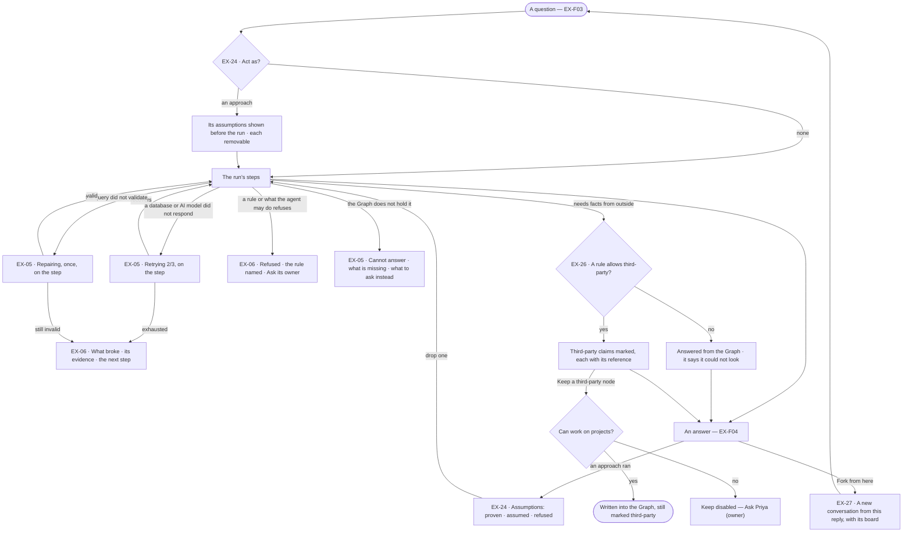
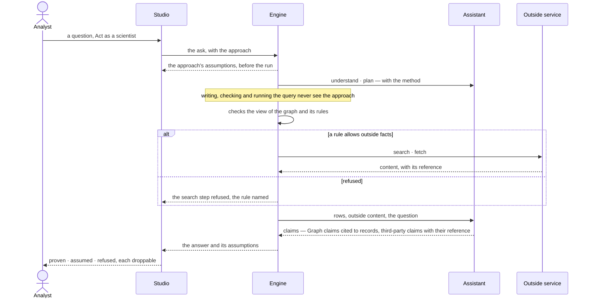

# When it cannot answer, and how it reasons

> What a question gives back when it is not a plain answer — the Graph does not hold it, a rule refuses it, or
> something broke — and the ways a person steers how it is reasoned: a method with its assumptions shown, facts
> from beyond the Graph marked as such, and a fork to try another direction — so the person knows which kind of
> nothing they have, and what an answer rests on, before acting on it.
> The decision it helps make: *which kind of nothing is this, and which method and facts may an answer rest on?*

## User journey

Journeys this feature is a step of: [J02 · Ask and trust the answer](../../../../journeys/J02-ask-and-trust-the-answer.md)

## Stories

| ID | Story | Status |
|---|---|---|
| EX-05 | [Be told when the Graph cannot answer](stories/EX-05-be-told-when-the-graph-cannot-answer/story.md) | idea |
| EX-06 | [A refusal or a failure that says why and what next](stories/EX-06-a-refusal-or-a-failure-that-says-why/story.md) | idea |
| EX-24 | [Ask the way a scientist would, with the assumptions shown](stories/EX-24-ask-with-an-approach-and-see-its-assumptions/story.md) | idea |
| EX-26 | [Facts from beyond the Graph, marked as such](stories/EX-26-facts-from-beyond-the-graph/story.md) | idea |
| EX-27 | [Fork a conversation from a reply](stories/EX-27-fork-a-conversation-from-a-reply/story.md) | idea |

## Access

| Act | Role (`.claude/team/TEAM.md` §7) | Everyone else sees |
|---|---|---|
| Read a cannot answer, a refusal or a diagnosis, and follow its next step | Operator — every member | A next step that needs a grant says *Ask Priya (owner)* |
| Pick an approach with *Act as* · remove an assumption before the run · drop one and re-run | Operator — every member, on their own runs | — |
| Author, change and publish an approach | `builder` · shown as *Can build agents* | Listed read-only in Agents › Skills; *+* hidden |
| Read third-party claims and nodes, and their references | Operator — every member | — |
| *Keep* a third-party node in the Graph | `contributor` · shown as *Can work on projects*, and a rule allowing the write | Disabled — *Ask Priya (owner)*; refused by a rule, the rule named |
| Allow outside services, or the model's own knowledge, in a view of the graph | `modeller` · shown as *Can shape the model* | The rules read-only |
| Add, change or remove a search provider | `owner` · shown as *Owner* | The providers read-only; *Add* hidden |
| *Fork from here* | Operator — every member, on their own conversations | Another member's conversation: not shown |

## States

| State | What the person sees |
|---|---|
| First use | No approach picked and no outside service allowed: the question is answered from the Graph alone; Settings › Search providers says none is added, with *Add* for an Owner |
| Empty after a filter | Zero rows from a valid query: *Cannot answer*, worded as an answer to the question asked, naming what is missing |
| Loading | The step reads what it does — *Retrying 2/3*, *Repairing*, *Searching the web · provider* — while the Graph's steps already show; *Fork from here* shows a spinner until the new conversation exists |
| Has data | An answer whose assumptions, third-party claims and fork lineage are each one click away |
| Failed | What broke, on the step it broke on, with its evidence folded under it and one next step |
| Agent working or proposing | The approach's assumptions above the composer before the run; the assistant's third-party nodes on the board, marked, waiting for *Keep* |
| No access | A rule's refusal names the rule and its owner; *Keep* without the grant says *Ask Priya (owner)*; another member's conversation shows no *Fork from here* |

## Rules

| Rule | Detail |
|---|---|
| Five ways a run ends | Answered · cannot answer · refused · failed · cancelled. A run that only replied to small talk is *conversed* — it claims nothing |
| Four kinds of nothing never share a surface | Retrying and repairing show on their step; cannot answer is calm — a dashed border, no colour of alarm; a diagnosis is drawn as a fault with its evidence under it — no answer header, no citation strip, its next step its only action. Their shapes differ before a word is read |
| Nothing partial is an answer | A run that did not settle shows what it reached as steps, never as an answer |
| Cannot answer names what is missing | Which kind, which model, or that nothing is loaded — and whether the kind is modelled but empty |
| A diagnosis is built from evidence | The step, the error and the query — never an invented cause — and its one action is its next step |
| Repair once | An invalid query goes back once with the error; a second failure stops |
| The agent's voice, the same facts | A cannot answer and a refusal are worded in the agent's voice, still name what is missing, and end with something the person can ask instead |
| An approach is a method, not an actor | It brings a method, a declared set of assumptions and an answer shape. The agent still acts, with its own *What it may do*, budget and model |
| An approach never changes what runs | It reaches understanding, planning and the answer's shape; it never reaches writing, checking or running the query. The check of *What it may do* is the same with or without one |
| One run, one approach | Two at once are refused; an agent may carry a default the asker overrides per run |
| An approach never softens *Cannot answer* | If its method needs what the Graph does not hold, the answer is *Cannot answer*, never an estimate |
| An approach that only changes the words did nothing | Swapping it on the same question and data must change the plan or the assumptions |
| A rule beats an assumption | An assumption a rule contradicts is dropped, naming the rule |
| Anything not from the Graph is third-party | The internet, any connected source and the model's own knowledge — marked *Third-party · internet*, *· api*, *· app*, *· db*, *· agent* or *· model*, in words, on the canvas and in the panel |
| No reference, not shown | Every third-party item keeps where it came from — for the internet the link, title, kind and when it was fetched — captured on arrival and never recomputed |
| Off unless a rule allows it | Outside services and the model's own knowledge are off in every view of the graph whose rules do not allow them; a deny wins at any level |
| What it may do says whether an agent may look | An agent not allowed to search never plans a search, whatever the view allows; its instructions say only *when* |
| A third-party node is drawn first, written on *Keep* | It is on the board only; *Keep* writes it as a source linked to what it is about, never into a model's own kinds, still marked third-party after a reload |
| A fork copies; it does not point | A fork holds its own copies of the turns up to the reply and the board as it stood there; deleting the parent takes nothing from it |
| Lineage is one link deep | A conversation knows its parent and the reply it branched at; nothing links conversations by inference |
| Leans on | EX-F01 — the board and its panel · EX-F03 — the question and its view of the graph · EX-F04 — the reply, its meta line and *How it got here* · Semantics › rules (SE-F07) — what outside services a view allows · Agents › Skills — where approaches are authored · Settings › AI and connections — search providers |

## Data touched

| Record | Read or write |
|---|---|
| Run — how it ended, its steps' retries and repair, its diagnosis | Write (the engine) · read |
| Approach — name, when to use, method, assumptions with what changes without each, answer shape, version | Read · write (Can build agents) |
| A run's approach and version, and its assumptions — claim, where it entered, whether checked and by which query, without it | Write (the engine) · read |
| Search provider — name, kind, address, key, last ping | Read · write (Owner) |
| A third-party claim or node — source, reference, title, kind, domain, fetched at, model, run | Write (the engine) · read |
| A kept third-party node — its provenance, who kept it and when, what it is about | Write (Can work on projects) · read |
| A conversation's parent and the reply it forked at · its copied turns · its board | Write · read |

## Engine

### Records

| Table | Columns | Notes |
|---|---|---|
| `explore_approaches` | `graph_id` · `name` · `when_to_use` · `method` · `assumptions[]` (each `claim` · `without_it`) · `answer_shape` · `version` · `status` (`draft` · `published`) | Authored in Agents › Skills. A published version never changes |
| `explore_search_providers` | `graph_id` · `name` · `kind` (`brave` · `tavily` · `searxng`) · `base_url?` · `api_key_encrypted?` · `last_ping_at` · `last_ping_ok` | Unique (`graph_id`, `name`); addressed `third_party/internet/search/{name}` |

### Reads

| Record | Owner |
|---|---|
| A conversation and its turns — the fork columns are on `explore_sessions` | [EX-F03 › Engine](../EX-F03-ask-a-question/feature.md#engine) |
| The run — its status and outcome, steps, retries, its approach (`approach_id` · `approach_version`) and `assumptions` | [AG-F03](../../../agents/features/AG-F03-runs-and-how-the-agents-are-doing/feature.md#engine) |
| *What it may do* — the bound a plan is checked against, whether the agent may search | [AG-F01](../../../agents/features/AG-F01-build-an-agent/feature.md#engine) |
| The plan `nl-outside` and the functions `search_web` · `fetch_source` | [AG-F06](../../../agents/features/AG-F06-plans-and-functions/feature.md#engine) |
| The web tools `web.search` · `web.read_url` · `web.download_file` | [RT-F02](../../../../os/runtime/features/RT-F02-plugins-and-outside-tools/feature.md#engine) |
| Rules allowing outside services, and `own_knowledge` on an AI model rule (off by default) | [SE-F07](../../../semantics/features/SE-F07-rules/feature.md#engine) |
| What may cross to an outside service | [SE-F09](../../../semantics/features/SE-F09-views-of-the-graph/feature.md#engine) |
| Boards and their versions — a fork's board | [EX-F01 › Engine](../EX-F01-the-board-and-its-canvas/feature.md#engine) |
| A board save — how *Keep* writes | [EX-F06 › Engine](../EX-F06-annotate-and-edit-the-data/feature.md#engine) |

### Routes

| Route, after `/api/v1/u/{u}/{g}/explore` | Does | Story |
|---|---|---|
| `POST /sessions/{session}/fork` | `{message_id}` → `201` the fork | EX-27 |
| `GET /approaches` · `POST /approaches` | The Graph's approaches · author one | EX-24 |
| `GET /approaches/{approach}` · `PATCH /approaches/{approach}` · `POST /approaches/{approach}/publish` | Read · change (a published one makes a new draft version) · publish | EX-24 |
| `GET /search-providers` · `POST /search-providers` | The providers, each with its last ping and the rules that name it · add one, pinged before it is saved | EX-26 |
| `PATCH /search-providers/{provider}` · `DELETE /search-providers/{provider}` | Change, pinged again · remove one | EX-26 |
| `POST /third-party/keep` | `{run_id, node_refs[]}` — write the picked third-party nodes into the Graph, as one run | EX-26 |

### Events

| Event | When |
|---|---|
| `explore.sessions.fork` | A fork is made — `session_id` · `parent_id` · `message_id` |
| `explore.approaches.publish` | An approach version is published |
| `explore.approaches.apply` | A run starts under an approach — `run_id` · `approach_id` · `approach_version` |
| `explore.approaches.drop_assumption` | An assumption is dropped on a run, naming the rule that contradicts it |
| `explore.third_party.fetch` · `explore.third_party.keep` | A source is fetched · third-party nodes are kept |

### Refusals

| Status | When | Sentence | Criterion |
|---|---|---|---|
| 422 | Two approaches on one ask | *One run, one approach.* | EX-24.9 |
| refused | A rule of the view of the graph refuses the question; the run settles `refused` before anything runs | *{rule} ({owner}) does not allow this — {what to ask instead}.* | EX-06.1 |
| refused | A plan outside *What it may do*; the run settles `refused` | *{agent} may not {bound}.* | EX-06.2 |
| step refused | A rule refuses the search; the step is refused before it is sent and the run goes on from the Graph | *I'm not allowed to look that up here.* | EX-26.6 |
| 403 | *Keep* without *Can work on projects* | *This needs Can work on projects — ask {owner}.* | EX-26.18 |
| 403 | *Keep* where a rule refuses the write | *{rule} does not allow writing this.* | EX-26.12 |
| 403 | Authoring an approach without *Can build agents* | *This needs Can build agents — ask {owner}.* | EX-24.15 |
| 403 | Adding, changing or removing a search provider by anyone but the Owner | *Only the Owner manages search providers.* | EX-26.19 |
| 422 | A search provider whose ping fails on save | *{provider} did not answer — {why}.* | EX-26.15 |
| 409 | A fork from a reply that is running, refused or failed | *Only a settled answer can be forked.* | EX-27.2 |
| 404 | A fork of another member's conversation | *Not found.* | EX-27.3 |

### CLI

| Command | Does |
|---|---|
| — | No command of its own |

### Mechanisms

| Mechanism | How |
|---|---|
| Outcome beside status | `answered` · `conversed` · `cannot_answer` · `refused` · `failed` · `cancelled` on the run; *succeeded* and *cannot answer* are two claims |
| Three endings, three signals | A step returns *cannot answer* (`CannotAnswer`), a failure (`TaskFailure`) or an answer — never one shaped as another. `execute` returning nothing is *the graph does not hold this*, never a generated guess |
| Steps that end a run | `understand` — *cannot answer* · `plan` — refused, naming the bound · `validate` — after its one repair · `execute` — a failure with a diagnosis. `verify` records its verdict and never ends one |
| Retry | Per step kind: attempts, backoff, jitter; each attempt a frame on its step |
| Repair | The validation error is carried into the repair attempt's prompt |
| A diagnosis | Assembled from the step, the error and the query, with a next step from a fixed set — never generated free-form, so the same failure reads the same |
| An approach in the run | Reaches `understand`, `plan` and `project` as offered context; never `translate`, `validate` or `execute`; no field of it is an input to the check of *What it may do*. `verify` reads only the run's assumptions and checks them against what the run did |
| A run's assumptions | Written on the run, each `claim` · `source` (`approach` · `question` · `model` · `rule`) · `checked` and the query that checked it · `without_it` (authored, never generated); shown as one `assumptions` part |
| Outside facts | The `nl-outside` plan — translate · validate · execute · search · fetch · project · verify · answer — is picked when the intent `needs_outside` and *What it may do* lists the search. `search_web` and `fetch_source` are bound `third_party` |
| What may go out | Search terms from the ask cross as `the_question`; terms carrying record values as `property_values` |
| A third-party claim | `{text, third_party: {source, reference, title?, source_kind?, domain?, fetched_at?, model?, run_id}}`, captured on arrival and never recomputed |
| A third-party node | A `Source` — `reference` · `title` · `source` · `source_kind` · `fetched_at` · `excerpt` — with an `ABOUT` relationship to what it concerns; on the board only until *Keep* |
| *Keep* | Writes each picked `Source` and its `ABOUT` as a board save does (EX-F06), stamped `_inv_origin = third_party` · `_inv_source` · `_inv_reference` · `_inv_source_title` · `_inv_source_kind` · `_inv_fetched_at` · `_inv_model` · `_inv_run_id` · `_inv_kept_by` · `_inv_kept_at` |
| A fork copies | Every turn at or below the reply's `seq`, field for field, `run_id` kept; `surface`, `agent_id`, `lens_id` and `max_tokens_run` carried; a new board from the parent's version at that reply, else its current snapshot. Forks never group conversations |
| Fork fields on the reads | EX-F03's `GET /sessions` adds `forked_from_title` · `fork_count`; its `GET /sessions/{session}` adds `forked_from: {id, title, message_id} \| null` · `forks: [{id, title, message_id}]` |

## System impact

| HLD section | Change | NFRs |
|---|---|---|
| § 6 Data and storage | Two tables in Invana's own store; `Source` nodes written into the customer's graph on *Keep* | — |
| § 10 AI and agents | The `nl-outside` plan; approaches as offered context, never an input to the bound | — |
| § 11 Failure modes and the outside boundary | Search providers are outside services a run reaches only when a rule allows it; a failed ping fails the *Search* step and the answer is from the Graph | — |
| § 12 Qualities | Security: search terms cross by the view's egress; provider keys stored encrypted | — |

## Decisions

| Decision | Detail |
|---|---|
| A refusal is part of the answer | A search a rule refuses is refused before it is sent and recorded; the run goes on from the Graph and the words say it could not look |
| Approaches are authored with skills | Same shape — named, described, *when to use*, offered to a step, reused by many agents — so they sit in Agents › Skills, not a second authoring place |
| No default approach for the product | The plain path has no assumptions list; an agent's author may give one agent a default, which its page names |
| Assumptions say what changes without them | Each assumption carries what the answer becomes if it does not hold, authored with the approach — so dropping one is predictable, and a re-run proves it |
| Outside facts run their own plan | A question that needs outside facts runs a plan with Search and Fetch in its steps, so the steps a person reads say up front that it looked outside |
| Search providers are configured rows | Never an AI model vendor's built-in search; each is an address a rule can name, pinged before it is saved, its detail listing the rules that name it. They sit in Settings › AI and connections as their own list, never inside an AI model's settings: an AI model is who an agent thinks with, a search provider a third party the Graph lets it reach |
| The internet is one outside service | Every service connected later reaches a run the same way: an address a rule can name, a mark, a reference. A service that cannot give a reference is not connected |
| A fork starts with the board at its reply | The board as the conversation had drawn it then; the parent's current board when none was kept at that reply |
| A deleted parent leaves the fork whole | The banner reads *Forked from a deleted conversation*, with no link; a delete is never blocked by forks |
| Only a settled answer is a fork point | A running, refused or failed reply has nothing to branch from |

## Open questions

| Question | Who answers |
|---|---|
| Should *Keep* a third-party node need *Can work on projects* (as board edits do, EX-F06) or *Can shape the model* (it writes into the Graph)? | Ravi — follows the answer for EX-F06 |

## Not building

| Item | Why not |
|---|---|
| Endless repair loops | Two invalid attempts mean the intent is wrong, not the syntax |
| A generic *Something went wrong* | It teaches nothing and hides the evidence |
| Falling back to the model's own knowledge unasked | That is the failure the product exists to avoid; it needs a rule that allows it, and is marked |
| Approaches with their own tools, keys or permissions | That is an agent |
| An approach invented at ask time | Its value is its declared assumptions; one made up on the spot declares nothing |
| Tone or character on an approach | Who speaks is the agent's; an approach is a method |
| Blended approaches · approaches applied by question type | A blend has no statable assumptions; applying one unasked hides the method again |
| An approach that adds a step kind | The steps a plan may use are the runtime's; a method chooses among them |
| Crawling or scheduled scraping | A search serves one question; collecting the web is the customer's pipeline, loaded through Records |
| Third-party claims mixed into Graph citations | A citation resolves to a record; a reference to a source — two different checks |
| Connecting api · app · db · agent sources here | Each is its own feature when added, following the same three rules |
| A tree view of forks · merging a fork back | The banner, the forked-into lines and the list mark show each link; two threads are two histories |
| Forking another member's conversation · forking mid-run | Conversations are their member's; a running reply has nothing to branch from |
