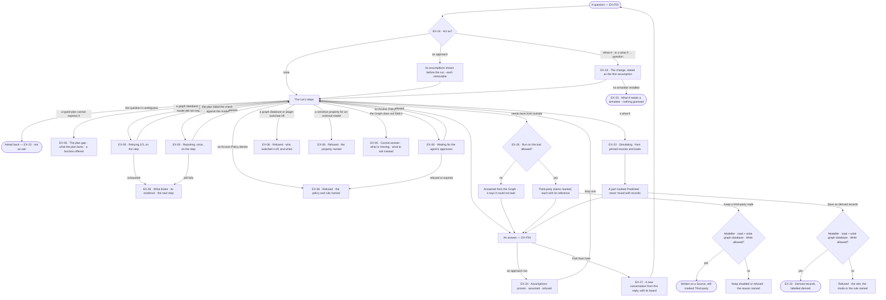
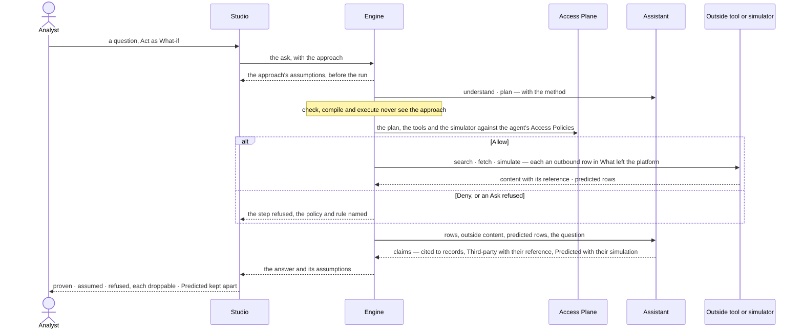

# When it cannot answer, and how it reasons

> What a question gives back when it is not a plain answer — the Graph does not hold it, a typed plan cannot express
> it, an Access Policy refuses it, something is switched off, or something broke — and the ways a person steers how it
> is reasoned: an approach with its assumptions shown, a what-if whose output is *Predicted*, facts from beyond the
> Graph marked *Third-party*, and a fork to try another direction — so the person knows which kind of nothing they
> have, and what an answer rests on, before acting on it.
> The decision it helps make: *which kind of nothing is this, and which method and facts may an answer rest on?*

## User journey

Journeys this feature is a step of: [J02 · Ask and trust the answer](../../../../journeys/J02-ask-and-trust-the-answer.md)

## Stories

| ID | Story | Status |
|---|---|---|
| EX-05 | [Be told when the Graph cannot answer](stories/EX-05-be-told-when-the-graph-cannot-answer/story.md) | idea |
| EX-06 | [A refusal or a failure that says why and what next](stories/EX-06-a-refusal-or-a-failure-that-says-why/story.md) | idea |
| EX-24 | [Ask with an approach, with the assumptions shown](stories/EX-24-ask-with-an-approach-and-see-its-assumptions/story.md) | idea |
| EX-33 | [Ask what if, and read the prediction as evidence](stories/EX-33-ask-what-if-and-read-the-prediction-as-evidence/story.md) | idea |
| EX-26 | [Facts from beyond the Graph, marked as such](stories/EX-26-facts-from-beyond-the-graph/story.md) | idea |
| EX-27 | [Fork a conversation from a reply](stories/EX-27-fork-a-conversation-from-a-reply/story.md) | idea |

## Access

Who may do what is the [role table](../../../../os/access/features/AC-F02-access-policies/feature.md#the-role-table):
*how it reasons* is *Acts* for Operator, Modeller and Admin. Every act also runs through an agent, within what its
Access Policies allow. A run's content — a refusal, a diagnosis, a prediction — is its run's: run privacy is
[CP-F10](../../../../os/control/features/CP-F10-runs-and-how-the-agents-are-doing/feature.md).

| Act | Who | Everyone else sees |
|---|---|---|
| Read a cannot answer, a plan gap, a refusal or a diagnosis, and follow its next step | The person behind the run; an Admin reads every one | Another person's run: that it ran, its status and its tokens |
| Pick an approach with *Act as* · remove an assumption before the run · drop one and re-run · ask *what if* | Operator · Modeller · Admin, on their own runs | — |
| Author, change, copy and publish an approach | Modeller · Admin — *skills* | Listed read-only in Agents › Skills; *+* disabled — *Needs the Modeller role — ask an Admin* |
| Read third-party claims, nodes and predicted parts, with their references | Whoever may read the answer | Content withheld |
| *Keep* a third-party node | Modeller · Admin — *Edit on the board* — on a read + write graph database, through the Record editor, whose Access Policies allow Write on `data/<graph database>/Source` | *Keep* disabled — *Needs the Modeller role — ask an Admin*; refused on a read-only graph database or by a rule, naming it |
| Save a predicted part as derived records | Modeller · Admin — *bring records in* — on a read + write graph database, through the Loader, whose Access Policies allow Write on `data/<graph database>/<kind>` | *Save as derived records* disabled — *Needs the Modeller role — ask an Admin*; refused on a read-only graph database or by a rule, naming it |
| Change the Access Policy a refusal names | Admin ([AC-F02](../../../../os/access/features/AC-F02-access-policies/feature.md)) | *Open the policy* disabled — *Needs the Admin role — ask an Admin* |
| Set up and switch the web tool or a simulator's plugin | Admin ([CP-F02](../../../../os/control/features/CP-F02-plugins-and-outside-tools/feature.md)) | The step names who switched it off, or that it is not set up |
| *Fork from here* | The person whose conversation it is | Another person's conversation: no *Fork from here* |

## States

| State | What the person sees |
|---|---|
| First use | No approach picked and no outside tool allowed: the question is answered from the Graph alone; *Act as* lists the built-in *What-if* and any published approach |
| Empty after a filter | Zero rows from a valid plan: *Cannot answer*, worded as an answer to the question asked, naming what is missing |
| Loading | The step reads what it does — *Retrying 2/3*, *Repairing*, *Waiting for approvers*, *Searching the web*, *Simulating* — while the Graph's steps already show; *Fork from here* shows a spinner until the new conversation exists |
| Has data | An answer whose assumptions, third-party claims, predicted parts and fork lineage are each one click away |
| Failed | What broke, on the step it broke on, with its evidence folded under it and one next step |
| Agent working or proposing | The approach's assumptions above the composer before the run; the assistant's third-party nodes on the board, marked, waiting for *Keep*; a predicted part waiting for *Save as derived records* |
| No access | A refusal names the policy and rule, the switch and who set it, or the property; *Keep* and *Save as derived records* disabled for an Operator, naming *Modeller*; another person's run shows only that it ran, its status and its tokens |

## Rules

| Rule | Detail |
|---|---|
| Six ways a run ends | Answered · conversed · cannot answer · refused · failed · cancelled. A run that only replied to small talk is *conversed* — it claims nothing |
| Kinds of nothing never share a surface | Retrying, repairing and waiting show on their step; cannot answer and the plan gap are calm — a dashed border, no colour of alarm; a refusal names what refused; a diagnosis is drawn as a fault with its evidence under it — no answer header, no citation strip, its next step its only action. Their shapes differ before a word is read |
| Nothing partial is an answer | A run that did not settle shows what it reached as steps, never as an answer |
| Cannot answer names what is missing | Which kind, which model, or that nothing is loaded — and whether the kind is modelled but empty |
| The plan gap says what the plan lacks | A question a typed plan cannot express is said so, naming what the plan lacks, offering a function that does it — never a raw query run silently. The typed plan and the gap are [EX-F03](../EX-F03-ask-a-question/feature.md#engine)'s |
| A refusal names what refused | An Access Policy's Deny names the policy and the rule; an Ask refused or expired names who answered; a switched-off graph database or plugin names who switched it off and when; a sensitive property bound for an external AI model names the property |
| A question asked back is not an ask | Asked back ([EX-23](../EX-F03-ask-a-question/stories/EX-23-be-asked-back-not-guessed-for/story.md)) is *I do not know*, answered by the asker; an Ask is *I may not proceed*, answered by the agent's named approvers ([AC-F05](../../../../os/access/features/AC-F05-asks-and-approvals/feature.md)). Neither is the other |
| A diagnosis is built from evidence | The step, the error and the query — never an invented cause — and its one action is its next step |
| Repair once | A plan that fails the check against the model goes back once with the error; a second failure stops |
| The agent's voice, the same facts | A cannot answer and a refusal are worded in the agent's voice, still name what is missing, and end with something the person can ask instead |
| Recall is the thinking graph's | A plan that failed before is recalled as *avoid*, and a plan that served is preferred, from the [thinking graph](../../../agents/features/AG-F09-thinking-graph-and-memory/feature.md); *How it got here* names the run recalled |
| An approach is a method, not an actor | It brings a method, a declared set of assumptions and an answer shape. The agent still acts, with its own Access Policies, budget and model |
| An approach never changes what runs | It reaches understanding, planning and the answer's shape; it never reaches checking, compiling or running the plan. The policy check is the same with or without one |
| One run, one approach | Two at once are refused; an agent carries no default approach ([AG-F01](../../../agents/features/AG-F01-build-an-agent/feature.md)) |
| An approach never softens *Cannot answer* | If its method needs what the Graph does not hold, the answer is *Cannot answer*, never an estimate |
| An approach that only changes the words did nothing | Swapping it on the same question and data must change the plan or the assumptions |
| A model rule beats an assumption | An assumption a model rule ([SE-F07](../../../semantics/features/SE-F07-rules/feature.md)) contradicts is dropped, naming the rule |
| What-if is a reasoning method | Picked as the built-in *What-if* approach, or understood from a *what if …* question. The agent runs a simulator the deployment has installed — a plugin function, Run on its plugin allowed — from records and loads it pins; Invana never computes a figure itself |
| Predicted is never observed | A simulation's output is a part marked *Predicted*, citing the simulator and its version, the seed, and the records and loads it started from; it never shares a table, a drawing or a claim with what the records hold |
| Saved predictions are derived | Saving a predicted part writes derived records to a read + write graph database, labelled *derived* with the simulator and its version; its lineage — the run and its pinned loads — lives in the system graph ([RC-F02](../../../records/features/RC-F02-bring-records-in/feature.md)) |
| Anything not from the Graph is third-party | The internet, any connected tool and the model's own knowledge — marked *Third-party · internet*, *· api*, *· app*, *· db*, *· agent* or *· model*, in words, on the canvas and in the panel |
| No reference, not shown | Every third-party item keeps where it came from — for the internet the link, title, kind and when it was fetched — captured on arrival and never recomputed |
| Off unless a rule allows it | An outside tool, and the model's own knowledge, reach a run only when an Access Policy on the agent allows Run on `tool/<plugin>/<tool>` — `tool/web/search`, `tool/web/read_url`, `tool/answer/own_knowledge`. Default deny; the strictest rule wins; an Ask waits on the agent's approvers |
| The agent never plans what it may not run | A tool no rule allows is never planned, and the words say it could only answer from the Graph |
| A third-party node is drawn first, written on *Keep* | It is on the board only; *Keep* writes it as a record of the built-in *Source* kind linked to what it is about, through a board save ([EX-F06](../EX-F06-annotate-and-edit-the-data/feature.md)), still marked third-party after a reload |
| A fork copies; it does not point | A fork holds its own copies of the turns up to the reply and the board as it stood there; deleting the parent takes nothing from it |
| Lineage is one link deep | A conversation knows its parent and the reply it branched at; nothing links conversations by inference |
| Leans on | EX-F01 — the board and its panel · EX-F03 — the question, the typed plan and the plan gap · EX-F04 — the reply, its meta line and *How it got here* · EX-F06 — a board save · Access Policies and asks (AC-F02 · AC-F05) · what left the platform (AC-F09) · plugins, tools and simulators (CP-F02) · graph databases and their modes (CP-F05) · AI models, local or external (CP-F01) · runs and run privacy (CP-F10) · the thinking graph (AG-F09) · loads of derived records (RC-F02) · model rules (SE-F07) · sensitive properties (SE-F03) |

## Data touched

| Record | Read or write |
|---|---|
| Run — how it ended, its steps' retries and repair, its diagnosis | Write (the engine) · read |
| Approach — name, origin, when to use, method, assumptions with what changes without each, answer shape, version | Read · write (Modeller · Admin) |
| A run's approach and version, and its assumptions — claim, where it entered, whether checked and by which query, without it | Write (the engine) · read |
| Simulation — the simulator and its version, the change, the seed, the pinned records and loads, the run | Write (the engine) · read |
| Derived records saved from a predicted part — a load of `source = run` | Write (Modeller · Admin, through the Loader) ([RC-F02](../../../records/features/RC-F02-bring-records-in/feature.md)) |
| A third-party claim or node — source, reference, title, kind, domain, fetched at, model, run | Write (the engine) · read |
| A kept third-party node — its provenance, who kept it and when, what it is about | Write (Modeller · Admin, through the Record editor) · read |
| A conversation's parent and the reply it forked at · its copied turns · its board | Write · read |
| Ledger rows — every search, fetch, simulation and AI model call | Write, by the engine ([AC-F09](../../../../os/access/features/AC-F09-what-left-the-platform/feature.md)) |

## Engine

The low-level design: what this feature stores, serves and refuses. Conventions — naming, errors, lists, events — are
[system-design.md](../../../../system-design.md) §§ 6–8; this section only fills them in.

### Records

| Table | Columns | Notes |
|---|---|---|
| `explore_approaches` | `name` · `origin` (`builtin` · `custom`) · `when_to_use` · `method` · `assumptions[]` (each `claim` · `without_it`) · `answer_shape` · `version` · `status` (`draft` · `published`) · `created_by_id` | Authored in Agents › Skills. A published version never changes. `what-if` is `builtin`, written from code, owned by the system user |
| `explore_simulations` | `run_id` · `step_run_id` · `session_id` · `message_id` · `simulator` · `simulator_version` · `plugin` · `plugin_version` · `change` (the simulator's declared fields, as the agent filled them) · `seed` · `inputs` (`[{load_id, content_hash}]`, the pins) · `record_ids` (the records it started from) · `saved_load_id?` · `created_by_id` (the person behind the run) · `created_at` | One per simulate step. Its result is the step's `predicted` part. No route updates or deletes a row |

### Reads

| Record | Owner |
|---|---|
| A conversation and its turns — the fork columns are on `explore_sessions` · the typed plan and the plan gap | [EX-F03 › Engine](../EX-F03-ask-a-question/feature.md#engine) |
| An answer's parts — `evidence` `observed` · `predicted` · `third_party` | [EX-F04 › Engine](../EX-F04-the-answer/feature.md#engine) |
| The run — its status and outcome, steps, retries, its approach (`approach_id` · `approach_version`) and `assumptions` | [CP-F10](../../../../os/control/features/CP-F10-runs-and-how-the-agents-are-doing/feature.md#engine) |
| The agent, its budget and its Access Policies · the built-in agents | [AG-F01](../../../agents/features/AG-F01-build-an-agent/feature.md#engine) · [AC-F02](../../../../os/access/features/AC-F02-access-policies/feature.md#engine) |
| An Ask and its approvers | [AC-F05](../../../../os/access/features/AC-F05-asks-and-approvals/feature.md#engine) |
| The functions a plan may call, the workflows `nl-outside` and `simulate` | [AG-F06](../../../agents/features/AG-F06-plans-and-workflows/feature.md#engine) |
| Recall — plans that served, plans to avoid | [AG-F09](../../../agents/features/AG-F09-thinking-graph-and-memory/feature.md#engine) |
| Plugins, their switches and declared needs · the web tools `web.search` · `web.read_url` and their setting · plugins of kind `simulator` | [CP-F02](../../../../os/control/features/CP-F02-plugins-and-outside-tools/feature.md#engine) |
| A graph database's mode — read-only or read + write — and its switch | [CP-F05](../../../../os/control/features/CP-F05-graph-databases/feature.md#engine) |
| The AI model's local or external mark · sensitive properties | [CP-F01](../../../../os/control/features/CP-F01-ai-models/feature.md#engine) · [SE-F03](../../../semantics/features/SE-F03-meaning/feature.md#engine) |
| Model rules an assumption is checked against | [SE-F07](../../../semantics/features/SE-F07-rules/feature.md#engine) |
| Loads — stable id, content hash, undone · a load of derived records, `POST /loads` with `from_run_id` | [RC-F02](../../../records/features/RC-F02-bring-records-in/feature.md#engine) |
| Boards and their versions — a fork's board | [EX-F01 › Engine](../EX-F01-the-board-and-its-canvas/feature.md#engine) |
| A board save — how *Keep* writes | [EX-F06 › Engine](../EX-F06-annotate-and-edit-the-data/feature.md#engine) |
| The ledger rows of every outbound call | [AC-F09](../../../../os/access/features/AC-F09-what-left-the-platform/feature.md#engine) |

### Routes

| Route, after `/api/v1/explore` | Does | Story |
|---|---|---|
| `POST /sessions/{session}/fork` | `{message_id}` → `201` the fork | EX-27 |
| `GET /approaches` · `POST /approaches` | Every approach, built-in and custom · author one | EX-24 |
| `GET /approaches/{approach}` · `PATCH /approaches/{approach}` · `POST /approaches/{approach}/publish` | Read · change (a published one makes a new draft version) · publish | EX-24 |
| `POST /approaches/{approach}/copy` | A custom draft from a built-in or custom approach, owned by the copier | EX-24 |
| `POST /third-party/keep` | `{run_id, graph_database, node_refs[]}` — write the picked third-party nodes, as one run of the Record editor | EX-26 |
| `GET /simulators` | Every installed simulator, its plugin switched on for the reader, with its declared fields | EX-33 |
| `GET /simulations` · `GET /simulations/{simulation}` | A conversation's simulations (`?session=`), newest first · one, with its predicted part once the step settled; *Not found* to a reader who may not read the run | EX-33 |

### Events

| Event | When |
|---|---|
| `explore.sessions.fork` | A fork is made — `session_id` · `parent_id` · `message_id` |
| `explore.approaches.publish` | An approach version is published |
| `explore.approaches.apply` | A run starts under an approach — `run_id` · `approach_id` · `approach_version` |
| `explore.approaches.drop_assumption` | An assumption is dropped on a run, naming the model rule that contradicts it |
| `explore.third_party.fetch` · `explore.third_party.keep` | A source is fetched · third-party nodes are kept |
| `explore.simulations.settle` | A simulate step settles — `run_id` · `simulation_id` · `simulator` · `simulator_version` · `outcome` |

### Refusals

| Status | When | Sentence | Criterion |
|---|---|---|---|
| refused `plan_gap` | A question a typed plan cannot express — EX-F03's refusal | *I cannot ask this yet — a plan cannot {what it lacks}.* | EX-05.13 |
| refused | A Deny rule on an agent's Access Policy reaches a step; the run settles `refused` before anything runs — a Read on data is EX-F03's row, worded the same | *{agent} may not {verb} {resource} — {rule} on {policy}, set by {person}.* | EX-06.1 |
| refused | A skill or function needs what the agent's Access Policies or the graph database's mode do not give | *{agent} may not {need} — {what is missing}.* | EX-06.2 |
| refused | An Ask refused or expired | *{approver} refused this.* · *Nobody answered in time — refused.* | EX-06.3 |
| refused | A plugin needed is switched off — the web tool or a simulator's included; a graph database switched off is EX-F03's | *{plugin} is off — switched off by {person} {when}.* | EX-06.4 · EX-26.16 · EX-33.3 |
| refused | A sensitive property bound for an external AI model | *{property} is sensitive — it never goes to an external model.* | EX-06.5 |
| 422 | Two approaches on one ask | *One run, one approach.* | EX-24.9 |
| 403 | Authoring, changing or publishing an approach without the Modeller role | *Skills needs the Modeller role.* | EX-24.15 |
| 422 | Changing the built-in *What-if* in place | *What-if is built in — copy it to change it.* | EX-24.16 |
| step refused | No rule allows Run on the tool, or a Deny reaches it; the run goes on from the Graph | *I'm not allowed to look that up here.* | EX-26.6 |
| step failed | The web tool has no search address set | *Web search is not set up — an Admin sets it in Plugins.* | EX-26.17 |
| 403 | *Keep* without the Modeller role | *Edit on the board needs the Modeller role.* | EX-26.18 |
| 409 | *Keep* on a read-only graph database | *{graph database} is read-only — nothing can be written to it.* | EX-26.12 |
| 403 | *Keep* where no rule allows Write on `data/<graph database>/Source` | *{policy} › {rule} does not allow writing Source.* | EX-26.13 |
| cannot answer | A what-if with no simulator installed | *What-if needs a simulator, and none is installed.* | EX-33.2 |
| step refused | No rule allows Run on the simulator's plugin | *{policy} › {rule} does not allow running {simulator}.* | EX-33.4 |
| step refused | More than 20 loads to pin, or a load undone or unreadable | *A simulation reads at most 20 loads.* · *Load `{id}` {why} — nothing ran.* | EX-33.10 |
| step failed | The simulator cannot use the data | The simulator's own sentence | EX-33.9 |
| — | A refusal saving a predicted part as derived records — the role, a read-only graph database, a rule, a kind the rows do not fit | RC-F02's, in the dialog | EX-33.13 · EX-33.14 · EX-33.15 · EX-33.16 |
| 409 | A fork from a reply that is running, refused or failed | *Only a settled answer can be forked.* | EX-27.2 |
| 404 | A fork of another person's conversation, or a simulation of a run the reader may not read | *Not found.* | EX-27.3 · EX-33.20 |

### CLI

| Command | Does |
|---|---|
| — | No command of its own |

### Mechanisms

| Mechanism | How |
|---|---|
| Outcome beside status | `answered` · `conversed` · `cannot_answer` · `refused` · `failed` · `cancelled` on the run; *succeeded* and *cannot answer* are two claims |
| Three endings, three signals | A step returns *cannot answer* (`CannotAnswer`), a failure (`TaskFailure`) or an answer — never one shaped as another. `execute` returning nothing is *the Graph does not hold this*, never a generated guess |
| Steps that end a run | `understand` — *cannot answer* or the plan gap · `plan` — the plan gap · `check` — refused, naming the policy and rule, the switch or the property, after its one repair against the model · `execute` — a failure with a diagnosis. `verify` records its verdict and never ends one |
| Retry | Per step kind: attempts, backoff, jitter; each attempt a frame on its step |
| Repair | The check's error against the model is carried into the plan step's second attempt |
| A diagnosis | Assembled from the step, the error and the query, with a next step from a fixed set — open the run, check the graph database, bring records in, open the policy — never generated free-form, so the same failure reads the same |
| Recall | `plan` reads the thinking graph for this question's nearest plans: served ones ranked first, failed ones marked *avoid* and never re-drafted; the recalled run is written on the step |
| An approach in the run | Reaches `understand`, `plan` and `project` as offered context; never `check`, `compile` or `execute`; no field of it is an input to the policy check. `verify` reads only the run's assumptions and checks them against what the run did |
| A run's assumptions | Written on the run, each `claim` · `source` (`approach` · `question` · `model` · `rule`) · `checked` and the query that checked it · `without_it` (authored, never generated); shown as one `assumptions` part |
| What-if | `understand` marks the intent `what_if` when the approach is `what-if` or the question asks what would follow from a change; the plan is the built-in workflow `simulate`: `plan` → `check` → `execute` (the starting records) → `simulate` → `project` → `verify` → `answer`. The change is written as the run's first assumption, `source = question` |
| The simulate step | Calls one function of a plugin of kind `simulator` (CP-F02) — Run on `plugin/<name>` checked first — with the change as its declared fields, the pinned inputs and the seed; it reads only the loads it is given and checks each content hash. It returns ranked rows and a summary; `project` writes them as one part with `evidence = predicted`. No simulator installed: `understand` ends *cannot answer* |
| Pins and seed | Inputs are the loads behind the starting records, at most 20, pinned by stable id and content hash when the step opens; a load undone since is refused before it reads. The seed is kept — picked when none is given — so the same simulator version, change, inputs and seed give the same rows |
| Save as derived records | Studio calls RC-F02's `POST /loads` with `{from_run_id, graph_database, kind}` as the Loader: one `source = run` load into a read + write graph database, every value labelled *derived* with the simulator and its version, its lineage — the run and its pinned loads — written to the system graph; `saved_load_id` is set on the simulation |
| Outside facts | The built-in workflow `nl-outside` — plan · check · execute · search · fetch · project · verify · answer — is picked when the intent `needs_outside` and the agent's Access Policies allow Run on `tool/web/search`; `search_web` and `fetch_source` are bound `third_party` |
| The model's own knowledge | Offered to the Answer step only when a rule allows Run on `tool/answer/own_knowledge`; each claim from it carries `third_party.source = model` and the model's name |
| What goes out | Search terms from the ask cross as schema-only; terms carrying record values are data-bearing; each call is an outbound ledger row with every term sent |
| A third-party claim | `{text, third_party: {source, reference, title?, source_kind?, domain?, fetched_at?, model?, run_id}}`, captured on arrival and never recomputed |
| A third-party node | A `Source` — `reference` · `title` · `source` · `source_kind` · `fetched_at` · `excerpt` — with an `ABOUT` relationship to what it concerns; on the board only until *Keep* |
| *Keep* | Writes each picked `Source` and its `ABOUT` as a board save does (EX-F06), as the Record editor, stamped `_inv_origin = third_party` · `_inv_source` · `_inv_reference` · `_inv_source_title` · `_inv_source_kind` · `_inv_fetched_at` · `_inv_model` · `_inv_run_id` · `_inv_kept_by` · `_inv_kept_at` |
| A fork copies | Every turn at or below the reply's `seq`, field for field, `run_id` kept; `surface`, `agent_id` and `max_tokens_run` carried; a new board from the parent's version at that reply, else its current snapshot. Forks never group conversations |
| Fork fields on the reads | EX-F03's `GET /sessions` adds `forked_from_title` · `fork_count`; its `GET /sessions/{session}` adds `forked_from: {id, title, message_id} \| null` · `forks: [{id, title, message_id}]` |

## System impact

| HLD section | Change | NFRs |
|---|---|---|
| § 6 Data and storage | Two tables in Postgres; `Source` records and derived records written to the customer's read + write graph database; their lineage in the system graph | — |
| § 10 AI and agents | The `nl-outside` and `simulate` workflows; approaches as offered context, never an input to the policy check; recall from the thinking graph; predicted and third-party evidence kept apart from observed | NFR-SEC-5 · NFR-SEC-8 |
| § 11 Failure modes and the outside boundary | An outside tool or a simulator reaches a run only when an Access Policy allows Run on it; a failed search or simulation fails its step and the answer is from the Graph | — |

## Decisions

| Decision | Detail |
|---|---|
| A refusal is part of the answer | A search or a simulation a rule refuses is refused before it is sent and recorded; the run goes on from the Graph and the words say it could not look |
| Approaches are authored with skills | Same shape — named, described, *when to use*, offered to a step, reused by many agents — so they sit in Agents › Skills, not a second authoring place |
| No default approach | The plain path has no assumptions list; an approach is picked for one question |
| Assumptions say what changes without them | Each assumption carries what the answer becomes if it does not hold, authored with the approach — so dropping one is predictable, and a re-run proves it |
| What-if is an approach, not a product | It is picked like any approach or read from the question; its science is a simulator's, shipped in a Domain pack; Explore runs it and labels it |
| Predicted stands apart | A predicted part is its own card, never merged with a table or drawing of records; a claim citing it is marked *Predicted* |
| Saving a prediction is a load | Saving derived records is RC-F02's load of `source = run`, so undoing an input flags the derived records like any other citation |
| Outside facts run their own workflow | A question that needs outside facts runs a workflow with Search and Fetch in its steps, so the steps a person reads say up front that it looked outside |
| Outside tools are Access Policy resources | The web tool, any outside MCP server and the model's own knowledge are `tool/<plugin>/<tool>` resources a rule allows, asks or denies; their setup is CP-F02's |
| The internet is one outside tool | Every tool connected later reaches a run the same way: a resource a rule can name, a mark, a reference. A tool that cannot give a reference is not connected |
| A fork starts with the board at its reply | The board as the conversation had drawn it then; the parent's current board when none was kept at that reply |
| A deleted parent leaves the fork whole | The banner reads *Forked from a deleted conversation*, with no link; a delete is never blocked by forks |
| Only a settled answer is a fork point | A running, refused or failed reply has nothing to branch from |

## Open questions

| Question | Who answers |
|---|---|
| The model's own knowledge as a third-party source needs a resource a rule can name. Recommend: `tool/answer/own_knowledge`, a tool the core `answer` plugin declares, off until a rule allows it | Ravi |

## Not building

| Item | Why not |
|---|---|
| Endless repair loops | Two failed attempts mean the intent is wrong, not the syntax |
| A generic *Something went wrong* | It teaches nothing and hides the evidence |
| A raw query when a plan cannot express the question | The plan gap says so and offers a function; a raw query is the person's, through the Query console |
| Falling back to the model's own knowledge unasked | That is the failure the product exists to avoid; it needs a rule that allows it, and is marked |
| Approaches with their own tools, keys or permissions | That is an agent |
| An approach invented at ask time | Its value is its declared assumptions; one made up on the spot declares nothing |
| Tone or character on an approach | Who speaks is the agent's; an approach is a method |
| Blended approaches · approaches applied by question type | A blend has no statable assumptions; applying one unasked hides the method again |
| An approach that adds a step kind | The steps a plan may use are the runtime's; a method chooses among them |
| A simulator in the core | The science is a domain's; a simulator ships in a Domain pack |
| Parameter sweeps | One change per what-if; a sweep is several questions |
| Editing or deleting a simulation | It is the record of a run; ask again |
| Crawling or scheduled scraping | A search serves one question; collecting the web is the customer's pipeline, loaded through Records |
| Third-party or predicted claims mixed into record citations | A citation resolves to a record; a reference to a source or a simulation is a different check |
| A tree view of forks · merging a fork back | The banner, the forked-into lines and the list mark show each link; two threads are two histories |
| Forking another person's conversation · forking mid-run | Conversations are their asker's; a running reply has nothing to branch from |
