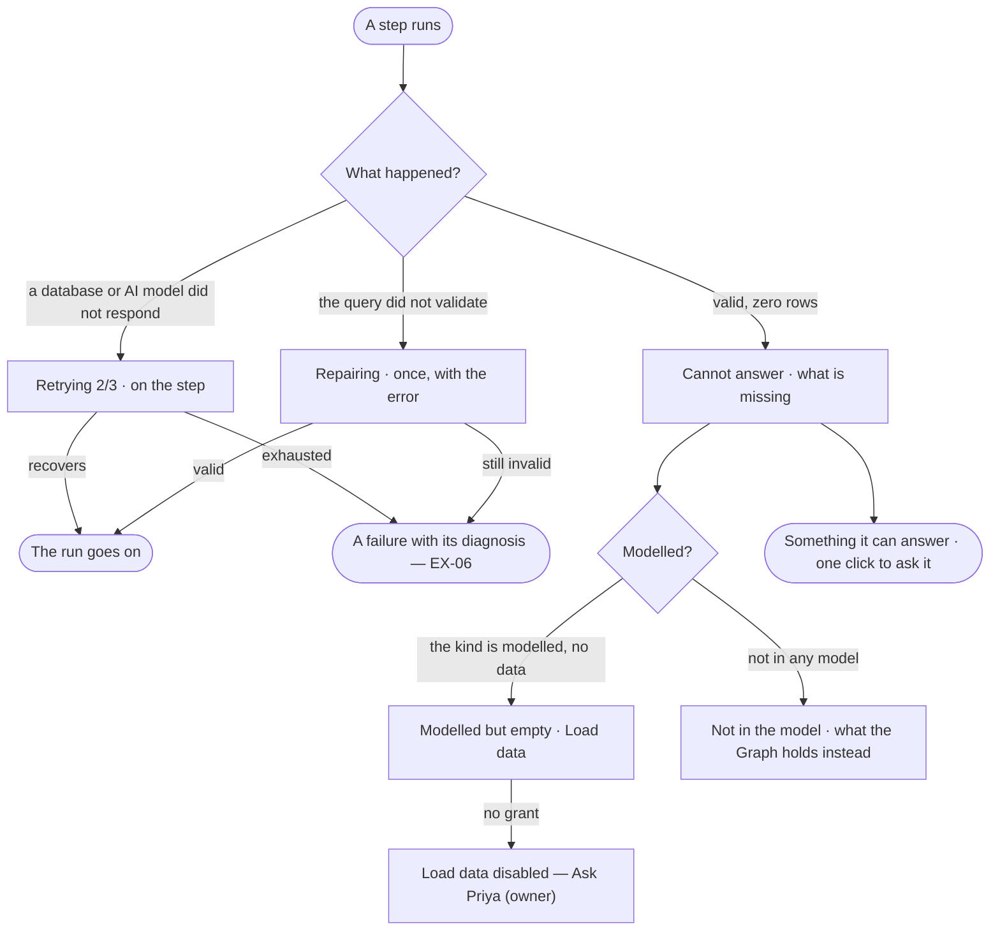

# EX-05 · Be told when the Graph cannot answer

**As** an analyst who asked and did not get an answer **I want** the Graph to say plainly that it does not hold what I
asked, and what is missing **so that** I am never handed a guess, and know whether to wait, rephrase or load data.

Tasks: [task.md](task.md) · Feature: [EX-F05](../../feature.md)

## Who can

| Lens | Can | Otherwise sees |
|---|---|---|
| Admin | Read a cannot answer, watch a step retry or repair, follow *Load data* or ask what it offers instead | — |
| Operator | The same; *Load data* needs *Can shape the model* | *Load data* disabled — *Ask Priya (owner)*; the questions it offers instead stay |

## Flow

## Acceptance criteria

| # | Given | When | Then |
|---|---|---|---|
| EX-05.1 | A valid query that returns zero rows | the run settles | the reply is *Cannot answer*, worded as an answer to the question asked, never an empty table or a zeroed chart |
| EX-05.2 | A cannot answer | it is shown | it is drawn calmly — a dashed border, no colour of alarm, no citation strip — so it is never mistaken for an answer |
| EX-05.3 | A question about a kind no published model has | the run settles | it names what is missing and what the Graph holds instead |
| EX-05.4 | A kind that is modelled but holds no data | the run settles | it says the kind is modelled but empty and offers *Load data* |
| EX-05.5 | A Graph with nothing loaded | the person asks | it says nothing is loaded yet and offers *Load data* |
| EX-05.6 | Any cannot answer | it is shown | it is worded in the agent's voice and ends with a question the Graph can answer, one click to ask |
| EX-05.7 | The database or the AI model does not respond | a step runs | the step shows *Retrying 2/3* with backoff — never a silent pause and never a message in the thread |
| EX-05.8 | The generated query does not validate | the step runs | it shows *Repairing* on the step and tries once more with the error; a second invalid query stops the run with a diagnosis (EX-06) |
| EX-05.9 | A run that stopped before it settled | it is shown | what it reached shows as steps, never as an answer |
| EX-05.10 | A cannot answer | the person opens *How it got here* | it shows the query that ran, its zero rows and the model it checked |
| EX-05.11 | An Operator without *Can shape the model* | they read a cannot answer offering *Load data* | *Load data* is disabled — *Ask Priya (owner)*; the question it offers instead still works |
| EX-05.12 | Runs that ended in cannot answer, failed or refused | they are counted | each is recorded as its own outcome, never as answered |

## Screens

| Surface | Lens | First use | Empty after a filter | Loading | Has data | Failed | Agent working or proposing | No access |
|---|---|---|---|---|---|---|---|---|
| The reply in the thread | Admin | explore.board.cannot · Nothing loaded | explore.board.cannot | explore.board · Working | explore.board.cannot · Modelled but empty | explore.board.cannot · Stopped | — | — |
| The reply in the thread | Operator | explore.board.cannot · Nothing loaded | explore.board.cannot | explore.board · Working | explore.board.cannot · Modelled but empty | explore.board.cannot · Stopped | — | explore.board.cannot · Ask owner |
| A step retrying or repairing | Admin | — | — | explore.board · Retrying | explore.board · Repairing | explore.board · Retries exhausted | explore.board · Working | — |
| A step retrying or repairing | Operator | — | — | explore.board · Retrying | explore.board · Repairing | explore.board · Retries exhausted | explore.board · Working | — |
