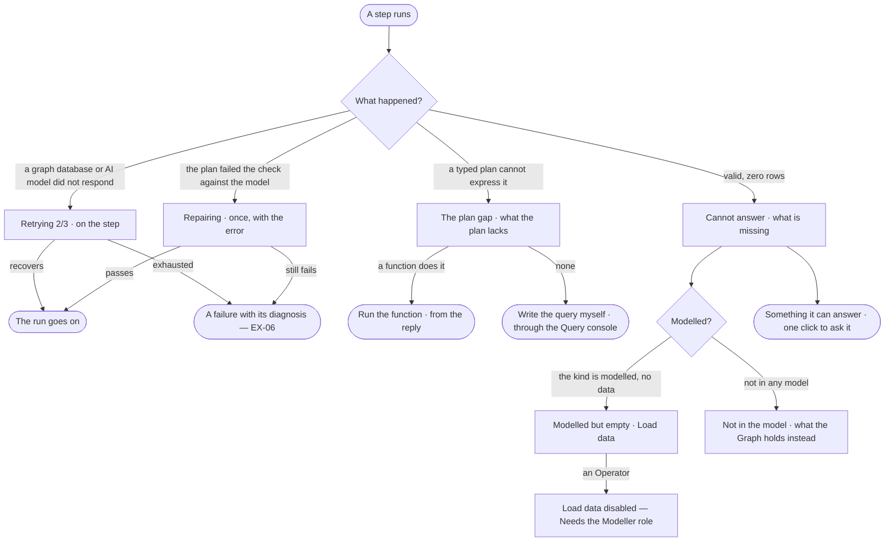

# EX-05 · Be told when the Graph cannot answer

**As** an analyst who asked and did not get an answer **I want** to be told plainly that the Graph does not hold what I
asked, or that a plan cannot ask it yet, and what is missing **so that** I am never handed a guess, and know whether to
wait, rephrase, run a function or load data.

Tasks: [task.md](task.md) · Feature: [EX-F05](../../feature.md)

## Who can

| Lens | Can | Otherwise sees |
|---|---|---|
| Admin | Read a cannot answer or a plan gap, watch a step retry or repair, run a function the plan gap offers, follow *Load data*, ask what it offers instead | — |
| Operator | The same on their own runs, except *Load data* — *bring records in* needs the Modeller role; a Modeller as Admin ([role table](../../../../../../os/access/features/AC-F02-access-policies/feature.md#the-role-table)) | *Load data* disabled — *Needs the Modeller role — ask an Admin*; the questions it offers instead stay. Another person's run: that it ran, its status and its tokens |

## Flow

## Acceptance criteria

| # | Given | When | Then |
|---|---|---|---|
| EX-05.1 | A valid plan that returns zero rows | the run settles | the reply is *Cannot answer*, worded as an answer to the question asked, never an empty table or a zeroed chart |
| EX-05.2 | A cannot answer | it is shown | it is drawn calmly — a dashed border, no colour of alarm, no citation strip — so it is never mistaken for an answer |
| EX-05.3 | A question about a kind no published model has | the run settles | it names what is missing and what the Graph holds instead |
| EX-05.4 | A kind that is modelled but holds no data | the run settles | it says the kind is modelled but empty and offers *Load data* |
| EX-05.5 | A deployment with nothing loaded | the person asks | it says nothing is loaded yet and offers *Load data* |
| EX-05.6 | Any cannot answer | it is shown | it is worded in the agent's voice and ends with a question the Graph can answer, one click to ask |
| EX-05.7 | A graph database or the AI model does not respond | a step runs | the step shows *Retrying 2/3* with backoff — never a silent pause and never a message in the thread |
| EX-05.8 | A plan that fails the check against the published model | the step runs | it shows *Repairing* on the step and plans once more with the error; a second failure stops the run with a diagnosis (EX-06) |
| EX-05.9 | A run that stopped before it settled | it is shown | what it reached shows as steps, never as an answer |
| EX-05.10 | A cannot answer | the person opens *How it got here* | it shows the typed plan, the compiled query per graph database, their zero rows and the model version it checked |
| EX-05.11 | An Operator | they read a cannot answer offering *Load data* | *Load data* is disabled — *Needs the Modeller role — ask an Admin*; the question it offers instead still works |
| EX-05.12 | Runs that ended in cannot answer, failed or refused | they are counted | each is recorded as its own outcome, never as answered |
| EX-05.13 | A question a typed plan cannot express — a shortest path, a hop deeper than the plan allows, a graph algorithm | the run settles | the reply says *I cannot ask this yet — a plan cannot* and what it lacks, calm like a cannot answer; no raw query runs ([EX-F03](../../../EX-F03-ask-a-question/feature.md)) |
| EX-05.14 | A plan gap, and functions the agent may run that do it | the reply is shown | each function is offered, runnable from the reply as a one-function plan |
| EX-05.15 | A plan gap, and no function that does it | the reply is shown | it offers *Write the query myself* through the Query console (EX-08) when the person may use it, else says no function does this yet |
| EX-05.16 | A question like one whose plan failed before | the run plans | the failed plan is recalled as *avoid* from the thinking graph and not drafted again; *How it got here* names the run it recalled |

## Screens

| Surface | Lens | First use | Empty after a filter | Loading | Has data | Failed | Agent working or proposing | No access |
|---|---|---|---|---|---|---|---|---|
| The reply in the thread | Admin | explore.board.cannot · Nothing loaded | explore.board.cannot | explore.board · Working | explore.board.cannot · Modelled but empty | explore.board.cannot · Stopped | — | — |
| The reply in the thread | Operator | explore.board.cannot · Nothing loaded | explore.board.cannot | explore.board · Working | explore.board.cannot · Modelled but empty | explore.board.cannot · Stopped | — | explore.board.cannot · Load data disabled |
| The plan gap | Admin | — | — | explore.board · Working | explore.board.cannot · Plan gap | — | explore.board.cannot · Plan gap, a function offered | — |
| The plan gap | Operator | — | — | explore.board · Working | explore.board.cannot · Plan gap | — | explore.board.cannot · Plan gap, a function offered | — |
| A step retrying or repairing | Admin | — | — | explore.board · Retrying | explore.board · Repairing | explore.board · Retries exhausted | explore.board · Working | — |
| A step retrying or repairing | Operator | — | — | explore.board · Retrying | explore.board · Repairing | explore.board · Retries exhausted | explore.board · Working | — |
