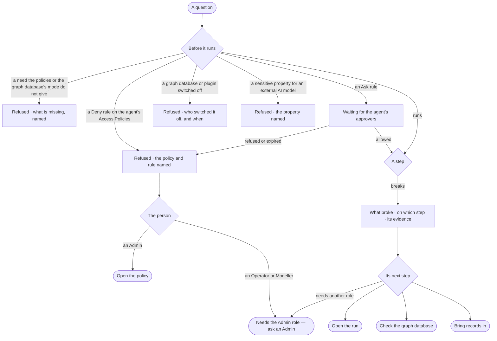

# EX-06 · A refusal or a failure that says why and what next

**As** an analyst whose question was refused or broke **I want** to be told which Access Policy refused it, what was
switched off and by whom, or what broke and its evidence **so that** a refusal is a conversation, not a wall, and a
failure is something I can fix.

Tasks: [task.md](task.md) · Feature: [EX-F05](../../feature.md)

## Who can

| Lens | Can | Otherwise sees |
|---|---|---|
| Admin | Read any refusal and the policy and rule behind it, read a diagnosis and its evidence, follow its next step — open the run, check the graph database, bring records in, open the policy | — |
| Operator | Read the same on their own runs, open the run, and ask an Admin; a Modeller the same, and *bring records in* as Admin ([role table](../../../../../../os/access/features/AC-F02-access-policies/feature.md#the-role-table)) | *Open the policy* and *Check the graph database* disabled — *Needs the Admin role — ask an Admin*. Another person's run: that it ran, its status and its tokens |

## Flow

## Acceptance criteria

| # | Given | When | Then |
|---|---|---|---|
| EX-06.1 | A question a Deny rule on the agent's Access Policies reaches | it is asked | it is refused before anything runs; the reply names the policy and the rule, in the agent's voice |
| EX-06.2 | A skill or function whose declared needs the agent's Access Policies, or the graph database's mode, do not give | the plan is checked | it is refused before anything runs, naming what is missing |
| EX-06.3 | An Ask rule reaches a step | the run reaches it | the step reads *Waiting for* the agent's approvers; allowed, the run goes on; refused or expired, it is refused naming who refused, or that nobody answered in time |
| EX-06.4 | A plugin the plan needs is switched off — at install by an Admin, or by the person's own switch | the question is asked | it is refused before it starts, naming the plugin, who switched it off and when; a switched-off graph database reads the same ([EX-F03](../../../EX-F03-ask-a-question/feature.md)) |
| EX-06.5 | A plan that would send a sensitive property to an agent whose AI model is external | it is checked | it is refused before anything runs, naming the property, and offers to ask through an agent whose model is local |
| EX-06.6 | A refusal | it is shown | it ends with something the person can ask instead, and a refusal is never worded as *cannot answer* |
| EX-06.7 | A step that breaks | the run stops | a diagnosis shows what broke, on which step, with the error and the query folded under it — drawn as a fault, unlike an answer and unlike a cannot answer |
| EX-06.8 | A diagnosis | it is shown | its cause comes from the step, the error and the query — never an invented cause — and never *Something went wrong* |
| EX-06.9 | A diagnosis | it is shown | its only action is its next step — open the run, check the graph database, or bring records in |
| EX-06.10 | An AI provider's rate limit | retries run out | the diagnosis names the provider and the limit |
| EX-06.11 | The same failure across runs | it recurs | the diagnosis reads the same each time |
| EX-06.12 | An Operator, and a next step that needs the Admin role | they reach it | it is disabled — *Needs the Admin role — ask an Admin*; an Admin's *Open the policy* opens the policy at the rule |
| EX-06.13 | A refusal or a diagnosis | the person opens *How it got here* | the run shows the policy and rule, the switch, the property, or the step with its error and its query |

## Screens

| Surface | Lens | First use | Empty after a filter | Loading | Has data | Failed | Agent working or proposing | No access |
|---|---|---|---|---|---|---|---|---|
| A refusal in the thread | Admin | — | — | — | explore.board.cannot · Refused | — | explore.board.cannot · Waiting for approvers | — |
| A refusal in the thread | Operator | — | — | — | explore.board.cannot · Refused | — | explore.board.cannot · Waiting for approvers | explore.board.cannot · Refused, ask an Admin |
| A diagnosis in the thread | Admin | — | — | — | — | explore.board.cannot · Diagnosis | — | — |
| A diagnosis in the thread | Operator | — | — | — | — | explore.board.cannot · Diagnosis | — | explore.board.cannot · Diagnosis, ask an Admin |
| The run | Admin | — | — | agents.run.answer · Loading | agents.run.answer · Refused | agents.run.answer · Step failed | — | — |
| The run | Operator | — | — | agents.run.answer · Loading | agents.run.answer · Refused | agents.run.answer · Step failed | — | agents.run.answer · Content withheld |
