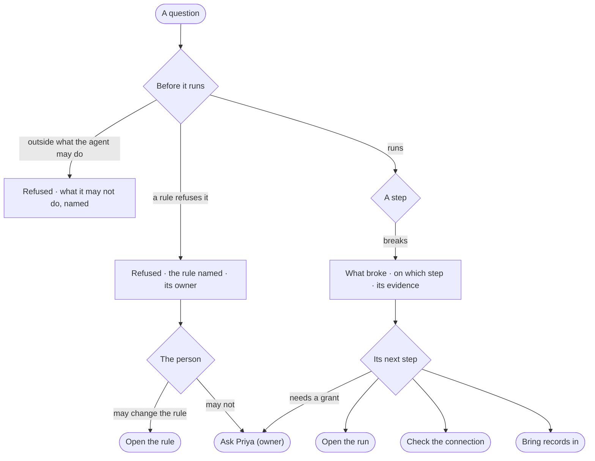

# EX-06 · A refusal or a failure that says why and what next

**As** an analyst whose question was refused or broke **I want** to be told which rule refused it and who owns it, or
what broke and its evidence **so that** a rule is a conversation, not a wall, and a failure is something I can fix.

Tasks: [task.md](task.md) · Feature: [EX-F05](../../feature.md)

## Who can

| Lens | Can | Otherwise sees |
|---|---|---|
| Admin | Read a refusal and the rule behind it, read a diagnosis and its evidence, follow its next step — open the run, check the connection, bring records in, change the rule | — |
| Operator | Read the same refusal and diagnosis, open the run, and ask the rule's owner | A next step that needs a grant — change the rule, check the connection — says *Ask Priya (owner)*; with *Can shape the model*: change the rule, as Admin |

## Flow

## Acceptance criteria

| # | Given | When | Then |
|---|---|---|---|
| EX-06.1 | A question a rule of the conversation's view of the graph refuses | it is asked | it is refused before anything runs; the reply names the rule and its owner, in the agent's voice |
| EX-06.2 | A plan outside what the agent may do | it is checked | it is refused before anything runs, naming what it may not do |
| EX-06.3 | A refusal | it is shown | it ends with something the person can ask instead, and a refusal is never worded as *cannot answer* |
| EX-06.4 | A step that breaks | the run stops | a diagnosis shows what broke, on which step, with the error and the query folded under it — drawn as a fault, unlike an answer and unlike a cannot answer |
| EX-06.5 | A diagnosis | it is shown | its cause comes from the step, the error and the query — never an invented cause — and never *Something went wrong* |
| EX-06.6 | A diagnosis | it is shown | its only action is its next step — open the run, check the connection, or bring records in |
| EX-06.7 | An AI provider's rate limit | retries run out | the diagnosis names the provider and the limit |
| EX-06.8 | The same failure across runs | it recurs | the diagnosis reads the same each time |
| EX-06.9 | An Operator without the grant a next step needs | they reach it | it says *Ask Priya (owner)*; with *Can shape the model*, *Open the rule* opens the rule |
| EX-06.10 | A refusal or a diagnosis | the person opens *How it got here* | the run shows the rule or the step, its error and its query |

## Screens

| Surface | Lens | First use | Empty after a filter | Loading | Has data | Failed | Agent working or proposing | No access |
|---|---|---|---|---|---|---|---|---|
| A refusal in the thread | Admin | — | — | — | explore.board.cannot · Refused | — | — | — |
| A refusal in the thread | Operator | — | — | — | explore.board.cannot · Refused | — | — | explore.board.cannot · Refused, ask owner |
| A diagnosis in the thread | Admin | — | — | — | — | explore.board.cannot · Diagnosis | — | — |
| A diagnosis in the thread | Operator | — | — | — | — | explore.board.cannot · Diagnosis | — | explore.board.cannot · Diagnosis, ask owner |
| The run | Admin | — | — | agents.run.answer · Loading | agents.run.answer · Refused | agents.run.answer · Step failed | — | — |
| The run | Operator | — | — | agents.run.answer · Loading | agents.run.answer · Refused | agents.run.answer · Step failed | — | — |
