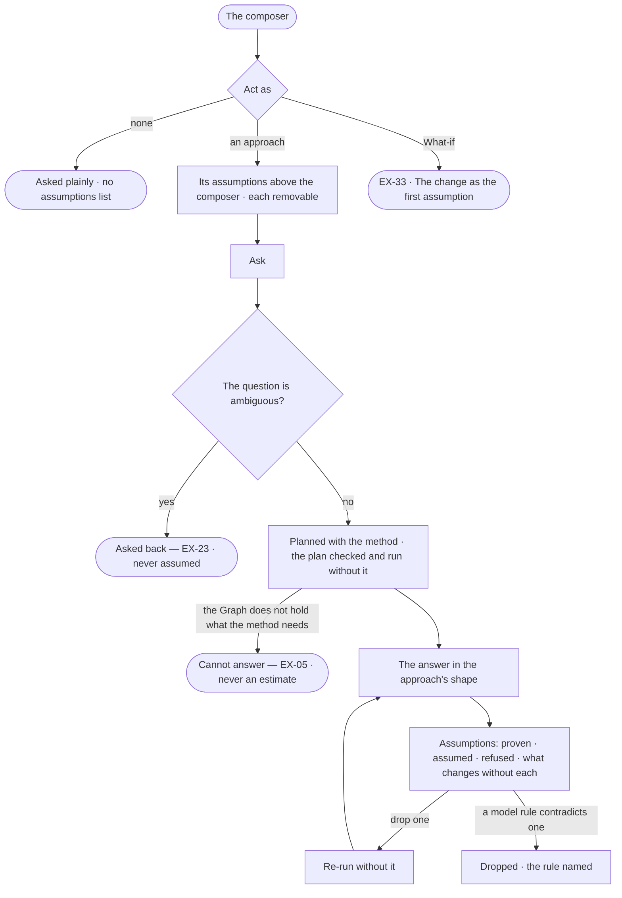

# EX-24 · Ask with an approach, with the assumptions shown

**As** an analyst asking a question I do not fully know how to frame **I want** to ask it with an approach — a method
and the assumptions it rests on, the agent proposing them and I deciding which to keep **so that** I see what the
answer rests on before it arrives, instead of inheriting it silently.

Tasks: [task.md](task.md) · Feature: [EX-F05](../../feature.md)

## Who can

| Lens | Can | Otherwise sees |
|---|---|---|
| Admin | Pick an approach with *Act as*, remove an assumption before the run, drop one from an answer and re-run; author, copy and publish approaches in Agents › Skills | — |
| Operator | Pick an approach, remove assumptions, drop one and re-run, on their own runs; read approaches in Agents › Skills. A Modeller as Admin ([role table](../../../../../../os/access/features/AC-F02-access-policies/feature.md#the-role-table) › *skills*) | *+* disabled — *Needs the Modeller role — ask an Admin* |

## Flow

## Acceptance criteria

| # | Given | When | Then |
|---|---|---|---|
| EX-24.1 | The composer | the person opens *Act as* | it lists the published approaches — the built-in *What-if* among them — opening on none |
| EX-24.2 | An approach picked | before the question is sent | its assumptions show above the composer, each removable |
| EX-24.3 | No approach picked | the question is asked | it runs plainly, with no assumptions list |
| EX-24.4 | An answer run with an approach | it settles | it carries its assumptions as a table — claim · where it entered (the approach, the question, the model, a model rule) · whether the Graph checked it, and by which query · what the answer becomes without it |
| EX-24.5 | An assumption in an answer | the person drops it | the question re-runs without it, and the earlier answer stays |
| EX-24.6 | An approach picked | the plan is checked, compiled and run | the approach is not passed to those steps, and the policy check is the same as without it |
| EX-24.7 | An approach whose method needs what the Graph does not hold | the run settles | the reply is *Cannot answer* (EX-05), never an estimate |
| EX-24.8 | An ambiguous question with an approach | it is understood | the person is asked back (EX-23) — a question to the asker, not an ask to approvers; the approach never settles what the question means |
| EX-24.9 | Two approaches asked for at once | the question is sent | it is refused: *One run, one approach* |
| EX-24.10 | An assumption a model rule contradicts | the run settles | the assumption is dropped from the list, naming the rule |
| EX-24.11 | The same question on the same data | a different approach is picked | the plan or the assumptions differ |
| EX-24.12 | The approach is changed mid-conversation | the next question is asked | it uses the new one; earlier answers keep the approach they ran under, named in *How it got here* |
| EX-24.13 | An answer run with an approach | the person opens *How it got here* | it names the approach and its version, and its assumptions with the queries that checked them |
| EX-24.14 | A Modeller or an Admin | they open approaches in Agents › Skills | they author one — name, when to use, method, assumptions each with what changes without it, answer shape — and publish it as a version |
| EX-24.15 | An Operator | they open approaches in Agents › Skills | they read them; *+* and every edit are disabled — *Needs the Modeller role — ask an Admin* |
| EX-24.16 | The built-in *What-if* | a Modeller opens it | it reads, owned by *System*; it cannot be changed in place, and *Copy* makes a custom draft owned by them |

## Screens

| Surface | Lens | First use | Empty after a filter | Loading | Has data | Failed | Agent working or proposing | No access |
|---|---|---|---|---|---|---|---|---|
| Act as, in the composer | Admin | explore.ask · Act as, built-in only | — | — | explore.ask · Act as | — | explore.ask · Assumptions before the run | — |
| Act as, in the composer | Operator | explore.ask · Act as, built-in only | — | — | explore.ask · Act as | — | explore.ask · Assumptions before the run | — |
| The assumptions on an answer | Admin | — | — | explore.board · Working | explore.board · Assumptions | explore.board · Two approaches refused | explore.board · Working | — |
| The assumptions on an answer | Operator | — | — | explore.board · Working | explore.board · Assumptions | explore.board · Two approaches refused | explore.board · Working | — |
| Approaches in Skills | Admin | agents.skills · Approaches, built-in only | agents.skills · Approaches filtered | agents.skills · Loading | agents.skills · Approaches | agents.skills · Failed | — | — |
| Approaches in Skills | Operator | agents.skills · Approaches, built-in only | agents.skills · Approaches filtered | agents.skills · Loading | agents.skills · Approaches | agents.skills · Failed | — | agents.skills · Approaches read only |
| The run's trace | Admin | — | — | agents.run.answer · Loading | agents.run.answer · Approach | agents.run.answer · Step failed | agents.run.answer · Running | — |
| The run's trace | Operator | — | — | agents.run.answer · Loading | agents.run.answer · Approach | agents.run.answer · Step failed | agents.run.answer · Running | agents.run.answer · Content withheld |
