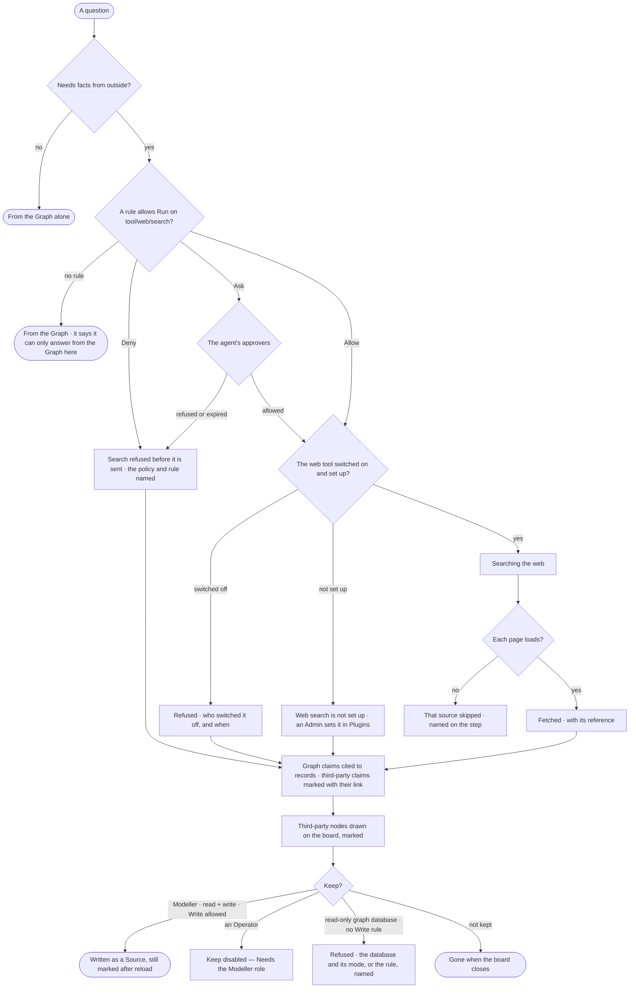

# EX-26 · Facts from beyond the Graph, marked as such

**As** an analyst asking about my data **I want** the agent to fill in what the Graph does not hold — from the web or
from what its model knows, where its Access Policies allow it — and propose what to keep, while I decide **so that** I
get the whole picture and always see which part is my data, which came from somewhere else, and where.

Tasks: [task.md](task.md) · Feature: [EX-F05](../../feature.md)

## Who can

| Lens | Can | Otherwise sees |
|---|---|---|
| Admin | Read third-party claims and nodes and their references; *Keep* a third-party node on a read + write graph database | — |
| Operator | Read third-party claims and nodes and their references, on answers they may read. A Modeller as Admin ([role table](../../../../../../os/access/features/AC-F02-access-policies/feature.md#the-role-table) › *Edit on the board*) | *Keep* disabled — *Needs the Modeller role — ask an Admin* |

Which outside tools an agent may run is its Access Policies' ([AC-F02](../../../../../../os/access/features/AC-F02-access-policies/feature.md)); setting up the web tool is an Admin's ([CP-F02](../../../../../../os/control/features/CP-F02-plugins-and-outside-tools/feature.md)).

## Flow

## Acceptance criteria

| # | Given | When | Then |
|---|---|---|---|
| EX-26.1 | An agent whose Access Policies allow Run on `tool/web/search` and `tool/web/read_url` | a question needs facts the Graph does not hold | the run searches the web and reads what it found, as steps — *Search* and *Fetch* — named in its plan |
| EX-26.2 | A claim from beyond the Graph | it is shown in the words, on the canvas or in the panel | it is marked *Third-party ·* its source — internet, api, app, db, agent or model |
| EX-26.3 | A third-party item from the internet | the person opens its reference | it shows the link, title, kind (website, document, file), domain and when it was fetched; the link opens in a new tab |
| EX-26.4 | A third-party item with no reference | the answer is assembled | it is not shown |
| EX-26.5 | An agent whose Access Policies have no rule allowing the web tool | a question needs outside facts | no search is planned; it is answered from the Graph, the words say it can only answer from the Graph here, and the trace says nothing was asked outside |
| EX-26.6 | A Deny rule on the web tool | the run plans the search | the search is refused before it is sent, the step names the policy and the rule, and the words say *I'm not allowed to look that up here* in the agent's voice |
| EX-26.7 | An Ask rule on the web tool | the run reaches the search | the step waits for the agent's approvers; allowed, it searches; refused or expired, it is answered from the Graph, naming who refused |
| EX-26.8 | A page that does not load, or that its site's robots.txt disallows | the run fetches | that source is skipped and named on the step with its link; the others are used |
| EX-26.9 | A rule allowing Run on the model's own knowledge | the model adds a claim from what it knows | it is marked *Third-party · model*, naming the model |
| EX-26.10 | A search running | the person watches | the step reads *Searching the web*, while the Graph's steps' results already show |
| EX-26.11 | Third-party nodes on the board, a Modeller or an Admin, a read + write graph database and a rule allowing the Record editor to write `Source` | they select them and choose *Keep* | each is written to that graph database as a *Source* linked to what it is about, still marked third-party after a reload |
| EX-26.12 | A read-only graph database | the person chooses *Keep* | it is refused, naming the graph database and that it is read-only |
| EX-26.13 | No rule allowing the Record editor to write `Source` | the person chooses *Keep* | it is refused, naming the policy and the rule |
| EX-26.14 | Third-party nodes not kept | the board closes | they are gone; nothing was written |
| EX-26.15 | A link that has since died | the person opens the reference | it keeps the link and says *as fetched on* its date |
| EX-26.16 | The web tool switched off — at install by an Admin, or by the person's own switch | a question needs the web | the search is refused, naming who switched it off and when, and the answer is from the Graph |
| EX-26.17 | The web tool with no search address set | an allowed question needs the web | the step says *Web search is not set up — an Admin sets it in Plugins*, and the answer is from the Graph |
| EX-26.18 | An Operator | they select third-party nodes | *Keep* is disabled — *Needs the Modeller role — ask an Admin* |
| EX-26.19 | An answer with third-party claims | the person opens *How it got here* | it shows the search, each fetch with its reference, which claims came from where, and that each call is in *What left the platform* |
| EX-26.20 | A kept third-party node | anyone opens it in the Element panel | it shows its reference, the run it came from, who kept it and when, and what it is about |

## Screens

| Surface | Lens | First use | Empty after a filter | Loading | Has data | Failed | Agent working or proposing | No access |
|---|---|---|---|---|---|---|---|---|
| Third-party in the answer | Admin | explore.board · Graph only | — | explore.board · Searching | explore.board · Third-party | explore.board · Search refused | explore.board · Working | — |
| Third-party in the answer | Operator | explore.board · Graph only | — | explore.board · Searching | explore.board · Third-party | explore.board · Search refused | explore.board · Working | — |
| Third-party nodes and Keep | Admin | — | — | explore.board.menu · Keeping | explore.board.menu · Keep | explore.board.menu · Keep refused | explore.board.menu · Third-party nodes | — |
| Third-party nodes and Keep | Operator | — | — | — | explore.board.menu · Third-party nodes | — | explore.board.menu · Third-party nodes | explore.board.menu · Keep disabled |
