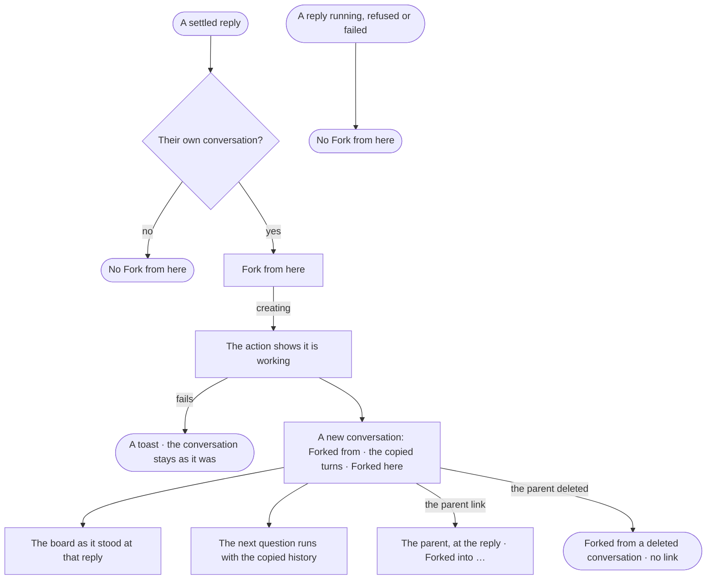

# EX-27 · Fork a conversation from a reply

**As** an analyst working through a question **I want** to try another direction from an answer without losing the
conversation I am in **so that** I can compare where each path leads, and later see which path got me to what I found.

Tasks: [task.md](task.md) · Feature: [EX-F05](../../feature.md)

## Who can

| Lens | Can | Otherwise sees |
|---|---|---|
| Admin | *Fork from here* on a settled reply of their own conversation; follow a fork to its parent and a parent to its forks | — |
| Operator | The same, on their own conversations | Another member's conversation: no *Fork from here* |

## Flow

## Acceptance criteria

| # | Given | When | Then |
|---|---|---|---|
| EX-27.1 | A settled answer in their own conversation | the person opens the reply's meta line | *Fork from here* is there, after *Share*, folding into *⋯* by width |
| EX-27.2 | A reply still running, refused or failed | the person opens its meta line | there is no *Fork from here* |
| EX-27.3 | Another member's conversation | the person reads it | there is no *Fork from here* |
| EX-27.4 | *Fork from here* chosen | the fork is made | a new conversation opens, titled with the forked reply's question, holding copies of every turn up to that reply above a *Forked here* divider |
| EX-27.5 | A fork | the person asks in it | the question carries the copied history and nothing after the reply |
| EX-27.6 | A fork | it opens | the board is the one kept at that reply, else the parent's current board |
| EX-27.7 | A fork | it opens | it starts with the parent's agent, view of the graph and token limit per run |
| EX-27.8 | A fork | the person reads its top | *Forked from* the parent's title *at* the question, linking to the parent scrolled to that reply |
| EX-27.9 | A reply a fork was taken at | the person reads the parent | under it, one *Forked into* line per fork, each opening it |
| EX-27.10 | The conversation list | the person reads it | a fork shows a fork mark and *from* its parent; a parent shows how many forks it has |
| EX-27.11 | A fork | the person reloads | its banner, copied turns and board come back |
| EX-27.12 | A fork whose parent was deleted | the person opens it | its turns stay and the banner reads *Forked from a deleted conversation*, with no link |
| EX-27.13 | Forking fails | the request returns an error | a toast says so and nothing is half-made |
| EX-27.14 | A copied reply in a fork | the person opens *How it got here* | it opens the parent's run, the one record of what was asked and returned |

## Screens

| Surface | Lens | First use | Empty after a filter | Loading | Has data | Failed | Agent working or proposing | No access |
|---|---|---|---|---|---|---|---|---|
| Fork from here, on a reply | Admin | — | — | explore.board · Forking | explore.board · Fork from here | explore.board · Fork failed | — | — |
| Fork from here, on a reply | Operator | — | — | explore.board · Forking | explore.board · Fork from here | explore.board · Fork failed | — | explore.board · Not their conversation |
| The fork | Admin | — | — | explore.board · Working | explore.board · Forked | explore.board · Parent deleted | explore.board · Working | — |
| The fork | Operator | — | — | explore.board · Working | explore.board · Forked | explore.board · Parent deleted | explore.board · Working | — |
| The conversation list | Admin | — | explore.ask · Conversations filtered | explore.ask · Loading | explore.ask · Forks | — | — | — |
| The conversation list | Operator | — | explore.ask · Conversations filtered | explore.ask · Loading | explore.ask · Forks | — | — | — |
