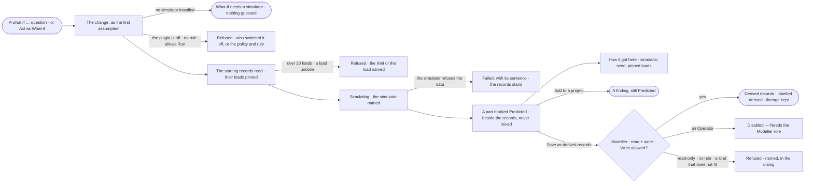

# EX-33 · Ask what if, and read the prediction as evidence

**As** a decision-maker weighing a change — *what if a Supplier stops delivering a Product: which Orders slip?* —
**I want** to ask it in the conversation and get a prediction marked as such, citing what it started from **so that**
I weigh what would follow before committing, and never mistake a prediction for what the records hold.

Tasks: [task.md](task.md) · Feature: [EX-F05](../../feature.md)

## Who can

| Lens | Can | Otherwise sees |
|---|---|---|
| Admin | Ask *what if* or pick *What-if*, read the predicted part and its run, add it to a project, save it as derived records on a read + write graph database | — |
| Operator | Ask *what if*, read the predicted part and its run on their own runs, add it to a project; a Modeller as Admin ([role table](../../../../../../os/access/features/AC-F02-access-policies/feature.md#the-role-table) › *how it reasons* · *bring records in*) | *Save as derived records* disabled — *Needs the Modeller role — ask an Admin*. Another person's run: that it ran, its status and its tokens |

## Flow

## Acceptance criteria

| # | Given | When | Then |
|---|---|---|---|
| EX-33.1 | A question that asks what would follow from a change, or *What-if* picked in *Act as* | it is understood | the change is stated as the run's first assumption, shown before the run, removable like any other (EX-24) |
| EX-33.2 | No simulator installed | a what-if is asked | the reply is *What-if needs a simulator, and none is installed*, calm like a cannot answer; nothing is estimated |
| EX-33.3 | The simulator's plugin switched off — at install by an Admin, or by the person's own switch | a what-if is asked | it is refused before it starts, naming the plugin, who switched it off and when |
| EX-33.4 | An agent whose Access Policies hold no rule allowing Run on the simulator's plugin, or a Deny | the run reaches the simulate step | the step is refused, naming the policy and the rule; the records read so far stand. An Ask rule waits for the agent's approvers |
| EX-33.5 | A what-if running | the person watches | the step reads *Simulating ·* the simulator, under the steps that read its starting records; a reload reopens it and still follows the run |
| EX-33.6 | A simulation that settled | the answer is shown | its result is a part of its own, marked *Predicted*, ranked in the simulator's order with a line saying its rows are predictions, not observations — never in the same table or drawing as the records |
| EX-33.7 | A predicted part | the person opens its citation | it names the simulator and its version, the seed, the records it started from and each pinned load by id and content hash |
| EX-33.8 | The answer's words | a claim rests on predicted rows | it is marked *Predicted*, citing the simulation, apart from claims cited to records (EX-25) |
| EX-33.9 | The simulator cannot use the data | the step settles | it is failed with the simulator's own sentence; the records stand as the answer and nothing is written |
| EX-33.10 | More than 20 loads behind the starting records, or one undone or unreadable to the person | the simulate step opens | it is refused, naming the limit of 20 or the load, and nothing runs |
| EX-33.11 | A what-if with no seed given | it runs | the seed Invana picked is kept; the same simulator version, change, pinned loads and seed give the same rows |
| EX-33.12 | A predicted part, a Modeller or an Admin, a read + write graph database and a rule allowing the Loader Write on `data/<graph database>/<kind>` | they choose *Save as derived records* and pick the graph database and the kind | the rows are written to that graph database as records of the kind, each labelled *derived* with the simulator and its version; their lineage — the run and its pinned loads — is kept, and *How it got here* on a saved record shows it |
| EX-33.13 | A read-only graph database picked | the person saves | it is refused in the dialog, naming the graph database and that it is read-only; nothing is written |
| EX-33.14 | No rule allowing the Loader Write on the kind in that graph database | the person saves | it is refused in the dialog, naming the policy and the rule |
| EX-33.15 | A kind the rows do not fit | the person saves | it is refused in the dialog, naming the field that does not fit |
| EX-33.16 | An Operator | they read a predicted part | *Save as derived records* is disabled — *Needs the Modeller role — ask an Admin* |
| EX-33.17 | A predicted part | the person opens *How it got here* | it shows the steps, the change, the simulator and its version, the seed, the pinned loads and the tokens |
| EX-33.18 | A predicted part | the person chooses *Add to a project* | it becomes a finding still marked *Predicted*, citing the run ([PJ-F03](../../../../../projects/features/PJ-F03-branches-findings-and-decisions/feature.md)) |
| EX-33.19 | A simulator removed since a what-if ran | the conversation is opened | the predicted part still reads, naming the simulator version it ran |
| EX-33.20 | Another person's what-if run | the person opens it | they see that it ran, its status and its tokens; the API answers *Not found* for the simulation |

## Screens

| Surface | Lens | First use | Empty after a filter | Loading | Has data | Failed | Agent working or proposing | No access |
|---|---|---|---|---|---|---|---|---|
| What-if in the composer | Admin | explore.ask · Act as, built-in only | — | — | explore.ask · What-if picked | — | explore.ask · Assumptions before the run | — |
| What-if in the composer | Operator | explore.ask · Act as, built-in only | — | — | explore.ask · What-if picked | — | explore.ask · Assumptions before the run | — |
| The predicted part | Admin | explore.board · No simulator | — | explore.board · Simulating | explore.board · Predicted | explore.board · Simulation failed | explore.board · Simulating | — |
| The predicted part | Operator | explore.board · No simulator | — | explore.board · Simulating | explore.board · Predicted | explore.board · Simulation failed | explore.board · Simulating | explore.board · Save disabled |
| Save as derived records | Admin | — | — | explore.board.save_derived · Saving | explore.board.save_derived | explore.board.save_derived · Refused | — | — |
| Save as derived records | Operator | — | — | — | — | — | — | explore.board · Save disabled |
| The run's trace | Admin | — | — | agents.run.answer · Loading | agents.run.answer · Simulation | agents.run.answer · Step failed | agents.run.answer · Running | — |
| The run's trace | Operator | — | — | agents.run.answer · Loading | agents.run.answer · Simulation | agents.run.answer · Step failed | agents.run.answer · Running | agents.run.answer · Content withheld |
