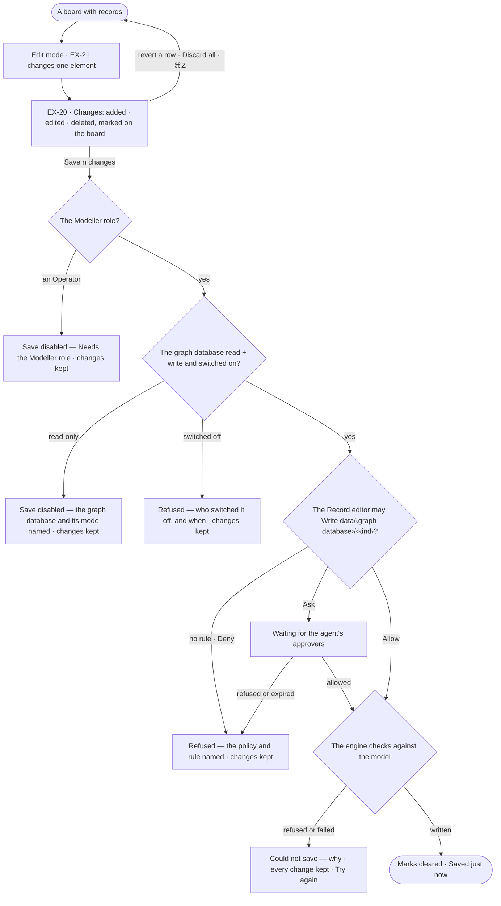
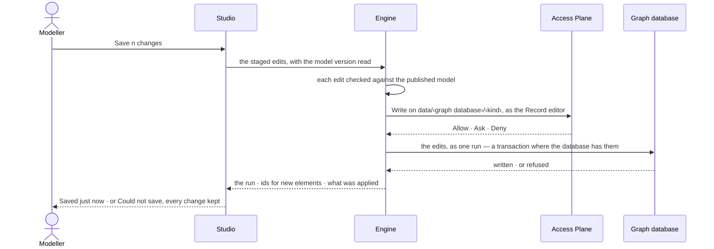

# Edit on the board

> The fixes a person makes to the records themselves on a board — added, edited, deleted — held on the board until
> they decide to save them, then written to the customer's graph database that holds them, through the Record editor.
> Annotating is [RC-F07](../../../records/features/RC-F07-annotations/feature.md)'s
> ([RC-13](../../../records/features/RC-F07-annotations/stories/RC-13-annotate-the-records-on-a-board/story.md)).
> The decision it helps make: *which fixes belong in the data, and which stay on the board?*

## User journey

## Stories

| ID | Story | Status |
|---|---|---|
| EX-20 | [Save or discard the board's changes](stories/EX-20-save-or-discard-the-boards-changes/story.md) | idea |

## Access

Who may do what is the [role table](../../../../os/access/features/AC-F02-access-policies/feature.md#the-role-table):
*Edit on the board* is *Reads* for Operator, *Acts* for Modeller and Admin. Staging an edit is the board's
([EX-F01](../EX-F01-the-board-and-its-canvas/feature.md)); saving runs as the built-in Record editor, within its
Access Policies.

| Act | Role ([the role table](../../../../os/access/features/AC-F02-access-policies/feature.md#the-role-table)) | Everyone else sees |
|---|---|---|
| Stage edits on the board · revert one · discard them | Anyone who opens the board ([EX-F01](../EX-F01-the-board-and-its-canvas/feature.md)) | — |
| Save the board's edits to a graph database | Modeller · Admin, on a read + write graph database, through the Record editor, whose Access Policies allow Write on `data/<graph database>/<kind>` | An Operator: Save disabled — *Needs the Modeller role — ask an Admin*. A read-only graph database: Save disabled, naming it and its mode. A rule: refused, naming the policy and rule |
| Read the save's run | The person behind it · an Admin ([CP-F10](../../../../os/control/features/CP-F10-runs-and-how-the-agents-are-doing/feature.md)) | That it ran, its status and its tokens |

## States

| State | What the person sees |
|---|---|
| First use | No change on the board: no Changes button |
| Empty after a filter | — |
| Loading | Saving: rows dim, *Saving…*, the list fixed until it settles |
| Has data | The Changes panel with its count; each change marked on the board |
| Failed | *Could not save* with the reason and *Try again*; every change kept |
| Agent working or proposing | — |
| No access | Save disabled, naming the Modeller role, or the graph database and its mode; the changes stay on the board |

## Rules

| Rule | Detail |
|---|---|
| Unsaved is the board's history since the last save | Undo and Redo move it; what the engine brings in, an expansion, is never unsaved |
| The model is the schema | The engine refuses a kind or key the published model does not have, whatever Studio sends |
| Written to the customer's graph database | A save writes to the graph database that holds each record; it needs a read + write connection and Write on `data/<graph database>/<kind>` in the Record editor's Access Policies. A read-only graph database is never written, whatever the role |
| A switched-off graph database refuses | The save is refused before it starts, naming who switched it off and when |
| One run per save | The save is one recorded run of the Record editor, with the person behind it; each graph database it touches is a step |
| Leans on | EX-F01 — the board, Edit mode and the Element panel · the published model edits are checked against (SE-F02) · graph databases and their modes (CP-F05) · Access Policies (AC-F02) · runs (CP-F10) · the workflow `data-edit` (AG-F06) |

## Data touched

| Record | Read or write |
|---|---|
| Records in the customer's graph database — nodes and relationships | Write, on Save, as one run of the Record editor |
| The published model's kinds and keys | Read |
| A graph database's mode and switch | Read |

## Engine

The low-level design: what this feature stores, serves and refuses. Conventions — naming, errors, lists, events — are
[system-design.md](../../../../system-design.md) §§ 6–8; this section only fills them in.

### Records

| Table | Columns | Notes |
|---|---|---|
| — | — | Stores nothing of its own: a save is a run ([CP-F10](../../../../os/control/features/CP-F10-runs-and-how-the-agents-are-doing/feature.md#engine)); the records are the customer's graph database's |

### Reads

| Record | Owner |
|---|---|
| The active published model version — kinds and keys | [SE-F02](../../../semantics/features/SE-F02-change-and-publish-a-model/feature.md#engine) |
| The run a save opens · the built-in workflow `data-edit` and the function `graph.write.edits` | [CP-F10](../../../../os/control/features/CP-F10-runs-and-how-the-agents-are-doing/feature.md#engine) · [AG-F06](../../../agents/features/AG-F06-plans-and-workflows/feature.md#engine) |
| A graph database's mode, switch, and whether its connector writes | [CP-F05](../../../../os/control/features/CP-F05-graph-databases/feature.md#engine) |
| The Record editor and the policy check | [AC-F02](../../../../os/access/features/AC-F02-access-policies/feature.md#engine) |
| An Ask and its approvers | [AC-F05](../../../../os/access/features/AC-F05-asks-and-approvals/feature.md#engine) |

### Routes

| Route, after `/api/v1/explore` | Does | Story |
|---|---|---|
| `POST /edits` | Save a board's staged edits: `model_version_id?` (the version Studio read) · `edits[]`, 1 to 1,000, in order, each naming its `graph_database` → `run_id` · `ids` (database id by board ref) · `applied` | EX-20 |

### Events

| Event | When |
|---|---|
| `explore.edits.save` | A save run settles — its own record of what was applied |

### Refusals

| Status | When | Sentence | Criterion |
|---|---|---|---|
| 403 `role_required` | The person's role does not hold *Edit on the board* | *Edit on the board needs the Modeller role.* | EX-20.11 |
| 409 `read_only` | A graph database the edits name is read-only; before the run opens | *{graph database} is read-only — nothing can be written to it.* | EX-20.9 |
| 409 `switched_off` | A graph database the edits name is switched off | *{graph database} is off — switched off by {person} {when}.* | EX-20.16 |
| 403 `policy` | No rule allows the Record editor Write on `data/<graph database>/<kind>`, or a Deny reaches it | *{policy} › {rule} does not allow writing {kind}.* | EX-20.15 |
| 409 `writes_unsupported` | The connector does not implement the write | *Saving to this database isn't supported yet.* | EX-20.17 |
| 409 `no_model` | No published model | *Publish a model to edit the data.* | EX-21.10 |
| 422 `not_in_model` | A kind, or a key of that kind, the active published version lacks; names the edit's index | *Change {n}: {kind}.{key} is not in the model.* | EX-20.7 · EX-20.13 |
| 422 `duplicate_key` | One edit sets and unsets the same key | *Change {n} sets and unsets {key}.* | API only — Studio's form refuses a key twice (EX-21.7) |
| 409 `not_found` · `stale_type` | The element is gone from the graph database, or its kind changed since the board read it | *Change {n}: {element} is gone* · *has changed kind.* | EX-20.14 |
| 502 `write_failed` | The graph database refused an edit; says how many were written before it | *{the database's message} — {n} of {m} changes saved.* | EX-20.8 |

### CLI

| Command | Does |
|---|---|
| — | No command of its own |

### Mechanisms

| Mechanism | How |
|---|---|
| An edit | `add_node` (`ref` · `kind` · `properties`) · `add_edge` (`ref` · `kind` · `source` · `target`, each a database id or an earlier `ref`) · `update_node` (`id` · `kind` · `from_kind?` · `set` · `unset`) · `update_edge` (`id` · `kind`, never changed · `set` · `unset`) · `delete_node` (`id` · `kind`, its relationships with it) · `delete_edge`; each names its `graph_database` |
| Checked, then run | Every edit is checked against the active published version, each graph database's mode and switch, and the Record editor's Access Policies before a run opens; a refusal found there opens no run. The save runs `data-edit` calling `graph.write.edits`, one step per graph database, in the driver's write mode; a refusal found inside it carries the run's `run_id` |
| Atomic where it can be | A Cypher graph database writes its edits in one transaction; a Gremlin graph database writes edit by edit and stops at the first refusal, returning what was applied. Across graph databases there is no transaction: a refusal on one says which were saved |
| Every write is recorded | Each step's write is a ledger row: the graph database, the kinds and every record ID written |

## System impact

| HLD section | Change | NFRs |
|---|---|---|
| § 8 APIs and events | One route and one event under `explore` | — |
| § 11 Failure modes and the outside boundary | A Gremlin graph database saves edit by edit, and a save across graph databases is not one transaction; a refusal part-way says what was applied | — |

## Decisions

| Decision | Detail |
|---|---|
| Edits stage, then save as one run | Added · edited · deleted stay marked on the board until *Save n changes*; the save is one recorded run of the Record editor |
| Unsaved marks | New: a dashed outline in the warning colour. Edited: a dot in the warning colour. Deleted: a faded, dashed ghost in place |
| The Changes panel does not open by itself | The rail's Changes button carries the count; the panel lists Added · Edited · Deleted, each row framing its element and reverting on its own, a node taking what hangs on it; it ends *Discard all · Save n changes*. No bar in the footer |
| Discard asks nothing | ⌘Z brings it back |
| A blank value is not saved | Removing a row unsets the key |
| A relationship keeps its kind | Changing it is deleting it and drawing it again; a node deleted takes the relationships that hang on it |

## Open questions

| Question | Who answers |
|---|---|
| — | — |

## Not building

| Item | Why not |
|---|---|
| Annotating | It is RC-F07's ([RC-13](../../../records/features/RC-F07-annotations/stories/RC-13-annotate-the-records-on-a-board/story.md)) |
| Merging two people's edits | Last save wins |
| Editing data in Explore mode | Writing is a mode entered on purpose |
| Bulk edit of a selection | One element at a time; bulk changes are a fix across records ([RC-F04](../../../records/features/RC-F04-bulk-fixes/feature.md)) |
| Keys outside the model | The model is the schema; adding a key is Ontology's job |
| Undo after Save | A saved change is in the graph database; reverting it is another edit |
| A transaction across graph databases | Each graph database writes in its own language; the run says what each applied |
