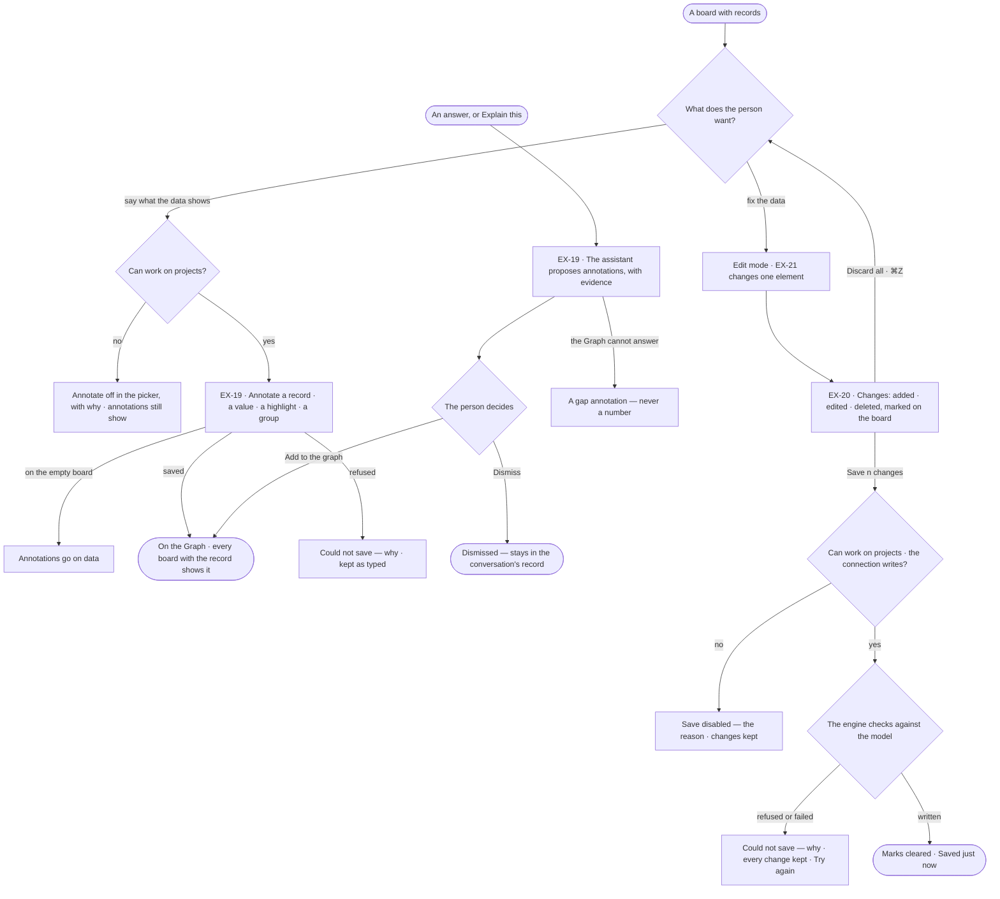
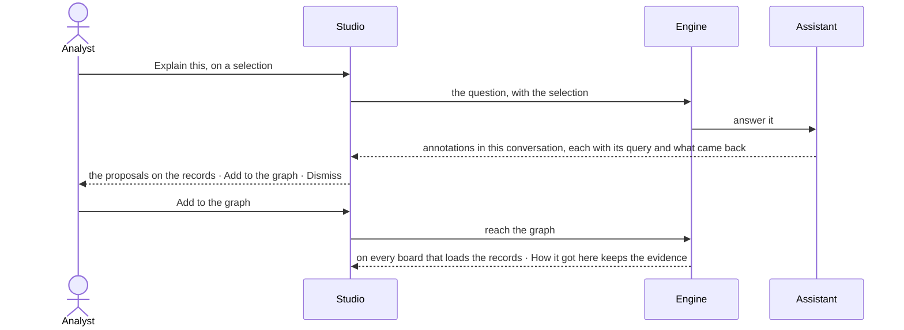

# Annotate and edit the data

> The board's acts on the data: annotating records while investigating — what an annotation is and how it is kept is
> [RC-F07](../../../records/features/RC-F07-annotations/feature.md) — and the fixes made to the records themselves,
> held on the board until the person decides to save them to the Graph.
> The decision it helps make: *which notes and fixes belong in the Graph, and which stay on the board?*

## User journey

## Stories

| ID | Story | Status |
|---|---|---|
| EX-19 | [Annotate the records](stories/EX-19-annotate-the-records/story.md) | idea |
| EX-20 | [Save or discard the board's changes](stories/EX-20-save-or-discard-the-boards-changes/story.md) | idea |

## Access

| Act | Role (`.claude/team/TEAM.md` §7) | Everyone else sees |
|---|---|---|
| Read annotations · hide or show them on the board | Operator — every member | — |
| Write an annotation · add the assistant's to the Graph · dismiss it | `contributor` · shown as *Can work on projects* | Annotate off in the picker — *You can view annotations — Ask Priya (owner) to annotate* |
| Change or delete a person's annotation | As [RC-F07 › Access](../../../records/features/RC-F07-annotations/feature.md#access) | As RC-F07 |
| Stage edits on the board · discard them | Operator — every member | — |
| Save the board's edits to the Graph | `contributor` · shown as *Can work on projects*, on a connection that writes | Save disabled — *You can change this board, not the graph*; a read-only connection gives its own reason |

## States

| State | What the person sees |
|---|---|
| First use | No annotation on these records: the panel says *Nothing annotated here yet*; no change on the board: no Changes button |
| Empty after a filter | Every annotation hidden in the Legend: *n hidden on this board · Show* |
| Loading | Records draw first; annotations arrive after, moving nothing. Saving: rows dim, *Saving…*, the list fixed until it settles |
| Has data | Cards beside records, rings, frames — or a count badge on each; the Changes panel with its count |
| Failed | *Could not save* with the reason and *Try again*; every change and every typed word kept |
| Agent working or proposing | The assistant's annotations on the records, marked as its own, each with *Add to the graph* · *Dismiss* and its evidence |
| No access | Annotations show; Annotate is off and Save disabled, each with its reason |

## Rules

| Rule | Detail |
|---|---|
| Annotations are RC-F07's | What an annotation is, what it names, its reach, its evidence, its colours and who may change it are [RC-F07](../../../records/features/RC-F07-annotations/feature.md); this feature is the board's acts on them |
| Tools in Annotate | Annotate · Highlight · Group |
| Hidden is the board's | The Legend's *Annotations* section — all · by you · by others · by the assistant · highlights · groups — and *In full / Badges* are saved with the board, so everyone opening it sees the same; an Operator's own toggles are theirs and not saved |
| Annotations are drawn with the data | Cards are laid out with the records, so none overlaps a node or another card, and an image export carries them; they are never counted, typed, exported as data or undone. A group is a frame round its records, read off their places every frame: it is not a node, never re-parents them, and no layout places it. Hiding annotations removes them from the drawing; the records stay where they are |
| Unsaved is the board's history since the last save | Undo and Redo move it; what the engine brings in, an expansion, is never unsaved |
| The model is the schema | The engine refuses a type or key the published model does not have, whatever Studio sends |
| Leans on | EX-F01 — the board and the Element panel · EX-F02 — authored steps that show annotations · Semantics — the published model edits are checked against · Records — annotations, kept and managed (RC-F07) |

## Data touched

| Record | Read or write |
|---|---|
| Annotation ([RC-F07](../../../records/features/RC-F07-annotations/feature.md)) | Read · write |
| The board's annotation view — what is hidden, In full or Badges | Read · write, with the board |
| Graph records — nodes and relationships | Write, on Save, as one run |
| The published model's types and keys | Read |

## Engine

### Records

| Table | Columns | Notes |
|---|---|---|
| — | — | Stores nothing of its own: annotations are [RC-F07](../../../records/features/RC-F07-annotations/feature.md)'s; the board's annotation view is in its `settings` ([EX-F01 › Engine](../EX-F01-the-board-and-its-canvas/feature.md#engine)); a save is a run |

### Reads

| Record | Owner |
|---|---|
| Annotations — create, list, change, delete, reach | [RC-F07](../../../records/features/RC-F07-annotations/feature.md) |
| The active published model version — types and keys | [SE-F02](../../../semantics/features/SE-F02-change-and-publish-a-model/feature.md#engine) |
| The run a save opens · the plan `data-edit@1` and the function `graph.write.edits` | [AG-F03](../../../agents/features/AG-F03-runs-and-how-the-agents-are-doing/feature.md#engine) · [AG-F06](../../../agents/features/AG-F06-plans-and-functions/feature.md#engine) |
| Whether the connection is read-only, and whether its connector writes | [RT-F05](../../../../os/runtime/features/RT-F05-graph-database-connectors/feature.md#engine) |

### Routes

| Route, after `/api/v1/u/{u}/{g}/explore` | Does | Story |
|---|---|---|
| `POST /edits` | Save a board's staged edits: `model_version_id?` (the version Studio read) · `edits[]`, 1 to 1,000, in order → `run_id` · `ids` (database id by board ref) · `applied` | EX-20 |

### Events

| Event | When |
|---|---|
| `explore.edits.save` | A save run settles — its own record of what was applied |

### Refusals

| Status | When | Sentence | Criterion |
|---|---|---|---|
| 403 `role_required` | The member lacks *Can work on projects*; names the area, the role and who holds it | *You can change this board, not the graph — ask {owner}.* | EX-20.11 |
| 403 `read_only_graph` | The connection is read-only; before the run opens | *This connection is read-only.* | EX-20.9 |
| 409 `writes_unsupported` | The connector does not implement the write | *Saving to this database isn't supported yet.* | EX-20.9 |
| 409 `no_model` | The Graph has no published model | *Publish a model to edit this Graph's data.* | EX-21.10 |
| 422 `not_in_model` | A type, or a key of that type, the active published version lacks; names the edit's index | *Change {n}: {type}.{key} is not in the model.* | EX-20.7 · EX-20.13 |
| 422 `duplicate_key` | One edit sets and unsets the same key | *Change {n} sets and unsets {key}.* | API only — Studio's form refuses a key twice (EX-21.7) |
| 409 `not_found` · `stale_type` | The element is gone from the graph, or its type changed since the board read it | *Change {n}: {element} is gone from the graph* · *has changed type.* | EX-20.14 |
| 502 `write_failed` | The database refused an edit; says how many were written before it | *{the database's message} — {n} of {m} changes saved.* | EX-20.8 |

### CLI

| Command | Does |
|---|---|
| — | No command of its own |

### Mechanisms

| Mechanism | How |
|---|---|
| An edit | `add_node` (`ref` · `type` · `properties`) · `add_edge` (`ref` · `type` · `source` · `target`, each a database id or an earlier `ref`) · `update_node` (`id` · `type` · `from_type?` · `set` · `unset`) · `update_edge` (`id` · `type`, never changed · `set` · `unset`) · `delete_node` (`id` · `type`, its relationships with it) · `delete_edge` |
| Checked, then run | Every edit is checked against the active published version before a run opens; a refusal found there (`403`, `422`, `no_model`) opens no run. The save runs `data-edit@1` calling `graph.write.edits`; a refusal found inside it carries the run's `run_id` |
| Atomic where it can be | A Cypher database writes the batch in one transaction; a Gremlin database writes edit by edit and stops at the first refusal, returning what was applied |

## System impact

| HLD section | Change | NFRs |
|---|---|---|
| § 8 APIs and events | One route and one event under `explore` | — |
| § 11 Failure modes and the outside boundary | A Gremlin database saves edit by edit; a refusal part-way says what was applied | — |

## Decisions

| Decision | Detail |
|---|---|
| Explore creates, Records keeps | An annotation is made here, while investigating; finding, editing and removing every annotation in the Graph is Records' ([RC-F07](../../../records/features/RC-F07-annotations/feature.md)) |
| The assistant proposes, the person adds | The assistant's annotations are proposals in their conversation; only a person's *Add to the graph* makes them the Graph's |
| Edits stage, then save as one run | Added · edited · deleted stay marked on the board until *Save n changes*; the save is one recorded run. A Cypher database writes it in one transaction; a Gremlin database writes edit by edit and stops at the first refusal, saying what was applied |
| Unsaved marks | New: a dashed outline in the warning colour. Edited: a dot in the warning colour. Deleted: a faded, dashed ghost in place |
| The Changes panel does not open by itself | The rail's Changes button carries the count; the panel lists Added · Edited · Deleted, each row framing its element and reverting on its own, a node taking what hangs on it; it ends *Discard all · Save n changes*. No bar in the footer |
| Discard asks nothing | ⌘Z brings it back |
| A blank value is not saved | Removing a row unsets the key |
| A relationship keeps its type | Changing it is deleting it and drawing it again; a node deleted takes the relationships that hang on it |

## Open questions

| Question | Who answers |
|---|---|
| Saving edits and writing annotations need *Can work on projects* in the engine; the glossary puts *loading data* under *Can shape the model*. Which grant should each need? Recommend: *Can work on projects* for both, as the engine enforces | Ravi |

## Not building

| Item | Why not |
|---|---|
| Free shapes, arrows, freehand ink, text on the board | They are about the board, not the data |
| Live co-editing of one annotation · merging two members' edits | Last save wins |
| Resizing or rotating a group | It is the box around its records |
| Editing data in Explore mode | Writing is a mode entered on purpose |
| Bulk edit of a selection | One element at a time; bulk changes are a fix across records ([RC-F04](../../../records/features/RC-F04-bulk-fixes/feature.md)) |
| Keys outside the model | The model is the schema; adding a key is Semantics' job |
| Undo after Save | A saved change is in the graph; reverting it is another edit |
