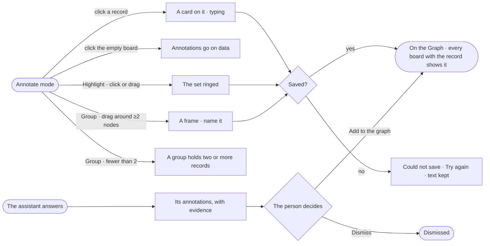

# EX-19 · Annotate the records

**As** an analyst **I want** to annotate the records themselves — a node, a relationship, a value, a path, a group —
and see what others and the assistant noted on them **so that** whoever loads those records next sees what the data
says, and a walkthrough can point at it.

Tasks: [task.md](task.md) · Feature: [EX-F06](../../feature.md)

## Who can

| Lens | Can | Otherwise sees |
|---|---|---|
| Admin | Read, write, hide and show annotations; add the assistant's to the Graph or dismiss them; change or delete their own | Delete off on someone else's — *Only Priya Nair can delete it* |
| Operator | Read every annotation; hide and show them for themselves | Annotate off in the picker — *You can view annotations — Ask Priya (owner) to annotate*. With *Can work on projects*: as Admin |

## Flow

## Acceptance criteria

| # | Given | When | Then |
|---|---|---|---|
| EX-19.1 | Annotate mode and a person with *Can work on projects* | they click a node or a relationship and type | a card is drawn beside it, linked by a dashed line, and saved on the Graph when they leave it |
| EX-19.2 | A record selected in Annotate | the person annotates one of its values | the annotation keeps that value; when the value later differs it says *Was 71% when noted* |
| EX-19.3 | Highlight | the person clicks or drags over nodes | those nodes are ringed and the relationships among them marked |
| EX-19.4 | Group | the person drags around fewer than two nodes | it is refused with *A group holds two or more records* |
| EX-19.5 | Annotate mode | the person clicks the empty board | nothing is made, and the board says *Annotations go on data* |
| EX-19.6 | Records annotated on one board | another member loads those records on another board | the annotations show there too |
| EX-19.7 | The Legend's *Annotations* section | the person hides the assistant's, or switches to *Badges* | the board shows each annotated record with a count instead, the choice is saved with the board, and the panel says how many are hidden, with *Show* |
| EX-19.8 | Only part of a group's records on the board | it draws | the frame is drawn dashed around those here, saying *3 of 7 on this board* |
| EX-19.9 | An answer, or *Explain this* on a selection | the assistant annotates records | its annotations show as the assistant's, in this conversation only, each with *Add to the graph* · *Dismiss* |
| EX-19.10 | An assistant's annotation | the person opens it | *How it got here* shows its query, what came back and the reply |
| EX-19.11 | A question the Graph cannot answer | the assistant annotates | it writes a gap annotation saying what is missing, never a number |
| EX-19.12 | Someone else's annotation | the person selects it | its author's initials show and delete is off with *Only Priya Nair can delete it* |
| EX-19.13 | Saving an annotation fails | the engine refuses | the card keeps its text and says *Could not save · Try again* |
| EX-19.14 | An Operator without *Can work on projects* | they open the mode picker | Annotate is off with *You can view annotations — Ask Priya (owner) to annotate*; every annotation still shows |

## Screens

| Surface | Lens | First use | Empty after a filter | Loading | Has data | Failed | Agent working or proposing | No access |
|---|---|---|---|---|---|---|---|---|
| Annotations on the board | Admin | explore.board.annotate · Nothing annotated | explore.board.annotate · All hidden | explore.board.annotate · Loading | explore.board.annotate | explore.board.annotate · Could not save | explore.board.annotate · Assistant proposes | — |
| Annotations on the board | Operator | explore.board.annotate · Nothing annotated | explore.board.annotate · All hidden | explore.board.annotate · Loading | explore.board.annotate | — | explore.board.annotate · Assistant proposes | explore.board.annotate · Read only |
| The Annotations panel | Admin | explore.board.annotate · Panel empty | explore.board.annotate · Panel hidden | explore.board.annotate · Loading | explore.board.annotate · Panel | — | explore.board.annotate · Evidence | — |
| The Annotations panel | Operator | explore.board.annotate · Panel empty | explore.board.annotate · Panel hidden | explore.board.annotate · Loading | explore.board.annotate · Panel | — | explore.board.annotate · Evidence | explore.board.annotate · Read only |
