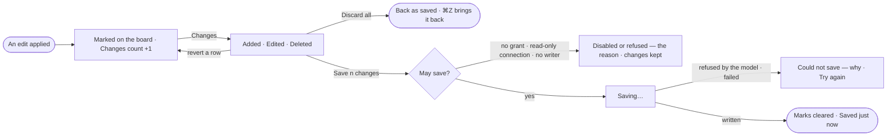

# EX-20 · Save or discard the board's changes

**As** an analyst **I want** to see what I added, changed and deleted on the board until it is saved, and save or
discard it from one panel **so that** nothing reaches the Graph by accident, and nothing is lost by accident.

Tasks: [task.md](task.md) · Feature: [EX-F06](../../feature.md)

## Who can

| Lens | Can | Otherwise sees |
|---|---|---|
| Admin | Stage, revert, discard and save changes to the Graph | — |
| Operator | Stage, revert and discard changes on the board | *Save n changes* disabled — *You can change this board, not the graph*. With *Can work on projects*: as Admin |

## Flow

## Acceptance criteria

| # | Given | When | Then |
|---|---|---|---|
| EX-20.1 | An edit applied on the board | it lands | a new element has a dashed outline in the warning colour, an edited one a dot, a deleted one a faded dashed ghost in place; the rail's Changes button counts it |
| EX-20.2 | Unsaved changes | the person opens Changes | they are listed under Added · Edited · Deleted; a row frames its element on the board, and its revert undoes only that change — a node taking what hangs on it |
| EX-20.3 | Unsaved changes | the person picks *Discard all* | every change goes without a question, and ⌘Z brings them back |
| EX-20.4 | Unsaved changes | the person presses ⌘Z or ⌘⇧Z | the list moves with the board's history |
| EX-20.5 | An expansion in Edit mode | the neighbours draw | they are not listed as unsaved |
| EX-20.6 | A person with *Can work on projects* | they pick *Save n changes* | rows dim, *Saving…* shows, and when the run settles the marks clear and the panel says *Saved just now*, new elements taking their Graph ids |
| EX-20.7 | A change with a type or key the model does not have | the person saves | the save is refused naming the change and the key; every change is kept |
| EX-20.8 | A save the graph database refuses | it settles | *Could not save* shows the database's reason with *Try again*; nothing is half-saved where the database runs transactions |
| EX-20.9 | A read-only connection, or a graph database Invana cannot write to yet | the person opens Changes | Save is disabled with that reason — *Saving to this database isn't supported yet*; the changes stay |
| EX-20.10 | Unsaved changes | the person leaves the board or reloads | they are warned first that the changes will be lost |
| EX-20.11 | An Operator without *Can work on projects* | they open Changes | *Save n changes* is disabled with *You can change this board, not the graph*; the changes stay on the board |
| EX-20.12 | A node deleted on the board | Changes lists it | the relationships that hang on it are listed under it, and saving deletes them with it |
| EX-20.13 | Changes staged before the model was published again | the person saves | they are checked against the model as it is now; a refusal names the change and the key |
| EX-20.14 | A change to an element someone else deleted, or whose type changed, since the board read it | the person saves | the save is refused naming that change; every change is kept |

## Screens

| Surface | Lens | First use | Empty after a filter | Loading | Has data | Failed | Agent working or proposing | No access |
|---|---|---|---|---|---|---|---|---|
| Changes | Admin | explore.board.edit · No changes | — | explore.board.edit · Saving | explore.board.edit | explore.board.edit · Save failed | — | — |
| Changes | Operator | explore.board.edit · No changes | — | — | explore.board.edit | — | — | explore.board.edit · Read only |
