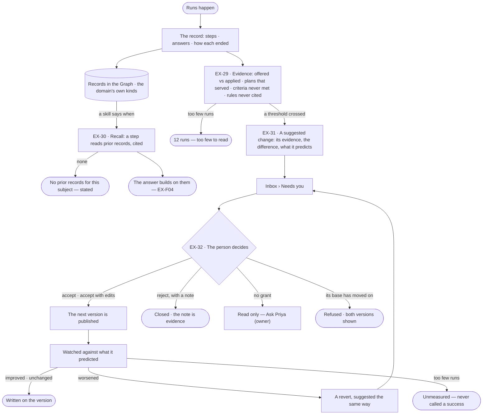
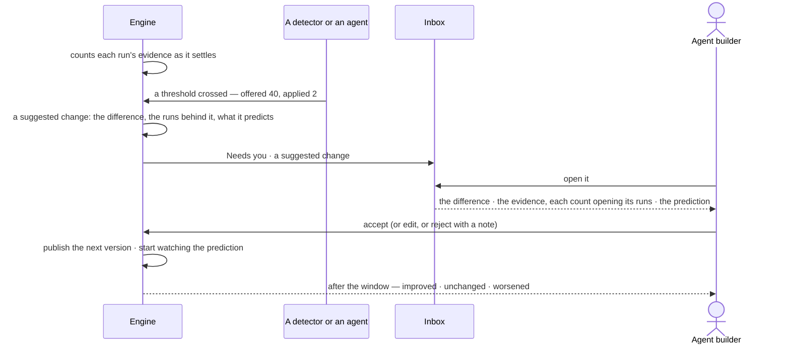

# Memory — what past runs teach

> What carries over from one run to the next: records in the Graph an agent reads with a step it plans, and changes a
> person accepts on the evidence of what happened — so the person decides which skill, plan, rule or criterion to
> change, from counts they can open, and never finds the setup changed behind their back.
> The decision it helps make: *which skill, plan, rule or criterion should change, given what past runs show?*

## User journey

Journeys this feature is a step of: [J02 · Ask and trust the answer](../../../../journeys/J02-ask-and-trust-the-answer.md) · [J04 · Build an agent and improve it from what runs teach](../../../../journeys/J04-build-an-agent-and-improve-it-from-what-runs-teach.md)

## Stories

| ID | Story | Status |
|---|---|---|
| EX-29 | [See what is failing quietly](stories/EX-29-see-what-is-failing-quietly/story.md) | idea |
| EX-30 | [The next run builds on the last](stories/EX-30-the-next-run-builds-on-the-last/story.md) | idea |
| EX-31 | [A suggested change, with its evidence](stories/EX-31-a-suggested-change-with-its-evidence/story.md) | idea |
| EX-32 | [Accept, edit or reject a suggested change, then see if it helped](stories/EX-32-decide-on-a-suggested-change/story.md) | idea |

## Access

| Act | Role (`.claude/team/TEAM.md` §7) | Everyone else sees |
|---|---|---|
| Read evidence and open the runs behind a count | Operator — every member | — |
| Read a recall step and its citations | Operator — every member who can read the run | — |
| Say when a skill recalls | `builder` · shown as *Can build agents* | The skill read-only |
| Model the kinds the domain remembers with | `modeller` · shown as *Can shape the model* | The model read-only |
| Read a suggested change | Operator — every member | — |
| Accept, edit or reject a suggested change to a skill, plan, agent or answer template | `builder` · shown as *Can build agents* | Read only — *Ask Priya (owner)* |
| Accept, edit or reject a suggested change to a rule | `modeller` · shown as *Can shape the model* | Read only — *Ask Priya (owner)* |
| Accept, edit or reject a suggested change to a project's criterion | `contributor` · shown as *Can work on projects* | Read only — *Ask Priya (owner)* |

## States

| State | What the person sees |
|---|---|
| First use | No runs yet: Evidence says counts arrive as runs settle; no suggested change waits |
| Empty after a filter | Nothing wrong for that kind and window: Evidence says so — never a board of zeroes; an empty queue says the setup is behaving |
| Loading | Evidence and the suggested change's evidence load with their window named; a recall step reads *Recall ·* its count as it settles |
| Has data | Counts ranked by the size of the gap, each with its window and what its runs share; a suggested change with its difference, evidence and prediction |
| Failed | A suggested change refused because its base moved on, both versions shown; a recall step that failed, named on the step |
| Agent working or proposing | A suggested change waiting in Inbox › Needs you, from a detector or an agent, named |
| No access | Without the grant its target needs, a suggested change is read only — *Ask Priya (owner)* |

## Rules

| Rule | Detail |
|---|---|
| No memory of its own | An agent does not carry anything from one run to the next by itself. What it knows next time is a record in the Graph it reads, or a change a person accepted |
| Recall is a planned step | Never context added behind the scenes; it reads records with a query, cites them by record, and states *nothing to recall* when there is none |
| A skill says when to recall | The trigger is written in the skill; recall never runs on every question |
| The domain models its memory | The product ships the mechanism; a Graph names its own kinds — an observation, a claim made from observations, how the claim fared. A starter model ships that shape, renamed on arrival |
| Where memory lives | Runs, their steps and their evidence are Invana's; what the domain learned is in the Graph, joined to its own kinds and cited in answers. A memory record carries the run that produced it |
| Counts, not scores | Evidence is counted and opened, never scored or ranked by agent |
| Every count opens its runs | A count that cannot be opened is not evidence |
| The window is stated | Last 7 · 30 · 90 days, on every figure; a new version restarts its counts, the previous version's kept beside them |
| Too few is said | *12 runs — too few to read*, never a percentage |
| A gap is read beside what its runs share | *37 of the 40 never matched the trigger* — the count says something is wrong; what the runs share says what to change |
| Improvement is a version a person accepts | Never a weight that shifts; nothing changes itself at any threshold |
| A suggested change carries its evidence | The runs, the counts and the window behind it; one without evidence is refused when it is made |
| One change, one target | A suggested change is the whole new body of one skill, plan, agent's skills or limits, rule, criterion or answer template, against the version it changes — or one change to the semantic model (below) |
| Memory also tunes Semantics | What questions keep missing becomes a suggested change to the model's meaning: a synonym, definition or unit (SE-F03) · a broader kind (SE-F04) · a derivation (SE-F07) · a saved query shape (SE-F02) · an index (SE-F10). Each is a draft in Semantics, published through Semantics' own review — never applied from Explore |
| An index is an Admin's | An index suggestion is applied to the graph database only by an Admin |
| Did it help is the engine's | For a semantic change, the engine stores answer accuracy and latency over the same window before and after it was published; the outcome is read from those, never worked out in Studio |
| Newer replaces older | A newer suggested change on the same target replaces the open one, carrying both bodies of evidence |
| An agent may only tighten its own limits | It may suggest a tighter limit, or a change to a skill or plan; widening its own limits or budget is a person's act |
| A rejection carries a note | The note is evidence about what suggested it |
| Accepting predicts | It states what should change, and by how much, so the outcome is judged — improved · unchanged · worsened · unmeasured |
| A worse outcome is a revert suggested the same way | Nothing rolls back by itself |
| Leans on | EX-F04 — the run and its trace · Agents › Skills — the skills, plans and templates that change · Semantics — the domain's memory kinds, meaning, broader kinds, derivations, saved query shapes and indexes (SE-F02 · SE-F03 · SE-F04 · SE-F07 · SE-F10) · Projects — criteria · Inbox — Needs you |

## Data touched

| Record | Read or write |
|---|---|
| Runs and their steps — skills offered and applied, plan served, rules cited, refusals, failures | Read |
| Evidence counts — per skill, plan, rule, criterion and refusal, per version and window | Write (the engine, as each run settles) · read |
| Memory records in the Graph — the domain's own kinds, each with the run that produced it | Read · write (by a run, inside what it may do) |
| A suggested change — target and the version it changes, the new body, the evidence, the prediction, who suggested it, status | Write (a detector or an agent) · read |
| The decision on it — who, when, the note, whether edited | Write (the grant its target needs) · read |
| A version's outcome against its prediction | Write (the engine) · read |

## Engine

### Records

| Table | Columns | Notes |
|---|---|---|
| `explore_evidence_counts` | `graph_id` · `target_kind` (`skill` · `plan` · `rule` · `criterion` · `refusal` · `failure`) · `target_id` · `target_version` · `agent_id?` · `window` (`7d` · `30d` · `90d`) · `offered` · `applied` · `served` · `met` · `unmet` · `not_applicable` · `cited` · `refused` · `failed` · `run_count` | Written by the engine as each run settles, never on read. A new `target_version` starts its own rows |
| `explore_evidence_runs` | `count_id` · `run_id` | The runs behind a count, so every count opens its runs |
| `explore_suggested_changes` | `graph_id` · `target_kind` (`skill` · `plan` · `agent` · `rule` · `criterion` · `answer_template` · `model`) · `target_id` · `base_version` · `change` (the whole new body; for `model`, the changes to stage) · `semantic_kind?` (`meaning` · `broader_kind` · `derivation` · `query_shape` · `index`) · `basis` (window, counts, run ids) · `prediction` (the measure and the threshold) · `suggested_by_kind` (`detector` · `agent`) · `suggested_by_id` · `suggested_in_run_id?` · `status` (`open` · `accepted` · `rejected` · `superseded`) · `decided_by_id?` · `decided_at?` · `note?` · `edited` · `outcome?` (`improved` · `unchanged` · `worsened` · `unmeasured`) · `measured_before?` · `measured_after?` | One open per target. `measured_before` · `measured_after` hold the prediction's measure over the same window before and after publishing — for `model`, answer accuracy and latency |
| `explore_detectors` | `graph_id` · `target_kind` · `measure` · `threshold` · `window` | A declarative threshold over the evidence; each firing is one `explore_suggested_changes` row |

### Reads

| Record | Owner |
|---|---|
| Runs and their steps — skills offered and applied, plan served, rules cited, refusals, failures, outcome, `work_ms` | [AG-F03](../../../agents/features/AG-F03-runs-and-how-the-agents-are-doing/feature.md#engine) |
| Skills — the recall trigger, and publishing a skill's next version | [AG-F04](../../../agents/features/AG-F04-skills/feature.md#engine) |
| Plans — promoting and publishing one · an agent's skills and limits | [AG-F06](../../../agents/features/AG-F06-plans-and-functions/feature.md#engine) · [AG-F01](../../../agents/features/AG-F01-build-an-agent/feature.md#engine) |
| Rules — publishing a rule, and a derivation | [SE-F07 › Engine](../../../semantics/features/SE-F07-rules/feature.md#engine) |
| The model's draft a semantic suggestion stages on, its review and publish · saved query shapes · indexes (`model_indexes`) | [SE-F02 › Engine](../../../semantics/features/SE-F02-change-and-publish-a-model/feature.md#engine) |
| Synonyms, definitions and units | [SE-F03](../../../semantics/features/SE-F03-meaning/feature.md) |
| Broader kinds | [SE-F04](../../../semantics/features/SE-F04-taxonomies/feature.md) |
| An index's health on the graph database | [SE-F10](../../../semantics/features/SE-F10-health-and-history/feature.md#engine) |
| A criterion's revisions and outcomes | [PJ-F02 › Engine](../../../projects/features/PJ-F02-objectives-and-review/feature.md#engine) |
| Answer templates | [EX-F04 › Engine](../EX-F04-the-answer/feature.md#engine) |
| Needs you — where an open suggested change waits · History of each decision | [AC-F05](../../../../os/access/features/AC-F05-asks-and-approvals/feature.md#engine) · [AC-F06](../../../../os/access/features/AC-F06-history/feature.md#engine) |

### Routes

| Route, after `/api/v1/u/{u}/{g}/explore` | Does | Story |
|---|---|---|
| `GET /evidence` · `GET /evidence/{kind}/{id}` | Counts by kind, window and version · one target's counts | EX-29 |
| `GET /suggested-changes` · `GET /suggested-changes/{change}` | The open changes, ranked by the size of their evidence · one, with its difference | EX-31 |
| `POST /suggested-changes/{change}/accept` · `POST /suggested-changes/{change}/reject` | Accept, with an edited body or as suggested · reject, with a note | EX-32 |

### Events

| Event | When |
|---|---|
| `explore.suggested_changes.open` · `supersede` · `accept` · `reject` | A suggested change opens · gives way to a newer one on its target · is accepted · is rejected |
| `explore.suggested_changes.outcome` | The window passed and the outcome was written |

### Refusals

| Status | When | Sentence | Criterion |
|---|---|---|---|
| 422 | A suggested change made without `basis` | *A suggested change needs its evidence.* | EX-31.6 |
| 422 | An agent's suggestion that widens its own limits or budget | *An agent may only tighten its own limits.* | EX-31.8 |
| 409 | Accepting a change whose `base_version` is not the target's current version | *This was made against v{base}; {target} is at v{current}.* | EX-32.4 |
| 403 | Accepting, editing or rejecting without the grant the target needs | *This needs {grant} — ask {owner}.* | EX-32.12 |
| 403 | Accepting an index suggestion by anyone but an Admin | *Only an Admin adds an index — ask {admin}.* | EX-32.15 |
| 422 | A reject with no note | *A rejection needs a note.* | EX-32.3 |

### CLI

| Command | Does |
|---|---|
| — | No command of its own |

### Mechanisms

| Mechanism | How |
|---|---|
| Counted when a run settles | The engine adds the run to each count it touches and links it in `explore_evidence_runs`; Studio reads the stored numbers |
| A recall step | An ordinary query step with a subject parameter, planned when a skill's trigger says so and recorded like any other; finding nothing is the step's outcome, never a skipped step. A memory record a run writes carries that run's `run_id` |
| Detectors | Evaluated on a schedule over the evidence; a crossing opens a suggested change naming the threshold. A skill: offered often and applied rarely, or applied and the run still failed · a plan: keeps serving, or its answer template keeps being abandoned · an agent: a skill a peer applied well that it never had · *What it may do*: steps refused repeatedly, a budget never approached · a rule: never cited, or cited in every failure · a criterion: never met, or always met unexamined · an answer template: readers keep switching away |
| What a suggestion may change | A skill's `when_to_use` or `content`, a split, a retirement · a plan: promote, a step's arguments, retire · an agent: bind or unbind a skill, tighten *What it may do* · a rule: add, rewrite, deactivate · a criterion: rewrite, drop, add a check · an answer template: promote, its columns · the model: one `semantic_kind` |
| Accepting publishes | Through the target's own publish — a skill AG-F04, a plan AG-F06, an agent AG-F01, a rule SE-F07, a criterion's revision PJ-F02, an answer template EX-F04. `edited` is set when the body differs from the suggestion |
| A semantic suggestion | Accepting stages `change` on the model's draft ([SE-F02 › Engine](../../../semantics/features/SE-F02-change-and-publish-a-model/feature.md#engine)) — a synonym, definition or unit ([SE-F03](../../../semantics/features/SE-F03-meaning/feature.md)), a broader kind ([SE-F04](../../../semantics/features/SE-F04-taxonomies/feature.md)), a derivation ([SE-F07](../../../semantics/features/SE-F07-rules/feature.md#engine)), a saved query shape or an index — and the draft is published through Semantics' own review, never from Explore |
| The outcome | When the window after publishing passes, the engine stores `measured_before` and `measured_after` and writes `outcome`; too few runs is `unmeasured`. For `model`: accuracy is the share of runs on the changed kinds that ended `answered`, latency their median `work_ms`. A `worsened` outcome opens a revert as a new suggested change |

## System impact

| HLD section | Change | NFRs |
|---|---|---|
| § 6 Data and storage | Four tables in Invana's own store, written as runs settle | — |
| § 8 APIs and events | The routes and events above, under `explore` | — |
| § 9 Distributed execution | Detectors run on a schedule | — |
| § 10 AI and agents | Recall is a planned query step; an agent may suggest but never widen its own limits; nothing changes without a person's accept | — |

## Decisions

| Decision | Detail |
|---|---|
| The engine counts evidence | Every count is stored by the engine when the run it counts settles; Studio shows it and never works one out |
| Evidence opens from Agents › Skills | It is read about a skill, plan, rule or criterion, so it opens from the Skills list and from the item itself, with the same numbers on both — never a place of its own in the leftNav |
| Suggested changes wait in Inbox › Needs you | They wait on a person and never block a run; ranked by the size of their evidence, not their age |
| A stale base is refused | A suggested change made against an older version than the current one is refused on accept, with both shown — never merged blind |
| What is offered is versioned; what is judged against is revised | Skills, plans, rules and answer templates have versions old runs still resolve to; a criterion has revisions, and its outcome keeps the statement it judged |
| Accepted with edits is recorded | The published body, and that a person changed it |
| Tuning means agents, skills and the model | What improves is a skill, a plan, an agent's limits or the semantic model — each a version a person accepts; no AI model is tuned |

## Open questions

| Question | Who answers |
|---|---|
| Who sets a detector's threshold — the defaults that ship, or each Graph? | Ravi |
| Does accepting with edits keep the body as suggested, to compare? | Ravi |
| Does a suggested change expire if nobody decides, or wait in Needs you? | Ravi |
| May a suggested change target a starter model's shape, or only what a Graph authored? | Ravi |

## Not building

| Item | Why not |
|---|---|
| An agent carrying context from one run to the next | It cannot be audited, and what it recalls cannot be cited |
| Recall by similarity over past runs | What is recalled must be explainable as a query over records |
| Recall on every run · recall across Graphs | A skill decides when; the Graph is the boundary |
| Agents writing their own skills or rules | A change has an author for a reason |
| Memory per person | The Graph is the shared truth; a memory per person forks it |
| Training or fine-tuning on outcomes · scoring agents | What changes must stay readable and editable by a person; a score invites gaming the score |
| Agent leaderboards · predicting quality · alerts on thresholds | A count you can open is the point; alerts belong to operations |
| Changing itself at a threshold · accepting in bulk · accepting low-risk changes unread | A difference nobody read is not a decision; risk is what the person judges |
| A rollback by itself on a worse outcome | Reverting is a change, and changes are reviewed |
| A suggested change to several things at once | A difference a person cannot hold in their head is not reviewable |
| Running two versions live side by side | Its cost and attribution make it unreadable at this scale |
