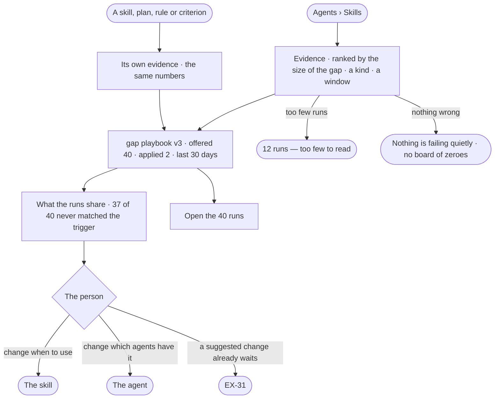

# EX-29 · See what is failing quietly

**As** an agent builder responsible for a setup that runs by itself **I want** the counts that say what is failing
quietly — skills offered but not applied, plans that do not serve, criteria never met, rules nothing cites — each
opening the runs behind it **so that** I fix the right thing.

Tasks: [task.md](task.md) · Feature: [EX-F07](../../feature.md)

## Who can

| Lens | Can | Otherwise sees |
|---|---|---|
| Admin | Read Evidence for every skill, plan, rule, criterion, refusal and failure; open the runs behind each count; act on the item | — |
| Operator | Read the same Evidence and open its runs | Acting on the item follows its own grant — with *Can build agents*: change a skill or plan, as Admin |

## Flow

## Acceptance criteria

| # | Given | When | Then |
|---|---|---|---|
| EX-29.1 | Runs that offered skills | the person opens Evidence from Agents › Skills | each skill shows how often it was offered and reported applied, per version and per agent, ranked by the size of the gap |
| EX-29.2 | Plans with a check step | the person filters Evidence to plans | each plan version shows how often its check said it served |
| EX-29.3 | Project criteria | the person filters to criteria | each shows met · unmet · not applicable across tasks |
| EX-29.4 | Rules | the person filters to rules | each shows how often it is cited, and those never cited |
| EX-29.5 | Refusals and failures | the person filters to them | each limit that refuses plans, and each step that fails with which diagnosis, shows how often |
| EX-29.6 | Any count | the person opens it | it lists the runs behind it |
| EX-29.7 | A gap | it is shown | what its runs share is stated beside it — *37 of the 40 never matched the trigger* |
| EX-29.8 | Any figure | it is shown | its window — 7 · 30 · 90 days — is named on it |
| EX-29.9 | Fewer runs than can be read | a figure would show | it says *12 runs — too few to read*, never a percentage |
| EX-29.10 | A new version of a skill | the person reads its evidence | its counts restart, the previous version's kept beside them |
| EX-29.11 | Runs past their payloads' window | the person opens a count | the count stands, and each run says its payloads are purged |
| EX-29.12 | Nothing failing in the window | the person opens Evidence | it says so in a sentence, not a board of zeroes |
| EX-29.13 | A skill, plan, rule or criterion | the person opens it | the same numbers show on it as in Evidence |
| EX-29.14 | A count | Studio shows it | it is the number the engine stored when the runs settled; Studio does not work it out |
| EX-29.15 | An Operator | they open Evidence | they read it and open the runs; acting on an item they lack the grant for says *Ask Priya (owner)* |

## Screens

| Surface | Lens | First use | Empty after a filter | Loading | Has data | Failed | Agent working or proposing | No access |
|---|---|---|---|---|---|---|---|---|
| Evidence | Admin | agents.skills · Evidence, no runs | agents.skills · Evidence, nothing wrong | agents.skills · Evidence loading | agents.skills · Evidence | agents.skills · Failed | agents.skills · Evidence, suggestion open | — |
| Evidence | Operator | agents.skills · Evidence, no runs | agents.skills · Evidence, nothing wrong | agents.skills · Evidence loading | agents.skills · Evidence | agents.skills · Failed | agents.skills · Evidence, suggestion open | — |
| Evidence on the item | Admin | agents.skill · Evidence, no runs | agents.skill · Evidence, too few | agents.skill · Loading | agents.skill · Evidence | agents.skill · Failed | — | — |
| Evidence on the item | Operator | agents.skill · Evidence, no runs | agents.skill · Evidence, too few | agents.skill · Loading | agents.skill · Evidence | agents.skill · Failed | — | agents.skill · Read only |
