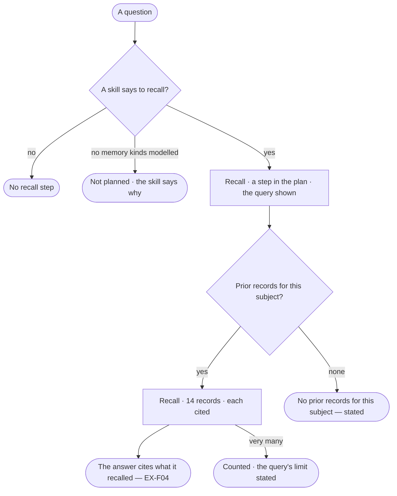

# EX-30 · The next run builds on the last

**As** an analyst whose agents work the same subject again and again **I want** the next run to read what the last ones
concluded, and cite it **so that** it builds on them instead of starting cold, and I can check what it recalled.

Tasks: [task.md](task.md) · Feature: [EX-F07](../../feature.md)

## Who can

| Lens | Can | Otherwise sees |
|---|---|---|
| Admin | Read a recall step, its query, its rows and its citations; say in a skill when to recall; model the kinds the domain remembers with | — |
| Operator | Read a recall step, its query, its rows and its citations on runs they can read | The skill and the model read-only; with *Can build agents*: say when to recall; with *Can shape the model*: model the memory kinds |

## Flow

## Acceptance criteria

| # | Given | When | Then |
|---|---|---|---|
| EX-30.1 | A skill that says when to recall, and memory kinds in the model | a run is planned for its subject | the plan includes a *Recall* step, shown with its steps like any other |
| EX-30.2 | A recall step | it runs | it queries prior records in the Graph scoped to the run's subject, and the query is shown |
| EX-30.3 | Prior records found | the answer is written | it cites them by record, inline, each opening the record |
| EX-30.4 | Prior records found | the step settles | it reads *Recall ·* the count *· query shown*, and the count is in the answer — *Read 14 prior observations* |
| EX-30.5 | No prior records for the subject | the step settles | it states *No prior records for this subject*, with the query, and is never skipped silently |
| EX-30.6 | No memory kinds in the model | a skill would recall | no recall step is planned, and the skill says why |
| EX-30.7 | Very many prior records | the step settles | it counts them and states the query's limit |
| EX-30.8 | A recalled record later corrected | the person opens its citation | it opens the record as it is now, with its own history |
| EX-30.9 | No skill saying to recall | a run is planned | no recall step runs, and nothing is added to the run behind the scenes |
| EX-30.10 | A recall step | the person opens *How it got here* | it shows the query, the rows and what the step made of them |
| EX-30.11 | A memory record a run writes | it is written | it carries the run that produced it |
| EX-30.12 | An Operator without *Can build agents* | they open the skill that recalls | they read when it recalls; nothing can be edited — *Ask Priya (owner)* |

## Screens

| Surface | Lens | First use | Empty after a filter | Loading | Has data | Failed | Agent working or proposing | No access |
|---|---|---|---|---|---|---|---|---|
| The recall step on the answer | Admin | explore.board · Recall not planned | explore.board · Nothing to recall | explore.board · Working | explore.board · Recall | explore.board · Recall failed | explore.board · Working | — |
| The recall step on the answer | Operator | explore.board · Recall not planned | explore.board · Nothing to recall | explore.board · Working | explore.board · Recall | explore.board · Recall failed | explore.board · Working | — |
| The run's trace | Admin | — | agents.run.answer · Nothing to recall | agents.run.answer · Loading | agents.run.answer · Recall | agents.run.answer · Step failed | agents.run.answer · Running | — |
| The run's trace | Operator | — | agents.run.answer · Nothing to recall | agents.run.answer · Loading | agents.run.answer · Recall | agents.run.answer · Step failed | agents.run.answer · Running | — |
| When to recall, on the skill | Admin | agents.skill · No memory kinds | — | agents.skill · Loading | agents.skill · Recall | agents.skill · Failed | — | — |
| When to recall, on the skill | Operator | agents.skill · No memory kinds | — | agents.skill · Loading | agents.skill · Recall | agents.skill · Failed | — | agents.skill · Read only |
