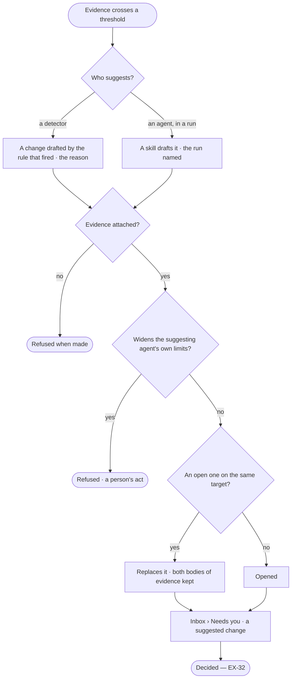

# EX-31 · A suggested change, with its evidence

**As** an agent builder running agents **I want** Invana to tell me which skill, plan or rule is failing and propose a
change I can accept — its evidence, the difference and what it should improve **so that** the setup improves from what
actually happened rather than from my memory of it.

Tasks: [task.md](task.md) · Feature: [EX-F07](../../feature.md)

## Who can

| Lens | Can | Otherwise sees |
|---|---|---|
| Admin | Read every suggested change, its evidence and its difference; open the runs behind it; decide it (EX-32) | — |
| Operator | Read every suggested change, its evidence and its difference; open the runs | Deciding it needs the grant of its target — *Ask Priya (owner)* |

## Flow

## Acceptance criteria

| # | Given | When | Then |
|---|---|---|---|
| EX-31.1 | Evidence crossing a detector's threshold | the detector runs | a suggested change opens, naming the threshold that fired as its reason |
| EX-31.2 | A skill that drafts changes, in a run | it drafts one | a suggested change opens, naming the agent and the run |
| EX-31.3 | A suggested change | the person opens it | it shows the difference, field by field, against the version it changes |
| EX-31.4 | A suggested change | the person opens its evidence | it shows the counts, the window and the runs behind them, each count opening its runs |
| EX-31.5 | A suggested change | the person reads it | it states what accepting should change, and by how much — *applied should exceed 40% within 20 offers* |
| EX-31.6 | A suggested change with no evidence | it is made | it is refused and never shown |
| EX-31.7 | An open suggested change on a target | a newer one is made on it | the newer replaces it, carrying both bodies of evidence |
| EX-31.8 | An agent | it suggests widening its own limits or budget | it is refused; suggesting a tighter one is allowed |
| EX-31.9 | A suggested change | it is shown | it changes one thing — a skill, a plan, an agent's skills or limits, a rule, a criterion or an answer template |
| EX-31.10 | Several suggested changes | the person opens Inbox › Needs you | they are ranked by the size of their evidence, not their age, and never block a run |
| EX-31.11 | Evidence with a suggested change open | the person reads Evidence | the count says a suggested change waits, one click to it |
| EX-31.12 | A suggested change | nothing is decided | nothing changes; no threshold applies it by itself |
| EX-31.13 | An Operator without the grant its target needs | they open it | they read it; deciding says *Ask Priya (owner)* |
| EX-31.14 | A suggested change | the person opens *How it got here* | its steps and sources are shown — the detector or run that made it and the runs its evidence counts |

## Screens

| Surface | Lens | First use | Empty after a filter | Loading | Has data | Failed | Agent working or proposing | No access |
|---|---|---|---|---|---|---|---|---|
| A suggested change in Needs you | Admin | inbox · Nothing suggested | inbox · Needs you filtered | inbox · Loading | inbox · Suggested change | inbox · Failed | inbox · Suggested by an agent | — |
| A suggested change in Needs you | Operator | inbox · Nothing suggested | inbox · Needs you filtered | inbox · Loading | inbox · Suggested change | inbox · Failed | inbox · Suggested by an agent | inbox · Suggested change, read only |
| Its link from Evidence | Admin | — | — | — | agents.skills · Evidence, suggestion open | — | — | — |
| Its link from Evidence | Operator | — | — | — | agents.skills · Evidence, suggestion open | — | — | — |
