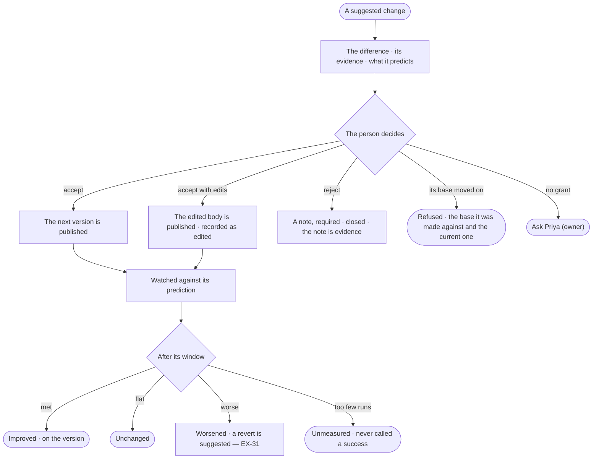

# EX-32 · Accept, edit or reject a suggested change, then see if it helped

**As** the person responsible for the setup **I want** suggested changes to wait for my decision with their evidence,
and then to see whether each accepted one did what it predicted **so that** improving the setup is a review, not a
project, and nothing changes without me.

Tasks: [task.md](task.md) · Feature: [EX-F07](../../feature.md)

## Who can

| Lens | Can | Otherwise sees |
|---|---|---|
| Admin | Accept, accept with edits, or reject with a note any suggested change; read each version's outcome | — |
| Operator | Read the suggested change and each version's outcome | The three acts disabled — *Ask Priya (owner)*. With *Can build agents*: decide those on skills, plans, agents and answer templates; with *Can shape the model*: on rules; with *Can work on projects*: on criteria |

## Flow

## Acceptance criteria

| # | Given | When | Then |
|---|---|---|---|
| EX-32.1 | A suggested change and the grant its target needs | the person accepts | the next version of the target is published; runs that used the earlier version still open it |
| EX-32.2 | A suggested change | the person edits the body and accepts | the edited body is published, recorded as edited by that person |
| EX-32.3 | A suggested change | the person rejects it | a note is required; it closes, and the note is kept as evidence |
| EX-32.4 | A suggested change made against an older version than the current one | the person accepts | it is refused, showing the version it was made against and the current one |
| EX-32.5 | An accepted change | its window passes | the outcome is written on the version — improved · unchanged · worsened — against what it predicted |
| EX-32.6 | An accepted change with too few runs in its window | the window passes | it is marked unmeasured, never improved |
| EX-32.7 | A worsened outcome | it is written | a revert opens as an ordinary suggested change; nothing rolls back by itself |
| EX-32.8 | A target's versions | the person opens its history | each version shows what suggested it, who decided, and how it fared |
| EX-32.9 | The same kind of suggestion rejected repeatedly | the person reads Evidence | the repeated rejections and their notes are visible |
| EX-32.10 | Several suggested changes selected | the person looks for an act on all | there is none: each is decided on its own |
| EX-32.11 | A decision | it is made | Inbox › History records who decided, when, and the note |
| EX-32.13 | A suggested change to the semantic model | a person with *Can shape the model* accepts it | it becomes a draft of the model, published through the model's own review (SE-F02); nothing changes the model from Explore |
| EX-32.14 | A published semantic change | its window passes | the outcome reads the engine's stored answer accuracy and latency for that window before and after it — improved · unchanged · worsened · unmeasured |
| EX-32.15 | An index suggestion | anyone but an Admin accepts it | it is refused, naming the Admin |
| EX-32.12 | An Operator without the grant its target needs | they open a suggested change | accept, edit and reject are disabled — *Ask Priya (owner)* |

## Screens

| Surface | Lens | First use | Empty after a filter | Loading | Has data | Failed | Agent working or proposing | No access |
|---|---|---|---|---|---|---|---|---|
| Deciding a suggested change | Admin | inbox · Nothing suggested | — | inbox · Publishing | inbox · Suggested change | inbox · Stale base | — | — |
| Deciding a suggested change | Operator | inbox · Nothing suggested | — | inbox · Loading | inbox · Suggested change | inbox · Stale base | — | inbox · Suggested change, read only |
| The version's outcome | Admin | agents.skill · History, no outcomes | — | agents.skill · Watching | agents.skill · History | agents.skill · Worsened | agents.skill · Revert suggested | — |
| The version's outcome | Operator | agents.skill · History, no outcomes | — | agents.skill · Watching | agents.skill · History | agents.skill · Worsened | agents.skill · Revert suggested | agents.skill · Read only |
