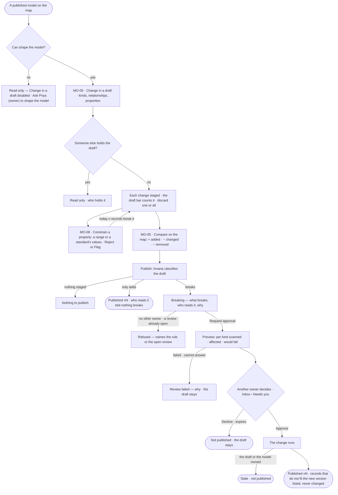
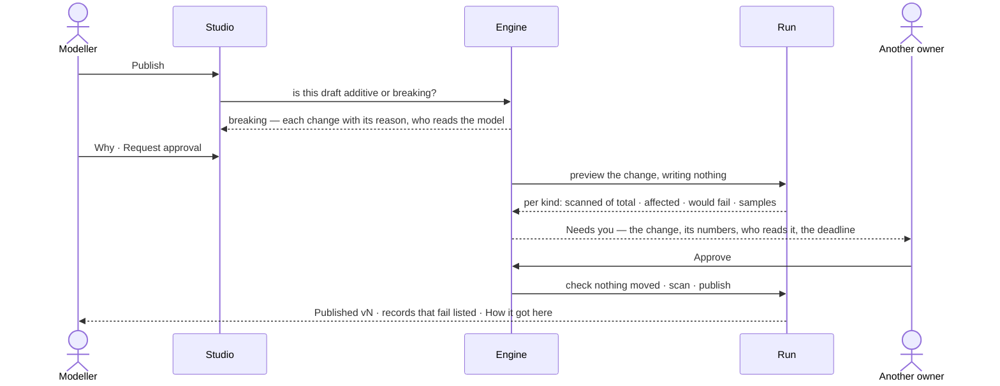

# Change and publish a model

> Every change to a model gathers in a draft, is compared on the map, and is published in one act. Invana says before
> publishing whether the change only adds or breaks what is already in the graph, who reads the model, and how many
> records a breaking change touches — and a breaking change waits for another owner's yes. The decision it helps
> make: *is this change safe to publish?*

## User journey

Journeys this feature is a step of: [J01 · From an empty install to a first answer](../../../../journeys/J01-from-an-empty-install-to-a-first-answer.md)

## Stories

| ID | Story | Status |
|---|---|---|
| MO-05 | [Change a model and publish it](stories/MO-05-change-a-model-and-publish-it/story.md) | idea |
| MO-08 | [Constrain a property's values](stories/MO-08-constrain-a-propertys-values/story.md) | idea |

## Access

| Act | Role (`.claude/team/TEAM.md` §7) | Everyone else sees |
|---|---|---|
| Read a model, its draft, its comparison and its reviews | Operator — every member | — |
| Change in a draft · stage, discard · constrain a property | `modeller` · shown as *Can shape the model* | *Change in a draft* disabled — *Ask Priya (owner) to shape the model* |
| Publish a draft that only adds · request approval for a breaking one | `modeller` · shown as *Can shape the model* | *Publish* hidden; the draft reads |
| Approve or decline a breaking publish | `owner`, other than the person who asked | Not asked; the review reads *waiting on approval* |

## States

| State | What the person sees |
|---|---|
| First use | A published model with no draft: *Change in a draft*; a draft with nothing staged: *Publish* disabled with *Nothing to publish* |
| Empty after a filter | — |
| Loading | The draft bar counts while changes save; the publish confirm reads *Checking what this changes…*; a review reads *previewing* with its run |
| Has data | The draft on its canvas, changed kinds chipped, the draft bar `n staged · Discard · Publish vN` |
| Failed | A refused change says why where it was made; a failed preview says why and keeps the draft; a stale review says what moved |
| Agent working or proposing | An agent's changes arrive staged on the same draft as a person's; the preview run scanning records |
| No access | The model and its draft read; every change disabled with *Ask Priya (owner) to shape the model* |

## Rules

| Rule | Detail |
|---|---|
| Everything stages | Adding, changing and deleting kinds, relationships, properties and constraints join one draft; nothing reaches a version until it is published |
| One draft, one writer at a time | The draft is kept by Invana, survives a reload and is seen by everyone; while one person holds it, others read it |
| An agent stages like a person | A run's changes join the same draft and the same publish |
| A published version never changes | Changing it publishes the next version; answers and loads that used the old one still resolve to it |
| Breaking, change by change | A draft breaks when any one change does: a kind removed · a property removed · a property's type changed · a property narrowed (list to single, list to set, a unique or exists constraint, a range or a standard's values added or changed) · a relationship's ends narrowed · its multiplicity changed · a key added, removed or changed · a kind's validation, parent or abstract flag changed. Adding, widening, removing a constraint that is not a key, an index or a description only adds |
| A model never published only adds | There is nothing in the graph it can break |
| One way past a breaking change | A review: a preview that writes nothing, another owner's yes, then the change runs. Nothing bypasses it |
| Counts are of what was read | The preview reads at most 1,000 records a kind and says so — *first 1,000 of 52,310* — never extrapolating |
| Data is never rewritten | Publishing changes what the model says; records that do not fit the new version are listed, never changed or deleted |
| Who reads it | The datasets added to this graph that load a touched kind, and the links between models on it. Runs do not pin a model version, so a run is not a reader |
| A constraint is one property on one kind | A range with a unit, or one standard's values; Reject or Flag for review. Checked by one check wherever a record lands — every load and every edit on a board |
| Leans on | MO-F01 — the draft · MO-F03 — links that read a model · Data — the datasets that load it and the standards it names · Inbox — the approval |

## Data touched

| Record | Read or write |
|---|---|
| Model draft — its staged changes, who holds it | Read · write |
| Model versions and the comparison between two | Read · write on publish |
| Publish review — classification, changes, preview, why, requester, approval, runs, status | Read · write |
| Approval in Inbox › Needs you — the impact list, frozen when the preview settles | Write |
| Constraint on a property — range and unit, or the standard version and term, and what happens on a break | Read · write |
| Standards and their values | Read |
| Graph records | Read — counted by the preview and by *today n break it* |

## Decisions

| Decision | Detail |
|---|---|
| The canvas draws; the draft bar writes | Adding a kind, adding a relationship and deleting are acts on the bar over the canvas and the kind's form, never canvas gestures |
| A delete stages | Its confirm says *gone when you publish*, naming what depends on it before, not after |
| Staged first | In every list, staged rows sort first with a *staged* chip |
| Publish asks first | *Publish* reads whether the draft adds or breaks before its confirm opens. Adding: the changes, what the database is asked to hold, *Who reads it* and *None of them break*, then *Publish vN*. Breaking: *— breaking*, a banner naming each breaking change and its reason, who reads it, a *Why* field and *Request approval* |
| The review in the confirm | After the request the confirm reads *previewing* with its run, then per kind *scanned of total · affected · would fail*, then *waiting on approval* linked to Inbox › Needs you. A refusal shows the engine's sentence |
| Approvers | Every owner but the requester, unless the request names some; with none, it is refused before anything opens. The deadline is 72 hours by default — a reminder at half time, *expired, not published* at the end |
| Publish exactly what was approved, or nothing | If the draft or the published version moved after the request, the review is *stale* and nothing publishes |
| One open review a model | A second request while one is previewing, waiting or running is refused, naming it |
| Compare is any two versions, on the map | The Comparing bar: *from* → *to* among a model's versions and its draft, `+ n added · ~ n changed · − n removed`, *Review and publish* while *to* is the draft. Each changed kind wears one chip of its lines, toned by its strongest sign; an added kind is a dashed ghost, a removed one keeps its place |
| A standard's values are copied when the constraint is saved | A newer standard version reaches the model only when the constraint is saved again |
| Reject is the default | Flag lets the record land and lists it in the load's report and in the constraint's count |
| *Today n records break it* is counted by the engine | Before saving, with up to five named; nothing written. A database it cannot count on says so, and the constraint still saves |

## Open questions

| Question | Who answers |
|---|---|
| — | — |

## Not building

| Item | Why not |
|---|---|
| Writing from a canvas gesture — drag to connect, add on the canvas, a context menu | The canvas draws; the bar and the form write |
| Layout saved per kind · auto-layout that rewrites an arranged model | Layout is a view, not part of the model |
| Live co-editing of a draft | One writer, with who holds it visible, is honest at this scale |
| Rewriting or deleting records to fit a new version | Data is loaded against a version, not rewritten by one |
| Withdrawing a review | Decline it, or change the draft — it goes stale |
| Extrapolated counts | A number nobody read is a guess |
| A rule loosened as a breaking publish | Rules are not part of a model version (MO-F05) |
| Unit conversion | The unit is a label; values compare as written |
| Pattern, length and allowed-list constraints in the dialog | The dialog authors a range or a standard's values; the others read on the kind's mappings |
| Constraints from SHACL | Later |
| Authoring a standard in Model | Data owns standards |
| Counting breaks on a Gremlin database | The count says it cannot count there |
