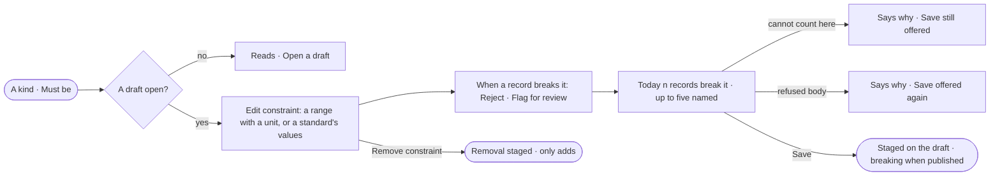

# MO-08 · Constrain a property's values

**As** a modeller **I want** a range on a property, or values named by a standard, and to say what happens to a record
that breaks it **so that** impossible values never land, and I know how many records break it before I save it.

Tasks: [task.md](task.md) · Feature: [MO-F02](../../feature.md)

## Who can

| Lens | Can | Otherwise sees |
|---|---|---|
| Admin | Add, change and remove a property's constraint in a draft, and see what breaks it today | — |
| Operator | Read each property's constraint on the kind | No edit act on a property — *Ask Priya (owner) to shape the model*. With *Can shape the model*: as Admin |

## Flow

## Acceptance criteria

| # | Given | When | Then |
|---|---|---|---|
| MO-08.1 | A kind open | anyone reads its properties | each shows its constraint under *Must be* — a range with its unit, or a standard's term with its first three values and `+n` — and where it comes from |
| MO-08.2 | An open draft | the person edits a number property's constraint | they set a minimum, a maximum or both, and a unit label |
| MO-08.3 | An open draft | the person picks *Or use a standard* | they pick one term of a standard that has values; the range empties, and typing a minimum or maximum sets the standard back to none |
| MO-08.4 | A constraint being edited | the person picks *When a record breaks it* | Reject is chosen by default; Flag for review lets the record land and lists it |
| MO-08.5 | A constraint being edited | it changes | *Today n records break it* is counted against the graph, naming up to five records and their values; while counting it reads *Counting the records that break it…* and Save stays enabled |
| MO-08.6 | A database the count cannot run on, or not connected | the constraint is edited | the line says why, and the constraint still saves |
| MO-08.7 | A range on a text property, a minimum above the maximum, or a term with no values | the person saves | the reason shows in the dialog in place of the count; nothing is staged |
| MO-08.8 | No standard has a term with values | the person opens *Or use a standard* | it reads *No standard has a term with values* and is disabled |
| MO-08.9 | A saved constraint | it is staged | it joins the draft with a *staged* chip on its row, and publishing it is breaking — previewed with the records that would fail (MO-05) |
| MO-08.10 | A property with a constraint | the person picks *Remove constraint* | the removal is staged and only adds when published |
| MO-08.11 | A published constraint set to Reject | a load or an edit on a board writes a value outside it | the record is refused with `<Kind>.<property> breaks its constraint <label>: <value>` |
| MO-08.12 | A published constraint set to Flag for review | such a value is written | the record lands and is listed as flagged in the load's report and in the constraint's count |
| MO-08.13 | A record with no value for the property | it is checked | it does not break the constraint — a key says whether a value is required |
| MO-08.14 | A constraint naming a standard | a newer standard version is published | the constraint keeps the values it copied until someone saves it again |
| MO-08.15 | No draft open | the person reads the kind | the constraints read with no edit act, and *Open a draft* is offered |
| MO-08.16 | An Operator without *Can shape the model* | they open a kind | the constraints read; there is no edit act, and *Change in a draft* is disabled with *Ask Priya (owner) to shape the model* |

## Screens

| Surface | Lens | First use | Empty after a filter | Loading | Has data | Failed | Agent working or proposing | No access |
|---|---|---|---|---|---|---|---|---|
| A kind · Must be | Admin | model.board.kind · No constraints | — | — | model.board.kind | — | — | — |
| A kind · Must be | Operator | model.board.kind · No constraints | — | — | model.board.kind · Read only | — | — | model.board.kind · Read only |
| The constraint | Admin | model.board.draft · Constraint | — | model.board.draft · Constraint counting | model.board.draft · Constraint breaks today | model.board.draft · Constraint refused | — | — |
| The constraint | Operator | — | — | — | — | — | — | — |
