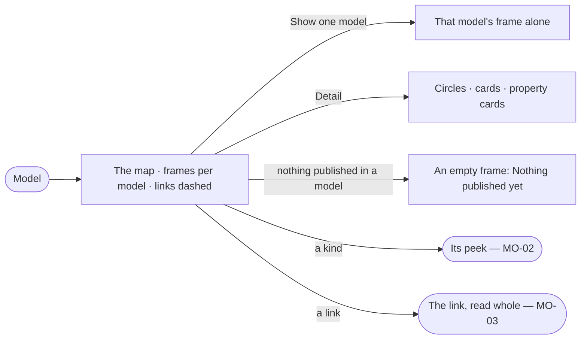

# MO-01 · See every model on one map

**As** a modeller **I want** every published model on one canvas, with the links between them dashed **so that** I
see the whole of what people and agents ask against.

Tasks: [task.md](task.md) · Feature: [MO-F03](../../feature.md)

## Who can

| Lens | Can | Otherwise sees |
|---|---|---|
| Admin | Read the map, pick what it shows and its detail, and start a link or a new model from it | — |
| Operator | Read the map, pick what it shows and its detail | *Link models* and *New model* disabled — *Ask Priya (owner) to shape the model*. With *Can shape the model*: as Admin |

## Flow

## Acceptance criteria

| # | Given | When | Then |
|---|---|---|---|
| MO-01.1 | A Graph with published models | the person opens Model | the map shows every published model as a frame in its own hue with its kinds inside, laid out and framed before it first shows |
| MO-01.2 | Links between models | the map draws | each link is a dashed line crossing between frames; a model's own relationships are solid and stay inside its frame |
| MO-01.3 | The map | the person picks *Show* | it draws all models or the one picked |
| MO-01.4 | The map | the person picks *Detail* | kinds draw as circles, cards or property cards, re-laid out with room for what is drawn |
| MO-01.5 | A model with nothing published | the map draws | it is an empty frame reading *Nothing published yet* |
| MO-01.6 | The map | it shows | the footer reads `n models · n kinds · n links between models`; while links load it reads `—`, never `0` |
| MO-01.7 | Staged links, or links bound to an older version | the map shows | each set sits on a bar above the canvas with its acts; no count is drawn on the canvas |
| MO-01.8 | The map | the person hovers a kind or a link | a kind shows its properties and a link its rule |
| MO-01.9 | The dark theme | the map draws | frames, hues and titles follow the theme |
| MO-01.10 | A Graph with no model | the person opens Model | the map says *No model yet* with *New model* |
| MO-01.11 | An Operator without *Can shape the model* | they open the map | it reads in full; *Link models* and *New model* are disabled with *Ask Priya (owner) to shape the model* |

## Screens

| Surface | Lens | First use | Empty after a filter | Loading | Has data | Failed | Agent working or proposing | No access |
|---|---|---|---|---|---|---|---|---|
| The map | Admin | model.board · No model yet | model.board · One model | model.board · Laying out | model.board | model.board · Could not load | — | — |
| The map | Operator | model.board · No model yet | model.board · One model | model.board · Laying out | model.board · Read only | model.board · Could not load | — | model.board · Read only |
