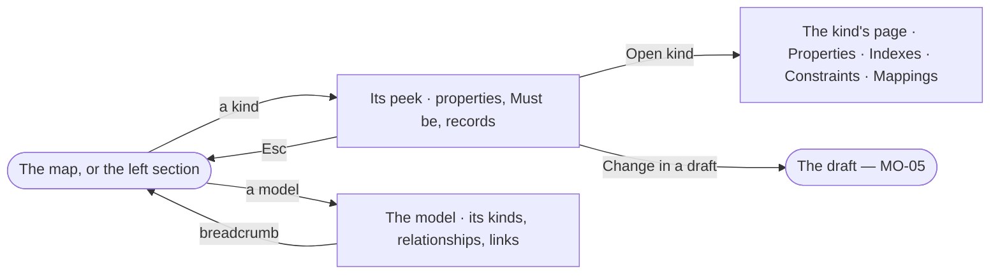

# MO-02 · Open a model and a kind

**As** a modeller **I want** to go from the map into one model and one kind **so that** I read any part of the model
in detail — its properties, records, key and constraints.

Tasks: [task.md](task.md) · Feature: [MO-F03](../../feature.md)

## Who can

| Lens | Can | Otherwise sees |
|---|---|---|
| Admin | Open a model and a kind, and from a kind change it in a draft | — |
| Operator | Open a model and a kind and read them | *Change in a draft* disabled — *Ask Priya (owner) to shape the model*. With *Can shape the model*: as Admin |

## Flow

## Acceptance criteria

| # | Given | When | Then |
|---|---|---|---|
| MO-02.1 | The map | the person clicks a kind, or picks it in the left section | a peek opens beside it: the kind, its model and record count, its description, and each property with its type and *Must be*; the left section marks it and the footer reads *<kind> selected · Esc to close* |
| MO-02.2 | A kind's peek | the person picks *Open <kind>* | the kind opens as a page of its model, breadcrumb `Model › <model> › <kind>`, with its records and key and tabs Properties · Indexes · Constraints · Mappings, each with its count |
| MO-02.3 | A model in the left section | the person picks it | the model opens with its kinds of node, its relationships and the links touching it from either side, each with its count; an empty list says what would go there |
| MO-02.4 | A kind's peek with constraints that records break | it shows | it names how many records break each, and whether new ones are rejected |
| MO-02.5 | A kind | the person presses Esc or picks the breadcrumb | they are back on the map as they left it |
| MO-02.6 | A model with a draft | its kind opens | the page shows the draft's chip and, with *Can shape the model*, *Add property* |
| MO-02.7 | An Operator without *Can shape the model* | they open a kind | it reads; *Change in a draft* is disabled with *Ask Priya (owner) to shape the model* |

## Screens

| Surface | Lens | First use | Empty after a filter | Loading | Has data | Failed | Agent working or proposing | No access |
|---|---|---|---|---|---|---|---|---|
| A kind | Admin | model.board.kind · No properties | — | model.board.kind · Loading | model.board.kind | model.board.kind · Could not load | — | — |
| A kind | Operator | model.board.kind · No properties | — | model.board.kind · Loading | model.board.kind · Read only | model.board.kind · Could not load | — | model.board.kind · Read only |
| A model | Admin | model.board · Model with nothing yet | — | model.board · Loading | model.board · One model | model.board · Could not load | — | — |
| A model | Operator | model.board · Model with nothing yet | — | model.board · Loading | model.board · One model | model.board · Could not load | — | model.board · Read only |
