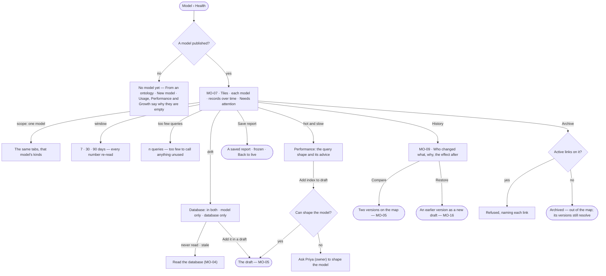

# Model health and history

> Whether each model is used, how fast it answers, how its data grows and where it has drifted from the database —
> beside who changed it, why, and what the change did after. The decision it helps make: *which model do I fix,
> index, retire or roll back?*

## User journey

## Stories

| ID | Story | Status |
|---|---|---|
| MO-07 | [See each model's health](stories/MO-07-see-each-models-health/story.md) | idea |
| MO-09 | [Read a model's history](stories/MO-09-read-a-models-history/story.md) | idea |

## Access

| Act | Role (`.claude/team/TEAM.md` §7) | Everyone else sees |
|---|---|---|
| Read health — Overview, Database, Usage, Performance, Growth — and history | Operator — every member | — |
| Save a report · open saved reports | Operator — every member | — |
| Read the database · *Add it in a draft* · *Add index to draft* | `modeller` · shown as *Can shape the model* | Absent; the reading stays — *Ask Priya (owner) to shape the model* on the drift and advice rows |
| Archive, restore or delete a model | `modeller` · shown as *Can shape the model* | Absent from the model's `⋯` |

## States

| State | What the person sees |
|---|---|
| First use | No published model: Overview says so with *From an ontology* and *New model*; Usage, Performance and Growth say why they are empty. Published but nothing loaded: Growth and Usage name the model and *Bring data in* — no charts of zeros |
| Empty after a filter | A scope or window with nothing in it: *Nothing in the last 7 days for Routes* · *30 days* |
| Loading | Tiles and tables hold their shape; scope and window stay live |
| Has data | Tiles, each model or kind as a row with its signals, records over time, Needs attention, history |
| Failed | A reading that cannot load says which and why; a reading the engine does not measure yet reads *Not measured yet*, naming what it reads from; a database that cannot list indexes says so |
| Agent working or proposing | — |
| No access | Every reading shows; acts that change a model are absent |

## Rules

| Rule | Detail |
|---|---|
| One page, the model a filter | Overview · Database · Usage · Performance · Growth, read for all models or one; changing scope keeps the tab. History opens from *Versions* |
| One window | 7 · 30 · 90 days, read by every number on the page; Database ignores it and says so |
| Signals are fixed rules, not a score | *Unused* — records and no query touched it. *Empty* — published, no records. *Cold property* — never filtered, returned or ordered on, where the database can explain a query. *Hot* — touched by a quarter of the window's queries. *Hot and slow* — hot, with p95 at or above the Graph's. *Supernode* — a kind whose most connected record has at least a hundred times the median and at least 1,000. Nothing is called with fewer than 50 queries in the window |
| Every use is split by who called | Agent · plan · Explore · API, read off the run, never guessed from the query |
| Queries are grouped by shape | A query with its values taken out; a thousand calls of one generated query are one row, with p50 · p95 · rows · callers |
| Drift is matched by what a row covers | A kind, relationship, index or constraint is *in both*, *model only* or *database only* by what it covers, never by its name |
| Growth moves only when something writes | Records are counted after every read of the database, load and link commit, each mark naming the run that wrote; never sampled on a timer |
| Advice is a draft change, never a write | A missing index is offered as *Add index to draft*; the next publish adds it |
| Archive, not delete | A published model is archived — out of the map, its versions still resolve for every answer and load that used them; only a never-published model is deleted. A model with active links cannot be archived |
| The engine counts every number | Studio formats; history's effect after is stored when the version publishes and never recomputed |
| Leans on | MO-F01 — reading the database · MO-F02 — the draft, the comparison, the review · MO-F03 — links · Data — datasets that load a model · Agents › Runs — each run a number links to |

## Data touched

| Record | Read or write |
|---|---|
| Model versions and what each changed | Read |
| What the database holds and when it was read | Read |
| Record counts per kind, written by every act that writes data | Read |
| Query log — shape, caller, timing, rows, kinds touched | Read |
| Saved report — the tab, its scope and window, frozen | Read · write |
| A version's effect after — each dataset it touched and the records failing | Read |
| Model status — active, archived | Write |

## Decisions

| Decision | Detail |
|---|---|
| Health is a tab of the map | Map · Health · History; Health's tiles read *Models in use · Unused kinds · Slowest kind · Records*, then each model with its health, use, p95 and growth, records over time, and History beside them |
| Needs attention is capped | Six rows, then `+n more` counted by the engine; a model's signal shows three and `+n` |
| Drift says what to do | A model-only or database-only row names the next act — *Add it in a draft* or *Read the database*; a read older than the last load turns to the warning tone |
| A saved report is the tab, frozen | *Save report* keeps the tab's tiles and tables at its scope and window; it reopens reading *Saved report · <what> · kept by <who> on <date> · it will not change* with *Back to live* |
| History reads effect after | Each version: when · by · what changed · why · effect after — *1 dataset now warns · 6 rows* or *2 datasets hold*, else the runs and tokens while it was published. *Compare vA and vB* and each row's *Compare* open the map's Comparing bar |
| All models, all history | At all models, History lists every model's versions with a model column, newest first |

## Open questions

| Question | Who answers |
|---|---|
| — | — |

## Not building

| Item | Why not |
|---|---|
| A health score | Signals are fixed rules a person can argue with |
| Running an index from the page | Advice lands in a draft; publishing adds it |
| Numbers from telemetry | The query log is Invana's own, so the page works with telemetry off |
| Recomputing a past version's effect | What a publish affected is stored when it publishes |
