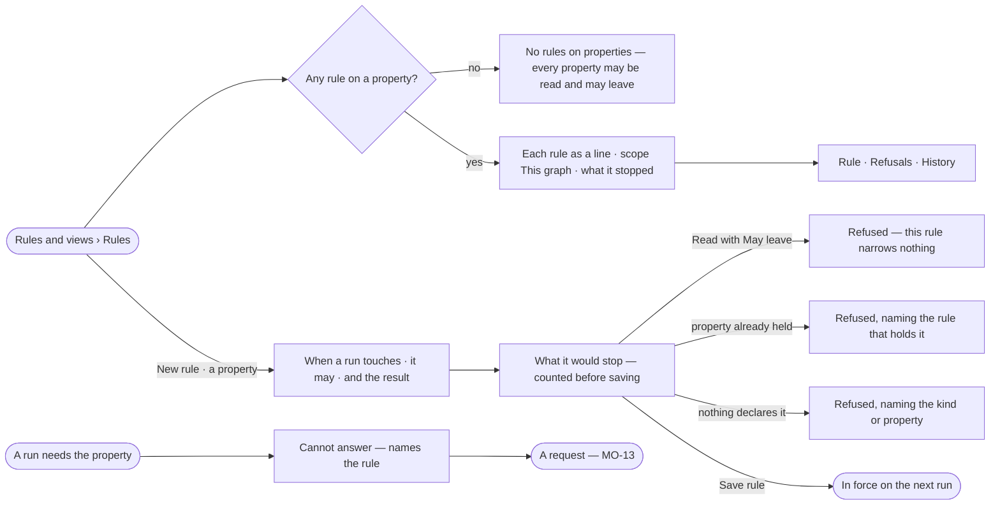

# MO-11 · Keep protected data protected

**As** a modeller accountable for what this Graph does with its data **I want** one rule per protected property,
always in force, saying what a run may do with it **so that** protected data stays protected and I can hand the list
to an auditor.

Tasks: [task.md](task.md) · Feature: [MO-F05](../../feature.md)

## Who can

| Lens | Can | Otherwise sees |
|---|---|---|
| Admin | Read every rule on a property, its refusals and history; create, edit and delete one | — |
| Operator | Read every rule on a property, its refusals and history | *New rule*, *Edit rule* and *Delete* absent, not disabled; one line names who may edit. With *Can shape the model*: as Admin |

## Flow

## Acceptance criteria

| # | Given | When | Then |
|---|---|---|---|
| MO-11.1 | A Graph with no rule on a property | the person opens Rules | the list reads *No rules on properties — every property may be read and may leave* |
| MO-11.2 | A person with *Can shape the model* | they pick *New rule* and *A property* | the dialog offers *When a run touches* (a pick over the published kinds' properties, either side may be *any*) · *It may* Read · Read in counts only · Never read · *And the result* May leave · Stays in the Graph |
| MO-11.3 | The dialog with a target chosen | it changes | the engine counts the views and schedules that read the property today and shows it before saving; *Save rule* waits while it reads *Counting…* |
| MO-11.4 | *Read* with *May leave* | the rule is saved | it is refused: *this rule narrows nothing* |
| MO-11.5 | A property another rule already holds | the rule is saved | it is refused naming that rule |
| MO-11.6 | A saved rule | it lists | its name is made from the rule — `Deal.price never leaves` · `*.email never read` · `Deal.price in counts only` — its scope reads *This graph*, and it shows what it stopped this week |
| MO-11.7 | `Deal.price` *Read in counts only* | a run sums or counts it | the result returns; a query returning the value itself is refused |
| MO-11.8 | `Deal.price` *Stays in the Graph* | a run calls an AI model or an outside service | no record value crosses in that run |
| MO-11.9 | A run that needs `Deal.price` held by *Never read* | it is asked | it ends *cannot answer*, naming the rule, and a request is filed (MO-13) |
| MO-11.10 | A rule on a property | the person opens it | it shows *Rule* (the kinds carrying the property, the rule as a sentence, the views it is allowed in, refused this week — who · where · when) · *Refusals* (every request it filed) · *History* (its events, before and after) |
| MO-11.11 | A run in progress | the rule is edited | that run keeps what it was frozen with; the next run gets the new rule |
| MO-11.12 | A rule allowed in a view | that view is deleted | the view leaves the rule's exceptions; the rule binds everywhere else unchanged |
| MO-11.13 | A refused run | the person opens *How it got here* | the step names the rule and the property it refused |
| MO-11.14 | An Operator without *Can shape the model* | they open a rule on a property | it reads; *New rule*, *Edit rule* and *Delete* are absent and a line says the rules are edited by people who can shape the model |

## Screens

| Surface | Lens | First use | Empty after a filter | Loading | Has data | Failed | Agent working or proposing | No access |
|---|---|---|---|---|---|---|---|---|
| Rules | Admin | model.rules · No rules on properties | model.rules · Rules filter empty | model.rules · Loading | model.rules | model.rules · Could not load | — | — |
| Rules | Operator | model.rules · No rules on properties | model.rules · Rules filter empty | model.rules · Loading | model.rules | model.rules · Could not load | — | model.rules · Rules read only |
| A rule on a property | Admin | model.rules · Property rule never refused | — | model.rules · Property rule loading | model.rules · Property rule | model.rules · Could not load | — | — |
| A rule on a property | Operator | model.rules · Property rule never refused | — | model.rules · Property rule loading | model.rules · Property rule | model.rules · Could not load | — | model.rules · Property rule read only |
| New rule on a property | Admin | model.rules · New property rule | — | model.rules · Property rule counting | model.rules · Property rule impact | model.rules · Property rule refused | — | — |
| New rule on a property | Operator | — | — | — | — | — | — | model.rules · Rules read only |
