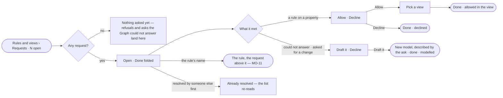

# MO-13 · Act on what people and agents ask of the model

**As** a modeller **I want** one list of what analysts and agents asked to see or have modelled **so that** gaps get
fixed, not lost.

Tasks: [task.md](task.md) · Feature: [MO-F05](../../feature.md)

## Who can

| Lens | Can | Otherwise sees |
|---|---|---|
| Admin | Read every request; *Allow*, *Draft it* or *Decline* one | — |
| Operator | Read every request; file one with *Ask for a change* | Rows without *Allow*, *Draft it* or *Decline*. With *Can shape the model*: as Admin |

## Flow

## Acceptance criteria

| # | Given | When | Then |
|---|---|---|---|
| MO-13.1 | Nothing asked | the person opens Requests | it reads *Nothing asked yet — refusals and asks the Graph could not answer land here* |
| MO-13.2 | Open requests | Rules and views opens | its head shows the open count, as counted by the engine |
| MO-13.3 | Requests | the person opens Requests | Open lists first and Done folded; a row is the ask over who · from where · what it met (the rule, or *the Graph could not answer*) · how many times asked · when |
| MO-13.4 | A run refused by a rule on a property, or ending *cannot answer · outside this graph*, asked by a person or an agent | it settles | a request is filed by the engine; an eval or a test files none |
| MO-13.5 | The same open ask by the same person or agent | it is asked again | it adds to the one request's count and last asked, never a second row |
| MO-13.6 | A person in Explore | they pick *Ask for a change* | a request is filed with their words |
| MO-13.7 | A request a rule on a property caused | a person with *Can shape the model* picks *Allow* and a view | the view joins the rule's exceptions and the row moves to Done reading *allowed in <view>* |
| MO-13.8 | Any other request | they pick *Draft it* | New model opens described by the ask; creating the draft moves the row to Done reading *modelled in <model>* |
| MO-13.9 | Any request | they pick *Decline* | the row moves to Done reading *declined* |
| MO-13.10 | A request whose rule was deleted | they pick *Allow* | it is refused: *its rule is gone* — decline it instead |
| MO-13.11 | A view deleted meanwhile | they allow in it | it is refused naming the view |
| MO-13.12 | A request resolved by someone else first | they act on it | it says *already resolved* and the list re-reads |
| MO-13.13 | A resolution | it is made | History records who resolved it, how and when |
| MO-13.14 | An Operator without *Can shape the model* | they open Requests | the rows read without *Allow*, *Draft it* or *Decline* |

## Screens

| Surface | Lens | First use | Empty after a filter | Loading | Has data | Failed | Agent working or proposing | No access |
|---|---|---|---|---|---|---|---|---|
| Requests | Admin | model.rules · No requests | — | model.rules · Requests loading | model.rules · Requests | model.rules · Request refused | — | — |
| Requests | Operator | model.rules · No requests | — | model.rules · Requests loading | model.rules · Requests | model.rules · Could not load | — | model.rules · Requests read only |
| Allow in a view | Admin | — | — | — | model.rules · Allow in a view | model.rules · Request refused | — | — |
| Allow in a view | Operator | — | — | — | — | — | — | model.rules · Requests read only |
| A rule from a request | Admin | — | — | model.rules · Property rule loading | model.rules · Property rule from a request | model.rules · Request refused | — | — |
| A rule from a request | Operator | — | — | model.rules · Property rule loading | model.rules · Property rule from a request | model.rules · Could not load | — | model.rules · Property rule read only |
