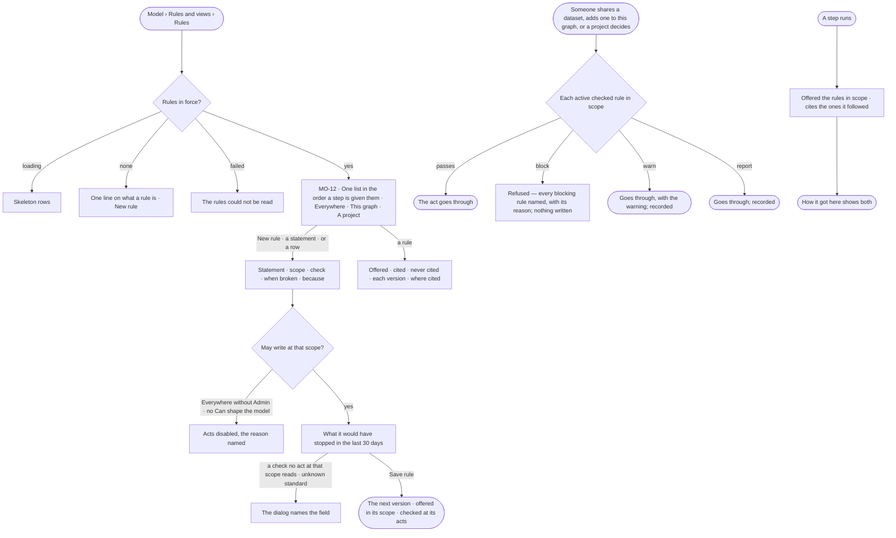

# Rules agents work by

> One statement that must always hold — everywhere on the install, in this Graph or in one project — offered to every
> step in its scope, and, when it carries a check, enforced at the acts the check names. The decision it helps make:
> *what must hold before data is shared or added, or a project decides — and what would this rule have stopped?*

## User journey

## Stories

| ID | Story | Status |
|---|---|---|
| MO-12 | [State what must always hold](stories/MO-12-state-what-must-always-hold/story.md) | idea |

## Access

| Act | Role (`.claude/team/TEAM.md` §7) | Everyone else sees |
|---|---|---|
| Read every rule in force and its evidence | Operator — every member | — |
| Create, edit, stop offering or offer again a rule on *This graph* or *A project* | `modeller` · shown as *Can shape the model* | Acts disabled, the reason named — *Ask Priya (owner) to shape the model* |
| Create, edit, stop offering or offer again a rule *Everywhere* | Admin — the install's | *Everywhere* disabled in the scope, the reason named; an *Everywhere* rule opens read-only |

## States

| State | What the person sees |
|---|---|
| First use | No rule in force: one line on what a rule is, and *New rule* |
| Empty after a filter | *No rules — Everywhere* · *checked on Dataset share*, with the filter to clear |
| Loading | Skeleton rows; the impact line reads *Counting…* while the dialog's check changes |
| Has data | One list in the order a step is given them, each row with scope · checked on · when broken · broken in 30 days; a rule not offered dimmed in place |
| Failed | *The rules could not be read*; a save the engine refused names the field |
| Agent working or proposing | — |
| No access | Every rule reads; acts are disabled with the reason |

## Rules

| Rule | Detail |
|---|---|
| One statement | A rule is one sentence; a long one is accepted, with a nudge that it reads better as two |
| Three scopes, fixed once saved | *Everywhere* — every Graph on the install, the install Admin's · *This graph* · *A project* |
| Inherited, in order | A step is given the *Everywhere* rules, then the Graph's, then its project's — each by itself, with its id, never run together. A project shows its Graph's and the install's above its own, read-only |
| Offered and cited | A step records the rules it was offered and the ones it says it followed; a citation is never enforcement |
| A check is picked, never written | A rule may carry one check from a fixed list, and the check names the acts it is read at — *Dataset share* · *Add to this graph* · *Project decision*. A rule with no check is offered only |
| The checks | *Dataset meets a standard* (the standard, a minimum score) — at share and add · *Dataset licence is one of* (the licences) — at share and add · *Evidence was reviewed by a person* — at a decision · *Evidence is not retracted* — at a decision. A project rule may carry only the two evidence checks |
| When broken | *Block* refuses the act, naming the rule · *Warn* lets it through and says so · *Report* records it only. A check with no mode warns |
| Every block in one refusal | An act reads every active checked rule in its scope before writing; a blocked act writes nothing, and the refusal names each blocking rule, its *because* and the reason |
| Because | One optional line said to whoever the rule stops |
| Versioned | Changing the statement, check, mode or *because* publishes the next version; a past run and a past check name the version they read |
| Stop offering, not delete | *Stop offering it* stops offering and checking; its versions and past citations stay, and *Offer it again* reverses it |
| Impact before saving | The engine reads the last 30 days of the check's acts back through it — the count read, the count broken and the newest five, each naming its act, subject, time and reason — worded *would have stopped* · *would have warned on* · *would have reported* |
| Broken in 30 days | Each row's count is the same read-back of its current check, done by the engine |
| A statement opens its rule | On a step and in *How it got here*, each rule is its statement — the version the step was given — and opens the rule's evidence; where no rule can open it reads as text |
| Leans on | MO-F05 — the same Rules list holds the rules on properties · Data — standards, sharing and adding a dataset · Projects — the decision, and a project's working rules on its Details · Agents › Runs — a step's offered and cited rules |

## Data touched

| Record | Read or write |
|---|---|
| Rule — scope, order, offered or not, its current version | Read · write |
| Rule version — statement, check, mode, because, when published | Read · write |
| Run step — the rules offered and the rules cited | Read |
| Acts of the last 30 days — dataset shares and adds, project decisions | Read |
| Events — create, publish, stop and resume offering, a failed warn or report | Write |

## Decisions

| Decision | Detail |
|---|---|
| One list of what must always hold | The Rules section lists every rule in force in the Graph — *Everywhere*, *This graph*, every project's the reader can see, and the rules on properties — filtered by scope and by what it is checked on, the filters held in the URL and applied by the engine |
| New rule asks what it holds | *A property* (what a run may read and send — MO-11) or *A statement* (offered to every step, and checked at acts when it carries a check) |
| The rule opens as a modal | Statement · scope · check and its fields · *Checked on* (read off the check, never picked) · *When broken* · *Because* · the impact line; footer *Stop offering it* or *Offer it again* · *Cancel* · *Save rule* |
| Evidence is a reading | Offered · cited · never cited, each version with its own cited count, and where each was cited; until the Graph has offers, the two derived tiles are absent rather than zero |
| Clicking a statement in *How it got here* | It closes and the rule's evidence opens in its place; the citation reopens it |
| A project's rules sit in its Details | The inherited rules first, dimmed and read-only, then the project's own — never a tab of their own (PJ-F01) |

## Open questions

| Question | Who answers |
|---|---|
| — | — |

## Not building

| Item | Why not |
|---|---|
| Rules a step must obey while it runs | A run is bounded by *What it may do* and its criteria; a check is read at acts, never mid-run |
| A free-text or scripted check | A check is a fixed list an auditor can read |
| A rule checked at a record write | One property's range or a standard's values is a constraint on the model (MO-08) |
| A rule checked at a finding | A finding is evidence, not an act; the decision citing it is where a rule reads it |
| Choosing the acts a check is read at | The check names its acts |
| An *Everywhere* rule's history and citations across Graphs | History and citations read one Graph |
| Detecting rules that contradict | Two rules in tension is a judgement, and *How it got here* shows which was used |
| Rules on an agent | An agent carries skills and bounds; rules describe the world |
