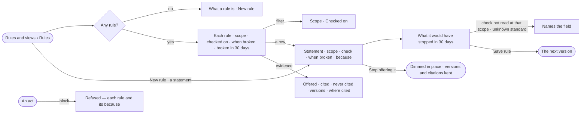

# MO-12 · State what must always hold

**As** a compliance lead **I want** rules everywhere on the install, in a Graph or in a project — offered to every
step and checked where they apply **so that** organisation and certification policy holds, and no agent has to be
told twice that prices are in rupees.

Tasks: [task.md](task.md) · Feature: [MO-F06](../../feature.md)

## Who can

| Lens | Can | Otherwise sees |
|---|---|---|
| Admin | Read every rule and its evidence; create, edit, stop offering and offer again rules at every scope — *Everywhere* only as the install's Admin | *Everywhere* disabled in the scope with its reason, for an owner who is not the install's Admin |
| Operator | Read every rule in force and its evidence | *New rule*, *Save rule* and *Stop offering it* disabled — *Ask Priya (owner) to shape the model*. With *Can shape the model*: as Admin on *This graph* and *A project* |

## Flow

## Acceptance criteria

| # | Given | When | Then |
|---|---|---|---|
| MO-12.1 | No rule in force | the person opens Rules | one line says what a rule is, with *New rule* |
| MO-12.2 | Rules in force | the person opens Rules | one list in the order a step is given them — *Everywhere*, then *This graph*, then each project's the reader can see — each row the statement over scope · checked on · when broken (a badge) · broken in 30 days, counted by the engine |
| MO-12.3 | The list | the person filters by *Scope* or *Checked on* | the engine returns the matching rules and the filter is kept in the URL; nothing matching names the filter and how to clear it |
| MO-12.4 | A person with *Can shape the model* | they pick *New rule* and *A statement* | the dialog offers statement · scope (*This graph* · *A project*, which picks the project) · check · *Checked on* read off the check · *When broken* Block · Warn · Report · *Because* |
| MO-12.5 | A long statement | it is typed | it is accepted, with a nudge that a rule reads better as one sentence |
| MO-12.6 | A check chosen | the dialog changes | the impact line shows what the rule would have stopped, warned on or reported in the last 30 days, with the newest five acts, each naming its subject, time and reason |
| MO-12.7 | A check no act at that scope reads, or a standard that does not exist | the rule is saved | the dialog names the field and nothing is saved |
| MO-12.8 | A saved rule | its statement, check, mode or *because* changes | it publishes the next version; runs and checks that read the earlier one still name it |
| MO-12.9 | An active *Block* rule *Dataset licence is one of* CC-BY | someone adds a dataset with another licence to this graph | the act is refused naming every blocking rule, its *because* and the reason, and nothing is written |
| MO-12.10 | A *Warn* rule that fails | the act happens | it goes through, says so, and History records the check |
| MO-12.11 | A *Report* rule that fails | the act happens | it goes through and History records the check |
| MO-12.12 | A rule | someone picks *Stop offering it* | it is dimmed in place, offered and checked nowhere, its versions and past citations kept; *Offer it again* reverses it |
| MO-12.13 | A step in the rule's scope | it runs | *How it got here* lists the rules it was offered, each as its statement, with the ones it cited marked |
| MO-12.14 | A statement in *How it got here* | the person clicks it | it closes and the rule's evidence opens: offered · cited · never cited, each version with its own cited count, and where each was cited |
| MO-12.15 | A Graph owner who is not the install's Admin | they set the scope | *Everywhere* is disabled with its reason, and an *Everywhere* rule opens read-only |
| MO-12.16 | An Operator without *Can shape the model* | they open a rule | it reads; *Save rule* and *Stop offering it* are disabled with *Ask Priya (owner) to shape the model* |

## Screens

| Surface | Lens | First use | Empty after a filter | Loading | Has data | Failed | Agent working or proposing | No access |
|---|---|---|---|---|---|---|---|---|
| Rules | Admin | model.rules · No rules | model.rules · Rules filter empty | model.rules · Loading | model.rules | model.rules · Could not load | — | — |
| Rules | Operator | model.rules · No rules | model.rules · Rules filter empty | model.rules · Loading | model.rules | model.rules · Could not load | — | model.rules · Rules read only |
| A rule | Admin | model.rules · New rule | — | model.rules · Rule counting | model.rules · Rule impact | model.rules · Rule refused | — | model.rules · Everywhere rule read only |
| A rule | Operator | — | — | model.rules · Rule counting | model.rules · Rule read only | model.rules · Could not load | — | model.rules · Rule read only |
| A rule's evidence | Admin | model.rules · Rule never offered | — | model.rules · Rule evidence loading | model.rules · Rule evidence | model.rules · Could not load | — | — |
| A rule's evidence | Operator | model.rules · Rule never offered | — | model.rules · Rule evidence loading | model.rules · Rule evidence | model.rules · Could not load | — | — |
