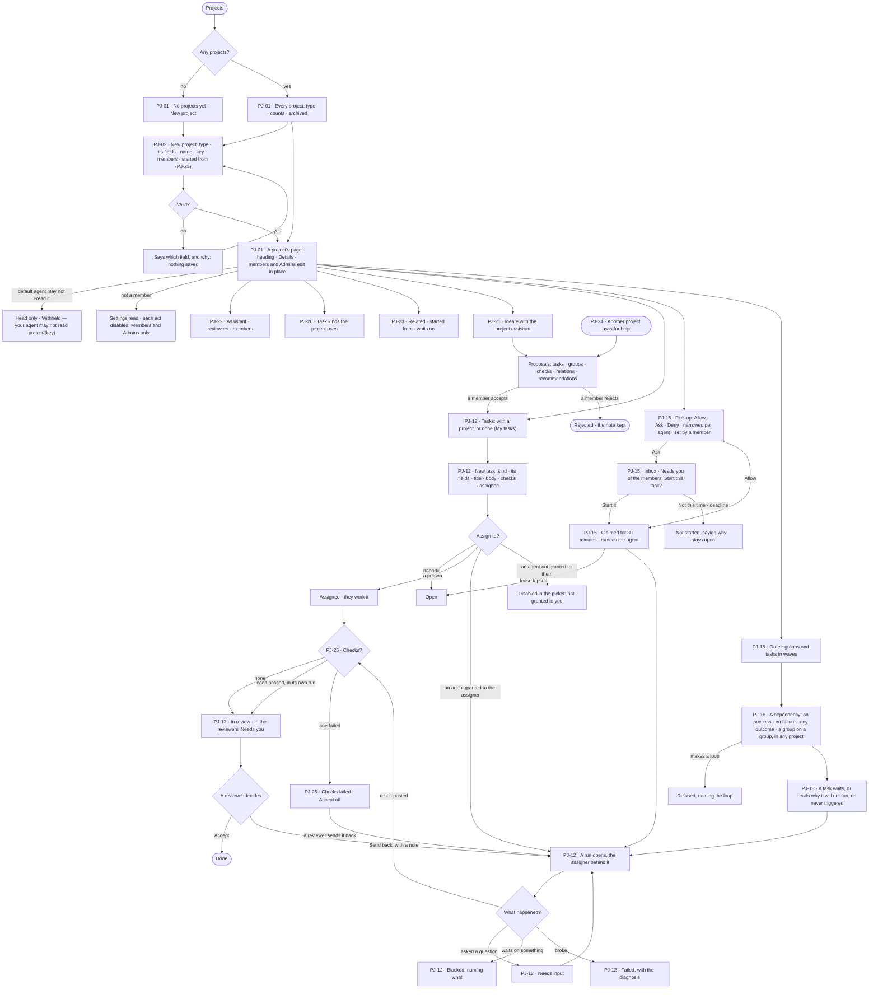
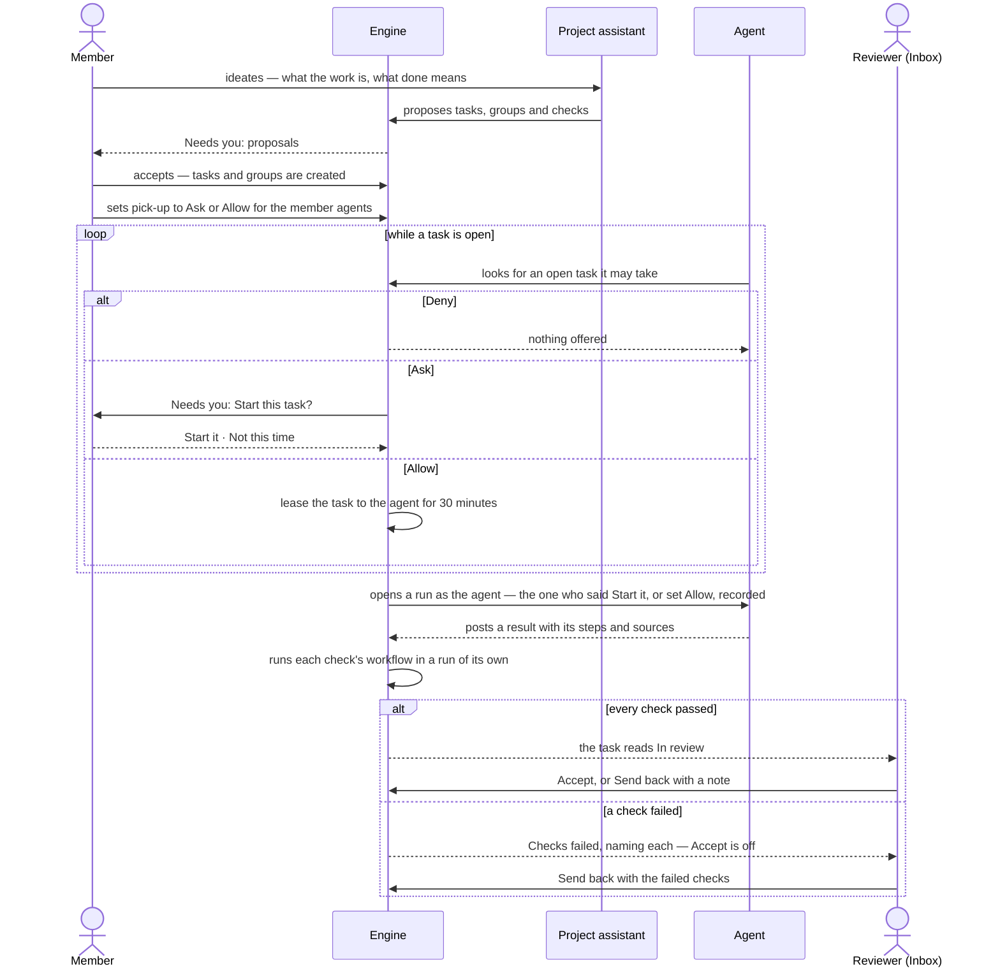

# Projects and tasks

> A project holds one piece of work of any kind, and a task is one piece of it that a person or an agent takes —
> written once, handed on, run, checked and accepted by a person. The decisions it helps make: *what should this
> project do next, who should take it, in what order, may an agent start it without me — and is this result really
> done?*

## User journey

Journeys this feature is a step of: [J03 · Give an agent work and decide on the result](../../../../journeys/J03-give-an-agent-work-and-decide-on-the-result.md) · [J11 · Ideate and run a project with its assistant](../../../../journeys/J11-ideate-and-run-a-project-with-its-assistant.md)

## Stories

| ID | Story | Status |
|---|---|---|
| PJ-01 | [See every project and open one](stories/PJ-01-see-every-project-and-open-one/story.md) | idea |
| PJ-02 | [Start a project of its type](stories/PJ-02-start-a-project-of-its-type/story.md) | idea |
| PJ-12 | [Write a task, hand it on and accept the result](stories/PJ-12-write-a-task-hand-it-on-and-accept-the-result/story.md) | idea |
| PJ-15 | [Let agents pick up tasks by hand, by asking or on their own](stories/PJ-15-let-agents-pick-up-tasks-by-hand-by-asking-or-on-their-own/story.md) | idea |
| PJ-18 | [Order tasks by what they wait on](stories/PJ-18-order-tasks-by-what-they-wait-on/story.md) | idea |
| PJ-20 | [Give a project its kinds of task](stories/PJ-20-give-a-project-its-kinds-of-task/story.md) | idea |
| PJ-21 | [Ideate with the project assistant](stories/PJ-21-ideate-with-the-project-assistant/story.md) | idea |
| PJ-22 | [Name the project assistant and its reviewers](stories/PJ-22-name-the-project-assistant-and-its-reviewers/story.md) | idea |
| PJ-23 | [Relate a project to another or start one from it](stories/PJ-23-relate-a-project-to-another-or-start-one-from-it/story.md) | idea |
| PJ-24 | [Ask another project for help](stories/PJ-24-ask-another-project-for-help/story.md) | idea |
| PJ-25 | [Gate a task on its checks](stories/PJ-25-gate-a-task-on-its-checks/story.md) | idea |

## Access

Who may do what is the [role table](../../../../os/access/features/AC-F02-access-policies/feature.md#the-role-table):
*Projects and tasks* is *Acts* for Operator, Modeller and Admin. A project grants nothing: what a person reads of it is
what their default agent may Read ([AC-F02 › Rules](../../../../os/access/features/AC-F02-access-policies/feature.md#rules)),
and what a run reaches is its agent's Access Policies within the run scope
([AC-F04](../../../../os/access/features/AC-F04-what-an-agent-may-touch/feature.md#rules)). Members, reviewers and
assignees are slots ([AC-F07](../../../../os/access/features/AC-F07-ownership/feature.md#slots-and-fallbacks)).

| Act | Role ([the role table](../../../../os/access/features/AC-F02-access-policies/feature.md#the-role-table)) | Everyone else sees |
|---|---|---|
| See a project's head — name, key, type, status, counts | Every signed-in person | — |
| Read a project, its tasks, its Order, its assistant's thread and its relations | A person whose default agent may Read `project/<key>` | The head only; the rest reads *Withheld — your agent may not read `project/{key}`* |
| Start a project | Operator · Modeller · Admin; the creator is its first member and first reviewer | — |
| Edit a project's name, purpose and fields; archive or unarchive it; add or take off members; name its assistant and reviewers; turn task kinds on or off; relate it; set its pick-up | Its members · Admins | Every setting reads; each act is disabled — *Members and Admins only* |
| Write a task, assign it to a person, start it, post a result, cancel it, add checks, draw or remove a dependency, make a group | A person who may read the project; a task with no project, anyone | An archived project's tasks read; each act is disabled, saying it is archived |
| Assign a task to an agent, name an agent as assistant or member, set *Allow* for an agent | A person the agent is granted to ([AC-F03](../../../../os/access/features/AC-F03-directory/feature.md)) | The agent is disabled in the picker — *Not granted to you* |
| Accept or reject a proposal of the project assistant · answer an agent's ask to start a task | Its members, people only — an answer to *Start it* names an agent granted to them | The proposal or ask reads, naming who it waits on |
| Accept or send back a task's result | Its reviewers — never an agent | The result reads; *Accept* and *Send back* are disabled — *Reviewers only* |
| Ask another project for help | A person who may read both projects · a run in the asking project | — |
| Read a task's run — its steps, sources and *How it got here* | As [AC-31](../../../../os/access/features/AC-F09-what-left-the-platform/stories/AC-31-keep-a-runs-content-to-those-who-may-read-it/story.md) says | That it ran, its status and its tokens; the steps read *Content withheld* |

## States

| State | What the person sees |
|---|---|
| First use | *No projects yet* with *New project*; in Tasks, *No tasks yet* with *New task*; on the Order tab, *No tasks to order yet*; the assistant's thread opens on *What is this project for?* |
| Empty after a filter | *Nothing matches* in Projects, *No tasks match* in Tasks — the filter named, with *Clear* |
| Loading | The list, page, Order or thread is drawn at once with its frame; rows and counts load in place |
| Has data | Projects with type, counts and badges; tasks with their kind, state, assignee, checks and what they wait on; the Order in groups and waves; related projects; open proposals |
| Failed | The list or page could not load, saying why, with *Try again*; a save refused names its field; a failed task names its diagnosis; a failed check names the check and its run; a loop is refused naming the tasks or groups in it |
| Agent working or proposing | A task *In progress* streams its steps to those who may read its run; a task *Checking* names the checks running; the project assistant's proposals wait for a member; an agent asking to start a task waits in the Inbox; a claimed task shows who holds it and until when |
| No access | A project the reader's default agent may not Read shows its head only — *Withheld — your agent may not read `project/{key}`*. A project's settings read to anyone not a member, each act disabled. A run the reader may not read shows that it ran, its status and its tokens — *Content withheld* |

## Rules

| Rule | Detail |
|---|---|
| Any kind of work | A project is a record of work: it never runs. Its type declares its fields — every type has a name and a purpose; Research, Investigation and Policy add a question — its task kinds, its words, default rules, suggested agents and skills, default checks and a report template |
| Flat projects | A project holds tasks, groups and branches; it has no sub-projects |
| A task is one piece of work | It has a kind, the kind's fields, a title, a body, a project or none, a group or none, an assignee, a due date, checks and an outcome. Its body says what done means |
| Task kinds | A type declares its kinds — each with its fields and default checks; every project has *Task* and *Recommendation*. Members turn the type's other kinds on or off for the project; a kind in use is never turned off. New task asks the kind first, and its fields follow (PJ-20) |
| A Recommendation is a task kind | A recommendation — from a person, an agent's run or another feature — lands as a proposal for the project assistant; a member who accepts it makes a task of kind *Recommendation*, worked like any task (PJ-21) |
| The project assistant | One agent per project, named by a member to whom it is granted. It ideates with the members in the project's thread and proposes tasks, groups, checks and relations; recommendations and asks from other projects reach it as proposals. It never accepts its own proposal (PJ-21 · PJ-22) |
| Reviewers | People named on the project who accept or send back its tasks' results; at least one. The creator is the first; naming a single reviewer warns. A reviewer who cannot act falls back to the other reviewers, then the successor, with an alert ([AC-F07](../../../../os/access/features/AC-F07-ownership/feature.md#slots-and-fallbacks)) |
| Members | People, teams and agents on the project. Being a member fills the assignee picker, lets an agent pick up the project's tasks, and lets a person change the project's settings and answer its proposals and asks. Being a member grants nothing over data, memory or tools |
| Relations | *Started from* — a project made from another project, task or finding · *Waits on* — a group of this project waits on a group of the other · *Related* — two projects that share context. A run's scope reaches the projects related to its own by any of the three ([AC-F04](../../../../os/access/features/AC-F04-what-an-agent-may-touch/feature.md#rules)) (PJ-23) |
| Asks across projects | A person or a run in one project asks another for help; the ask lands as a proposal for the other project's assistant, carrying its sources' lineage ([GP-F02](../../../../os/graph/features/GP-F02-memory/feature.md#rules)). Accepted, it is a task in the other project and the two projects become *Related*; the asking task lists it under *Asked of other projects* with its state, and its result is posted to the asking task's thread (PJ-24) |
| Checks gate a task | A check names a workflow ([AG-F06](../../../agents/features/AG-F06-plans-and-workflows/feature.md)). When a result is posted, the engine runs each check in a run of its own through the project assistant, never in the run that did the work; the task reads *Checking*, then *In review* when every check passed, or *Checks failed*, naming each. *Accept* is off until every check passed; a failed check is never re-run on its own — a reviewer sends the task back. What an agent says about its own work is never a check's result (PJ-25) |
| Groups | A group is a named set of a project's tasks done in order. A group waits on another group — of this project or of another — on success: when every task in it is done. A task in a group whose group waits reads *Blocked*, naming the group (PJ-18) |
| The Order is not a plan | Tasks, groups and their dependencies are work people accept; a plan and a workflow are an agent's ([AG-F06](../../../agents/features/AG-F06-plans-and-workflows/feature.md)). A task's run has a plan; a project's Order is never one |
| Sub-tasks | A task may have sub-tasks, to any depth for people. An agent may make sub-tasks for its own parts, bounded by its run's limits ([CP-F04](../../../../os/control/features/CP-F04-limits/feature.md)) — depth, count and tokens. Cancelling a task cancels every sub-task at every level. A parent reads *Blocked* while any sub-task is open. The engine counts each level and a rolled-up total |
| Dependencies are between siblings | A task dependency joins two tasks that share a parent (or two top-level tasks of one project); one across levels or projects is refused, naming both — work across projects waits through groups |
| A task has no progress of its own | Its state is read off its latest run and its checks: *Open* and *Assigned* when no run yet · *In progress* while a run is open · *Needs input* on an unanswered question · *Blocked* on an unmet dependency, a waiting group, a paused agent, an exhausted token budget or an open sub-task · *Checking* while its checks run · *Checks failed* · *In review* · *Done*, *Failed*, *Cancelled* once closed |
| Only a person accepts | Accepting or sending back is a reviewer's act. An agent posts a result and never accepts, and a judging run's verdict is not an acceptance |
| A result waits in the Inbox | A task *In review* or *Checks failed* is listed in Inbox › Needs you ([CP-F08](../../../../os/control/features/CP-F08-the-inbox/feature.md)) of the project's reviewers and of the person behind its run; for a task with no project, of its author |
| One assignee field | A person and an agent are both assignees; assigning to an agent opens exactly one run, the assigner behind it, through that agent — so only an agent granted to the assigner can be assigned |
| A run is checked like any run | A task's run is checked by the agent's Access Policies within the run scope, like every run ([AC-F02](../../../../os/access/features/AC-F02-access-policies/feature.md)); a project grants nothing. The task's text is data to the agent, never an instruction that widens what it may do |
| A project reads through the default agent | A person sees every project's head; its content — tasks, results, the thread, relations, Order — reads when their default agent may Read `project/<key>`, else *Withheld*. A copy inside it — a result, a proposal, an ask — reads as far as [GP-F02's lineage](../../../../os/graph/features/GP-F02-memory/feature.md#rules) allows |
| Owned by the organisation | A project is the organisation's, keeping who made it ([AC-F07](../../../../os/access/features/AC-F07-ownership/feature.md)); its members and Admins change its settings. Tasks are the project's |
| Archiving freezes | An archived project's tasks are read only; a run already going finishes. Archiving and unarchiving are separate rows in History |
| Order is derived | Waves, what a task waits on and the critical path are the engine's derivation from dependencies and groups. A dependency carries a condition: on success · on failure · any outcome. A loop is refused, naming it |
| Failure edges are contingency | A dependency on failure is drawn dashed and never counts toward the critical path; a task whose condition cannot now be met says why, or reads *Never triggered* |
| Pick-up mode | Per project, for a member agent starting a task on its own: *Allow* · *Ask* (the default) · *Deny*, set by a member. An agent's own mode can be narrower, never wider; Deny over Ask over Allow. *Allow* is set by a member who confirms it after seeing which agents will start which tasks and the token budget cap — a total across every run pick-up opens, enforced by the engine — and who is granted each agent it covers. A claim is a 30-minute lease, one claim per task; a lapsed claim returns the task to open |
| A picked-up run runs as the agent | No person is behind it: it is checked by the agent's Access Policies within the run scope. Who set *Allow*, or who pressed *Start it*, is recorded on the claim and in History. A setter who leaves changes nothing — the mode keeps running and the setter stays recorded ([AC-F07](../../../../os/access/features/AC-F07-ownership/feature.md#slots-and-fallbacks)) |
| The backend owns every number | Counts of tasks by state, a project's counts, a group's progress and the critical path come from the engine; Studio formats and never adds up |
| Agent outcomes carry a trace | A task's result, a check's result, a claim, a proposal and a blocked reason open *How it got here* |
| Projects own tasks | There is no Tasks place of its own: the Tasks list is under Projects; a task with no project is listed with all of them |
| Project types | A project's type relabels Project and Task — and its branches, findings and decisions — inside the project only; shared places keep the generic words with the type as a badge ([PJ-F03 › Rules](../PJ-F03-branches-findings-and-decisions/feature.md#rules)) |
| The project key | Generated from the name, URL-safe and unique in the deployment; editable only in *New project*; refused if taken, not URL-safe or reserved (`tasks`, `decisions`, `types`), naming why, with nothing saved. Afterwards a fact on Details, never editable |
| Memory of a project | A project's tasks, groups, relations, runs and decisions are nodes in Memory; its map is [GP-08](../../../../os/graph/features/GP-F02-memory/stories/GP-08-see-a-project-as-a-map-and-what-is-moving-on-it/story.md) |
| Leans on | Build an agent (AG-F01) · workflows (AG-F06) · runs (CP-F10) · run privacy (AC-F09) · schedules (AG-F07) · run limits (CP-F04) · project types from Team packs (CP-F02) · the Inbox (CP-F08) · users, teams, the agents granted to each and default agents (AC-F02 · AC-F03) · the run scope (AC-F04) · slots (AC-F07) · Memory (GP-F02) |

## Data touched

| Record | Read or write |
|---|---|
| Projects — key, name, purpose, type, fields, status, assistant | Write · read |
| Members — users, teams and agents · reviewers | Write · read |
| Task kinds a project uses | Write · read |
| Relations between projects | Write · read |
| Groups and their dependencies | Write · read |
| Tasks — project, parent, group, kind, fields, title, body, assignee, due date, outcome | Write · read |
| Task dependencies — condition: on success · on failure · any outcome | Write · read |
| Checks of a task and each check's run | Write · read |
| Pick-up settings — a project's mode, each agent's narrower mode, who set it, the budget cap | Write · read |
| Claims — task, agent, who agreed, expires | Write · read |
| Proposals of the project assistant ([PJ-F03](../PJ-F03-branches-findings-and-decisions/feature.md#engine)) | Write · read |
| The run each assigned or picked-up task opens, and each check's run (CP-F10) | Write · read |
| Inbox asks to start a task, proposals and results in review | Write · read |
| History rows of every project and task act (AC-F06) | Write · read |
| A project's summary — counts by state, groups, critical path | Read |

## Engine

The low-level design: what this feature stores, serves and refuses. Conventions — naming, errors, lists, events — are
[system-design.md](../../../../system-design.md) §§ 6–8; this section only fills them in.

### Records

| Table | Columns | Notes |
|---|---|---|
| `projects` | `key` · `name` · `description` (the purpose) · `type` · `fields` (JSON, checked against the type's fields) · `status` (`active` · `archived`) · `assistant_agent_id?` · `assistant_set_by_id?` · `created_by_id` · `created_at` | Unique `key`. `type` is a key listed by `GET /api/v1/projects/types`; a question is a field of the types that ask one. Owned by the system user ([AC-F07](../../../../os/access/features/AC-F07-ownership/feature.md#engine)) |
| `projects_members` | `project_id` · `principal_kind` (`user` · `team` · `agent`) · `principal_id` · `added_by_id` · `added_at` | Unique (`project_id`, `principal_kind`, `principal_id`). The creator is written as the first member |
| `projects_reviewers` | `project_id` · `user_id` · `added_by_id` · `added_at` | At least one row per project; the creator is the first |
| `projects_task_kinds` | `project_id` · `kind` · `enabled` | A kind its type declares; *task* and *recommendation* always enabled. No row is enabled |
| `projects_relations` | `project_id` · `other_project_id` · `kind` (`started_from` · `waits_on` · `related`) · `from_kind?` (`task` · `finding`) · `from_id?` · `created_by_id` · `created_at` | Unique (`project_id`, `other_project_id`, `kind`). `waits_on` is written and removed with the cross-project group dependencies that carry it |
| `projects_groups` | `project_id` · `name` · `created_by_id` | Unique (`project_id`, `name`) |
| `projects_group_dependencies` | `group_id` · `depends_on_group_id` (any project) · `created_by_id` | On success only: the group's tasks all done |
| `projects_tasks` | `project_id?` · `parent_id?` (*part of*) · `group_id?` · `branch_id?` · `kind` · `fields` (JSON, checked against the kind's fields) · `title` · `body` (the intent an agent plans from, and what done means) · `assignee_kind?` (`user` · `agent`) · `assignee_id?` · `created_by_kind` (`user` · `run` · `rule` · `proposal`) · `created_by_id` · `due_at?` · `lens_id?` · `result?` · `closed_at?` · `outcome?` (`done` · `failed` · `cancelled`) | No `status` column — the state is derived (Mechanisms). A null `project_id` is the *No project* bucket |
| `projects_task_dependencies` | `task_id` · `depends_on_id` · `on` (`success` · `failure` · `any_outcome`) · `created_by_id` | *After* — distinct from `parent_id` |
| `projects_task_checks` | `task_id` · `name` · `workflow_key` · `from_kind` (`kind` · `type` · `person`) · `added_by_id?` | A kind's and a type's default checks are copied on create |
| `projects_check_results` | `task_id` · `check_id` · `result_number` (the posting it checked) · `run_id` · `outcome` (`passed` · `failed`) · `settled_at` | One row per check per posted result; written by the check's run only |
| `projects_task_asks` | `task_id` (the asking task) · `other_project_id` · `proposal_id` · `answered_task_id?` | An ask across projects and the task that answered it |
| `projects_pickup` | `project_id` · `agent_id?` (null for the project's own mode) · `mode` (`allow` · `ask` · `deny`) · `budget_tokens?` (on the project's `allow`) · `set_by_id` · `set_at` | Unique (`project_id`, `agent_id`). No row is *Ask* |
| `projects_task_claims` | `task_id` (unique) · `agent_id` · `agreed_by_id` (who set *Allow* or pressed *Start it*) · `claimed_at` · `expires_at` | `expires_at` is `claimed_at` plus 30 minutes |

### Reads

| Record | Owner |
|---|---|
| Runs, their prompts (a clarification is `kind = clarification`), steps and who writes each run field | [CP-F10](../../../../os/control/features/CP-F10-runs-and-how-the-agents-are-doing/feature.md#engine) |
| Who may read a run's content — `may_read_run()` | [AC-F09](../../../../os/access/features/AC-F09-what-left-the-platform/feature.md#engine) |
| Agents and whether one is paused or retired | [AG-F01](../../../agents/features/AG-F01-build-an-agent/feature.md#engine) |
| Workflows a check names | [AG-F06](../../../agents/features/AG-F06-plans-and-workflows/feature.md#engine) |
| Users, teams, the agents granted to each, default agents | [AC-F03](../../../../os/access/features/AC-F03-directory/feature.md#engine) |
| `decide()` and the default agent's read | [AC-F02](../../../../os/access/features/AC-F02-access-policies/feature.md#engine) |
| The run scope — a run's project, related projects and task | [AC-F04](../../../../os/access/features/AC-F04-what-an-agent-may-touch/feature.md#engine) |
| Slots and the successor | [AC-F07](../../../../os/access/features/AC-F07-ownership/feature.md#engine) |
| Proposals — `projects_proposals` | [PJ-F03](../PJ-F03-branches-findings-and-decisions/feature.md#engine) |
| Handing work to another agent — the same act as raising a task | [AG-F05](../../../agents/features/AG-F05-delegation-and-outside-agents/feature.md#engine) |
| Schedules — a schedule names an agent and instructions, not a project | [AG-F07](../../../agents/features/AG-F07-schedules/feature.md#engine) |
| The ask to start a task, a proposal, and a result in review, in Needs you | [CP-F08](../../../../os/control/features/CP-F08-the-inbox/feature.md#engine) |
| History — every event this feature writes | [AC-F06](../../../../os/access/features/AC-F06-history/feature.md#engine) |
| Run limits — depth, count and tokens of an agent's sub-tasks | [CP-F04](../../../../os/control/features/CP-F04-limits/feature.md#engine) |
| Project types and task kinds a Team pack installs | [CP-F02](../../../../os/control/features/CP-F02-plugins-and-outside-tools/feature.md#engine) |
| Branches a task is filed on · the summary's branch, finding and decision counts | [PJ-F03](../PJ-F03-branches-findings-and-decisions/feature.md#engine) |
| Lineage of a copy — `lineage.may_see` | [GP-F02](../../../../os/graph/features/GP-F02-memory/feature.md#engine) |

### Routes

| Route, after `/api/v1/projects` | Does | Story |
|---|---|---|
| `GET /` · `POST /` | Every project's head, and the content the reader's default agent may Read · create one, the caller its first member and reviewer | PJ-01 · PJ-02 |
| `GET /{key}` · `PATCH /{key}` | Read a project · edit its name, purpose and fields, or archive and unarchive it (`status` `active` ⇄ `archived`) | PJ-01 · PJ-02 |
| `GET /{key}/members` · `POST /{key}/members` · `DELETE /{key}/members/{principal}` | Who is on it · add a user, team or agent · take one off | PJ-22 |
| `GET /{key}/reviewers` · `POST /{key}/reviewers` · `DELETE /{key}/reviewers/{user}` | Reviewers · add one · take one off | PJ-22 |
| `PUT /{key}/assistant` | Name the project assistant | PJ-22 |
| `GET /{key}/kinds` · `PUT /{key}/kinds/{kind}` | The type's task kinds and which the project uses · turn one on or off | PJ-20 |
| `GET /{key}/relations` · `POST /{key}/relations` · `DELETE /{key}/relations/{id}` | Related projects, both ways · relate · unrelate (`waits_on` only through groups) | PJ-23 |
| `GET /{key}/thread` · `POST /{key}/thread` | The project's thread with its assistant · say something to it, which opens a run of the assistant, the speaker behind it | PJ-21 |
| `POST /{key}/recommendations` | Raise a recommendation for the project — a proposal of kind `recommendation` | PJ-21 |
| `POST /{key}/asks` | Ask this project for help, from a task of another project — a proposal of kind `ask` | PJ-24 |
| `GET /{key}/groups` · `POST /{key}/groups` · `POST /groups/{id}/dependencies` · `DELETE /groups/{id}/dependencies/{depends_on_id}` | Groups · make one · a group waits on another, in any project · remove the wait | PJ-18 |
| `GET /{key}/pickup` · `PUT /{key}/pickup` | The project's mode and each member agent's · set one; `allow` carries `budget_tokens` and `confirmed` | PJ-15 |
| `GET /{key}/pickup/preview` | Which member agents would start which open tasks now, and the cap they would run within | PJ-15 |
| `GET /{key}/order` | The derived order, groups included | PJ-18 |
| `GET /{key}/summary` | The project's counts | PJ-01 · PJ-03 |
| `GET /types` | Every project type — built in, and each a Team pack installs — with its fields, task kinds (each with fields and default checks), labels, default rules, suggested agents and skills, and report template | PJ-02 · PJ-20 |
| `GET /tasks` · `POST /tasks` | List tasks (`?project=`; none open is every task the reader may read, the reader's first) · create one | PJ-12 |
| `GET /tasks/{id}` · `PATCH /tasks/{id}` | Read a task · edit its title, body, fields, group, assignee or due date — assigning an agent opens its run | PJ-12 |
| `GET /tasks/{id}/checks` · `POST /tasks/{id}/checks` · `DELETE /tasks/{id}/checks/{check}` | Its checks and their results · add one · take one off before a result is posted | PJ-25 |
| `POST /tasks/{id}/start` | A person assigned to it starts it; no run opens | PJ-12 |
| `POST /tasks/{id}/result` | A person posts a result; its checks start | PJ-12 · PJ-25 |
| `POST /tasks/{id}/accept` · `POST /tasks/{id}/reject` | Accept · send back with a note — a reviewer only | PJ-12 |
| `POST /tasks/{id}/cancel` | Cancel it and every sub-task below it | PJ-12 |
| `GET /tasks/{id}/dependencies` · `POST /tasks/{id}/dependencies` · `DELETE /tasks/{id}/dependencies/{depends_on_id}` | What it waits on · draw · remove | PJ-18 |
| `GET /tasks/{id}/activity` | Its History, one tree | PJ-12 |

Proposals are read, accepted and rejected through `/api/v1/projects/{key}/proposals` ([PJ-F03](../PJ-F03-branches-findings-and-decisions/feature.md#engine)).

### Events

| Event | When |
|---|---|
| `projects.create` · `projects.update` | A project is created · its name, purpose or fields change |
| `projects.archive` · `projects.unarchive` | Two acts, two History rows |
| `projects.members.add` · `projects.members.remove` | Put on · taken off |
| `projects.reviewers.add` · `projects.reviewers.remove` · `projects.assistant.set` | A reviewer added · taken off · the assistant named |
| `projects.kinds.set` | A task kind turned on or off |
| `projects.relations.add` · `projects.relations.remove` | A relation made · removed |
| `projects.groups.create` · `projects.groups.dependencies.add` · `projects.groups.dependencies.remove` | A group made · a group's wait drawn · removed |
| `projects.recommendations.raised` · `projects.asks.raised` | A recommendation · an ask from another project, each a proposal |
| `projects.pickup.set` | A project's or an agent's mode changes — from and to, who set it, the cap on *Allow* |
| `projects.tasks.created` · `assigned` · `started` · `result_posted` · `accepted` · `rejected` · `blocked` · `cancelled` | Each act on a task; `rejected` is a send-back, its note on the event |
| `projects.tasks.checks.started` · `projects.tasks.checks.settled` | A result's checks start · each settles, with its outcome and run |
| `projects.tasks.dependencies.add` · `projects.tasks.dependencies.remove` | A dependency drawn · removed |
| `projects.tasks.claimed` | An agent claims a task — who agreed |
| `projects.tasks.claim_lapsed` | A claim's lease passes with no run opened |

### Refusals

| Status | When | Sentence | Criterion |
|---|---|---|---|
| 403 | Reading a project, its tasks, its Order or its thread when the caller's default agent may not Read `project/<key>` | *Withheld — your agent may not read `project/{key}`.* | PJ-01.3 · PJ-12.21 |
| 403 | A project's settings — edit, archive, members, assistant, reviewers, kinds, relations, pick-up — by someone neither a member nor an Admin | *Members and Admins only.* | PJ-01.13 · PJ-22.9 · PJ-15.16 · PJ-20.7 · PJ-23.8 |
| 403 | Assigning a task to an agent, naming it as assistant or member, setting *Allow* for it, or answering *Start it* with it, by a person it is not granted to | *{agent} is not granted to you.* | PJ-12.22 · PJ-22.4 · PJ-15.20 |
| 403 | Accepting or rejecting a proposal by someone not a member | *Members only.* | PJ-21.9 |
| 403 | Accepting or sending back a result by someone not a reviewer, or by an agent | *Reviewers only.* · *Only a person accepts or sends back a result.* | PJ-12.14 · PJ-12.34 |
| 409 | Accepting a task whose checks have not all passed | *{n} checks have not passed — {check}.* | PJ-25.6 |
| 409 | Taking off the last reviewer | *A project keeps at least one reviewer.* | PJ-22.6 |
| 409 | Turning off a task kind a task uses | *{kind} is in use by {n} tasks.* | PJ-20.5 |
| 422 | A create with an empty required field, a type neither built in nor installed by a Team pack, or a user, team or agent that does not exist | *{field}: {why}.* | PJ-02.3 |
| 422 | A task of a kind the project does not use, or a field its kind does not declare | *{kind}: {why}.* | PJ-20.4 |
| 422 | A check naming a workflow that does not exist | *There is no workflow {key}.* | PJ-25.9 |
| 422 | An edit that leaves the name empty | *A project needs a name.* | PJ-01.8 |
| 409 | A key already used | *The key `{key}` is taken.* | PJ-02.17 |
| 422 | A key that is not URL-safe, or is `tasks`, `decisions` or `types` | *`{key}` cannot be a key — {why}.* | PJ-02.17 |
| 422 | An edit that names the key | *A project's key is fixed once saved.* | PJ-02.18 |
| 409 | Any write to an archived project or its tasks | *{project} is archived — unarchive it first.* | PJ-01.9 · PJ-12.19 · PJ-18.15 |
| 409 | Accept or send back a task not in review or checks failed; start, cancel or post a result on a closed task | *{task} is {state} — {act} needs it {wanted}.* | API only — Studio offers each act only in its state |
| 422 | A dependency or a group's wait that makes a loop | *That makes a loop: {a} → {b} → {a}.* | PJ-18.4 · PJ-18.19 |
| 422 | A task dependency between tasks that do not share a parent | *{a} and {b} do not share a parent — a dependency joins tasks with the same parent.* | PJ-18.12 |
| 422 | Relating a project to itself, or one already related that way | *{project} is already {relation}.* | PJ-23.6 |
| 403 | An ask from a person whose default agent may not Read both projects | *Withheld — your agent may not read `project/{key}`.* | PJ-24.8 |
| 422 | An agent's sub-task past its run's limits | *{limit} reached — {n} of {max}.* | PJ-12.28 |
| 422 | An agent's pick-up mode wider than the project's | *The project allows less — {mode} at most.* | PJ-15.11 |
| 422 | *Allow* saved without `confirmed` | *Confirm what Allow starts first.* | PJ-15.17 |
| 409 | A claim on a task another agent holds | *{agent} holds this task until {time}.* | PJ-15.8 |
| 403 | A claim the strictest pick-up mode denies, or by an agent not a member | *Pick-up on {project} does not let {agent} start work.* | PJ-15.3 |
| 409 | A claim by an agent that is paused or retired | *{agent} is {state} — it takes no work.* | PJ-15.12 |
| 403 | A run a task opens that the agent's Access Policies refuse | The policy check's sentence, naming the rule ([AC-F02](../../../../os/access/features/AC-F02-access-policies/feature.md#refusals)) | PJ-12.33 · PJ-15.19 |

### CLI

| Command | Does |
|---|---|
| — | No command of its own |

### Mechanisms

| Mechanism | How |
|---|---|
| `open` · `assigned` | No run yet — *assigned* when it has an assignee |
| `in_progress` | A run is open, or a person assigned it pressed *Start* |
| `needs_input` | That run has an unanswered prompt of `kind = clarification` |
| `blocked` | An unmet dependency, a group waiting on another, a paused agent, an exhausted token budget, or an open sub-task at any level |
| `checking` | A result was posted and a check of it has no `projects_check_results` row yet |
| `checks_failed` | Every check of the latest result settled and one is `failed` |
| `review` | The run settled, or a person posted a result, after the last send-back; every check of it passed, or it has none; and `closed_at` is null |
| `done` · `failed` · `cancelled` | `closed_at` set, with the `outcome`; a task whose latest run failed reads *failed* until a person acts |
| One writer of `closed_at` | Accept and cancel write `closed_at` and `outcome`; a send-back writes neither and the task reads *assigned*, its note on `projects.tasks.rejected`. Every other state is read off the task's latest run and its checks. An evaluator run (`role = evaluate`) writes a verdict on its step, never `closed_at` |
| Reading a project | `GET /` returns every project's head — key, name, type, status, counts. Each content read calls `decide()` for the caller's default agent on `project/<key>` ([AC-F02](../../../../os/access/features/AC-F02-access-policies/feature.md#engine)); anything but Allow returns the head with `withheld` naming the resource. A copy inside the project — a result, a proposal, an ask — is shown through `lineage.may_see` ([GP-F02](../../../../os/graph/features/GP-F02-memory/feature.md#engine)) |
| Assigning an agent | Checks the agent is granted to the assigner ([AC-F03](../../../../os/access/features/AC-F03-directory/feature.md#engine)), then opens one run through it with the assigner as the person behind it |
| Types and kinds | A type — built in or from a Team pack — declares `fields[]` (name, kind of value, required), `task_kinds[]` (each with `fields[]` and `default_checks[]`), labels, default rules, suggested agents and skills, `default_checks[]` and a report template. `POST /` and `POST /tasks` check `fields` against them |
| The project assistant | `POST /{key}/thread` opens a run of the assistant, the speaker behind it, with the project's purpose, fields, open tasks and open proposals as context. It proposes through `projects.proposals.create` (kinds `task` · `group` · `check` · `relation`); a proposal is listed in the members' Needs you; accepting one writes what it proposes, `created_by_kind = proposal` |
| Recommendations and asks | `POST /{key}/recommendations` and `POST /{key}/asks` — and the agent function `projects.asks.create`, from inside a run — write a proposal of kind `recommendation` · `ask` with its sources' lineage ([GP-F02](../../../../os/graph/features/GP-F02-memory/feature.md#engine)), and open a run of the assistant to triage it — it proposes a task, or proposes declining with a reason. A member's accept writes a task of kind *Recommendation*, or for an ask a task in this project, a `projects_task_asks` row and a `related` relation |
| An answered ask | When the task an ask made closes, its result is posted to the asking task's thread, through `lineage.may_see` for each reader |
| Checks | On `result_posted`, for each `projects_task_checks` row the engine opens a run of the project's assistant running the check's workflow, `role = evaluate`, linked to the task; the run writes one `projects_check_results` row. A task with no assistant runs its checks through the built-in Assistant. A send-back and a new result start every check again; a failed check is never re-run on its own |
| Groups | A group's tasks are those with its `group_id`. A group is met when every task in it is closed `done`. A task in a group with an unmet `projects_group_dependencies` row reads `blocked`, naming the group. A cross-project wait writes a `waits_on` relation; removing the last one removes it |
| `projects.tasks.create` | The agent function that raises a task from inside a run, in the run's project or none; `created_by_kind = run`. Handing work to another agent is the same function |
| `projects.tasks.claim` | The agent function that claims an open task of a project it is a member of. It reads the strictest of the project's and the agent's `projects_pickup` modes: *Allow* writes the claim with `agreed_by_id` = the setter and opens the run as the agent, `projects.tasks.claimed`; *Ask* raises *Start this task?* in the members' Needs you ([CP-F08](../../../../os/control/features/CP-F08-the-inbox/feature.md#engine)) and claims on *Start it*, `agreed_by_id` = who answered; *Deny* refuses |
| A claim lapses | When `expires_at` passes with no run opened, the claim row is removed, `projects.tasks.claim_lapsed` is written and the task reads open |
| The budget cap | The tokens of every run a project's *Allow* opened are summed against `budget_tokens`; at the cap, a claim reads *Ask* until a member raises it |
| Slots | When a reviewer is deactivated, their `projects_reviewers` row passes to the successor if no other reviewer remains, with an alert; a task assigned to them goes to the successor or back to *Open*, as [AC-F07 › Succession](../../../../os/access/features/AC-F07-ownership/feature.md#mechanisms) calls. A member who leaves is taken off; pick-up rows they set keep running |
| History is one tree | Assembled from the event store and the run's nodes — never from trace ids, whose retention is days. A delegated child run nests under the step that opened it; the *on behalf of* line is written from the root run; skills are *offered* (a fact of the prompt) or *reported* (the model's claim). A run's content is withheld as [AC-F09](../../../../os/access/features/AC-F09-what-left-the-platform/feature.md#engine) says |
| Order | `GET /{key}/order` derives, among siblings: `wave` (dependency hops from the start, a group's wait counted as a hop) · `blocked_by[]` (the unmet dependencies and groups, named) · `critical_path` (the longest `on = success` chain). A parent waits on all its sub-tasks |
| Task counts | `GET /tasks` returns `total` and `by_status` of the listed tasks — a status with none absent — for each level and rolled up |
| Project counts | `GET /{key}/summary`: `branches` · `branches_by_status` · `findings` · `findings_reviewed` · `findings_predicted` · `loads` (distinct loads its findings cite) · `tasks_by_status` · `tasks_open` · `tasks_open_for_agents` · `groups` (each with `done` of `total`) · `proposals_open` · `decisions` (superseded included) · `critical_path` — from the rows the lists read |
| The maker's name | `created_by_name` on `GET /` and `GET /{key}`, resolved from `created_by_id` in one query for the whole list; *unknown* when the person was removed. Studio never asks per row |

## System impact

| HLD section | Change | NFRs |
|---|---|---|
| § 6 Data and storage | Fourteen tables in Invana's own store; no new store | — |
| § 8 APIs and events | The routes and events above, under `projects` | NFR-PERF-3 |
| § 10 AI and agents | Agent functions `projects.tasks.create`, `projects.tasks.claim`, `projects.proposals.create` and `projects.asks.create`; the project assistant runs on the project's thread and triages recommendations and asks; checks run each in an evaluator run of their own; a picked-up run runs as the agent; only a person closes a task | — |
| § 12 Qualities | Privacy: a project's content reads through the reader's default agent; copies inside it through lineage; a task's run content follows run privacy | — |

## Decisions

| Decision | Detail |
|---|---|
| Tasks are Projects' | There is no Tasks icon: a task without a project is a to-do list, and the project is what it is for. With no project open, the Tasks list is every task the reader may read, theirs first as *My tasks* |
| The list is two drawers | Projects over Tasks; opening a project narrows Tasks to its own while the projects list keeps its place |
| The page leads with the project | The name is the heading, the breadcrumb is the one way back, and the purpose is clamped to three lines with *Show more*, because every agent plans from it |
| Details is the one place a project is edited | Name, purpose and fields edit in place; key, maker and times are facts |
| Archiving is reversible | *Unarchive* sits where *Archive* was; the state rides on the name as a muted *archived* badge, not inside the counts line |
| The detail has no footer | Each act sits where its subject is: a task is written in Tasks, a dependency or a group is drawn on the Order tab, archive is in Details |
| Members, assistant and reviewers are one tab | *People* holds the members, the project assistant and the reviewers |
| The project assistant is in the assistant region | Its thread opens in the right region of the project, where the assistant always sits ([design language](../../../../design-language.md)) |
| New project is one modal | Type (Research · Investigation · Policy · General, and any a Team pack adds), then the type's fields, name, key, members and what it started from. The type's default rules, suggested agents and skills, task kinds, default checks and report template are applied; the assistant and more reviewers are named on People after it exists |
| Settings are the members' and the Admins' | A project is the organisation's; its members change its settings, and an Admin may, so no project waits on one person |
| Head for everyone, content through the default agent | Every person sees that a project exists, its type and its counts; what it holds reads as far as their default agent may Read `project/<key>` — never hidden, never a list of its own |
| Reviewers accept | A result is accepted by a reviewer, so who may close work is named on the project and falls back like any slot |
| Checks run outside the work's run | A check runs in an evaluator run of its own, so the agent that did the work never grades it |
| A send-back keeps its note on the task | The thread is the record: people ask, agents answer, and a result sent back returns to *Assigned* with the note above it |
| Pick-up is set where the work is | By a member, on the project, with each member agent's narrower mode beside it |
| A picked-up run runs as the agent | The same agent does the same thing whoever agreed; who agreed is recorded, and work keeps running when they leave |
| Order has two kinds of edge | A dependency on success is sequence; one on failure is contingency; any outcome is a join |
| Across projects through groups | A task dependency stays among siblings; work across projects waits group on group, so each project's Order stays derivable on its own |
| Asks are proposals | Another project's ask never writes a task directly: it reaches the assistant, and a member accepts |
| Reserved keys are the routes beside a project | `tasks`, `decisions` and `types` sit beside `/{key}`, so no project takes them |
| Pick-up is one agent function | An agent claims with `projects.tasks.claim`, which checks the pick-up modes; the claim and its lapse are History rows |
| Done is said in the body, proved by checks | A task's body says what done means; its checks prove what a workflow can; a reviewer reads the rest |

## Open questions

| Question | Who answers |
|---|---|
| Recurring work. A task template on a cron that creates a new task each firing would be a second kind of schedule beside AG-F07, where a schedule names an agent and instructions and whether a run creates work is the run's business. Recommend: no task templates — a recurring task is an AG-F07 schedule whose run creates the task for a person; PJ-18 keeps dependencies with conditions only | Ravi |
| A result sent back: the note could become a new task, the original returning to *Assigned*; this spec keeps the note on the same task, as a thread. Recommend: the same task, so the history of one piece of work stays in one place | Ravi |

## Not building

| Item | Why not |
|---|---|
| Sub-projects | Branches, groups and relations carry it |
| A project's own access list | Projects hold no permissions; the default agent decides what a person reads |
| Connectors on a project | Agents bring their work connections ([CP-F02](../../../../os/control/features/CP-F02-plugins-and-outside-tools/feature.md)) |
| Objectives and per-task criteria | A task's body says what done means; checks prove what can be proved; a reviewer accepts |
| Task dependencies across levels or projects | Order is derived among siblings; groups carry waits across projects |
| Renaming a project key | Links and citations resolve by key; the key is fixed once saved |
| Per-project roles | The role table and the agents' Access Policies cover every act |
| A swimlane board per assignee | The Order answers "what is next" better |
| Manual ordering that overrides dependencies | Two sources of order is one too many |
| Time tracking and estimates | The record already holds what things cost |
| Soft deletes, trash, undo | Archive covers the real need |
| An agent accepting its own work, or grading it | Only a reviewer accepts; checks run in a run of their own |
| Retrying a failed task or check | A failure is sent back or answered by a task that waits on failure |
| Recurring questions creating tasks | A schedule delivers answers; creating work is a run's business |
| Complex calendars for recurring work — business days, holidays, exceptions | Calendar-aware scheduling is not built ([AG-F07 › Not building](../../../agents/features/AG-F07-schedules/feature.md#not-building)) |
