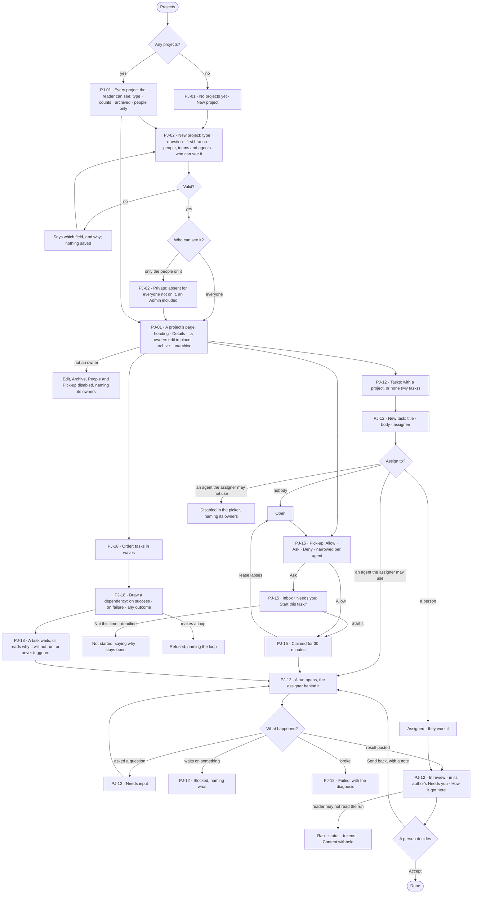
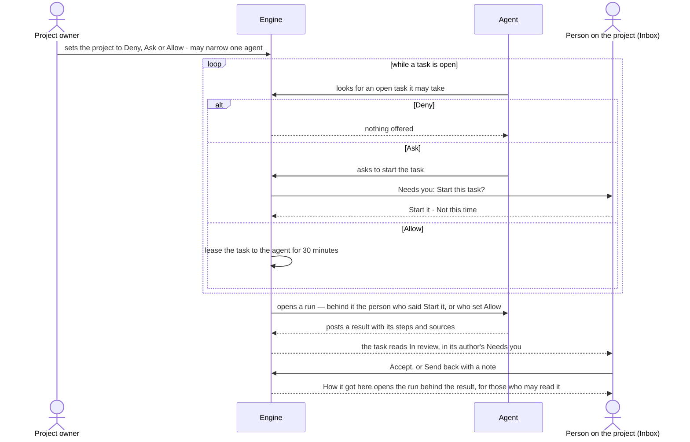

# Projects and tasks

> A project holds the work of one question, and a task is one piece of it that a person or an agent takes — written
> once, handed on, run and accepted by a person. The decisions it helps make: *who should take this, in what order,
> and may an agent start it without me?* — and, for a sensitive quest, *who may see it at all?*

## User journey

Journeys this feature is a step of: [J03 · Give an agent work and decide on the result](../../../../journeys/J03-give-an-agent-work-and-decide-on-the-result.md)

## Stories

| ID | Story | Status |
|---|---|---|
| PJ-01 | [See every project and open one](stories/PJ-01-see-every-project-and-open-one/story.md) | idea |
| PJ-02 | [Start a project and say who can see it](stories/PJ-02-start-a-project-and-say-who-can-see-it/story.md) | idea |
| PJ-12 | [Write a task, hand it on and accept the result](stories/PJ-12-write-a-task-hand-it-on-and-accept-the-result/story.md) | idea |
| PJ-15 | [Let agents pick up tasks by hand, by asking or on their own](stories/PJ-15-let-agents-pick-up-tasks-by-hand-by-asking-or-on-their-own/story.md) | idea |
| PJ-18 | [Order tasks by what they wait on](stories/PJ-18-order-tasks-by-what-they-wait-on/story.md) | idea |

## Access

Who may do what is the [role table](../../../../os/access/features/AC-F02-access-policies/feature.md#the-role-table):
*Projects and tasks* is *Acts* for Operator, Modeller and Admin — within the projects the person can see, the agents
they may use ([AC-F03](../../../../os/access/features/AC-F03-directory/feature.md)) and what they own
([AC-F07](../../../../os/access/features/AC-F07-ownership/feature.md)).

| Act | Who | Everyone else sees |
|---|---|---|
| Read a project open to everyone, its tasks and its Order | Every signed-in person | — |
| Read a private project, its tasks, decisions and events | Its owners and the people on it — users, and the members of teams on it — whatever their role; an Admin not on it does not see it | The project is absent: not in a list, not in search, not in History, and a link reads *Not found* |
| Start a project | Operator · Modeller · Admin; the creator is its first owner | — |
| Edit a project's name and purpose, archive or unarchive it, put people, teams and agents on it, change who can see it, set its pick-up | Its owners · an Admin who can see it | Everything reads; each act is disabled, naming its owners — *Ask {owner}* |
| Add a co-owner · hand a project over | Its owners · an Admin ([AC-F07](../../../../os/access/features/AC-F07-ownership/feature.md)) | Owners read |
| Write a task, assign it to a person, start it, post a result, cancel it, draw or remove a dependency | Anyone who can see the project; a task with no project, anyone | An archived project's tasks read; each act is disabled, saying it is archived |
| Assign a task to an agent | Anyone who can see the project, among the agents they may use | An agent they may not use is disabled in the picker, naming its owners — *Ask {owner}* |
| Accept or send back a task's result | A person who can see the project — never an agent | — |
| Answer an agent's ask to start a task | The project's owners and the people on it, among the agents they may use | The ask reads, naming who it waits on; *Start it* disabled when the reader may not use that agent |
| Read a task's run — its steps, sources and *How it got here* | The person behind the run, the agent's owners, Admins ([CP-F10](../../../../os/control/features/CP-F10-runs-and-how-the-agents-are-doing/feature.md)) | That it ran, its status and its tokens; the steps read *Content withheld* |

## States

| State | What the person sees |
|---|---|
| First use | *No projects yet* with *New project*; in Tasks, *No tasks yet* with *New task*; on the Order tab, *No tasks to order yet* |
| Empty after a filter | *Nothing matches* in Projects, *No tasks match* in Tasks — the filter named, with *Clear* |
| Loading | The list, page or Order is drawn at once with its frame; the rows and counts load in place |
| Has data | Projects with type, counts and badges; tasks with their state, assignee and what they wait on; the Order tab in waves |
| Failed | The list or page could not load, saying why, with *Try again*; a save refused names its field; a failed task names its diagnosis; a loop is refused naming the tasks in it |
| Agent working or proposing | A task *In progress* streams its steps to those who may read its run; an agent asking to start a task waits in the Inbox; a claimed task shows who holds it and until when |
| No access | A private project is absent, not locked. A project's settings read to anyone who is not an owner, each act disabled, naming its owners. A run the reader may not read shows that it ran, its status and its tokens — *Content withheld* |

## Rules

| Rule | Detail |
|---|---|
| Flat projects | A project holds tasks and branches; it has no sub-projects. A project is a record: it never runs |
| A task is one piece of work | It has a title, a body, a project or none, an assignee, a due date and an outcome. Its body says what done means; there are no separate criteria |
| The Order is not a plan | Tasks and their dependencies are work people accept; a plan and a workflow are an agent's ([AG-F06](../../../agents/features/AG-F06-plans-and-workflows/feature.md)). A task's run has a plan; a project's Order is never one |
| Sub-tasks | A task may have sub-tasks, to any depth for people. An agent may make sub-tasks for its own parts, bounded by its run's limits ([CP-F04](../../../../os/control/features/CP-F04-limits/feature.md)) — depth, count and tokens. Cancelling a task cancels every sub-task at every level. A parent reads *Blocked* while any sub-task is open. The engine counts each level and a rolled-up total |
| Dependencies are between siblings | A dependency joins two tasks that share a parent (or two top-level tasks of one project); one across levels is refused, naming both |
| A task has no progress of its own | Its state is read off its latest run: *Open* and *Assigned* when no run yet · *In progress* while a run is open · *Needs input* on an unanswered question · *Blocked* on an unmet dependency, a paused agent, an exhausted token budget or an open sub-task · *In review* when the run settled and nobody accepted · *Done*, *Failed*, *Cancelled* once closed |
| Only a person accepts | Accepting or sending back is the one thing written by hand. An agent posts a result and never accepts, and a judging run's verdict is not an acceptance |
| A result waits in the Inbox | A task *In review* is listed in Inbox › Needs you ([CP-F08](../../../../os/control/features/CP-F08-the-inbox/feature.md)) of the task's author and, when another, of the person behind its run; anyone who can see the project may accept it, and History names who did |
| One assignee field | A person and an agent are both assignees; assigning to an agent opens exactly one run, the assigner behind it, through that agent — so only an agent the assigner may use can be assigned |
| A run is checked like any run | A task's run is checked by the agent's Access Policies and the role of the person behind it, like every run ([AC-F02](../../../../os/access/features/AC-F02-access-policies/feature.md)); a project grants nothing. The task's text is data to the agent, never an instruction that widens what it may do |
| Run privacy | A task's run — its steps, sources and *How it got here* — is read by the person behind it, the agent's owners and Admins; anyone else who can see the task reads that it ran, its status and its tokens ([CP-F10](../../../../os/control/features/CP-F10-runs-and-how-the-agents-are-doing/feature.md)). The posted result is the task's and reads to anyone who can see it |
| Owned like any resource | A project is owned by people ([AC-F07](../../../../os/access/features/AC-F07-ownership/feature.md)): its creator first, co-owners added; what an agent creates is owned by the person behind its run. Tasks are the project's and are not owned |
| Staffing is a default | On a project open to everyone, being on it only puts a person, a team or an agent in the assignee picker |
| Private projects | A private project's access list is its owners and the people on it — users, and the members of teams on it. Being on it never widens what a person's role or agents allow. An owner is always on it |
| Hidden reads as absent | A private project is absent from lists, tasks, decisions, search and History for anyone not on it, and a link reads as not found |
| Archiving freezes | An archived project's tasks are read only; a run already going finishes. Archiving and unarchiving are separate rows in History |
| Order is derived | Waves, what a task waits on and the critical path are the engine's derivation from dependencies. A dependency carries a condition: on success · on failure · any outcome. A loop is refused, naming it |
| Failure edges are contingency | A dependency on failure is drawn dashed and never counts toward the critical path; a task whose condition cannot now be met says why, or reads *Never triggered* |
| Pick-up mode | Per project, for an agent starting a task on its own: *Allow* · *Ask* (the default) · *Deny*, set by the project's owners. An agent's own mode can be narrower, never wider; Deny over Ask over Allow. *Allow* is set by an owner who confirms it after seeing which agents will start which tasks and the token budget cap — a total across every run pick-up opens, enforced by the engine. A claim is a 30-minute lease, one claim per task; a lapsed claim returns the task to open |
| Who is behind a picked-up run | On *Ask*, the person who pressed *Start it*; on *Allow*, the owner who set it. Either must be able to use that agent. An *Allow* returns to *Ask* when its setter stops being an owner or loses the use of an agent it names |
| The backend owns every number | Counts of tasks by state, a project's counts and the critical path come from the engine; Studio formats and never adds up |
| Agent outcomes carry a trace | A task's result, a claim and a blocked reason open *How it got here* |
| Projects own tasks | There is no Tasks place of its own: the Tasks list is under Projects; a task with no project is listed with all of them |
| Project types | A project's type relabels Project and Task — and its branches, findings and decisions — inside the project only; shared places keep the generic words with the type as a badge ([PJ-F03 › Rules](../PJ-F03-branches-findings-and-decisions/feature.md#rules)) |
| The project key | Generated from the name, URL-safe and unique in the deployment; editable only in *New project*; refused if taken, not URL-safe or reserved (`tasks`, `decisions`, `types`), naming why, with nothing saved. Afterwards a fact on Details, never editable |
| Leans on | Build an agent (AG-F01) · runs and run privacy (CP-F10) · schedules (AG-F07) · run limits (CP-F04) · project types from Domain packs (CP-F02) · the Inbox (CP-F08) · users, teams and the agents each may use (AC-F03) · owners (AC-F07) |

## Data touched

| Record | Read or write |
|---|---|
| Projects — key, name, question, type, purpose, status, visibility | Write · read |
| Project owners (AC-F07) | Write on create · read |
| Project staffing — users, teams and agents | Write · read |
| Tasks — project, parent, title, body, assignee, due date, accepted time, outcome | Write · read |
| Task dependencies — condition: on success · on failure · any outcome | Write · read |
| Pick-up settings — a project's mode, each agent's narrower mode, who set it, the budget cap | Write · read |
| Claims — task, agent, expires | Write · read |
| The run each assigned or picked-up task opens (CP-F10) | Write · read |
| Inbox asks to start a task | Write · read |
| History rows of every project and task act, including accept and send back (AC-F06) | Write · read |
| A project's summary — counts by state, critical path | Read |

## Engine

The low-level design: what this feature stores, serves and refuses. Conventions — naming, errors, lists, events — are
[system-design.md](../../../../system-design.md) §§ 6–8; this section only fills them in.

### Records

| Table | Columns | Notes |
|---|---|---|
| `projects` | `key` · `name` · `description` (the purpose) · `question` · `type` · `status` (`active` · `archived`) · `visibility` (`everyone` · `private`) · `created_by_id` · `created_at` | Unique `key`. `type` is a key listed by `GET /api/v1/projects/types`. Owners are `access_owners` rows, `resource_type = project` ([AC-F07](../../../../os/access/features/AC-F07-ownership/feature.md#engine)) |
| `projects_assignments` | `project_id` · `principal_kind` (`user` · `team` · `agent`) · `principal_id` · `assigned_by_id` · `assigned_at` | Staffing, and with the owners a private project's access list |
| `projects_tasks` | `project_id?` · `parent_id?` (*part of*) · `branch_id?` · `title` · `body` (the intent an agent plans from, and what done means) · `assignee_kind?` (`user` · `agent`) · `assignee_id?` · `created_by_kind` (`user` · `run` · `rule`) · `created_by_id` · `due_at?` · `lens_id?` · `result?` · `closed_at?` · `outcome?` (`done` · `failed` · `cancelled`) | No `status` column — the state is derived (Mechanisms). A null `project_id` is the *No project* bucket |
| `projects_task_dependencies` | `task_id` · `depends_on_id` · `on` (`success` · `failure` · `any_outcome`) · `created_by_id` | *After* — distinct from `parent_id` |
| `projects_pickup` | `project_id` · `agent_id?` (null for the project's own mode) · `mode` (`allow` · `ask` · `deny`) · `budget_tokens?` (on the project's `allow`) · `set_by_id` · `set_at` | Unique (`project_id`, `agent_id`). No row is *Ask* |
| `projects_task_claims` | `task_id` (unique) · `agent_id` · `behind_id` (the person behind the run it opens) · `claimed_at` · `expires_at` | `expires_at` is `claimed_at` plus 30 minutes |

### Reads

| Record | Owner |
|---|---|
| Runs, their prompts (a clarification is `kind = clarification`), steps, who writes each run field, and who may read a run's content | [CP-F10](../../../../os/control/features/CP-F10-runs-and-how-the-agents-are-doing/feature.md#engine) |
| Agents and whether one is paused or retired | [AG-F01](../../../agents/features/AG-F01-build-an-agent/feature.md#engine) |
| Users, teams and the agents each person may use | [AC-F03](../../../../os/access/features/AC-F03-directory/feature.md#engine) |
| Owners of a project | [AC-F07](../../../../os/access/features/AC-F07-ownership/feature.md#engine) |
| Handing work to another agent — the same act as raising a task | [AG-F05](../../../agents/features/AG-F05-delegation-and-outside-agents/feature.md#engine) |
| Schedules — a schedule names an agent and instructions, not a project | [AG-F07](../../../agents/features/AG-F07-schedules/feature.md#engine) |
| The ask to start a task, and a result in review, in Needs you | [CP-F08](../../../../os/control/features/CP-F08-the-inbox/feature.md#engine) |
| History — every event this feature writes | [AC-F06](../../../../os/access/features/AC-F06-history/feature.md#engine) |
| Run limits — depth, count and tokens of an agent's sub-tasks | [CP-F04](../../../../os/control/features/CP-F04-limits/feature.md#engine) |
| Project types a Domain pack installs | [CP-F02](../../../../os/control/features/CP-F02-plugins-and-outside-tools/feature.md#engine) |
| Branches a task is filed on · the summary's branch, finding and decision counts | [PJ-F03](../PJ-F03-branches-findings-and-decisions/feature.md#engine) |

### Routes

| Route, after `/api/v1/projects` | Does | Story |
|---|---|---|
| `GET /` · `POST /` | List the projects the reader may see · create one, the caller its first owner | PJ-01 · PJ-02 |
| `GET /{key}` · `PATCH /{key}` | Read a project · edit its name, purpose and visibility, or archive and unarchive it (`status` `active` ⇄ `archived`) | PJ-01 · PJ-02 |
| `GET /{key}/assignments` · `POST /{key}/assignments` · `DELETE /{key}/assignments/{principal}` | Who is on it · put a user, team or agent on it · take one off | PJ-02 |
| `GET /{key}/pickup` · `PUT /{key}/pickup` | The project's mode and each agent's · set one; `allow` carries `budget_tokens` and `confirmed` | PJ-15 |
| `GET /{key}/pickup/preview` | Which staffed agents would start which open tasks now, and the cap they would run within | PJ-15 |
| `GET /{key}/order` | The derived order | PJ-18 |
| `GET /{key}/summary` | The project's counts | PJ-01 · PJ-03 |
| `GET /types` | Every project type — built in, and each a Domain pack installs — with its labels, default rules, suggested agents and skills, and report template | PJ-02 |
| `GET /tasks` · `POST /tasks` | List tasks (`?project=`; none open is every task the reader may see, the reader's first) · create one | PJ-12 |
| `GET /tasks/{id}` · `PATCH /tasks/{id}` | Read a task · edit its title, body, assignee or due date — assigning an agent opens its run | PJ-12 |
| `POST /tasks/{id}/start` | A person assigned to it starts it; no run opens | PJ-12 |
| `POST /tasks/{id}/result` | A person posts a result | PJ-12 |
| `POST /tasks/{id}/accept` · `POST /tasks/{id}/reject` | Accept · send back with a note — a person only | PJ-12 |
| `POST /tasks/{id}/cancel` | Cancel it and every sub-task below it | PJ-12 |
| `GET /tasks/{id}/dependencies` · `POST /tasks/{id}/dependencies` · `DELETE /tasks/{id}/dependencies/{depends_on_id}` | What it waits on · draw · remove | PJ-18 |
| `GET /tasks/{id}/activity` | Its History, one tree | PJ-12 |

Owners are added, removed and handed over through `/api/v1/owners/project/{id}` ([AC-F07](../../../../os/access/features/AC-F07-ownership/feature.md#engine)).

### Events

| Event | When |
|---|---|
| `projects.create` · `projects.update` | A project is created · its name, purpose or visibility changes |
| `projects.archive` · `projects.unarchive` | Two acts, two History rows |
| `projects.assignments.add` · `projects.assignments.remove` | Put on · taken off |
| `projects.pickup.set` | A project's or an agent's mode changes — from and to, who set it, the cap on *Allow* |
| `projects.pickup.lapsed` | An *Allow* returns to *Ask* because its setter stopped being an owner or lost the use of an agent it names |
| `projects.tasks.created` · `assigned` · `started` · `result_posted` · `accepted` · `rejected` · `blocked` · `cancelled` | Each act on a task; `rejected` is a send-back, its note on the event |
| `projects.tasks.dependencies.add` · `projects.tasks.dependencies.remove` | A dependency drawn · removed |
| `projects.tasks.claimed` | An agent claims a task |
| `projects.tasks.claim_lapsed` | A claim's lease passes with no run opened |

### Refusals

| Status | When | Sentence | Criterion |
|---|---|---|---|
| 404 | A private project the caller is not on — the project, its tasks, its order, its decisions or its events | *Not found.* | PJ-02.7 · PJ-12.21 |
| 403 | A project's settings — edit, archive, people, visibility, pick-up — by someone who is not an owner or an Admin | *Only its owners or an Admin — ask {owner}.* | PJ-01.13 · PJ-02.15 · PJ-15.16 |
| 403 | Assigning a task to an agent, or answering *Start it*, by a person who may not use that agent | *You may not use {agent} — ask {owner}.* | PJ-02.5 · PJ-12.22 · PJ-15.20 |
| 403 | An agent accepts or sends back a result | *Only a person accepts or sends back a result.* | PJ-12.14 |
| 422 | A create with an empty question, a type neither built in nor installed by a Domain pack, or a user, team or agent that does not exist | *{field}: {why}.* | PJ-02.3 |
| 422 | An edit that leaves the name empty | *A project needs a name.* | PJ-01.8 |
| 409 | A key already used | *The key `{key}` is taken.* | PJ-02.17 |
| 422 | A key that is not URL-safe, or is `tasks`, `decisions` or `types` | *`{key}` cannot be a key — {why}.* | PJ-02.17 |
| 422 | An edit that names the key | *A project's key is fixed once saved.* | PJ-02.18 |
| 409 | Taking an owner off a private project's people | *{person} owns {project} — hand it over first.* | PJ-02.11 |
| 409 | Any write to an archived project or its tasks | *{project} is archived — unarchive it first.* | PJ-01.9 · PJ-12.19 · PJ-18.15 |
| 409 | Accept or send back a task not in review; start, cancel or post a result on a closed task | *{task} is {state} — {act} needs it {wanted}.* | API only — Studio offers each act only in its state |
| 422 | A dependency that makes a loop | *That makes a loop: {a} → {b} → {a}.* | PJ-18.4 |
| 422 | A dependency between tasks that do not share a parent | *{a} and {b} do not share a parent — a dependency joins tasks with the same parent.* | PJ-18.12 |
| 422 | An agent's sub-task past its run's limits | *{limit} reached — {n} of {max}.* | PJ-12.28 |
| 422 | An agent's pick-up mode wider than the project's | *The project allows less — {mode} at most.* | PJ-15.11 |
| 422 | *Allow* saved without `confirmed`, or naming an agent its setter may not use | *Confirm what Allow starts first.* · *You may not use {agent} — ask {owner}.* | PJ-15.17 |
| 409 | A claim on a task another agent holds | *{agent} holds this task until {time}.* | PJ-15.8 |
| 403 | A claim the strictest pick-up mode denies — the project's or the agent's own | *Pick-up on {project} does not let {agent} start work.* | PJ-15.3 |
| 409 | A claim by an agent that is paused or retired | *{agent} is {state} — it takes no work.* | PJ-15.12 |
| 403 | A run a task opens that the agent's Access Policies refuse | The policy check's sentence, naming the rule ([AC-F02](../../../../os/access/features/AC-F02-access-policies/feature.md#refusals)) | PJ-12.33 · PJ-15.19 |

### CLI

| Command | Does |
|---|---|
| — | No command of its own |

### Mechanisms

| Mechanism | How |
|---|---|
| `open` · `assigned` | No run yet — *assigned* when it has an assignee |
| `in_progress` | A run is open, or a person assigned it pressed *Start* |
| `needs_input` | That run has an unanswered prompt of `kind = clarification` |
| `blocked` | An unmet dependency, a paused agent, an exhausted token budget, or an open sub-task at any level |
| `review` | The run settled, or a person posted a result, after the last send-back, and `closed_at` is null |
| `done` · `failed` · `cancelled` | `closed_at` set, with the `outcome`; a task whose latest run failed reads *failed* until a person acts |
| One writer of `closed_at` | Accept and cancel write `closed_at` and `outcome`; a send-back writes neither and the task reads *assigned*, its note on `projects.tasks.rejected`. Every other state is read off the task's latest run. An evaluator run (`role = evaluate`) writes a verdict on its step, never `closed_at` |
| Assigning an agent | Checks the assigner may use the agent ([AC-F03](../../../../os/access/features/AC-F03-directory/feature.md#engine)), then opens one run through it with the assigner as the person behind it |
| `projects.tasks.create` | The agent function that raises a task from inside a run, in the run's project or none; `created_by_kind = run`. Handing work to another agent is the same function |
| `projects.tasks.claim` | The agent function that claims an open task. It reads the strictest of the project's and the agent's `projects_pickup` modes: *Allow* writes the claim with `behind_id` = the setter and opens the run, `projects.tasks.claimed`; *Ask* raises *Start this task?* in the Needs you of the project's owners and people ([CP-F08](../../../../os/control/features/CP-F08-the-inbox/feature.md#engine)) and claims on *Start it*, `behind_id` = who answered; *Deny* refuses |
| *Allow* lapses | On a change to a project's owners or to who may use an agent, every `allow` row whose `set_by_id` is not an owner, or may not use an agent it covers, is set to `ask`, `projects.pickup.lapsed` |
| A claim lapses | When `expires_at` passes with no run opened, the claim row is removed, `projects.tasks.claim_lapsed` is written and the task reads open |
| The budget cap | The tokens of every run a project's *Allow* opened are summed against `budget_tokens`; at the cap, a claim reads *Ask* until an owner raises it |
| History is one tree | Assembled from the event store and the run's nodes — never from trace ids, whose retention is days. A delegated child run nests under the step that opened it; the *on behalf of* line is written from the root run; skills are *offered* (a fact of the prompt) or *reported* (the model's claim). A run's content is withheld as [CP-F10](../../../../os/control/features/CP-F10-runs-and-how-the-agents-are-doing/feature.md#engine) says |
| One filter hides it | `hidden_ids(reader)` names the private projects a reader is not on — no `access_owners` row for them and no `projects_assignments` row naming them or a team they are on. Project list and get, task list and get, the order, the decisions list, search and History all apply it. An agent's run reads as the person behind it |
| Order | `GET /{key}/order` derives, among siblings: `wave` (dependency hops from the start) · `blocked_by[]` (the unmet dependencies, named) · `critical_path` (the longest `on = success` chain). A parent waits on all its sub-tasks |
| Task counts | `GET /tasks` returns `total` and `by_status` of the listed tasks — a status with none absent — for each level and rolled up |
| Project counts | `GET /{key}/summary`: `branches` · `branches_by_status` · `findings` · `findings_reviewed` · `findings_predicted` · `loads` (distinct loads its findings cite) · `tasks_by_status` · `tasks_open` · `tasks_open_for_agents` · `decisions` (superseded included) · `critical_path` — from the rows the lists read; a task of another project drawn on the order is not counted |
| The creator's name | `created_by_name` on `GET /` and `GET /{key}`, resolved from `created_by_id` in one query for the whole list; *unknown* when the creator was removed. Studio never asks per row |

## System impact

| HLD section | Change | NFRs |
|---|---|---|
| § 6 Data and storage | Six tables in Invana's own store; no new store | — |
| § 8 APIs and events | The routes and events above, under `projects` | NFR-PERF-3 |
| § 10 AI and agents | Two agent functions: `projects.tasks.create` and `projects.tasks.claim`, the claim on a lease checked against the pick-up modes; a task's run is checked like any run; only a person closes a task | — |
| § 12 Qualities | Privacy: a private project is hidden by one filter on every read path; a task's run content follows run privacy | — |

## Decisions

| Decision | Detail |
|---|---|
| Tasks are Projects' | There is no Tasks icon: a task without a project is a to-do list, and the project is what it is for. With no project open, the Tasks list is every task the reader may see, theirs first as *My tasks* |
| The list is two drawers | Projects over Tasks; opening a project narrows Tasks to its own while the projects list keeps its place |
| The page leads with the project | The name is the heading, the breadcrumb is the one way back, and the purpose is clamped to three lines with *Show more*, because every agent plans from it |
| Details is the one place a project is edited | Name and purpose edit in place; key, owners and times are facts |
| Archiving is reversible | *Unarchive* sits where *Archive* was; the state rides on the name as a muted *archived* badge, not inside the counts line |
| The detail has no footer | Each act sits where its subject is: a task is written in Tasks, a dependency is drawn on the Order tab, archive is in Details |
| Agents is not a tab | Who is on a project is answered by the strip of people, teams and agents under its tasks |
| New project is one modal | Type (Research · Investigation · Policy · General, and any a Domain pack adds), question, name, key, first branch, people, teams and agents, who can see it. The type's default rules, suggested agents and skills and report template are applied; more rules are written on Details after it exists |
| The people picker names users, teams and agents | Users and teams by name; agents among those the person may use. The creator is its owner and is not offered |
| Admins are not exempt from a private project | Whoever should see it is put on it |
| A project's settings are its owners' | Edit, archive, people, visibility and pick-up are its owners' and an Admin's who can see it; tasks, branches, findings and decisions are anyone's who can see it |
| A send-back keeps its note on the task | The thread is the record: people ask, agents answer, and a result sent back returns to *Assigned* with the note above it |
| Pick-up is set where the work is | By the project's owners, on the project, with each staffed agent's narrower mode beside it |
| The person who says yes is behind the run | On *Ask*, whoever presses *Start it* is behind the run it opens, so the run never acts as someone who did not agree to it |
| Order has two kinds of edge | A dependency on success is sequence; one on failure is contingency; any outcome is a join |
| Reserved keys are the routes beside a project | `tasks`, `decisions` and `types` sit beside `/{key}`, so no project takes them |
| Pick-up is one agent function | An agent claims with `projects.tasks.claim`, which checks the pick-up modes; the claim and its lapse are History rows |
| Done is said in the body | A task's body says what done means; a person reads the result against it. Routine checks belong in a workflow ([AG-F06](../../../agents/features/AG-F06-plans-and-workflows/feature.md)) |

## Open questions

| Question | Who answers |
|---|---|
| Recurring work. A task template on a cron that creates a new task each firing would be a second kind of schedule beside AG-F07, where a schedule names an agent and instructions and whether a run creates work is the run's business. Recommend: no task templates — a recurring task is an AG-F07 schedule whose run creates the task for a person; PJ-18 keeps dependencies with conditions only. If templates are taken up instead, they are an AG-F07 story: a template (title with placeholders such as *Weekly review {date}*, body, project, assignee) on a cron; each firing creates a new task, never reopens one; an overlap policy *skip · queue · allow*; a skipped firing recorded with its reason; a person still accepts | Ravi |
| A result sent back: the note could become a new task, the original returning to *Assigned*; this spec keeps the note on the same task, as a thread. Recommend: the same task, so the history of one piece of work stays in one place | Ravi |

## Not building

| Item | Why not |
|---|---|
| Sub-projects | Branches carry the forks |
| Objectives and per-task criteria | Projects stay light: a task's body says what done means, and a person accepts |
| Dependencies across levels of sub-tasks | Order is derived among siblings; a cross-level edge makes the derivation ambiguous |
| Renaming a project key | Links and citations resolve by key; the key is fixed once saved |
| Per-project roles | The role table and the agents' Access Policies cover every act; a private project only narrows who sees it |
| Sharing a private project read-only | Put the person on it |
| A swimlane board per assignee | The Order answers "what is next" better |
| Manual ordering that overrides dependencies | Two sources of order is one too many |
| Time tracking and estimates | The record already holds what things cost |
| Soft deletes, trash, undo | Archive covers the real need |
| An agent accepting its own work | Only a person accepts |
| Auto-retry of a failed task | A task that waits on failure is the escalation |
| Recurring questions creating tasks | A schedule delivers answers; creating work is a run's business |
| Complex calendars for recurring work — business days, holidays, exceptions | Calendar-aware scheduling is not built ([AG-F07 › Not building](../../../agents/features/AG-F07-schedules/feature.md#not-building)) |
