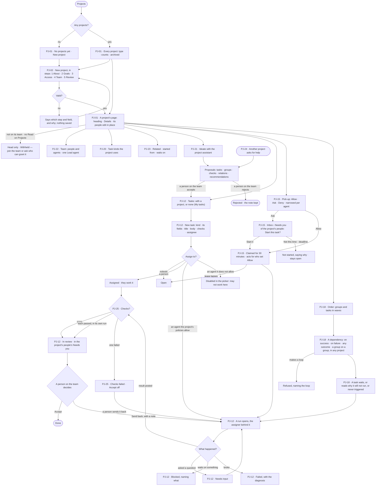
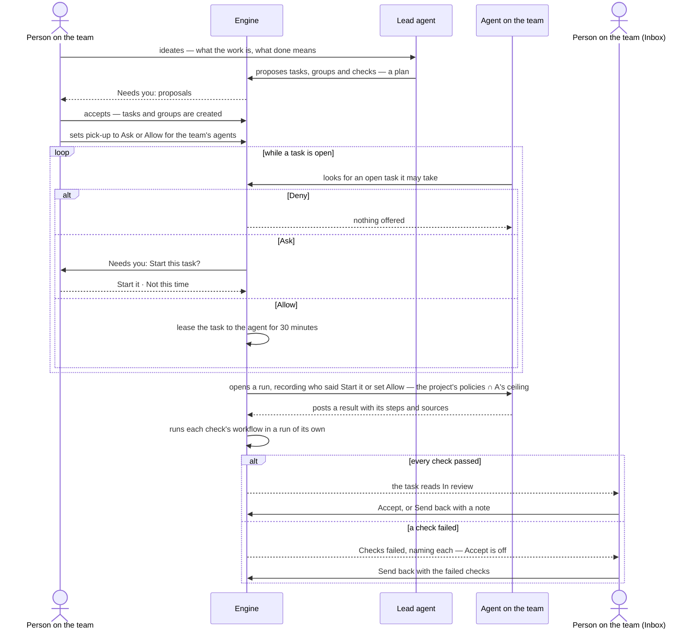

# Projects and tasks

> A project holds one piece of work of any kind, and a task is one piece of it that a person or an agent takes —
> written once, handed on, run, checked and accepted by a person. The decisions it helps make: *what should this
> project do next, who should take it, in what order, may an agent start it without me — and is this result really
> done?*

## User journey

Journeys this feature is a step of: [J03 · Give an agent work and decide on the result](../../../../journeys/J03-give-an-agent-work-and-decide-on-the-result.md) · [J11 · Ideate and run a project with its assistant](../../../../journeys/J11-ideate-and-run-a-project-with-its-assistant.md)

## Stories

| ID | Story | Status |
|---|---|---|
| PJ-01 | [See every project and open one](stories/PJ-01-see-every-project-and-open-one/story.md) | idea |
| PJ-02 | [Start a project of its type](stories/PJ-02-start-a-project-of-its-type/story.md) | idea |
| PJ-12 | [Write a task, hand it on and accept the result](stories/PJ-12-write-a-task-hand-it-on-and-accept-the-result/story.md) | idea |
| PJ-15 | [Let agents pick up tasks by hand, by asking or on their own](stories/PJ-15-let-agents-pick-up-tasks-by-hand-by-asking-or-on-their-own/story.md) | idea |
| PJ-18 | [Order tasks by what they wait on](stories/PJ-18-order-tasks-by-what-they-wait-on/story.md) | idea |
| PJ-20 | [Give a project its kinds of task](stories/PJ-20-give-a-project-its-kinds-of-task/story.md) | idea |
| PJ-21 | [Ideate with the project assistant](stories/PJ-21-ideate-with-the-project-assistant/story.md) | idea |
| PJ-22 | [Set the project team and its Lead agent](stories/PJ-22-set-the-project-team-and-its-lead-agent/story.md) | idea |
| PJ-23 | [Relate a project to another or start one from it](stories/PJ-23-relate-a-project-to-another-or-start-one-from-it/story.md) | idea |
| PJ-24 | [Ask another project for help](stories/PJ-24-ask-another-project-for-help/story.md) | idea |
| PJ-25 | [Gate a task on its checks](stories/PJ-25-gate-a-task-on-its-checks/story.md) | idea |

## Access

Permissions are [the permission catalogue](../../../../os/access/features/AC-F02-access-policies/feature.md#the-permission-catalogue)'s. Inside a
project there are no roles: **every person on its team may do everything inside it**. Being on the team grants nothing
outside the project. **A project owns its access**: its runs reach only **the project's Access Policies** ∩ the agent's ceiling, whoever
asked ([Rules](#rules)) — an Access Policy like a person's or a team's, attached to the project. An act a person lacks shows, disabled, naming the permission or *Join the team* and who can
grant it.

| Act | Who may |
|---|---|
| See a project's head — name, key, type, status, counts | Every signed-in person |
| Read a project, its tasks, its Order, its assistant's thread and its relations | A person on its team · Read on Projects |
| Start a project | Create on Projects; the creator is on its team |
| Everything inside a project — edit its name, purpose, goals and fields; archive or unarchive it; add people and agents to its team, or take them off, and tag its Lead agent; turn task kinds on or off; relate it; set its pick-up; write, assign, cancel and order tasks; accept proposals and plans; accept or send back results | Every person on its team · Manage on Projects; an agent only proposes |
| Widen a project's policies · attach another policy to the project | Manage on Projects. Anyone else on the team asks: what they may not grant waits in the Inbox of those who may |
| Narrow the project's policies | Every person on its team |
| Add a person, when the project is set to *Adding people needs approval* | A person on the team asks; Manage on Projects approves |
| Assign a task to an agent, put an agent on the team, set *Allow* for an agent | A person on its team, for an agent the project's policies let work here |
| Raise a Recommendation · ask another project for help | A person who may read the project · a run in the asking project |
| Read a task's run — its steps, sources and *How it got here* | As [AC-31](../../../../os/access/features/AC-F09-what-left-the-platform/stories/AC-31-keep-a-runs-content-to-those-who-may-read-it/story.md) says |

## States

| State | What the person sees |
|---|---|
| First use | *No projects yet* with *New project*; in Tasks, *No tasks yet* with *New task*; on the Order tab, *No tasks to order yet*; the assistant's thread opens on *What is this project for?* |
| Empty after a filter | *Nothing matches* in Projects, *No tasks match* in Tasks — the filter named, with *Clear* |
| Loading | The list, page, Order or thread is drawn at once with its frame; rows and counts load in place |
| Has data | Projects with type, counts and badges; tasks with their kind, state, assignee, checks and what they wait on; the Order in groups and waves; related projects; open proposals |
| Failed | The list or page could not load, saying why, with *Try again*; a save refused names its field; a failed task names its diagnosis; a failed check names the check and its run; a loop is refused naming the tasks or groups in it |
| Agent working or proposing | A task *In progress* streams its steps to those who may read its run; a task *Checking* names the checks running; the Lead agent's proposals and plans wait for the project's people; an agent asking to start a task waits in the Inbox; a claimed task shows who holds it and until when |
| No access | A project the reader is not on, without Read on Projects, shows its head only — *Withheld — join the team or ask {who can grant}*; each act inside is disabled, naming *Join the team*. A run the reader may not read shows that it ran, its status and its tokens — *Content withheld* |

## Rules

| Rule | Detail |
|---|---|
| Any kind of work | A project is a record of work: it never runs. Every project has a name, a description and its goals — the decision it helps make and what success looks like; its type declares its other fields — Research, Investigation and Policy add a question — its task kinds, its words, default rules, suggested agents and skills, default checks and a report template |
| Flat projects | A project holds tasks, groups and branches; it has no sub-projects |
| A task is one piece of work | It has a kind, the kind's fields, a title, a body, a project or none, a group or none, an assignee, a due date, checks and an outcome. Its body says what done means |
| Task kinds | A type declares its kinds — each with its fields and default checks; every project has *Task* and *Recommendation*. Its people turn the type's other kinds on or off for the project; a kind in use is never turned off. New task asks the kind first, and its fields follow (PJ-20) |
| A Recommendation is a task kind | A recommendation — from a person, an agent's run or another feature — lands as a proposal for the project assistant; a person on the team who accepts it makes a task of kind *Recommendation*, worked like any task (PJ-21) |
| The team | People, teams and agents on the project. Every person on it — directly or through a team — may do everything inside the project; there are no project roles for people. Being on the team fills the assignee picker and lets an agent pick up the project's tasks; it grants nothing over data, memory or tools. At least one active person; a project left with none alerts the Admins (PJ-22) |
| The Lead agent | At most one agent on the team is tagged **Lead agent** — the project assistant. It coordinates the project's agents: ideates in the project's thread, plans the work, splits a task into sub-tasks within its own run and assigns open tasks to the team's other agents. Every decision a person must give — a new task, group, check or relation, a plan, a goal, a change to the team or the policy, accepting or sending back a result — reaches the project's people as a proposal. It never accepts its own proposal (PJ-21 · PJ-22) |
| A project owns its access | Every run inside the project — asked by anyone on its team, scheduled, picked up or started by the Lead agent — reaches **the project's policies ∩ the agent's ceiling** ∩ the run scope. The person who asked is recorded on the run; their own policies do not decide what the run may reach, and joining or leaving never changes what the project may do — but whatever a run shows a viewer is filtered by that viewer's own Deny Read, so a property Hidden to them is absent from every answer, record and count the run shows them ([AC-F02 › Rules](../../../../os/access/features/AC-F02-access-policies/feature.md#rules)). The task's text is data to the agent, never an instruction that widens what it may do |
| The project's policies | Access Policies attached to the project exactly as to a user — one or more, their Allows added, any Deny winning; attaching one adds, never replaces. Each is set through [AC-F02's policy form](../../../../os/access/features/AC-F02-access-policies/feature.md#the-policy-form): Graph Data down to kinds, relationships and properties · Models · AI models · Agents that may work here · Skills and plugins · Fleet · Outside Invana — beside the project's setting *Adding people needs approval*, for a sensitive project. *Edit as policy* opens the same policy as the matrix. They grant a person nothing outside the project |
| The project's keys | CI, integrations and MCP clients that are no one person use a project key: it acts with the project's policies ∩ the agent's ceiling, keeps working when people join or leave, and is revoked when the project is archived or deleted ([AC-F10](../../../../os/access/features/AC-F10-keys/feature.md#rules)) |
| A template to start from | New project's Access step runs *New policy*'s form inline, from the one list of Access templates — the type's default first — and attaches the policy it makes to the new project; the creator only adjusts it ([AC-F02 › Access templates](../../../../os/access/features/AC-F02-access-policies/feature.md#access-templates)). A policy made in Access › *New policy* may be held by the project beside it |
| Widening asks | Setting or widening the project's policies needs Manage on Projects. A person without it may still create the project: it starts read-only on what they chose — Read on the graph databases, models and agents they picked — and the rest waits as an ask in the Inbox of those with Manage on Projects; History records the ask and its answer. Narrowing is open to the team |
| Joining is the gate | Joining a project is how a person reaches what it may do; adding a person is open to the team, unless the project is set to *Adding people needs approval*. Every join and leave is in History |
| Relations | *Started from* — a project made from another project, task or finding · *Waits on* — a group of this project waits on a group of the other · *Related* — two projects that share context. A run's scope reaches the projects related to its own by any of the three ([AC-F04](../../../../os/access/features/AC-F04-what-an-agent-may-touch/feature.md#rules)) (PJ-23) |
| Asks across projects | A person or a run in one project asks another for help; the ask lands as a proposal for the other project's assistant, carrying its sources' lineage ([GP-F02](../../../../os/graph/features/GP-F02-memory/feature.md#rules)). Accepted, it is a task in the other project and the two projects become *Related*; the asking task lists it under *Asked of other projects* with its state, and its result is posted to the asking task's thread (PJ-24) |
| Checks gate a task | A check names a workflow ([AG-F06](../../../agents/features/AG-F06-plans-and-workflows/feature.md)). When a result is posted, the engine runs each check in a run of its own through the project assistant, never in the run that did the work; the task reads *Checking*, then *In review* when every check passed, or *Checks failed*, naming each. *Accept* is off until every check passed; a failed check is never re-run on its own — a person on the team sends the task back. What an agent says about its own work is never a check's result (PJ-25) |
| Groups | A group is a named set of a project's tasks done in order. A group waits on another group — of this project or of another — on success: when every task in it is done. A task in a group whose group waits reads *Blocked*, naming the group (PJ-18) |
| The Order is not a plan | Tasks, groups and their dependencies are work people accept; a plan and a workflow are an agent's ([AG-F06](../../../agents/features/AG-F06-plans-and-workflows/feature.md)). A task's run has a plan; a project's Order is never one |
| Sub-tasks | A task may have sub-tasks, to any depth for people. An agent may make sub-tasks for its own parts, bounded by its run's limits ([CP-F04](../../../../os/control/features/CP-F04-limits/feature.md)) — depth, count and tokens. Cancelling a task cancels every sub-task at every level. A parent reads *Blocked* while any sub-task is open. The engine counts each level and a rolled-up total |
| Dependencies are between siblings | A task dependency joins two tasks that share a parent (or two top-level tasks of one project); one across levels or projects is refused, naming both — work across projects waits through groups |
| A task has no progress of its own | Its state is read off its latest run and its checks: *Open* and *Assigned* when no run yet · *In progress* while a run is open · *Needs input* on an unanswered question · *Blocked* on an unmet dependency, a waiting group, a paused agent, an exhausted token budget or an open sub-task · *Checking* while its checks run · *Checks failed* · *In review* · *Done*, *Failed*, *Cancelled* once closed |
| Only a person accepts | Accepting or sending back is the act of a person on the team. An agent posts a result and never accepts, and a judging run's verdict is not an acceptance |
| A result waits in the Inbox | A task *In review* or *Checks failed* is listed in Inbox › Needs you ([CP-F08](../../../../os/control/features/CP-F08-the-inbox/feature.md)) of the project's people and of the person behind its run; for a task with no project, of its author |
| One assignee field | A person and an agent are both assignees; assigning to an agent opens exactly one run, the assigner behind it, through that agent — so only an agent the project's policies let work here can be assigned |
| Who reads a project | A person sees every project's head; its content — tasks, results, the thread, relations, Order — reads to the people on its team and to Read on Projects, else *Withheld*. A copy inside it — a result, a proposal, an ask — reads as far as [GP-F02's lineage](../../../../os/graph/features/GP-F02-memory/feature.md#rules) allows |
| Owned by the organisation | A project is the organisation's, keeping who made it ([AC-F07](../../../../os/access/features/AC-F07-ownership/feature.md)); its people, and Manage on Projects, change its settings. Tasks are the project's |
| Archiving freezes | An archived project's tasks are read only; a run already going finishes. Archiving and unarchiving are separate rows in History |
| Order is derived | Waves, what a task waits on and the critical path are the engine's derivation from dependencies and groups. A dependency carries a condition: on success · on failure · any outcome. A loop is refused, naming it |
| Failure edges are contingency | A dependency on failure is drawn dashed and never counts toward the critical path; a task whose condition cannot now be met says why, or reads *Never triggered* |
| Pick-up mode | Per project, for an agent on the team starting a task on its own: *Allow* · *Ask* (the default) · *Deny*, set by a person on the team. An agent's own mode can be narrower, never wider; Deny over Ask over Allow. *Allow* is set by a person who confirms it after seeing which agents will start which tasks and the project's *Tokens a month* they run within — the project's limit ([CP-F04](../../../../os/control/features/CP-F04-limits/feature.md)), set in its Access; there is no pick-up cap of its own — and for agents the project's policies let work here. A claim is a 30-minute lease, one claim per task; a lapsed claim returns the task to open |
| A picked-up run records its setter | The person who set *Allow*, or who pressed *Start it*, is recorded on the claim, the run and History; the run reaches the project's policies ∩ the agent's ceiling — on a task outside any project, the setter's policies ∩ the agent's ceiling. When they leave, the setter's place falls to their successor ([AC-F07](../../../../os/access/features/AC-F07-ownership/feature.md#slots-and-fallbacks)) |
| The backend owns every number | Counts of tasks by state, a project's counts, a group's progress and the critical path come from the engine; Studio formats and never adds up |
| Agent outcomes carry a trace | A task's result, a check's result, a claim, a proposal and a blocked reason open *How it got here* |
| Projects own tasks | There is no Tasks place of its own: the Tasks list is under Projects; a task with no project is listed with all of them |
| Project types | A project's type relabels Project and Task — and its branches, findings and decisions — inside the project only; shared places keep the generic words with the type as a badge ([PJ-F03 › Rules](../PJ-F03-branches-findings-and-decisions/feature.md#rules)) |
| The project key | Generated from the name, URL-safe and unique in the deployment; editable only in *New project*; refused if taken, not URL-safe or reserved (`tasks`, `decisions`, `types`), naming why, with nothing saved. Afterwards a fact on Details, never editable |
| Memory of a project | A project's tasks, groups, relations, runs and decisions are nodes in Memory; its map is [GP-08](../../../../os/graph/features/GP-F02-memory/stories/GP-08-see-a-project-as-a-map-and-what-is-moving-on-it/story.md) |
| Leans on | Build an agent (AG-F01) · workflows (AG-F06) · runs (CP-F10) · run privacy (AC-F09) · schedules (AG-F07) · run limits (CP-F04) · project types from Team packs (CP-F02) · the Inbox (CP-F08) · users, teams and Access Policies (AC-F02 · AC-F03) · the run scope (AC-F04) · slots (AC-F07) · Memory (GP-F02) |

## Data touched

| Record | Read or write |
|---|---|
| Projects — key, name, purpose, type, fields, status, assistant | Write · read |
| The team — users, teams and agents, and its Lead agent | Write · read |
| The project's policies — Access Policies and their attachments, and the Access templates ([AC-F02](../../../../os/access/features/AC-F02-access-policies/feature.md#engine)) | Write · read |
| Task kinds a project uses | Write · read |
| Relations between projects | Write · read |
| Groups and their dependencies | Write · read |
| Tasks — project, parent, group, kind, fields, title, body, assignee, due date, outcome | Write · read |
| Task dependencies — condition: on success · on failure · any outcome | Write · read |
| Checks of a task and each check's run | Write · read |
| Pick-up settings — a project's mode, each agent's narrower mode, who set it | Write · read |
| Claims — task, agent, who agreed, expires | Write · read |
| Proposals of the project assistant ([PJ-F03](../PJ-F03-branches-findings-and-decisions/feature.md#engine)) | Write · read |
| The run each assigned or picked-up task opens, and each check's run (CP-F10) | Write · read |
| Inbox asks to start a task, proposals and results in review | Write · read |
| History rows of every project and task act (AC-F06) | Write · read |
| A project's summary — counts by state, groups, critical path | Read |

## Engine

The low-level design: what this feature stores, serves and refuses. Conventions — naming, errors, lists, events — are
[system-design.md](../../../../system-design.md) §§ 6–8; this section only fills them in.

### Records

| Table | Columns | Notes |
|---|---|---|
| `projects` | `key` · `name` · `description` (the purpose) · `goal` (the decision it helps make) · `success` (what success looks like) · `type` · `fields` (JSON, checked against the type's fields) · `status` (`active` · `archived`) · `people_need_approval` (bool — *Adding people needs approval*) · `created_by_id` · `created_at` | Unique `key`. Its policies are `access_policy_attachments` rows, `holder_kind = project` ([AC-F02](../../../../os/access/features/AC-F02-access-policies/feature.md#engine)), written in the same transaction. `type` is a key listed by `GET /api/v1/projects/types`; a question is a field of the types that ask one. Owned by the system user ([AC-F07](../../../../os/access/features/AC-F07-ownership/feature.md#engine)) |
| `projects_team` | `project_id` · `principal_kind` (`user` · `team` · `agent`) · `principal_id` · `lead_agent` (bool, an agent row only) · `added_by_id` · `added_at` | Unique (`project_id`, `principal_kind`, `principal_id`). The creator is written first. At least one row that is a user or a team with an active person; at most one `lead_agent` row — the project assistant |
| `projects_task_kinds` | `project_id` · `kind` · `enabled` | A kind its type declares; *task* and *recommendation* always enabled. No row is enabled |
| `projects_relations` | `project_id` · `other_project_id` · `kind` (`started_from` · `waits_on` · `related`) · `from_kind?` (`task` · `finding`) · `from_id?` · `created_by_id` · `created_at` | Unique (`project_id`, `other_project_id`, `kind`). `waits_on` is written and removed with the cross-project group dependencies that carry it |
| `projects_groups` | `project_id` · `name` · `created_by_id` | Unique (`project_id`, `name`) |
| `projects_group_dependencies` | `group_id` · `depends_on_group_id` (any project) · `created_by_id` | On success only: the group's tasks all done |
| `projects_tasks` | `project_id?` · `parent_id?` (*part of*) · `group_id?` · `branch_id?` · `kind` · `fields` (JSON, checked against the kind's fields) · `title` · `body` (the intent an agent plans from, and what done means) · `assignee_kind?` (`user` · `agent`) · `assignee_id?` · `created_by_kind` (`user` · `run` · `rule` · `proposal`) · `created_by_id` · `due_at?` · `result?` · `closed_at?` · `outcome?` (`done` · `failed` · `cancelled`) | No `status` column — the state is derived (Mechanisms). A null `project_id` is the *No project* bucket |
| `projects_task_dependencies` | `task_id` · `depends_on_id` · `on` (`success` · `failure` · `any_outcome`) · `created_by_id` | *After* — distinct from `parent_id` |
| `projects_task_checks` | `task_id` · `name` · `workflow_key` · `from_kind` (`kind` · `type` · `person`) · `added_by_id?` | A kind's and a type's default checks are copied on create |
| `projects_check_results` | `task_id` · `check_id` · `result_number` (the posting it checked) · `run_id` · `outcome` (`passed` · `failed`) · `settled_at` | One row per check per posted result; written by the check's run only |
| `projects_task_asks` | `task_id` (the asking task) · `other_project_id` · `proposal_id` · `answered_task_id?` | An ask across projects and the task that answered it |
| `projects_pickup` | `project_id` · `agent_id?` (null for the project's own mode) · `mode` (`allow` · `ask` · `deny`) · `set_by_id` · `set_at` | Unique (`project_id`, `agent_id`). No row is *Ask* |
| `projects_task_claims` | `task_id` (unique) · `agent_id` · `agreed_by_id` (who set *Allow* or pressed *Start it*) · `claimed_at` · `expires_at` | `expires_at` is `claimed_at` plus 30 minutes |

### Reads

| Record | Owner |
|---|---|
| Runs, their prompts (a clarification is `kind = clarification`), steps and who writes each run field | [CP-F10](../../../../os/control/features/CP-F10-runs-and-how-the-agents-are-doing/feature.md#engine) |
| Who may read a run's content — `may_read_run()` | [AC-F09](../../../../os/access/features/AC-F09-what-left-the-platform/feature.md#engine) |
| Agents and whether one is paused or retired | [AG-F01](../../../agents/features/AG-F01-build-an-agent/feature.md#engine) |
| Workflows a check names | [AG-F06](../../../agents/features/AG-F06-plans-and-workflows/feature.md#engine) |
| Users, teams and who is on each | [AC-F03](../../../../os/access/features/AC-F03-directory/feature.md#engine) |
| Access Policies, the project's policies, `decide()` and the person check | [AC-F02](../../../../os/access/features/AC-F02-access-policies/feature.md#engine) |
| The run scope — a run's project, related projects and task | [AC-F04](../../../../os/access/features/AC-F04-what-an-agent-may-touch/feature.md#engine) |
| The graph databases the deployment attaches | [CP-F05](../../../../os/control/features/CP-F05-graph-databases/feature.md#engine) |
| Slots and the successor | [AC-F07](../../../../os/access/features/AC-F07-ownership/feature.md#engine) |
| Proposals — `projects_proposals` | [PJ-F03](../PJ-F03-branches-findings-and-decisions/feature.md#engine) |
| Handing work to another agent — the same act as raising a task | [AG-F05](../../../agents/features/AG-F05-delegation-and-outside-agents/feature.md#engine) |
| Schedules — a schedule names an agent and instructions, not a project | [AG-F07](../../../agents/features/AG-F07-schedules/feature.md#engine) |
| The ask to start a task, a proposal, and a result in review, in Needs you | [CP-F08](../../../../os/control/features/CP-F08-the-inbox/feature.md#engine) |
| History — every event this feature writes | [AC-F06](../../../../os/access/features/AC-F06-history/feature.md#engine) |
| Run limits — depth, count and tokens of an agent's sub-tasks | [CP-F04](../../../../os/control/features/CP-F04-limits/feature.md#engine) |
| Project types and task kinds a Team pack installs | [CP-F02](../../../../os/control/features/CP-F02-plugins-and-outside-tools/feature.md#engine) |
| Branches a task is filed on · the summary's branch, finding and decision counts | [PJ-F03](../PJ-F03-branches-findings-and-decisions/feature.md#engine) |
| Lineage of a copy — `lineage.may_see` | [GP-F02](../../../../os/graph/features/GP-F02-memory/feature.md#engine) |

### Routes

| Route, after `/api/v1/projects` | Does | Story |
|---|---|---|
| `GET /` · `POST /` | Every project's head, and the content of those the reader is on or may Read · create one — name, description, goals, type and fields, its policy and team in one call — the caller on its team | PJ-01 · PJ-02 |
| `POST /drafts/goals` | From a name and a description, the assistant's draft of the goals — `{goal, success}`; writes nothing | PJ-02 |
| `GET /{key}` · `PATCH /{key}` | Read a project · edit its name, purpose, goals and fields, or archive and unarchive it (`status` `active` ⇄ `archived`) | PJ-01 · PJ-02 |
| `GET /{key}/access` · `PUT /{key}/access` | The project's policies, as [the form](../../../../os/access/features/AC-F02-access-policies/feature.md#the-policy-form) and as rules · save a policy's next version, attach another or take one off, through [AC-F02](../../../../os/access/features/AC-F02-access-policies/feature.md#routes)'s save and attach; a widening by a person without Manage on Projects saves what they may grant and raises an ask for the rest | PJ-02 · PJ-22 |
| `GET /{key}/team` · `PUT /{key}/team/{principal}` · `DELETE /{key}/team/{principal}` | Who is on it and which agent is its Lead agent · add a user, team or agent, or tag an agent Lead agent (`{lead_agent}`) · take one off | PJ-22 |
| `GET /{key}/kinds` · `PUT /{key}/kinds/{kind}` | The type's task kinds and which the project uses · turn one on or off | PJ-20 |
| `GET /{key}/relations` · `POST /{key}/relations` · `DELETE /{key}/relations/{id}` | Related projects, both ways · relate · unrelate (`waits_on` only through groups) | PJ-23 |
| `GET /{key}/thread` · `POST /{key}/thread` | The project's thread with its assistant · say something to it, which opens a run of the assistant, the speaker behind it | PJ-21 |
| `POST /{key}/recommendations` | Raise a recommendation for the project — a proposal of kind `recommendation` | PJ-21 |
| `POST /{key}/asks` | Ask this project for help, from a task of another project — a proposal of kind `ask` | PJ-24 |
| `GET /{key}/groups` · `POST /{key}/groups` · `POST /groups/{id}/dependencies` · `DELETE /groups/{id}/dependencies/{depends_on_id}` | Groups · make one · a group waits on another, in any project · remove the wait | PJ-18 |
| `GET /{key}/pickup` · `PUT /{key}/pickup` | The project's mode and each team agent's · set one; `allow` carries `confirmed` | PJ-15 |
| `GET /{key}/pickup/preview` | Which team agents would start which open tasks now, and the project's *Tokens a month* — used and left — they would run within ([CP-F04](../../../../os/control/features/CP-F04-limits/feature.md#engine)) | PJ-15 |
| `GET /{key}/order` | The derived order, groups included | PJ-18 |
| `GET /{key}/summary` | The project's counts | PJ-01 · PJ-03 |
| `GET /types` | Every project type — built in, and each a Team pack installs — with its fields, task kinds (each with fields and default checks), labels, default rules, suggested agents and skills, and report template | PJ-02 · PJ-20 |
| `GET /tasks` · `POST /tasks` | List tasks (`?project=`; none open is every task the reader may read, the reader's first) · create one | PJ-12 |
| `GET /tasks/{id}` · `PATCH /tasks/{id}` | Read a task · edit its title, body, fields, group, assignee or due date — assigning an agent opens its run | PJ-12 |
| `GET /tasks/{id}/checks` · `POST /tasks/{id}/checks` · `DELETE /tasks/{id}/checks/{check}` | Its checks and their results · add one · take one off before a result is posted | PJ-25 |
| `POST /tasks/{id}/start` | A person assigned to it starts it; no run opens | PJ-12 |
| `POST /tasks/{id}/result` | A person posts a result; its checks start | PJ-12 · PJ-25 |
| `POST /tasks/{id}/accept` · `POST /tasks/{id}/reject` | Accept · send back with a note — a person on the team only | PJ-12 |
| `POST /tasks/{id}/cancel` | Cancel it and every sub-task below it | PJ-12 |
| `GET /tasks/{id}/dependencies` · `POST /tasks/{id}/dependencies` · `DELETE /tasks/{id}/dependencies/{depends_on_id}` | What it waits on · draw · remove | PJ-18 |
| `GET /tasks/{id}/activity` | Its History, one tree | PJ-12 |

Proposals are read, accepted and rejected through `/api/v1/projects/{key}/proposals` ([PJ-F03](../PJ-F03-branches-findings-and-decisions/feature.md#engine)).

### Events

| Event | When |
|---|---|
| `projects.create` · `projects.update` | A project is created · its name, purpose, fields or graph databases change — from and to |
| `projects.archive` · `projects.unarchive` | Two acts, two History rows |
| `projects.team.add` · `projects.team.lead_agent` · `projects.team.remove` | Put on the team, and who added them · the Lead agent changed, from and to · taken off |
| `projects.access.save` · `projects.access.asked` | A project's policy saved, attached or taken off, from and to · a widening asked for, and its answer |
| `projects.kinds.set` | A task kind turned on or off |
| `projects.relations.add` · `projects.relations.remove` | A relation made · removed |
| `projects.groups.create` · `projects.groups.dependencies.add` · `projects.groups.dependencies.remove` | A group made · a group's wait drawn · removed |
| `projects.recommendations.raised` · `projects.asks.raised` | A recommendation · an ask from another project, each a proposal |
| `projects.pickup.set` | A project's or an agent's mode changes — from and to, who set it |
| `projects.tasks.created` · `assigned` · `started` · `result_posted` · `accepted` · `rejected` · `blocked` · `cancelled` | Each act on a task; `rejected` is a send-back, its note on the event |
| `projects.tasks.checks.started` · `projects.tasks.checks.settled` | A result's checks start · each settles, with its outcome and run |
| `projects.tasks.dependencies.add` · `projects.tasks.dependencies.remove` | A dependency drawn · removed |
| `projects.tasks.claimed` | An agent claims a task — who agreed |
| `projects.tasks.claim_lapsed` | A claim's lease passes with no run opened |

### Refusals

| Status | When | Sentence | Criterion |
|---|---|---|---|
| 403 | Reading a project, its tasks, its Order or its thread by a person not on its team and without Read on Projects | *Withheld — join the team or ask {who can grant}.* | PJ-01.3 · PJ-12.21 |
| 403 | A project's settings — edit, goals, policy, archive, team and Lead agent, kinds, relations, pick-up — or writing a task, a group, a check or a dependency, by a person not on its team and without Manage on Projects | *Join {project}'s team to change it.* | PJ-01.13 · PJ-22.9 · PJ-15.16 · PJ-20.7 · PJ-23.8 · PJ-12.37 |
| 403 | The same, or accepting a proposal or a result, by an agent — the project assistant included | *Only a person decides — {agent} may propose it.* | PJ-21.14 · PJ-22.13 |
| 403 | Assigning a task to an agent, putting it on the team, setting *Allow* for it, or answering *Start it* with it, for an agent the project's policies do not let work here | *{agent} may not work in {project} — widen its access.* | PJ-12.22 · PJ-22.4 · PJ-15.20 |
| 403 | Accepting or rejecting a proposal by a person not on the team | *Join {project}'s team to change it.* | PJ-21.9 |
| 403 | Accepting or sending back a result by a person not on the team, or by an agent | *Join {project}'s team to change it.* · *Only a person accepts or sends back a result.* | PJ-12.14 · PJ-12.34 |
| 202 | A widening of the project's policies by a person without Manage on Projects — the rest waits as an ask | *Asked {who can grant} for the rest — the project starts read-only on what you chose.* | PJ-02.29 |
| 409 | Tagging a second agent Lead agent | *{project} already has {agent} as its Lead agent.* | PJ-22.14 |
| 409 | Accepting a task whose checks have not all passed | *{n} checks have not passed — {check}.* | PJ-25.6 |
| 409 | Taking off the last active person on the team | *A project keeps at least one person on its team.* | PJ-22.6 |
| 409 | Turning off a task kind a task uses | *{kind} is in use by {n} tasks.* | PJ-20.5 |
| 422 | A create with an empty required field, a type neither built in nor installed by a Team pack, or a user, team or agent that does not exist | *{field}: {why}.* | PJ-02.3 |
| 422 | A task of a kind the project does not use, or a field its kind does not declare | *{kind}: {why}.* | PJ-20.4 |
| 422 | A check naming a workflow that does not exist | *There is no workflow {key}.* | PJ-25.9 |
| 422 | An edit that leaves the name empty | *A project needs a name.* | PJ-01.8 |
| 422 | A create or an edit naming a graph database the deployment does not attach | *There is no graph database {name}.* | PJ-02.22 |
| 409 | A key already used | *The key `{key}` is taken.* | PJ-02.17 |
| 422 | A key that is not URL-safe, or is `tasks`, `decisions` or `types` | *`{key}` cannot be a key — {why}.* | PJ-02.17 |
| 422 | An edit that names the key | *A project's key is fixed once saved.* | PJ-02.18 |
| 409 | Any write to an archived project or its tasks | *{project} is archived — unarchive it first.* | PJ-01.9 · PJ-12.19 · PJ-18.15 |
| 409 | Accept or send back a task not in review or checks failed; start, cancel or post a result on a closed task | *{task} is {state} — {act} needs it {wanted}.* | API only — Studio offers each act only in its state |
| 422 | A dependency or a group's wait that makes a loop | *That makes a loop: {a} → {b} → {a}.* | PJ-18.4 · PJ-18.19 |
| 422 | A task dependency between tasks that do not share a parent | *{a} and {b} do not share a parent — a dependency joins tasks with the same parent.* | PJ-18.12 |
| 422 | Relating a project to itself, or one already related that way | *{project} is already {relation}.* | PJ-23.6 |
| 403 | An ask from a person who may not read both projects | *Withheld — join the team or ask {who can grant}.* | PJ-24.8 |
| 422 | An agent's sub-task past its run's limits | *{limit} reached — {n} of {max}.* | PJ-12.28 |
| 422 | An agent's pick-up mode wider than the project's | *The project allows less — {mode} at most.* | PJ-15.11 |
| 422 | *Allow* saved without `confirmed` | *Confirm what Allow starts first.* | PJ-15.17 |
| 409 | A claim on a task another agent holds | *{agent} holds this task until {time}.* | PJ-15.8 |
| 403 | A claim the strictest pick-up mode denies, or by an agent not on the team | *Pick-up on {project} does not let {agent} start work.* | PJ-15.3 |
| 409 | A claim by an agent that is paused or retired | *{agent} is {state} — it takes no work.* | PJ-15.12 |
| 403 | A step of a task's run that the project's policies, or the agent's ceiling, refuse | The policy check's sentence, naming the rule ([AC-F02](../../../../os/access/features/AC-F02-access-policies/feature.md#refusals)) | PJ-12.33 · PJ-15.19 |

### CLI

| Command | Does |
|---|---|
| — | No command of its own |

### Mechanisms

| Mechanism | How |
|---|---|
| `open` · `assigned` | No run yet — *assigned* when it has an assignee |
| `in_progress` | A run is open, or a person assigned it pressed *Start* |
| `needs_input` | That run has an unanswered prompt of `kind = clarification` |
| `blocked` | An unmet dependency, a group waiting on another, a paused agent, an exhausted token budget, or an open sub-task at any level |
| `checking` | A result was posted and a check of it has no `projects_check_results` row yet |
| `checks_failed` | Every check of the latest result settled and one is `failed` |
| `review` | The run settled, or a person posted a result, after the last send-back; every check of it passed, or it has none; and `closed_at` is null |
| `done` · `failed` · `cancelled` | `closed_at` set, with the `outcome`; a task whose latest run failed reads *failed* until a person acts |
| One writer of `closed_at` | Accept and cancel write `closed_at` and `outcome`; a send-back writes neither and the task reads *assigned*, its note on `projects.tasks.rejected`. Every other state is read off the task's latest run and its checks. An evaluator run (`role = evaluate`) writes a verdict on its step, never `closed_at` |
| Reading a project | `GET /` returns every project's head — key, name, type, status, counts. Each content read passes when the caller is on its team, or the person check allows Read on `project/<key>` ([AC-F02](../../../../os/access/features/AC-F02-access-policies/feature.md#engine)); else it returns the head with `withheld` naming the resource. A copy inside the project — a result, a proposal, an ask — is shown through `lineage.may_see` ([GP-F02](../../../../os/graph/features/GP-F02-memory/feature.md#engine)) |
| Assigning an agent | Checks the project's policies let the agent work here ([AC-F02](../../../../os/access/features/AC-F02-access-policies/feature.md#engine)), then opens one run through it with the assigner recorded as the person behind it |
| Types and kinds | A type — built in or from a Team pack — declares `fields[]` (name, kind of value, required), `task_kinds[]` (each with `fields[]` and `default_checks[]`), labels, default rules, suggested agents and skills, `default_checks[]` and a report template. `POST /` and `POST /tasks` check `fields` against them |
| The Lead agent | The `projects_team` row with `lead_agent` set. `POST /{key}/thread` opens a run of it, the speaker behind it, with the project's purpose, goals, fields, open tasks and open proposals as context. It proposes through `projects.proposals.create` (kinds `task` · `group` · `check` · `relation` · `plan` · `goal` · `team`); a proposal is listed in the Needs you of the project's people; accepting one writes what it proposes, `created_by_kind = proposal`. It assigns an open task to another agent on the team through `projects.tasks.assign`, the run reaching the project's policies ∩ that agent's ceiling; the engine refuses it every act only a person gives |
| Recommendations and asks | `POST /{key}/recommendations` and `POST /{key}/asks` — and the agent function `projects.asks.create`, from inside a run — write a proposal of kind `recommendation` · `ask` with its sources' lineage ([GP-F02](../../../../os/graph/features/GP-F02-memory/feature.md#engine)), and open a run of the assistant to triage it — it proposes a task, or proposes declining with a reason. A person on the team accepting it writes a task of kind *Recommendation*, or for an ask a task in this project, a `projects_task_asks` row and a `related` relation |
| An answered ask | When the task an ask made closes, its result is posted to the asking task's thread, through `lineage.may_see` for each reader |
| Checks | On `result_posted`, for each `projects_task_checks` row the engine opens a run of the project's assistant running the check's workflow, `role = evaluate`, linked to the task; the run writes one `projects_check_results` row. A task with no assistant runs its checks through the built-in Assistant. A send-back and a new result start every check again; a failed check is never re-run on its own |
| Groups | A group's tasks are those with its `group_id`. A group is met when every task in it is closed `done`. A task in a group with an unmet `projects_group_dependencies` row reads `blocked`, naming the group. A cross-project wait writes a `waits_on` relation; removing the last one removes it |
| `projects.tasks.create` | The agent function that raises a task from inside a run, `created_by_kind = run`: in the run's project, a sub-task of the run's own task, or else a `task` proposal for the project's people; outside a project, a task with no project. Handing work to another agent is the same function |
| `projects.tasks.assign` | The agent function by which the project assistant assigns an open task to another agent on the team; refused for any other caller or assignee |
| `projects.tasks.claim` | The agent function that claims an open task of a project whose team it is on. It reads the strictest of the project's and the agent's `projects_pickup` modes: *Allow* writes the claim with `agreed_by_id` = the setter and opens the run with the setter recorded, `projects.tasks.claimed`; *Ask* raises *Start this task?* in the Needs you of the project's people ([CP-F08](../../../../os/control/features/CP-F08-the-inbox/feature.md#engine)) and claims on *Start it*, `agreed_by_id` = who answered; *Deny* refuses |
| A claim lapses | When `expires_at` passes with no run opened, the claim row is removed, `projects.tasks.claim_lapsed` is written and the task reads open |
| What pick-up spends | Every run a project's *Allow* opens counts against the project's *Tokens a month* ([CP-F04](../../../../os/control/features/CP-F04-limits/feature.md#engine)); at it, pick-up claims nothing and the project's runs are held until Manage on Projects raises it or the month turns |
| Slots | When a person on the team is deactivated, their `projects_team` row passes to the successor; a task assigned to them goes to the successor or back to *Open*, as [AC-F07 › Succession](../../../../os/access/features/AC-F07-ownership/feature.md#mechanisms) calls. A `projects_pickup` row they set moves `set_by_id` to the successor, and its runs act for them |
| History is one tree | Assembled from the event store and the run's nodes — never from trace ids, whose retention is days. A delegated child run nests under the step that opened it; the *on behalf of* line is written from the root run; skills are *offered* (a fact of the prompt) or *reported* (the model's claim). A run's content is withheld as [AC-F09](../../../../os/access/features/AC-F09-what-left-the-platform/feature.md#engine) says |
| Order | `GET /{key}/order` derives, among siblings: `wave` (dependency hops from the start, a group's wait counted as a hop) · `blocked_by[]` (the unmet dependencies and groups, named) · `critical_path` (the longest `on = success` chain). A parent waits on all its sub-tasks |
| Task counts | `GET /tasks` returns `total` and `by_status` of the listed tasks — a status with none absent — for each level and rolled up |
| Project counts | `GET /{key}/summary`: `branches` · `branches_by_status` · `findings` · `findings_reviewed` · `findings_predicted` · `loads` (distinct loads its findings cite) · `tasks_by_status` · `tasks_open` · `tasks_open_for_agents` · `groups` (each with `done` of `total`) · `proposals_open` · `decisions` (superseded included) · `critical_path` — from the rows the lists read |
| The maker's name | `created_by_name` on `GET /` and `GET /{key}`, resolved from `created_by_id` in one query for the whole list; *unknown* when the person was removed. Studio never asks per row |

## System impact

| HLD section | Change | NFRs |
|---|---|---|
| § 6 Data and storage | Fourteen tables in Invana's own store; no new store | — |
| § 8 APIs and events | The routes and events above, under `projects` | NFR-PERF-3 |
| § 10 AI and agents | Agent functions `projects.tasks.create`, `projects.tasks.claim`, `projects.proposals.create` and `projects.asks.create`; the project assistant runs on the project's thread and triages recommendations and asks; checks run each in an evaluator run of their own; every run in a project reaches the project's policies ∩ the agent's ceiling, the person recorded; the Lead agent coordinates and only proposes; only a person closes a task | — |
| § 12 Qualities | Privacy: a project's content reads to its team and to Read on Projects; copies inside it through lineage; a task's run content follows run privacy | — |

## Decisions

| Decision | Detail |
|---|---|
| Tasks are Projects' | There is no Tasks icon: a task without a project is a to-do list, and the project is what it is for. With no project open, the Tasks list is every task the reader may read, theirs first as *My tasks* |
| The list is two drawers | Projects over Tasks; opening a project narrows Tasks to its own while the projects list keeps its place |
| The page leads with the project | The name is the heading, the breadcrumb is the one way back, and the purpose is clamped to three lines with *Show more*, because every agent plans from it |
| Details is the one place a project is edited | Name, purpose and fields edit in place; key, maker and times are facts |
| Archiving is reversible | *Unarchive* sits where *Archive* was; the state rides on the name as a muted *archived* badge, not inside the counts line |
| The detail has no footer | Each act sits where its subject is: a task is written in Tasks, a dependency or a group is drawn on the Order tab, archive is in Details |
| The team is one tab | *Team* holds people and agents side by side, the project assistant marked *Lead agent*; the project's policies sit beside it |
| No roles inside a project | Every person on the team may do everything inside it; the only tag is the Lead agent, which coordinates and proposes |
| The wizard's step is *Access* | The step makes the project's first Access Policy — Graph Data, models, AI models, agents, skills and plugins, fleet, what may leave — through *New policy*'s form, inline, not graph databases alone |
| The project assistant is in the assistant region | Its thread opens in the right region of the project, where the assistant always sits ([design language](../../../../design-language.md)) |
| New project is a modal in steps | From the switcher's *New* or Projects, a modal with a step strip, because it asks five separate decisions ([design-language › Overlays](../../../../design-language.md#3-overlays--three-tiers)): **1 About** — name, description, the type as a grouped card grid and its fields, key, what it started from · **2 Goals** — the decision it helps make and what success looks like, drafted by the assistant from the description, edited by the person · **3 Access** — the project's first Access Policy made from an Access template, the form adjusted, *Edit as policy* for the matrix · **4 Team** — people and agents side by side, one agent tagged Lead agent · **5 Review** — every answer with *Edit*, then *Create*. The type's default rules, suggested agents and skills, task kinds, default checks and report template are applied (PJ-02) |
| Settings are the team's | A project is the organisation's; every person on its team changes its settings, and Manage on Projects may, so no project waits on one person |
| Head for everyone, content for the team | Every person sees that a project exists, its type and its counts; what it holds reads to its team and to Read on Projects — never hidden, never a list of its own |
| A person accepts | A result is accepted by a person on the team, never by an agent |
| Checks run outside the work's run | A check runs in an evaluator run of its own, so the agent that did the work never grades it |
| A send-back keeps its note on the task | The thread is the record: people ask, agents answer, and a result sent back returns to *Assigned* with the note above it |
| Pick-up is set where the work is | By a person on the team, on the project, with each team agent's narrower mode beside it |
| A project owns its access | What a project may do never moves with who asked, who joined or who left; a person's reach outside projects stays their own |
| Order has two kinds of edge | A dependency on success is sequence; one on failure is contingency; any outcome is a join |
| Across projects through groups | A task dependency stays among siblings; work across projects waits group on group, so each project's Order stays derivable on its own |
| Asks are proposals | Another project's ask never writes a task directly: it reaches the assistant, and a person on the team accepts |
| Reserved keys are the routes beside a project | `tasks`, `decisions` and `types` sit beside `/{key}`, so no project takes them |
| Pick-up is one agent function | An agent claims with `projects.tasks.claim`, which checks the pick-up modes; the claim and its lapse are History rows |
| Done is said in the body, proved by checks | A task's body says what done means; its checks prove what a workflow can; a person on the team reads the rest |

## Open questions

| Question | Who answers |
|---|---|
| Recurring work. A task template on a cron that creates a new task each firing would be a second kind of schedule beside AG-F07, where a schedule names an agent and instructions and whether a run creates work is the run's business. Recommend: no task templates — a recurring task is an AG-F07 schedule whose run creates the task for a person; PJ-18 keeps dependencies with conditions only | Ravi |
| A result sent back: the note could become a new task, the original returning to *Assigned*; this spec keeps the note on the same task, as a thread. Recommend: the same task, so the history of one piece of work stays in one place | Ravi |

## Not building

| Item | Why not |
|---|---|
| Sub-projects | Branches, groups and relations carry it |
| Roles inside a project | Every person on the team may do everything inside it; the project's policies bound its runs |
| Project templates — later | A template for a whole project — its goals, task kinds, team agents and an Access template — is not built now; a project's type and its default Access template carry what is needed |
| Connectors on a project | Agents bring their work connections ([CP-F02](../../../../os/control/features/CP-F02-plugins-and-outside-tools/feature.md)) |
| Objectives and per-task criteria | A task's body says what done means; checks prove what can be proved; a person on the team accepts |
| Task dependencies across levels or projects | Order is derived among siblings; groups carry waits across projects |
| Renaming a project key | Links and citations resolve by key; the key is fixed once saved |
| A swimlane board per assignee | The Order answers "what is next" better |
| Manual ordering that overrides dependencies | Two sources of order is one too many |
| Time tracking and estimates | The record already holds what things cost |
| Soft deletes, trash, undo | Archive covers the real need |
| An agent accepting its own work, or grading it | Only a person accepts; checks run in a run of their own |
| Retrying a failed task or check | A failure is sent back or answered by a task that waits on failure |
| Recurring questions creating tasks | A schedule delivers answers; creating work is a run's business |
| Complex calendars for recurring work — business days, holidays, exceptions | Calendar-aware scheduling is not built ([AG-F07 › Not building](../../../agents/features/AG-F07-schedules/feature.md#not-building)) |
