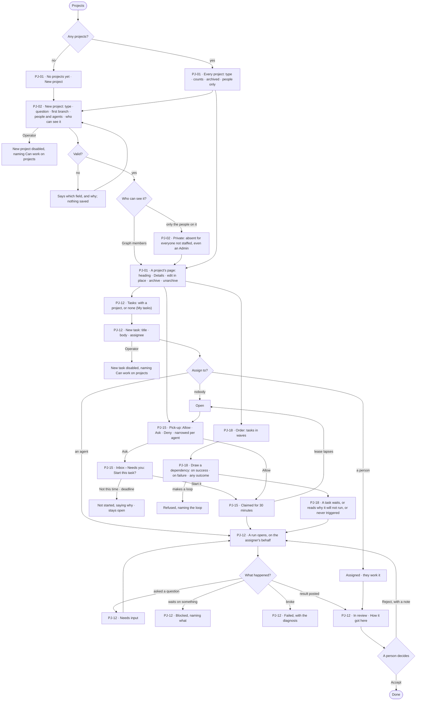

# Projects and tasks

> A project holds the work of one question, and a task is one piece of it that a person or an agent takes — written
> once, handed on, run and accepted by a person. The decisions it helps make: *who should take this, in what order,
> and may an agent start it without me?* — and, for a sensitive quest, *who may see it at all?*

## User journey

Journeys this feature is a step of: [J03 · Give an agent work and decide on the result](../../../../journeys/J03-give-an-agent-work-and-decide-on-the-result.md)



```mermaid
sequenceDiagram
  actor P as Person who can work on projects
  participant E as Engine
  participant A as Agent
  actor D as Person who decides (Inbox)
  P->>E: sets the project to Deny, Ask or Allow; may narrow one agent
  loop while a task is open
    A->>E: looks for an open task it may take
    alt Deny
      E-->>A: nothing offered
    else Ask
      A->>E: asks to start the task
      E->>D: Needs you: Start this task?
      D-->>E: Start it · Not this time
    else Allow
      E->>E: lease the task to the agent for 30 minutes
    end
  end
  E->>A: opens a run on behalf of the person who set the mode
  A-->>E: posts a result with its steps and sources
  E-->>P: the task reads In review
  P->>E: Accept, or Reject with a note
  E-->>P: How it got here opens the run behind the result
```

## Stories

| ID | Story | Status |
|---|---|---|
| PJ-01 | [See every project and open one](stories/PJ-01-see-every-project-and-open-one/story.md) | idea |
| PJ-02 | [Start a project and say who can see it](stories/PJ-02-start-a-project-and-say-who-can-see-it/story.md) | idea |
| PJ-12 | [Write a task, hand it on and accept the result](stories/PJ-12-write-a-task-hand-it-on-and-accept-the-result/story.md) | idea |
| PJ-15 | [Let agents pick up tasks by hand, by asking or on their own](stories/PJ-15-let-agents-pick-up-tasks-by-hand-by-asking-or-on-their-own/story.md) | idea |
| PJ-18 | [Order tasks by what they wait on](stories/PJ-18-order-tasks-by-what-they-wait-on/story.md) | idea |

## Access

| Act | Role (`.claude/team/TEAM.md` §7) | Everyone else sees |
|---|---|---|
| Read a project the Graph shows them, its tasks, runs and Order | Operator — every member | — |
| Read a private project, its tasks, decisions and events | Only the people staffed on it, whatever their role; an Admin or Owner not staffed on it does not see it | The project is absent: not in a list, not in search, not in History, and a link reads as not found |
| Create or edit a project, archive or unarchive it, staff it, change who can see it | `contributor` · shown as *Can work on projects* · Admin | Everything reads; each act is disabled, naming *Can work on projects* |
| Write a task, assign it, start it, cancel it, draw or remove a dependency | *Can work on projects* · Admin | The task reads; each act is disabled, naming *Can work on projects* |
| Accept or reject a task's result | *Can work on projects* · Admin — a person, never an agent | The result reads, with *How it got here*; *Accept* and *Reject* disabled, naming *Can work on projects* |
| Set a project's pick-up mode and narrow an agent's | *Can work on projects* · Admin | The mode reads; the controls are disabled, naming *Can work on projects* |
| Answer an agent's ask to start a task | A person staffed on the project who can work on projects | The ask reads, naming who it waits on |

## States

| State | What the person sees |
|---|---|
| First use | *No projects yet* with *New project*; in Tasks, *No tasks yet* with *New task*; on the Order tab, *No tasks to order yet* |
| Empty after a filter | *Nothing matches* in Projects, *No tasks match* in Tasks — the filter named, with *Clear* |
| Loading | The list, page or Order is drawn at once with its frame; the rows and counts load in place |
| Has data | Projects with type, counts and badges; tasks with their state, assignee and what they wait on; the Order tab in waves |
| Failed | The list or page could not load, saying why, with *Try again*; a save refused names its field; a failed task names its diagnosis; a loop is refused naming the tasks in it |
| Agent working or proposing | A task *In progress* streams its steps; an agent asking to start a task waits in the Inbox; a claimed task shows who holds it and until when |
| No access | Everything reads; each act is disabled, naming *Can work on projects*. A private project is absent, not locked |

## Rules

| Rule | Detail |
|---|---|
| Flat projects | A project holds tasks and branches; it has no sub-projects. A project is a record: it never runs |
| A task is one piece of work | It has a title, a body, a project or none, an assignee, a due date and an outcome. It may have sub-tasks, bounded when a run opens; an agent may make sub-tasks for its own parts |
| A task has no progress of its own | Its state is read off its latest run: *Open* and *Assigned* when no run yet · *In progress* while a run is open · *Needs input* on an unanswered question · *Blocked* on an unmet dependency, a paused agent, an exhausted token budget or an open sub-task · *In review* when the run settled and nobody accepted · *Done*, *Failed*, *Cancelled* once closed |
| Only a person accepts | Accepting or rejecting is the one thing written by hand. An agent posts a result and never accepts, and a judging run's verdict is not an acceptance |
| One assignee field | A person and an agent are both assignees; assigning to an agent opens exactly one run, on behalf of whoever assigned it |
| Staffing is a default | On a Graph-visible project, being staffed only puts a person or an agent in the assignee picker. An unstaffed agent can still be assigned by any member who can work on projects |
| Private projects | The people staffed on a private project are its access list. Per-project access sits on top of Graph roles: being on it never grants *Can work on projects*. A private project always has at least one person on it |
| Hidden reads as absent | A private project is absent from lists, tasks, decisions, search and History for anyone not on it, and a link reads as not found |
| Archiving freezes | An archived project's tasks are read only; a run already going finishes. Archiving and unarchiving are separate rows in History |
| Order is derived | Waves, what a task waits on and the critical path are the engine's derivation from dependencies. A dependency carries a condition: on success · on failure · any outcome. A loop is refused, naming it |
| Failure edges are contingency | A dependency on failure is drawn dashed and never counts toward the critical path; a task whose condition cannot now be met says why, or reads *Never triggered* |
| Pick-up mode | Per project, for starting a task: *Allow* · *Ask* (the default) · *Deny* ([the three modes](../../../../os/access/product.md#decisions)). *Allow* is set by a person, who confirms it after seeing which agents will start which tasks and the token budget cap. An agent's own mode can be narrower, never wider; pick-up is a line like any other, so a *For everyone* Deny on starting work holds. The token budget cap is a total across every run pick-up opens, enforced by the engine. An Allow is bounded by the person who set it and each task's author, and lapses when the setter loses the right to set it ([A standing Allow is bounded](../../../../os/access/product.md#decisions)). A claim is a 30-minute lease, one claim per task; a lapsed claim returns the task to open |
| Whose behalf a pick-up runs | The person who set the pick-up mode |
| The backend owns every number | Counts of tasks by state, a project's counts and the critical path come from the engine; Studio formats and never adds up |
| Agent outcomes carry a trace | A task's result, a claim and a blocked reason open *How it got here* |
| Projects own tasks | There is no Tasks place of its own: the Tasks list is under Projects; a task with no project is listed with all of them |
| Leans on | Build an agent (AG-F01) · runs (AG-F03) · schedules (AG-F07) · the Inbox · the Graph's members and grants in Settings › People and access |

## Data touched

| Record | Read or write |
|---|---|
| Projects — key, name, question, type, purpose, status, visibility, creator | Write · read |
| Project staffing — people and agents, by principal | Write · read |
| Tasks — project, parent, title, body, assignee, due date, accepted time, outcome | Write · read |
| Task dependencies — condition: on success · on failure · any outcome | Write · read |
| Pick-up settings — a project's mode, each agent's narrower mode | Write · read |
| Claims — task, agent, expires | Write · read |
| The run each assigned or picked-up task opens (AG-F03) | Write · read |
| Inbox asks to start a task | Write · read |
| History rows of every project and task act, including accept and reject (AC-F06) | Write · read |
| A project's summary — counts by state, critical path | Read |

## Decisions

| Decision | Detail |
|---|---|
| Tasks are Projects' | There is no Tasks icon: a task without a project is a to-do list, and the project is what it is for. With no project open, the Tasks list is every task on the Graph, mine first as *My tasks* |
| The list is two drawers | Projects over Tasks; opening a project narrows Tasks to its own while the projects list keeps its place |
| The page leads with the project | The name is the heading, the breadcrumb is the one way back, and the purpose is clamped to three lines with *Show more*, because every agent plans from it |
| Details is the one place a project is edited | Name and purpose edit in place; key, creator and times are facts |
| Archiving is reversible | *Unarchive* sits where *Archive* was; the state rides on the name as a muted *archived* badge, not inside the counts line |
| The detail has no footer | Each act sits where its subject is: a task is written in Tasks, a dependency is drawn on the Order tab, archive is in Details |
| Agents is not a tab | Who is on a project is answered by the strip of people and agents under its tasks |
| New project is one modal | Type (the three launched types; the others drawn and switched off), question, name, objective, first branch, people and agents, who can see it; rules are written on Details after it exists |
| The people picker names members | Other members and agents are offered by name; the creator is staffed by the engine and is not offered |
| Admins are not exempt from a private project | Whoever should see it is put on it |
| A reject keeps its note on the task | The thread is the record: people ask, agents answer, and a rejected result returns to *Assigned* with the note above it |
| Pick-up is set where the work is | By whoever can work on projects, on the project, with each staffed agent's narrower mode beside it |
| Order has two kinds of edge | A dependency on success is sequence; one on failure is contingency; any outcome is a join |

## Open questions

| Question | Who answers |
|---|---|
| Recurring work. The engine's recurring-task design makes a task template on a cron that creates a new task each firing. That is a second kind of schedule beside AG-F07, where a schedule names an agent and instructions and whether a run creates work is the run's business. Recommend: no task templates — a recurring task is an AG-F07 schedule whose run creates the task for a person; PJ-18 keeps dependencies with conditions only. The template, its overlap policy and its title placeholders stay in the engine document, unmoved | Ravi |
| Pick-up is set by the project's owner in the earlier plan, but a project has no owner other than its creator. Recommend: whoever can work on projects, as written here | Ravi |
| A rejected result: the engine design says the note becomes a new task and the original returns to *Assigned*; this spec keeps the note on the same task, as a thread. Recommend: the same task, so the history of one piece of work stays in one place | Ravi |
| Staffing other people from Studio: the product plan says it cannot be done yet, the private-projects design says the picker offers members by name. This spec follows the second. Recommend: confirm | Ravi |

## Not building

| Item | Why not |
|---|---|
| Sub-projects | Branches carry the forks |
| Per-project roles | Graph roles cover the writes; a private project only narrows who sees it |
| Sharing a private project read-only | Put the person on it |
| A swimlane board per assignee | The Order answers "what is next" better |
| Manual ordering that overrides dependencies | Two sources of order is one too many |
| Time tracking and estimates | The record already holds what things cost |
| Soft deletes, trash, undo | Archive covers the real need |
| An agent accepting its own work | Only a person accepts |
| Auto-retry of a failed task | A task that waits on failure is the escalation |
| Recurring questions creating tasks | A schedule delivers answers; creating work is a plan's business |
