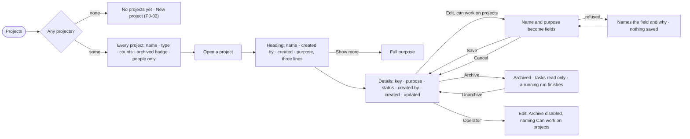

# PJ-01 · See every project and open one

**As** a decision maker **I want** every project on this Graph in one list, and each one's own page stating its purpose
and facts **so that** I see what is open, what is archived and who started it, and can correct the purpose in place.

Tasks: [task.md](task.md) · Feature: [PJ-F01](../../feature.md)

## Who can

| Lens | Can | Otherwise sees |
|---|---|---|
| Admin | Read every project the Graph shows them, open its page, edit its name and purpose in place, archive and unarchive | A private project they are not staffed on is absent, as for anyone |
| Operator | Read the list, every project they may see, its heading, its Details and its counts | *Edit*, *Archive* and *Unarchive* disabled, naming *Can work on projects*. *With Can work on projects: as Admin* |

## Flow

## Acceptance criteria

| # | Given | When | Then |
|---|---|---|---|
| PJ-01.1 | A Graph with no visible project | a member opens Projects | it reads *No projects yet* with *New project* (disabled for an Operator, naming *Can work on projects*) |
| PJ-01.2 | A Graph with projects | a member opens Projects | each row shows its name, type, the engine's counts of branches, open tasks and tasks running, and a muted *archived* badge beside the name when archived |
| PJ-01.3 | A private project the member is not staffed on | the list loads | it is absent from the list as if it did not exist; a person on it sees *people only* beside it |
| PJ-01.4 | A project's page | it opens | the heading shows the name, *created by*, the created time and the purpose clamped to three lines with *Show more*; the breadcrumb is the only way back |
| PJ-01.5 | A project with no purpose written | its page opens | the heading drops the paragraph; Details reads *No purpose written yet* and offers *Edit* |
| PJ-01.6 | A project whose creator was removed | its page opens | *created by* reads *unknown*, never a bare id |
| PJ-01.7 | A member who can work on projects | they press *Edit* on Details | name and purpose become fields in place; key, creator and times stay facts; *Save* writes both and *Cancel* leaves them |
| PJ-01.8 | An edit with an empty name | *Save* is pressed | it is refused, naming the field; nothing is saved |
| PJ-01.9 | An active project | a member who can work on projects presses *Archive* | the project reads archived, its tasks go read only, a run already going finishes, and History records *archived* |
| PJ-01.10 | An archived project | it opens | Details shows every field read only and offers *Unarchive*; pressing it makes the project active and History records *unarchived*, a separate row from *archived* |
| PJ-01.11 | The list or a project's counts | they load | every count is the engine's; none is added up in the browser |
| PJ-01.12 | The list failing to load | the request fails | it says why, with *Try again*; rows already on screen stay |
| PJ-01.13 | An Operator | they open a project's Details | *Edit*, *Archive* and *Unarchive* are disabled, naming *Can work on projects* |

## Screens

| Surface | Lens | First use | Empty after a filter | Loading | Has data | Failed | Agent working or proposing | No access |
|---|---|---|---|---|---|---|---|---|
| Projects | Admin | projects.list · No projects yet | projects.list · Nothing matches | projects.list · Loading | projects.list | projects.list · Could not load | projects.list · Tasks running | — |
| Projects | Operator | projects.list · No projects yet · Read only | projects.list · Nothing matches | projects.list · Loading | projects.list · Read only | projects.list · Could not load | projects.list · Tasks running | projects.list · Read only |
| A project and its Details | Admin | projects.project · No purpose written | — | projects.project · Loading | projects.project · Details | projects.project · Could not load | projects.project · Tasks running | — |
| A project and its Details | Operator | projects.project · No purpose written · Read only | — | projects.project · Loading | projects.project · Details · Read only | projects.project · Could not load | projects.project · Tasks running | projects.project · Details · Read only |
| Editing Details | Admin | — | — | — | projects.project · Details · Editing | projects.project · Details · Save refused | — | — |
| Editing Details | Operator | — | — | — | — | — | — | projects.project · Details · Read only |
| An archived project | Admin | — | — | — | projects.project · Archived | projects.project · Archived · Could not unarchive | — | — |
| An archived project | Operator | — | — | — | projects.project · Archived · Read only | — | — | projects.project · Archived · Read only |
