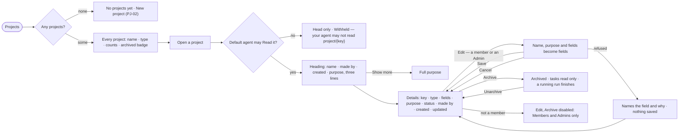

# PJ-01 · See every project and open one

**As** a decision maker **I want** every project in one list, and each one's own page stating its purpose and facts
**so that** I see what is open and what is archived, and can correct the purpose in place when I am on the project.

Tasks: [task.md](task.md) · Feature: [PJ-F01](../../feature.md)

## Who can

*Projects and tasks* is *Acts* for every role in the [role table](../../../../../../os/access/features/AC-F02-access-policies/feature.md#the-role-table);
what a person reads of a project is what their default agent may Read, and its settings are its members' and the
Admins' ([PJ-F01 › Access](../../feature.md#access)).

| Lens | Can | Otherwise sees |
|---|---|---|
| Admin | See every project's head; read the projects their default agent may Read; edit any project's name and purpose in place, archive and unarchive it | A project their default agent may not Read: its head only — *Withheld — your agent may not read `project/{key}`* |
| Operator | See every project's head; read the projects their default agent may Read; edit, archive and unarchive the projects they are a member of; a Modeller the same | On a project they are not a member of: *Edit*, *Archive* and *Unarchive* disabled — *Members and Admins only*. A project their default agent may not Read: its head only, withheld |

## Flow

## Acceptance criteria

| # | Given | When | Then |
|---|---|---|---|
| PJ-01.1 | No project in the deployment | they open Projects | it reads *No projects yet* with *New project* |
| PJ-01.2 | Projects in the deployment | they open Projects | each row shows its name, type, the engine's counts of branches, open tasks and tasks running, and a muted *archived* badge beside the name when archived — every project, for every person |
| PJ-01.3 | A project the reader's default agent may not Read | they open it | its head reads — name, key, type, status and counts — and the rest reads *Withheld — your agent may not read `project/{key}`*; nothing is hidden from the list |
| PJ-01.4 | A project's page | it opens | the heading shows the name, who made it, the created time and the purpose clamped to three lines with *Show more*; the breadcrumb is the only way back |
| PJ-01.5 | A project with no purpose written | its page opens | the heading drops the paragraph; Details reads *No purpose written yet* and offers *Edit* to its members and the Admins |
| PJ-01.6 | A project whose maker was removed | its page opens | *made by* reads *unknown*, never a bare id |
| PJ-01.7 | A member of the project, or an Admin | they press *Edit* on Details | name, purpose and the type's fields become fields in place; key, maker and times stay facts; *Save* writes them and *Cancel* leaves them |
| PJ-01.8 | An edit with an empty name or an empty required field | *Save* is pressed | it is refused, naming the field; nothing is saved |
| PJ-01.9 | An active project | a member or an Admin presses *Archive* | the project reads archived, its tasks go read only, a run already going finishes, and History records *archived* |
| PJ-01.10 | An archived project | it opens | Details shows every field read only and offers its members and the Admins *Unarchive*; pressing it makes the project active and History records *unarchived*, a separate row from *archived* |
| PJ-01.11 | The list or a project's counts | they load | every count is the engine's; none is added up in the browser |
| PJ-01.12 | The list failing to load | the request fails | it says why, with *Try again*; rows already on screen stay |
| PJ-01.13 | An Operator or a Modeller who is not a member | they open its Details | *Edit*, *Archive* and *Unarchive* are disabled — *Members and Admins only* |

## Screens

| Surface | Lens | First use | Empty after a filter | Loading | Has data | Failed | Agent working or proposing | No access |
|---|---|---|---|---|---|---|---|---|
| Projects | Admin | projects.list · No projects yet | projects.list · Nothing matches | projects.list · Loading | projects.list | projects.list · Could not load | projects.list · Tasks running | — |
| Projects | Operator | projects.list · No projects yet | projects.list · Nothing matches | projects.list · Loading | projects.list | projects.list · Could not load | projects.list · Tasks running | — |
| A project and its Details | Admin | projects.project · No purpose written | — | projects.project · Loading | projects.project · Details | projects.project · Could not load | projects.project · Tasks running | — |
| A project the default agent may not read | Admin | — | — | — | — | — | — | projects.project · Withheld |
| A project the default agent may not read | Operator | — | — | — | — | — | — | projects.project · Withheld |
| A project and its Details | Operator | projects.project · No purpose written | — | projects.project · Loading | projects.project · Details | projects.project · Could not load | projects.project · Tasks running | projects.project · Details · Not a member |
| Editing Details | Admin | — | — | — | projects.project · Details · Editing | projects.project · Details · Save refused | — | — |
| Editing Details | Operator | — | — | — | projects.project · Details · Editing | projects.project · Details · Save refused | — | projects.project · Details · Not a member |
| An archived project | Admin | — | — | — | projects.project · Archived | projects.project · Archived · Could not unarchive | — | — |
| An archived project | Operator | — | — | — | projects.project · Archived | projects.project · Archived · Could not unarchive | — | projects.project · Archived · Not a member |
