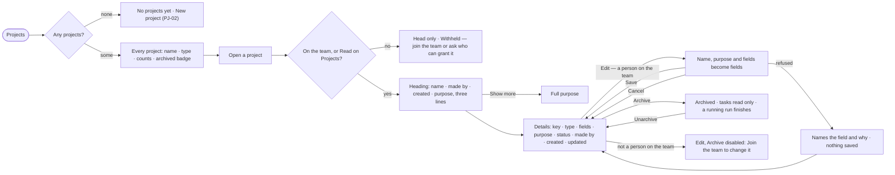

# PJ-01 · See every project and open one

**As** a decision maker **I want** every project in one list, and each one's own page stating its purpose and facts
**so that** I see what is open and what is archived, and can correct the purpose in place when I am on the project.

Tasks: [task.md](task.md) · Feature: [PJ-F01](../../feature.md)

## Who can

*Projects and tasks* follows the [permission catalogue](../../../../../../os/access/features/AC-F02-access-policies/feature.md#the-permission-catalogue);
what a person reads of a project is what they may read, and its settings are its team's and the
Admins' ([PJ-F01 › Access](../../feature.md#access)).

| Access | Can | Otherwise sees |
|---|---|---|
| Admin | See every project's head; read the projects they may read; edit any project's name and purpose in place, archive and unarchive it | A project they may not read: its head only — *Withheld — join the team or ask {who can grant}* |
| Operator | See every project's head; read the projects they may read; edit, archive and unarchive the projects whose team they are on | On a project whose team they are not on: *Edit*, *Archive* and *Unarchive* disabled — *Join the team to change it*. A project they may not read: its head only, withheld |

## Flow

## Acceptance criteria

| # | Given | When | Then |
|---|---|---|---|
| PJ-01.1 | No project in the deployment | they open Projects | it reads *No projects yet* with *New project* |
| PJ-01.2 | Projects in the deployment | they open Projects | each row shows its name, type, the engine's counts of branches, open tasks and tasks running, and a muted *archived* badge beside the name when archived — every project, for every person |
| PJ-01.3 | A project the reader may not read | they open it | its head reads — name, key, type, status and counts — and the rest reads *Withheld — join the team or ask {who can grant}*; nothing is hidden from the list |
| PJ-01.4 | A project's page | it opens | the heading shows the name, who made it, the created time and the purpose clamped to three lines with *Show more*; the breadcrumb is the only way back |
| PJ-01.5 | A project with no purpose written | its page opens | the heading drops the paragraph; Details reads *No purpose written yet* and offers *Edit* to its people |
| PJ-01.6 | A project whose maker was removed | its page opens | *made by* reads *unknown*, never a bare id |
| PJ-01.7 | A person on the project, or an Admin | they press *Edit* on Details | name, purpose, the type's fields and its graph databases become fields in place; key, maker and times stay facts; *Save* writes them and *Cancel* leaves them |
| PJ-01.8 | An edit with an empty name or an empty required field | *Save* is pressed | it is refused, naming the field; nothing is saved |
| PJ-01.9 | An active project | a person on the team presses *Archive* | the project reads archived, its tasks go read only, a run already going finishes, and History records *archived* |
| PJ-01.10 | An archived project | it opens | Details shows every field read only and offers its people *Unarchive*; pressing it makes the project active and History records *unarchived*, a separate row from *archived* |
| PJ-01.11 | The list or a project's counts | they load | every count is the engine's; none is added up in the browser |
| PJ-01.12 | The list failing to load | the request fails | it says why, with *Try again*; rows already on screen stay |
| PJ-01.13 | An Operator not on the team | they open its Details | *Edit*, *Archive* and *Unarchive* are disabled — *Join the team to change it* |
| PJ-01.14 | A project's Details | it is read | *Graph databases* reads *Every graph database*, or the ones it names; a person on the team who saves fewer or more has every later step of the project's runs checked against the new list, and History records from and to |

## Screens

| Surface | Access | First use | Empty after a filter | Loading | Has data | Failed | Agent working or proposing | No access |
|---|---|---|---|---|---|---|---|---|
| Projects | Admin | projects.projects · No projects yet | projects.projects · Nothing matches | projects.projects · Loading | projects.projects | projects.projects · Could not load | projects.projects · Tasks running | — |
| Projects | Operator | projects.projects · No projects yet | projects.projects · Nothing matches | projects.projects · Loading | projects.projects | projects.projects · Could not load | projects.projects · Tasks running | — |
| A project and its Details | Admin | projects.projects · Detail · No purpose written | — | projects.projects · Detail · Loading | projects.projects · Detail · Details | projects.projects · Detail · Could not load | projects.projects · Detail · Tasks running | — |
| A project the reader may not read | Admin | — | — | — | — | — | — | projects.projects · Detail · Withheld |
| A project the reader may not read | Operator | — | — | — | — | — | — | projects.projects · Detail · Withheld |
| A project and its Details | Operator | projects.projects · Detail · No purpose written | — | projects.projects · Detail · Loading | projects.projects · Detail · Details | projects.projects · Detail · Could not load | projects.projects · Detail · Tasks running | projects.projects · Detail · Details · Not a person on the team |
| Editing Details | Admin | — | — | — | projects.projects · Detail · Details · Editing | projects.projects · Detail · Details · Save refused | — | — |
| Editing Details | Operator | — | — | — | projects.projects · Detail · Details · Editing | projects.projects · Detail · Details · Save refused | — | projects.projects · Detail · Details · Not a person on the team |
| An archived project | Admin | — | — | — | projects.projects · Detail · Archived | projects.projects · Detail · Archived · Could not unarchive | — | — |
| An archived project | Operator | — | — | — | projects.projects · Detail · Archived | projects.projects · Detail · Archived · Could not unarchive | — | projects.projects · Detail · Archived · Not a person on the team |
