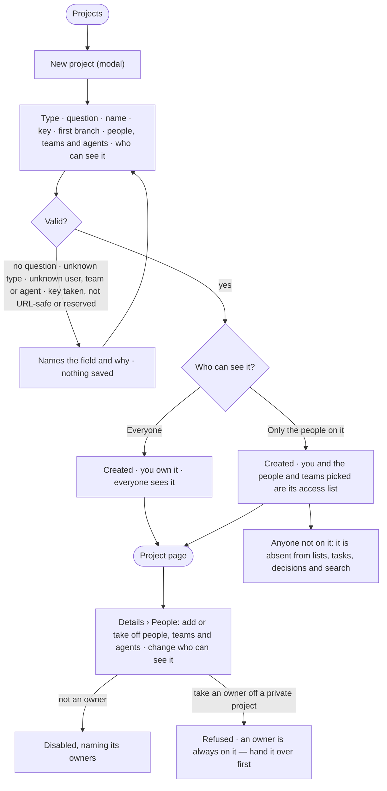

# PJ-02 · Start a project and say who can see it

**As** a decision maker **I want** to start a project by saying what I am deciding — its type, question, first branch,
the people, teams and agents on it, and who can see it **so that** the quest has a shape and the right words from day
one, and a sensitive one is not open to everyone.

Tasks: [task.md](task.md) · Feature: [PJ-F01](../../feature.md)

## Who can

*Projects and tasks* is *Acts* for every role in the [role table](../../../../../../os/access/features/AC-F02-access-policies/feature.md#the-role-table);
the creator owns the project ([AC-F07](../../../../../../os/access/features/AC-F07-ownership/feature.md)).

| Lens | Can | Otherwise sees |
|---|---|---|
| Admin | Start a project; put people, teams and agents on any project they can see; make it private or open to everyone, and change either later | A private project they are not on is absent. An Admin is not exempt: whoever should see it is put on it |
| Operator | Start a project and own it; put people, teams and the agents they may use on a project they own, and change who can see it; a Modeller the same | On a project they do not own, the people and visibility controls read, disabled, naming its owners — *Ask {owner}*. An agent they may not use is disabled in the picker, naming its owners |

## Flow

## Acceptance criteria

| # | Given | When | Then |
|---|---|---|---|
| PJ-02.1 | A signed-in person | they press *New project* | one modal opens with the type (the four launched types, and any type an installed Domain pack adds), the question, the name, the key, the first branch, the people, teams and agents, and who can see it |
| PJ-02.2 | The question typed and no name | the project is created | the name is the question's first 60 characters |
| PJ-02.3 | A question left empty, a type the deployment does not offer, or a user, team or agent that does not exist | they press *Create* | it is refused before saving, the modal naming the field and why |
| PJ-02.4 | A project created | the engine saves it | the creator is its owner and is not offered in the picker; the project opens on its page |
| PJ-02.5 | The people picker | it opens | it lists users and teams by name, and the agents the person may use; an agent they may not use is disabled, naming its owners |
| PJ-02.6 | *Only the people on it* chosen | the project is created | its owners and the people and teams picked are its access list, and its header reads *people only:* and their names |
| PJ-02.7 | A private project | a person not on it opens Projects, a task link, Decisions, search or History | the project, its tasks and its events are absent, and a direct link reads as not found, never *forbidden* |
| PJ-02.8 | A private project | an Admin who is not on it looks | it is absent for them too; putting them on the project is the only way to show it |
| PJ-02.9 | A team on a private project | a person joins or leaves the team | they see the project, or stop seeing it, from their next read |
| PJ-02.10 | A project open to everyone | an owner makes it private | the owners stay on it, so they still see what they hid; History records the change |
| PJ-02.11 | A private project | someone takes an owner off its people | it is refused: an owner is always on it — hand it over first ([AC-24](../../../../../../os/access/features/AC-F07-ownership/stories/AC-24-share-and-hand-over-what-i-own/story.md)) |
| PJ-02.12 | A project open to everyone | its people are edited | being on it only fills the assignee picker; everyone can still read the project |
| PJ-02.13 | An agent's run on a private project | it reads projects | it sees the project only when the person behind the run is on it |
| PJ-02.14 | A type picked | the project is created | the type's default rules are in force on it, its suggested agents and skills are offered first in the picker, and its report template is the report's starting point; further project rules are written on Details after it exists |
| PJ-02.16 | A name typed | the key field is read | it holds a key generated from the name — lower case, URL-safe — unique in the deployment, and may be edited here |
| PJ-02.17 | A key already used, one that is not URL-safe, or a reserved word (`tasks`, `decisions`, `types`) | they press *Create* | it is refused, the key field naming which and why; nothing is saved |
| PJ-02.18 | A project created | its Details are read | the key reads as a fact, never a field; no act edits it (PJ-01.7) |
| PJ-02.19 | A project of a type | it is open | its heading, tabs, dialogs and report use the type's words — a Research project reads *Study* and *Task*, an Investigation *Case* and *Action* — while Projects, My tasks, Inbox › Needs you, Decisions, search and History use *Project* and *Task* with the type as a badge |
| PJ-02.15 | An Operator or a Modeller who does not own a project | they open its People | the people and visibility controls read, disabled, naming its owners — *Ask {owner}* |

## Screens

| Surface | Lens | First use | Empty after a filter | Loading | Has data | Failed | Agent working or proposing | No access |
|---|---|---|---|---|---|---|---|---|
| New project | Admin | projects.new | — | projects.new · Loading people | projects.new · Filled | projects.new · Refused | — | — |
| New project | Operator | projects.new | — | projects.new · Loading people | projects.new · Filled | projects.new · Refused | — | projects.new · Agent not usable |
| A private project | Admin | projects.new · Only the people on it | — | — | projects.new · Only the people on it · Filled | projects.new · Refused | — | — |
| A private project | Operator | projects.new · Only the people on it | — | — | projects.new · Only the people on it · Filled | projects.new · Refused | — | projects.list · Private project absent |
| People and who can see it | Admin | projects.project · People · Only the owner | — | projects.project · People · Loading | projects.project · People | projects.project · People · Owner refused | — | — |
| People and who can see it | Operator | projects.project · People · Only the owner | — | projects.project · People · Loading | projects.project · People | projects.project · People · Owner refused | — | projects.project · People · Not an owner |
