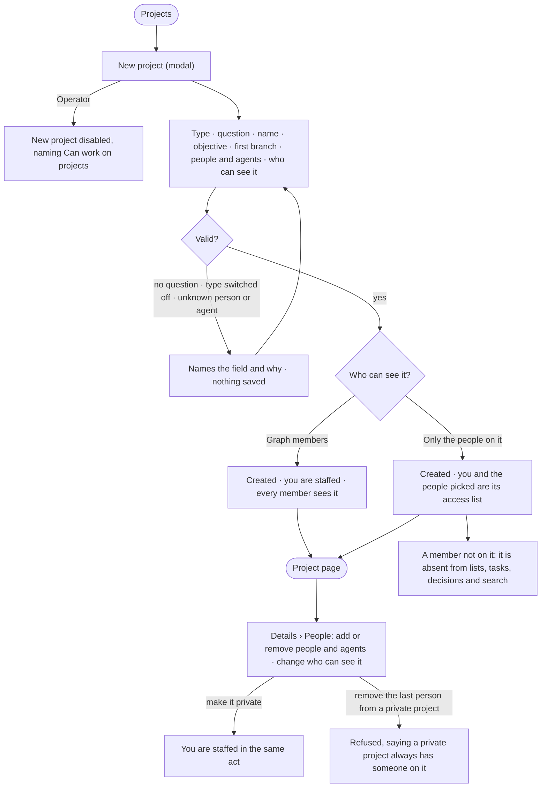

# PJ-02 · Start a project and say who can see it

**As** a decision maker **I want** to start a project by saying what I am deciding — its type, question, first branch,
the people and agents on it, and who can see it **so that** the quest has a shape and the right words from day one, and
a sensitive one is not open to the whole Graph.

Tasks: [task.md](task.md) · Feature: [PJ-F01](../../feature.md)

## Who can

| Lens | Can | Otherwise sees |
|---|---|---|
| Admin | Start a project, staff people and agents, make it private or Graph-visible, change either later, if they can see it | A private project they are not staffed on is absent. An Admin is not exempt: whoever should see it is put on it |
| Operator | Read the projects they may see and who is on them | *New project* and every people or visibility control disabled, naming *Can work on projects*. *With Can work on projects: as Admin* |

## Flow

## Acceptance criteria

| # | Given | When | Then |
|---|---|---|---|
| PJ-02.1 | A member who can work on projects | they press *New project* | one modal opens with the type (the three launched types selectable, the rest drawn and switched off), the question, the name, an objective, the first branch, the agents and people, and who can see it |
| PJ-02.2 | The question typed and no name | the project is created | the name is the question's first 60 characters |
| PJ-02.3 | A question left empty, a type that is switched off, or a person or agent that does not exist | they press *Create* | it is refused before saving, the modal naming the field and why |
| PJ-02.4 | A project created | the engine saves it | the creator is staffed by the engine and is not offered in the picker; the project opens on its page |
| PJ-02.5 | The people picker | it opens | it lists the Graph's other members by name, and the Graph's agents |
| PJ-02.6 | *Only the people on it* chosen | the project is created | the creator and the people picked are its access list, and its header reads *people only:* and their names |
| PJ-02.7 | A private project | a member who is not on it opens Projects, a task link, Decisions, search or the Graph's History | the project, its tasks and its events are absent, and a direct link reads as not found, never *forbidden* |
| PJ-02.8 | A private project | an Admin or Owner who is not on it looks | it is absent for them too; putting them on the project is the only way to show it |
| PJ-02.9 | Being on a private project | the person has no *Can work on projects* | they read it; being on it never grants the right to write |
| PJ-02.10 | A Graph-visible project | someone who can work on projects and can see it makes it private | they are staffed in the same act, so they still see what they hid; History records the change |
| PJ-02.11 | A private project | someone removes its last person | it is refused, saying a private project always has someone on it |
| PJ-02.12 | A Graph-visible project | staffing is edited | staffing only fills the assignee picker; every member can still read the project |
| PJ-02.13 | An agent running on a project | it reads projects | it reads through its own access; the rule for people is applied to the people-facing screens, search and History |
| PJ-02.14 | The project rules a type needs | the modal is open | they are not asked there; they are written on the project's Details tab after it exists |
| PJ-02.15 | An Operator | they open Projects | *New project* is disabled, naming *Can work on projects*; the people and visibility controls on a project read only, naming the same |

## Screens

| Surface | Lens | First use | Empty after a filter | Loading | Has data | Failed | Agent working or proposing | No access |
|---|---|---|---|---|---|---|---|---|
| New project | Admin | projects.new | — | projects.new · Loading people | projects.new · Filled | projects.new · Refused | — | — |
| New project | Operator | — | — | — | — | — | — | projects.list · Read only |
| A private project | Admin | projects.new · Only the people on it | — | — | projects.new · Only the people on it · Filled | projects.new · Refused | — | — |
| A private project | Operator | — | — | — | — | — | — | projects.list · Read only |
| People and who can see it | Admin | projects.project · People · Only you | — | projects.project · People · Loading | projects.project · People | projects.project · People · Last person refused | — | — |
| People and who can see it | Operator | — | — | projects.project · People · Loading | projects.project · People · Read only | projects.project · People · Could not load | — | projects.project · People · Read only |
