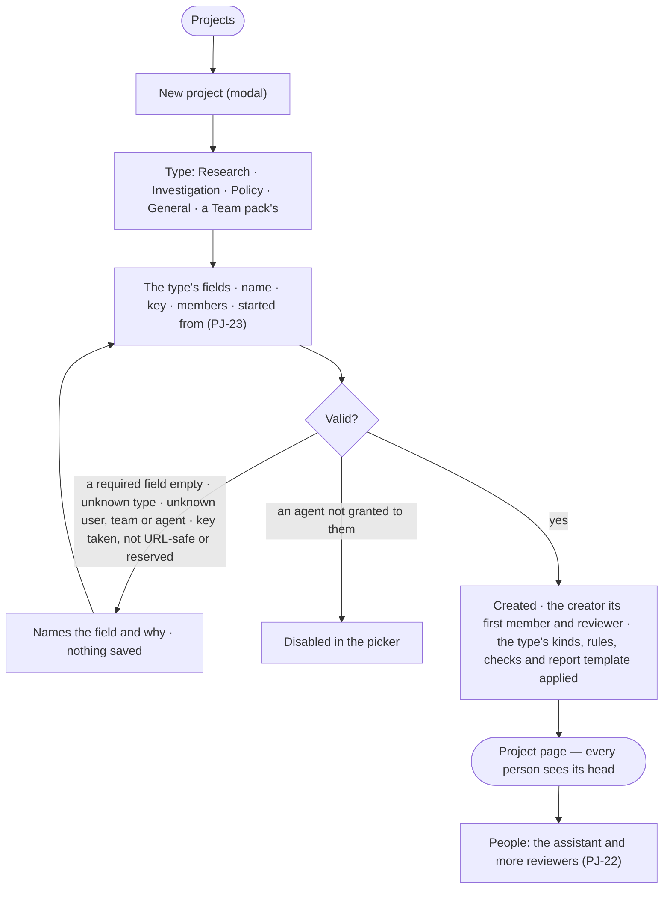

# PJ-02 · Start a project of its type

**As** anyone with work to run **I want** to start a project by picking what kind of work it is — its type, the fields
that type asks for, its name and the people, teams and agents on it **so that** the work has a shape, the right task
kinds and the right words from day one.

Tasks: [task.md](task.md) · Feature: [PJ-F01](../../feature.md)

## Who can

*Projects and tasks* is *Acts* for every role in the [role table](../../../../../../os/access/features/AC-F02-access-policies/feature.md#the-role-table);
the project is the organisation's, and its creator is its first member and reviewer ([PJ-F01 › Access](../../feature.md#access)).

| Lens | Can | Otherwise sees |
|---|---|---|
| Admin | Start a project of any type the deployment offers; add people, teams and the agents granted to them as members | An agent not granted to them is disabled in the picker — *Not granted to you* |
| Operator | The same; a Modeller the same | An agent not granted to them is disabled in the picker — *Not granted to you* |

## Flow

## Acceptance criteria

| # | Given | When | Then |
|---|---|---|---|
| PJ-02.1 | A signed-in person | they press *New project* | one modal opens with the type (the four built-in types, and any type an installed Team pack adds), the fields that type declares, the name, the key, the members and what it started from; nothing in it narrows who reads the project |
| PJ-02.2 | A type with a question, the question typed and no name | the project is created | the name is the question's first 60 characters; for a type without a question, the name is asked for |
| PJ-02.3 | A required field of the type left empty, a type the deployment does not offer, or a user, team or agent that does not exist | they press *Create* | it is refused before saving, the modal naming the field and why |
| PJ-02.4 | A project created | the engine saves it | the creator is its first member and its first reviewer, and is not offered in the picker; the project opens on its page |
| PJ-02.5 | The members picker | it opens | it lists users and teams by name, and the agents granted to the person; an agent not granted to them is disabled — *Not granted to you* |
| PJ-02.12 | A project with members | a person not a member opens it | they read it as far as their default agent may Read `project/{key}`; being a member only fills the assignee picker, lets an agent pick up its tasks and lets a person change its settings |
| PJ-02.14 | A type picked | the project is created | the type's default rules are in force on it, its task kinds are on (PJ-20), its default checks are offered on new tasks (PJ-25), its suggested agents and skills are offered first in the picker, and its report template is the report's starting point |
| PJ-02.16 | A name typed | the key field is read | it holds a key generated from the name — lower case, URL-safe — unique in the deployment, and may be edited here |
| PJ-02.17 | A key already used, one that is not URL-safe, or a reserved word (`tasks`, `decisions`, `types`) | they press *Create* | it is refused, the key field naming which and why; nothing is saved |
| PJ-02.18 | A project created | its Details are read | the key reads as a fact, never a field; no act edits it (PJ-01.7) |
| PJ-02.19 | A project of a type | it is open | its heading, tabs, dialogs and report use the type's words — a Research project reads *Study* and *Task*, an Investigation *Case* and *Action* — while Projects, My tasks, Inbox › Needs you, Decisions, search and History use *Project* and *Task* with the type as a badge |
| PJ-02.20 | A project created | every person opens Projects | it is listed for each of them, its head readable; History records who made it |

## Screens

| Surface | Lens | First use | Empty after a filter | Loading | Has data | Failed | Agent working or proposing | No access |
|---|---|---|---|---|---|---|---|---|
| New project | Admin | projects.new | — | projects.new · Loading people | projects.new · Filled | projects.new · Refused | — | — |
| New project | Operator | projects.new | — | projects.new · Loading people | projects.new · Filled | projects.new · Refused | — | projects.new · Agent not granted |
| The type's fields | Admin | projects.new · Type picked | — | projects.new · Loading types | projects.new · Fields | projects.new · Field refused | — | — |
| The type's fields | Operator | projects.new · Type picked | — | projects.new · Loading types | projects.new · Fields | projects.new · Field refused | — | — |
| A new project's page | Admin | projects.project · Just created | — | projects.project · Loading | projects.project · Details | projects.project · Could not load | — | — |
| A new project's page | Operator | projects.project · Just created | — | projects.project · Loading | projects.project · Details | projects.project · Could not load | — | projects.project · Withheld |
