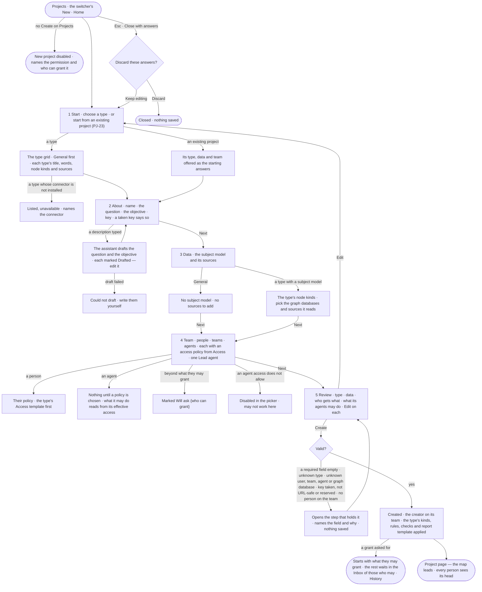

# PJ-02 · Start a project of its type

**As** anyone with work to run **I want** to start a project in five clear steps — choose its type or start from an
existing project, say what it is and the decision it helps make, name the data it reads, and put the people, teams and
agents on it with the access each gets — and see the effect of that access before I create it **so that** the work has a
shape, a goal every agent plans from, the right task kinds and words, access that holds steady whoever joins, and a team
from day one.

Tasks: [task.md](task.md) · Feature: [PJ-F01](../../feature.md)

## Who can

Starting a project needs Create on Projects, and gives each person, team and agent on it the access policy chosen for
them; widening access beyond what the creator may grant needs Manage on Projects — [PJ-F01 › Access](../../feature.md#access).

| Access | Can | Otherwise sees |
|---|---|---|
| Admin | Start a project of any type the deployment offers, or from an existing project; pick its data; put people, teams and agents on its team, each with an access policy from Access, and tag one Lead agent | — |
| Operator | Start a project when they hold Create on Projects; give access only within what they may grant — the rest is asked for | Without Create on Projects, *New project* is disabled, naming the permission and who can grant it; a grant they may not make reads *Will ask {who can grant}* |

## Flow

## Acceptance criteria

| # | Given | When | Then |
|---|---|---|---|
| PJ-02.1 | A person with Create on Projects | they press *New project* | one modal opens with a step strip — *1 Start · 2 About · 3 Data · 4 Team · 5 Review* — on Start, with *Next* and no *Create* until Review |
| PJ-02.2 | A type with a question, the question typed and no name | they leave About | the name is the question's first 60 characters; for a type without a question, the name is asked for |
| PJ-02.3 | A required field of the type left empty, a type the deployment does not offer, or a user, team or agent that does not exist | they press *Create* | it is refused before saving; the modal opens the step that holds the field and names it and why |
| PJ-02.4 | A project created | the engine saves it | the creator is on its team, listed in Team; the project opens on its page |
| PJ-02.5 | The Team step | it opens | people, teams and the agents the project's policies let work here sit side by side; one agent may be tagged *Lead agent*; an agent access does not allow is disabled — *May not work here*; tagging a second Lead agent is refused, naming the first |
| PJ-02.12 | A project with a team | a person not on it, without Read on Projects, opens it | they read its head only — *Withheld — join the team or ask {who can grant}* |
| PJ-02.14 | A type picked | the project is created | the type's default rules are in force on it, its task kinds are on (PJ-20), its default checks are offered on new tasks (PJ-25), its suggested agents and skills are offered first in the Team step, its Access template is chosen first, and its report template is the report's starting point |
| PJ-02.16 | A name typed | the key field is read | it holds a key generated from the name — lower case, URL-safe — unique in the deployment, and may be edited on About |
| PJ-02.17 | A key already used, one that is not URL-safe, or a reserved word (`tasks`, `decisions`, `types`) | they press *Next* on About, or *Create* | it is refused, the key field naming which and why; nothing is saved |
| PJ-02.18 | A project created | its Details are read | the key reads as a fact, never a field; no act edits it (PJ-01.7) |
| PJ-02.19 | A project of a type | it is open | its heading, tabs, dialogs and report use the `labels` of the type's manifest ([PJ-F07](../../../PJ-F07-the-project-graph/feature.md#the-project-type-manifest)) — a Software project reads *Story* where the generic words read *Task* — while Projects, My tasks, Inbox › Needs you, Decisions, search and History use *Project* and *Task* with the type as a badge |
| PJ-02.20 | A project created | every person opens Projects | it is listed for each of them, its head readable; History records who made it |
| PJ-02.22 | A graph database the deployment does not attach, sent by the API | they press *Create* | it is refused before saving — *There is no graph database {name}.*; nothing is saved |
| PJ-02.23 | About filled, with a description | the person moves on | the assistant drafts *The question* and *The objective* from the name, type and description, each marked *Drafted — edit it*; the person edits either before *Next*; *How it got here* on the draft shows its steps and sources |
| PJ-02.24 | About while the assistant drafts | the step is read | both fields show the draft arriving; the person may type over it and *Next* stays on |
| PJ-02.25 | The draft cannot be made — no description, or the assistant failed | About opens | both fields are empty, reading *Write the decision this project helps make*; nothing blocks *Next* |
| PJ-02.26 | Review | it opens | every answer of every step reads as a line — the type, the data, and for each person, team and agent the access policy they get — each step with *Edit* that opens it with its answers kept; *Create* is the one filled act |
| PJ-02.27 | Answers on any step | the person presses Esc or Close | a confirm asks *Discard these answers?* — *Keep editing* · *Discard*; nothing is saved until *Create* |
| PJ-02.28 | A team with no active person — the creator taken off and nobody else added | they press *Create* | it is refused, Team opening and naming why — *A project keeps at least one person on its team.* |
| PJ-02.29 | A creator without Manage on Projects who gives access beyond the template's or widens it | they press *Create* | the project is created read-only on what they chose — each part beyond it marked *Asked {who can grant}*; an ask lands in the Inbox of those with Manage on Projects; History records the ask and its answer |
| PJ-02.30 | A project created | any run inside it starts — asked by anyone on its team, scheduled, picked up or by its Lead agent | it reaches the project's policies ∩ the agent's ceiling; the person who asked is recorded on the run; *How it got here* names the project's policies for each step |
| PJ-02.31 | A project created | Access › Access Policies is read | each policy chosen on the Team step is attached to the person, team or agent it was chosen for, in this project; a policy made for the project is listed like any other, attached to it, started from its template; another attached later adds to it, never replaces it |
| PJ-02.32 | Start | it opens | the type grid lists every type the deployment offers, grouped — *Built in* (General) first, then each pack's — each card with its title, one line and the node kinds and sources its manifest declares, and beside it *Start from an existing project* listing the projects the person may read; a type whose required connector is not installed is listed and unavailable, naming the connector, and a call to create one is refused — *{type} needs {connector} — install it first.* |
| PJ-02.33 | A type picked | About shows its fields | it asks the fields the manifest declares — each with its label, kind, default and whether it is required — and nothing the manifest does not declare; changing the type clears fields the new type does not have, after a confirm that names them |
| PJ-02.34 | The General type picked | Data, Review and the new project's Sources are read | Data says *No subject model — only the work shows*; Review lists no sources or milestones; the project's Sources reads *No subject model* ([PJ-28.2](../../../PJ-F07-the-project-graph/stories/PJ-28-ground-a-project-in-its-subject-model/story.md)); tasks and milestones work as in any type |
| PJ-02.35 | A Software or Research type picked | Review reads | it lists, under the type, its starting milestones, default tags, default checks (each as the workflow or person it names) and suggested agents — each a line with *Edit* back to the step that sets it; *Create* applies them as PJ-02.14 says |
| PJ-02.36 | *Start from an existing project* chosen | the person picks one | its type, data and team are offered as the starting answers on the next steps, each editable; its tasks, findings and branches are not copied; the new project is related to it as *started from* (PJ-23) |
| PJ-02.37 | A type with a subject model | Data opens | it shows the node kinds the type declares and asks which graph databases and sources the project reads — only graph databases the creator may read are offered; each chosen one reads its mode and health (one that is Off or unhealthy stays listed and says so), and a source is parsed as [PJ-28](../../../PJ-F07-the-project-graph/stories/PJ-28-ground-a-project-in-its-subject-model/story.md) says after the project exists |
| PJ-02.38 | The Team step | a person, team or agent is added | the row carries an *Access policy*, chosen from the one list of Access Policies (AC-03) — the type's Access template first for a person or team, and *New policy for this project* opening the form of [AC-49](../../../../../../os/access/features/AC-F02-access-policies/stories/AC-49-make-a-policy-from-an-access-template/story.md) inline |
| PJ-02.39 | An agent added on the Team step | no policy is chosen for it | it holds nothing here — its row reads *Chooses nothing yet — pick a policy* and *Create* is refused naming the agent; a default policy is never applied |
| PJ-02.40 | A row with a policy chosen | the person opens its effect | for a person it reads what that policy lets them do in this project — the check of [AC-08](../../../../../../os/access/features/AC-F02-access-policies/stories/AC-08-check-whether-someone-can-do-something/story.md) over the project's resources; for an agent, the effective matrix of [AC-12.18](../../../../../../os/access/features/AC-F04-what-an-agent-may-touch/stories/AC-12-see-why-an-agent-can-or-cannot/story.md) for that agent *In* this project — before anything is created |
| PJ-02.41 | Review | it opens | *What its agents may do* lists each agent on the team with what its policy lets it Read, Write and Run here, from the engine's own check; a person edits it by *Edit* on the Team step |
| PJ-02.42 | A person without Read on `access/policies` | the Team step shows a row's effect | it reads *No access* naming Read on `access/policies` and who can grant it; the policy is still chosen from the list their grant allows |

## Screens

| Surface | Access | First use | Empty after a filter | Loading | Has data | Failed | Agent working or proposing | No access |
|---|---|---|---|---|---|---|---|---|
| New project · 1 Start | Admin | projects.new · Start | — | projects.new · Start · Loading types | projects.new · Start · Type picked | projects.new · Start · Type needs a connector | — | — |
| New project · 1 Start | Operator | projects.new · Start | — | projects.new · Start · Loading types | projects.new · Start · Type picked | projects.new · Start · Type needs a connector | — | — |
| New project · 1 Start · from a project | Admin | — | projects.new · Start · No project to start from | projects.new · Start · Loading types | projects.new · Start · From a project | — | — | — |
| New project · 1 Start · from a project | Operator | — | projects.new · Start · No project to start from | projects.new · Start · Loading types | projects.new · Start · From a project | — | — | — |
| New project · 2 About | Admin | projects.new · About | — | projects.new · About · Drafting | projects.new · About · Filled | projects.new · About · Slug taken | projects.new · About · Drafting | — |
| New project · 2 About | Operator | projects.new · About | — | projects.new · About · Drafting | projects.new · About · Filled | projects.new · About · Slug taken | projects.new · About · Drafting | — |
| New project · 3 Data | Admin | projects.new · Data · General | — | projects.new · Data · Loading | projects.new · Data | projects.new · Data · Could not load | — | — |
| New project · 3 Data | Operator | projects.new · Data · General | — | projects.new · Data · Loading | projects.new · Data | projects.new · Data · Could not load | — | — |
| New project · 4 Team | Admin | projects.new · Team · Only you | — | projects.new · Team · Loading people and agents | projects.new · Team | projects.new · Team · Agent without a policy | projects.new · Team · Effect of access | — |
| New project · 4 Team | Operator | projects.new · Team · Only you | — | projects.new · Team · Loading people and agents | projects.new · Team | projects.new · Team · Agent without a policy | projects.new · Team · Effect of access | projects.new · Team · Will ask |
| New project · 5 Review | Admin | — | — | — | projects.new · Review | projects.new · Review · Refused | — | — |
| New project · 5 Review | Operator | — | — | — | projects.new · Review | projects.new · Review · Refused | — | — |
| *New project*, refused — Create on Projects | Admin | — | — | — | — | — | — | — |
| *New project*, refused — Create on Projects | Operator | — | — | — | — | — | — | shell.switcher · Act disabled |
| *New project* on Home, refused — Create on Projects | Admin | — | — | — | — | — | — | — |
| *New project* on Home, refused — Create on Projects | Operator | — | — | — | — | — | — | start.home · Act disabled |
| A new project's page | Admin | projects.projects · Detail · Just created | — | projects.projects · Detail · Loading | projects.settings · General | projects.projects · Detail · Could not load | — | — |
| A new project's page | Operator | projects.projects · Detail · Just created | — | projects.projects · Detail · Loading | projects.settings · General | projects.projects · Detail · Could not load | — | projects.projects · Detail · Withheld |
| New project · 4 Team · Add | Admin | projects.new · Team · Add | — | projects.new · Team · Loading people and agents | projects.new · Team · Added | projects.new · Team · Agent may not work here | — | — |
| New project · 4 Team · Add | Operator | projects.new · Team · Add | — | projects.new · Team · Loading people and agents | projects.new · Team · Added | projects.new · Team · Agent may not work here | — | projects.new · Team · Will ask |
| New project · 4 Team · New policy | Admin | projects.new · Team · New policy | — | — | projects.new · Team | — | — | — |
| New project · 4 Team · New policy | Operator | projects.new · Team · New policy | — | — | projects.new · Team | — | — | — |
| New project · Create | Admin | projects.new · Review | — | projects.new · Creating | projects.projects · Detail · Just created | projects.new · Review · Refused | — | — |
| New project · Create | Operator | projects.new · Review | — | projects.new · Creating | projects.projects · Detail · Just created | projects.new · Review · Refused | — | — |
| New project · Discard these answers | Admin | projects.new · Discard confirm | — | — | projects.new · Discarded | — | — | — |
| New project · Discard these answers | Operator | projects.new · Discard confirm | — | — | projects.new · Discarded | — | — | — |
