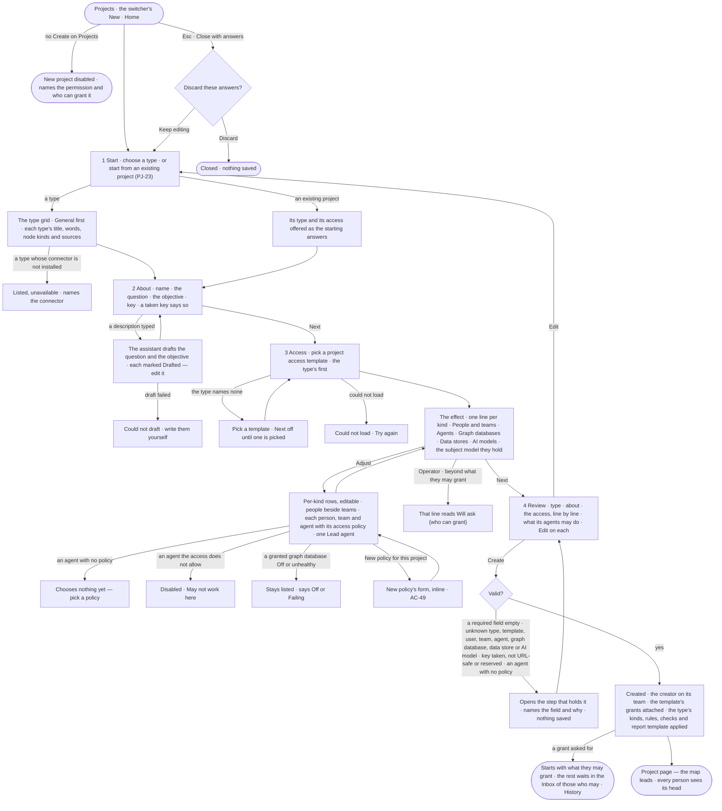

# PJ-02 · Start a project of its type

**As** anyone with work to run **I want** to start a project in four clear steps — choose its type or start from an
existing project, say what it is and the decision it helps make, give it its access in one choice of a project access
template — and see the effect of that access before I create it **so that** the work has a shape, a goal every agent
plans from, the right task kinds and words, and people, teams, agents and data from day one, with access that holds steady
whoever joins.

Tasks: [task.md](task.md) · Feature: [PJ-F01](../../feature.md)

## Who can

Starting a project needs Create on Projects, and gives it what its project access template grants — people and teams, agents,
graph databases, data stores and AI models; granting beyond what the creator may grant needs Manage on Projects —
[PJ-F01 › Access](../../feature.md#access).

| Access | Can | Otherwise sees |
|---|---|---|
| Admin | Start a project of any type the deployment offers, or from an existing project; pick its project access template and adjust each kind it grants — people and teams, agents (one tagged Lead agent), graph databases, data stores, AI models — each person, team and agent with an access policy from Access | — |
| Operator | Start a project when they hold Create on Projects; pick a project access template and adjust it, granting only within what they may grant — the rest is asked for | Without Create on Projects, *New project* is disabled, naming the permission and who can grant it; a grant they may not make reads *Will ask {who can grant}* |

## Flow

## Acceptance criteria

| # | Given | When | Then |
|---|---|---|---|
| PJ-02.1 | A person with Create on Projects | they press *New project* | one modal opens with a step strip — *1 Start · 2 About · 3 Access · 4 Review* — on Start, with *Next* and no *Create* until Review |
| PJ-02.2 | A type with a question, the question typed and no name | they leave About | the name is the question's first 60 characters; for a type without a question, the name is asked for |
| PJ-02.3 | A required field of the type left empty, a type the deployment does not offer, or a project access template, user, team, agent, data store or AI model version that does not exist | they press *Create* | it is refused before saving; the modal opens the step that holds the field and names it and why |
| PJ-02.4 | A project created | the engine saves it | the creator is on its team, listed in Team; the project opens on its page |
| PJ-02.5 | Access, *Adjust* open | it is read | one row per kind — *People and teams* · *Agents* · *Graph databases* · *Data stores* · *AI models* — each listing what [the project access template](../../../../../../os/access/features/AC-F02-access-policies/feature.md#project-access-templates) grants and editable: a person or a team — side by side in one row, the creator first — or an agent added or taken off, each with its access policy, a person's or a team's starting at the template's policy for people and teams; a graph database or a data store set *None* · *Read* · *Read + write*; AI models *Every offered version* · *Local only* · chosen versions; one agent may be tagged *Lead agent*, and tagging a second is refused, naming the first |
| PJ-02.12 | A project with a team | a person not on it, without Read on Projects, opens it | they read its head only — *Withheld — join the team or ask {who can grant}* |
| PJ-02.14 | A type picked | the project is created | the type's default rules are in force on it, its task kinds are on (PJ-20), its default checks are offered on new tasks (PJ-25), its suggested agents are on the Access step's *Agents* line with the type's assistant tagged *Lead agent*, its project access template is picked first, and its report template is the report's starting point |
| PJ-02.16 | A name typed | the key field is read | it holds a key generated from the name — lower case, URL-safe — unique in the deployment, and may be edited on About |
| PJ-02.17 | A key already used, one that is not URL-safe, or a reserved word (`tasks`, `decisions`, `types`) | they press *Next* on About, or *Create* | it is refused, the key field naming which and why; nothing is saved |
| PJ-02.18 | A project created | its Details are read | the key reads as a fact, never a field; no act edits it (PJ-01.7) |
| PJ-02.19 | A project of a type | it is open | its heading, tabs, dialogs and report use the `labels` of the type's manifest ([PJ-F07](../../../PJ-F07-the-project-graph/feature.md#the-project-type-manifest)) — a Software project reads *Story* where the generic words read *Task* — while Projects, My tasks, Inbox › Needs you, Decisions, search and History use *Project* and *Task* with the type as a badge |
| PJ-02.20 | A project created | every person opens Projects | it is listed for each of them, its head readable; History records who made it |
| PJ-02.22 | A graph database the deployment does not attach, sent by the API | they press *Create* | it is refused before saving — *There is no graph database {name}.*; nothing is saved |
| PJ-02.23 | About filled, with a description | the person moves on | the assistant drafts *The question* and *The objective* from the name, type and description, each marked *Drafted — edit it*; the person edits either before *Next*; *How it got here* on the draft shows its steps and sources |
| PJ-02.24 | About while the assistant drafts | the step is read | both fields show the draft arriving; the person may type over it and *Next* stays on |
| PJ-02.25 | The draft cannot be made — no description, or the assistant failed | About opens | both fields are empty, reading *Write the decision this project helps make*; nothing blocks *Next* |
| PJ-02.26 | Review | it opens | every answer of every step reads as a line — the type, About, the project access template and, per kind, what it grants: each person, team and agent with the access policy it gets, each graph database and data store with its level, the AI models, and the graph database that holds the subject model — each step with *Edit* that opens it with its answers kept; *Create* is the one filled act |
| PJ-02.27 | Answers on any step | the person presses Esc or Close | a confirm asks *Discard these answers?* — *Keep editing* · *Discard*; nothing is saved until *Create* |
| PJ-02.28 | A create with no active person on the team — sent by the API without the creator | it is sent | it is refused before saving, Access opening and naming why — *A project keeps at least one person on its team.*; in Studio the creator is always on the team and cannot be taken off on Access |
| PJ-02.29 | A creator without Manage on Projects whose access — the template as it is, or adjusted — grants more than Read on what they may read | they read Access, then press *Create* | each line beyond it reads *Will ask {who can grant}*; the project is created read-only on what they may grant — each part beyond it marked *Asked {who can grant}*; an ask lands in the Inbox of those with Manage on Projects; History records the ask and its answer |
| PJ-02.30 | A project created | any run inside it starts — asked by anyone on its team, scheduled, picked up or by its Lead agent | it reaches the project's policies ∩ the agent's ceiling; the person who asked is recorded on the run; *How it got here* names the project's policies for each step |
| PJ-02.31 | A project created | Access › Access Policies is read | the template's policy — or the policy made for the project when Access was adjusted, started from it and named for the project — is attached to the project; each person's, team's and agent's policy is attached to them, in this project; another attached later adds to it, never replaces it |
| PJ-02.32 | Start | it opens | the type grid lists every type the deployment offers, grouped — *Built in* (General) first, then each pack's — each card with its title, one line and the node kinds and sources its manifest declares, and beside it *Start from an existing project* listing the projects the person may read; a type whose required connector is not installed is listed and unavailable, naming the connector, and a call to create one is refused — *{type} needs {connector} — install it first.* |
| PJ-02.33 | A type picked | About shows its fields | it asks the fields the manifest declares — each with its label, kind, default and whether it is required — and nothing the manifest does not declare; changing the type clears fields the new type does not have, after a confirm that names them |
| PJ-02.34 | The General type picked | Access, Review and the new project's Sources are read | Access reads *No subject model — only the work shows* under its lines; Review lists no sources or milestones; the project's Sources reads *No subject model* ([PJ-28.2](../../../PJ-F07-the-project-graph/stories/PJ-28-ground-a-project-in-its-subject-model/story.md)); tasks and milestones work as in any type |
| PJ-02.35 | A Software or Research type picked | Review reads | it lists, under the type, its starting milestones, default tags, default checks (each as the workflow or person it names) and suggested agents — each a line with *Edit* back to the step that sets it; *Create* applies them as PJ-02.14 says |
| PJ-02.36 | *Start from an existing project* chosen | the person picks one | its type and its access — its people, teams, agents, graph databases, data stores and AI models, as one adjusted project access template — are offered as the starting answers on the next steps, each editable; its tasks, findings and branches are not copied; the new project is related to it as *started from* (PJ-23) |
| PJ-02.37 | A type with a subject model | Access shows its effect | the subject model reads from the graph databases the project is granted — the one at *Read + write* holds it, named on the *Graph databases* line; granted more than one at *Read + write*, *Adjust* asks which, the first by default; granted none, it reads *No graph database to hold the subject model — the work graph is off* and *Create* still works ([PJ-F07](../../../PJ-F07-the-project-graph/feature.md#rules)); sources are added on the project's Sources once it exists ([PJ-28](../../../PJ-F07-the-project-graph/stories/PJ-28-ground-a-project-in-its-subject-model/story.md)) |
| PJ-02.38 | Access | it opens | [the project access template](../../../../../../os/access/features/AC-F02-access-policies/feature.md#project-access-templates) the type names is picked, and one list offers every other one the person may read, each with one line of what it grants; picking one replaces every line of the effect — *People and teams · 2 teams, 1 person* · *Agents · Analyst, Forecaster* · *Graph databases · airways (read + write)* · *Data stores · …* · *AI models · …*; a person's, a team's or an agent's policy is chosen from the one list of Access Policies (AC-03), each section of *Adjust* adds through its own *+* (PJ-02.46), and *New policy for this project* opens the form of [AC-49](../../../../../../os/access/features/AC-F02-access-policies/stories/AC-49-make-a-policy-from-an-access-template/story.md) inline |
| PJ-02.39 | An agent on the *Agents* line — added in *Adjust*, or a pack agent whose policy is not applied | no policy is chosen for it | it holds nothing here — its row reads *Chooses nothing yet — pick a policy* and *Create* is refused naming the agent; a default policy is never applied |
| PJ-02.40 | A person, team or agent row in *Adjust* with a policy chosen | the person opens its effect | for a person or a team it reads what that policy lets them do in this project — the check of [AC-08](../../../../../../os/access/features/AC-F02-access-policies/stories/AC-08-check-whether-someone-can-do-something/story.md) over the project's resources; for an agent, the effective matrix of [AC-12.18](../../../../../../os/access/features/AC-F04-what-an-agent-may-touch/stories/AC-12-see-why-an-agent-can-or-cannot/story.md) for that agent *In* this project — before anything is created |
| PJ-02.41 | Review | it opens | *What its agents may do* lists each agent on the team with what its policy lets it Read, Write and Run here, from the engine's own check; a person edits it by *Edit* on Access |
| PJ-02.42 | A person without Read on `access/policies` | Access shows a row's effect | it reads *No access* naming Read on `access/policies` and who can grant it; the template and each policy are still chosen from the lists their grant allows |
| PJ-02.43 | A granted graph database or data store that is Off or unhealthy | Access's effect or *Adjust* is read | it stays listed with its level and says so — *Off* or *Failing* — and *Create* still works; a run of the project refuses a step on it until it is on and healthy ([CP-F05](../../../../../../os/control/features/CP-F05-graph-databases/feature.md)) |
| PJ-02.44 | *Adjust* | an agent the access does not allow — no Run on it in the project's access, or its ceiling forbids the project — is offered | it is disabled — *May not work here*; adding the agent through the API is refused the same way |
| PJ-02.45 | A graph database, data store or AI model offered in *Adjust* | the person picks | only those the creator may read are offered; one they may read but not grant beyond Read reads *Will ask {who can grant}* beside the higher level (PJ-02.29) |
| PJ-02.46 | Access, *Adjust* open | the person presses a section's *+* | each section but *AI models* has its own add, opening its picker: *People and teams* — people and teams side by side, searchable; *Agents* — the catalogue's agents, one the access does not allow disabled — *May not work here* (PJ-02.44); *Graph databases* — only those the creator may read, one that is Off listed and saying so (PJ-02.43 · PJ-02.45); *Data stores* — only those the creator may read; each pick lands in its section with the template's policy or level, editable; *AI models* is set in place, with no add |

## Screens

| Surface | Access | First use | Empty after a filter | Loading | Has data | Failed | Agent working or proposing | No access |
|---|---|---|---|---|---|---|---|---|
| New project · 1 Start | Admin | projects.new · Start | — | projects.new · Start · Loading types | projects.new · Start · Type picked | projects.new · Start · Type needs a connector | — | — |
| New project · 1 Start | Operator | projects.new · Start | — | projects.new · Start · Loading types | projects.new · Start · Type picked | projects.new · Start · Type needs a connector | — | — |
| New project · 1 Start · from a project | Admin | — | projects.new · Start · No project to start from | projects.new · Start · Loading types | projects.new · Start · From a project | — | — | — |
| New project · 1 Start · from a project | Operator | — | projects.new · Start · No project to start from | projects.new · Start · Loading types | projects.new · Start · From a project | — | — | — |
| New project · 2 About | Admin | projects.new · About | — | projects.new · About · Drafting | projects.new · About · Filled | projects.new · About · Slug taken | projects.new · About · Drafting | — |
| New project · 2 About | Operator | projects.new · About | — | projects.new · About · Drafting | projects.new · About · Filled | projects.new · About · Slug taken | projects.new · About · Drafting | — |
| New project · 3 Access | Admin | projects.new · Access · Pick a template | — | projects.new · Access · Loading | projects.new · Access · Template picked | projects.new · Access · Could not load | — | — |
| New project · 3 Access | Operator | projects.new · Access · Pick a template | — | projects.new · Access · Loading | projects.new · Access · Template picked | projects.new · Access · Could not load | — | projects.new · Access · Will ask |
| New project · 3 Access · Adjust | Admin | projects.new · Access · Adjust | — | projects.new · Access · Loading | projects.new · Access · Adjust | projects.new · Access · Agent may not work here | — | — |
| New project · 3 Access · Adjust | Operator | projects.new · Access · Adjust | — | projects.new · Access · Loading | projects.new · Access · Adjust | projects.new · Access · Agent may not work here | — | projects.new · Access · Will ask |
| New project · 3 Access · Adjust · an agent with no policy | Admin | — | — | — | projects.new · Access · Agent without a policy | — | — | — |
| New project · 3 Access · Adjust · an agent with no policy | Operator | — | — | — | projects.new · Access · Agent without a policy | — | — | — |
| New project · 3 Access · Adjust · a granted graph database or data store Off or unhealthy | Admin | — | — | — | projects.new · Access · Off or unhealthy | — | — | — |
| New project · 3 Access · Adjust · a granted graph database or data store Off or unhealthy | Operator | — | — | — | projects.new · Access · Off or unhealthy | — | — | — |
| New project · 3 Access · Adjust · effect of a row | Admin | — | — | — | projects.new · Access · Effect of access | — | — | — |
| New project · 3 Access · Adjust · effect of a row | Operator | — | — | — | projects.new · Access · Effect of access | — | — | projects.new · Access · No access |
| New project · 3 Access · Adjust · New policy | Admin | projects.new · Access · New policy | — | — | projects.new · Access · Adjust | — | — | — |
| New project · 3 Access · Adjust · New policy | Operator | projects.new · Access · New policy | — | — | projects.new · Access · Adjust | — | — | — |
| New project · 3 Access · Adjust · add people and teams | Admin | projects.new · Access · Add | — | projects.new · Access · Loading | projects.new · Access · Add | — | — | — |
| New project · 3 Access · Adjust · add people and teams | Operator | projects.new · Access · Add | — | projects.new · Access · Loading | projects.new · Access · Add | — | — | projects.new · Access · Will ask |
| New project · 3 Access · Adjust · add agents | Admin | projects.new · Access · Add agents | — | projects.new · Access · Loading | projects.new · Access · Add agents | projects.new · Access · Agent may not work here | — | — |
| New project · 3 Access · Adjust · add agents | Operator | projects.new · Access · Add agents | — | projects.new · Access · Loading | projects.new · Access · Add agents | projects.new · Access · Agent may not work here | — | projects.new · Access · Will ask |
| New project · 3 Access · Adjust · add graph databases | Admin | projects.new · Access · Add graph databases | — | projects.new · Access · Loading | projects.new · Access · Add graph databases | projects.new · Access · Off or unhealthy | — | — |
| New project · 3 Access · Adjust · add graph databases | Operator | projects.new · Access · Add graph databases | — | projects.new · Access · Loading | projects.new · Access · Add graph databases | projects.new · Access · Off or unhealthy | — | projects.new · Access · Will ask |
| New project · 3 Access · Adjust · add data stores | Admin | projects.new · Access · Add data stores | — | projects.new · Access · Loading | projects.new · Access · Add data stores | — | — | — |
| New project · 3 Access · Adjust · add data stores | Operator | projects.new · Access · Add data stores | — | projects.new · Access · Loading | projects.new · Access · Add data stores | — | — | projects.new · Access · Will ask |
| New project · 4 Review | Admin | — | — | — | projects.new · Review | projects.new · Review · Refused | — | — |
| New project · 4 Review | Operator | — | — | — | projects.new · Review | projects.new · Review · Refused | — | — |
| *New project*, refused — Create on Projects | Admin | — | — | — | — | — | — | — |
| *New project*, refused — Create on Projects | Operator | — | — | — | — | — | — | shell.switcher · Act disabled |
| *New project* on Home, refused — Create on Projects | Admin | — | — | — | — | — | — | — |
| *New project* on Home, refused — Create on Projects | Operator | — | — | — | — | — | — | start.home · Act disabled |
| A new project's page | Admin | projects.projects · Detail · Just created | — | projects.projects · Detail · Loading | projects.settings · General | projects.projects · Detail · Could not load | — | — |
| A new project's page | Operator | projects.projects · Detail · Just created | — | projects.projects · Detail · Loading | projects.settings · General | projects.projects · Detail · Could not load | — | projects.projects · Detail · Withheld |
| New project · Create | Admin | projects.new · Review | — | projects.new · Creating | projects.projects · Detail · Just created | projects.new · Review · Refused | — | — |
| New project · Create | Operator | projects.new · Review | — | projects.new · Creating | projects.projects · Detail · Just created | projects.new · Review · Refused | — | — |
| New project · Discard these answers | Admin | projects.new · Discard confirm | — | — | projects.new · Discarded | — | — | — |
| New project · Discard these answers | Operator | projects.new · Discard confirm | — | — | projects.new · Discarded | — | — | — |
