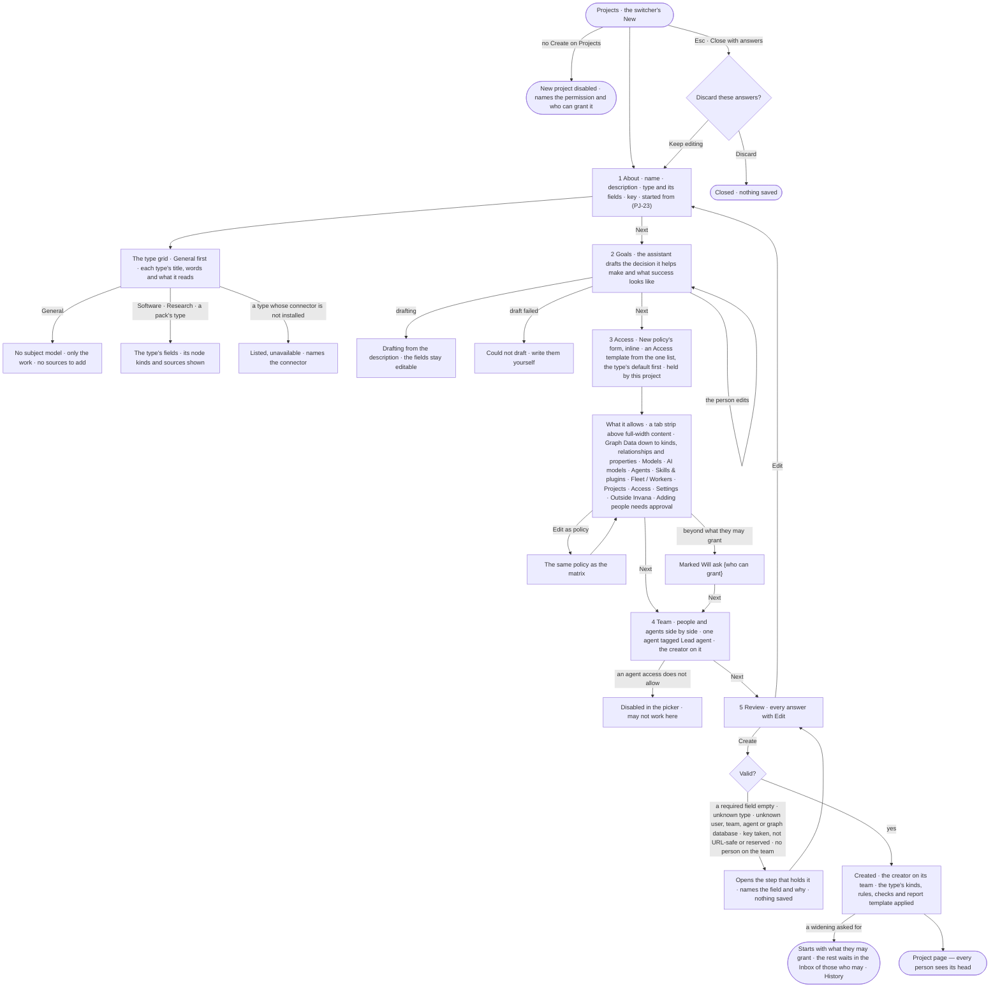

# PJ-02 · Start a project of its type

**As** anyone with work to run **I want** to start a project in a few clear steps — what it is, the decision it helps
make and what success looks like, what the project may reach, and the people and agents on it with its Lead agent —
**so that** the work has a shape, a goal every agent plans from, the right task kinds and words, access that holds
steady whoever joins, and a team from day one.

Tasks: [task.md](task.md) · Feature: [PJ-F01](../../feature.md)

## Who can

Starting a project needs Create on Projects, and makes the project's first Access Policy; widening it needs Manage on
Projects — [PJ-F01 › Access](../../feature.md#access).

| Access | Can | Otherwise sees |
|---|---|---|
| Admin | Start a project of any type the deployment offers; make its Access Policy from an Access template and adjust any of it; put people, teams and agents on its team and tag one Lead agent | — |
| Operator | Start a project when they hold Create on Projects; adjust access only within what they may grant — the rest is asked for | Without Create on Projects, *New project* is disabled, naming the permission and who can grant it; a widening they may not grant reads *Will ask {who can grant}* |

## Flow

## Acceptance criteria

| # | Given | When | Then |
|---|---|---|---|
| PJ-02.1 | A person with Create on Projects | they press *New project* | one modal opens with a step strip — *1 About · 2 Goals · 3 Access · 4 Team · 5 Review* — on About, with *Next* and no *Create* until Review |
| PJ-02.2 | A type with a question, the question typed and no name | they leave About | the name is the question's first 60 characters; for a type without a question, the name is asked for |
| PJ-02.3 | A required field of the type left empty, a type the deployment does not offer, or a user, team or agent that does not exist | they press *Create* | it is refused before saving; the modal opens the step that holds the field and names it and why |
| PJ-02.4 | A project created | the engine saves it | the creator is on its team, listed in Team; the project opens on its page |
| PJ-02.5 | The Team step | it opens | people, teams and the agents the project's policies let work here sit side by side; one agent may be tagged *Lead agent*; an agent access does not allow is disabled — *May not work here*; tagging a second Lead agent is refused, naming the first |
| PJ-02.12 | A project with a team | a person not on it, without Read on Projects, opens it | they read its head only — *Withheld — join the team or ask {who can grant}* |
| PJ-02.14 | A type picked | the project is created | the type's default rules are in force on it, its task kinds are on (PJ-20), its default checks are offered on new tasks (PJ-25), its suggested agents and skills are offered first in the Team step, its Access template is chosen first, and its report template is the report's starting point |
| PJ-02.16 | A name typed | the key field is read | it holds a key generated from the name — lower case, URL-safe — unique in the deployment, and may be edited on About |
| PJ-02.17 | A key already used, one that is not URL-safe, or a reserved word (`tasks`, `decisions`, `types`) | they press *Next* on About, or *Create* | it is refused, the key field naming which and why; nothing is saved |
| PJ-02.18 | A project created | its Details are read | the key reads as a fact, never a field; no act edits it (PJ-01.7) |
| PJ-02.19 | A project of a type | it is open | its heading, tabs, dialogs and report use the `labels` of the type's manifest ([PJ-F07](../../../PJ-F07-the-project-graph/feature.md#the-project-type-manifest)) — a Software project reads *Story* where the generic words read *Task* — while Projects, My tasks, Inbox › Needs you, Decisions, search and History use *Project* and *Task* with the type as a badge |
| PJ-02.20 | A project created | every person opens Projects | it is listed for each of them, its head readable; History records who made it |
| PJ-02.21 | The Access step | it opens | it runs *New policy*'s form inline ([AC-49](../../../../../../os/access/features/AC-F02-access-policies/stories/AC-49-make-a-policy-from-an-access-template/story.md)) — its Start, named for the project, from the one list of Access templates, the type's default first, then *What it allows* as [a tab per section](../../../../../../os/access/features/AC-F02-access-policies/feature.md#the-policy-form) — a horizontal tab strip above the content, each tab with its short status, the selected tab's content spanning the full width of the step: **Graph Data** — each graph database *None* · *Read* · *Read + write*, with overrides per kind of node and relationship and each property *Hidden* · *Read* · *Read + write* · **Models** · **AI models** · **Agents** that may work here · **Skills & plugins** · **Fleet / Workers** — the worker group, runs at once, tokens a month · **Projects** · **Access** · **Settings** · **Outside Invana** · *Adding people needs approval*; *Who holds it* is this project, fixed; the person adjusts it, and *Edit as policy* opens the same policy as the matrix |
| PJ-02.22 | A graph database the deployment does not attach, sent by the API | they press *Create* | it is refused before saving — *There is no graph database {name}.*; nothing is saved |
| PJ-02.23 | About filled, with a description | the person moves to Goals | the assistant drafts *The decision it helps make* and *What success looks like* from the name, type and description, each marked *Drafted — edit it*; the person edits either before *Next*; *How it got here* on the draft shows its steps and sources |
| PJ-02.24 | Goals while the assistant drafts | the step is read | both fields show the draft arriving; the person may type over it and *Next* stays on |
| PJ-02.25 | The draft cannot be made — no description, or the assistant failed | Goals opens | both fields are empty, reading *Write the decision this project helps make*; nothing blocks *Next* |
| PJ-02.26 | Review | it opens | every answer of every step reads as a line — the Access step as New policy's Review reads it: every section in full and what does not apply to a project — each step with *Edit* that opens it with its answers kept; *Create* is the one filled act, and creates the policy attached to the new project |
| PJ-02.27 | Answers on any step | the person presses Esc or Close | a confirm asks *Discard these answers?* — *Keep editing* · *Discard*; nothing is saved until *Create* |
| PJ-02.28 | A team with no active person — the creator taken off and nobody else added | they press *Create* | it is refused, Team opening and naming why — *A project keeps at least one person on its team.* |
| PJ-02.29 | A creator without Manage on Projects who sets access beyond the template's or widens it | they press *Create* | the project is created read-only on what they chose — Read on the graph databases, models and agents they picked — each part beyond it marked *Asked {who can grant}*; an ask lands in the Inbox of those with Manage on Projects; History records the ask and its answer |
| PJ-02.30 | A project created | any run inside it starts — asked by anyone on its team, scheduled, picked up or by its Lead agent | it reaches the project's policies ∩ the agent's ceiling; the person who asked is recorded on the run; *How it got here* names the project's policies for each step |
| PJ-02.31 | A project created | Access › Access Policies is read | its policy is listed like any other, attached to it, started from its template — the same object a person's or a team's policy is; another attached later adds to it, never replaces it |
| PJ-02.32 | About | it opens | the type grid lists every type the deployment offers, grouped — *Built in* (General) first, then each pack's — each card with its title, one line and the node kinds and sources its manifest declares; a type whose required connector is not installed is listed and unavailable, naming the connector, and a call to create one is refused — *{type} needs {connector} — install it first.* |
| PJ-02.33 | A type picked | About shows its fields | it asks the fields the manifest declares — each with its label, kind, default and whether it is required — and nothing the manifest does not declare; changing the type clears fields the new type does not have, after a confirm that names them |
| PJ-02.34 | The General type picked | About, Review and the new project's Sources are read | About says *No subject model — only the work shows*; Review lists no sources or milestones; the project's Sources reads *No subject model* ([PJ-28.2](../../../PJ-F07-the-project-graph/stories/PJ-28-ground-a-project-in-its-subject-model/story.md)); tasks and milestones work as in any type |
| PJ-02.35 | A Software or Research type picked | Review reads | it lists, under the type, its starting milestones, default tags, default checks (each as the workflow or person it names) and suggested agents — each a line with *Edit* back to the step that sets it; *Create* applies them as PJ-02.14 says |

## Screens

| Surface | Access | First use | Empty after a filter | Loading | Has data | Failed | Agent working or proposing | No access |
|---|---|---|---|---|---|---|---|---|
| New project · About | Admin | projects.projects · New · About | — | projects.projects · New · Loading types | projects.projects · New · About filled | projects.projects · New · Field refused | — | — |
| New project · About | Operator | projects.projects · New · About | — | projects.projects · New · Loading types | projects.projects · New · About filled | projects.projects · New · Field refused | — | — |
| New project · Type | Admin | projects.projects · New · About · Types | — | projects.projects · New · Loading types | projects.projects · New · About · General | projects.projects · New · About · Type needs a connector | — | — |
| New project · Type | Operator | projects.projects · New · About · Types | — | projects.projects · New · Loading types | projects.projects · New · About · General | projects.projects · New · About · Type needs a connector | — | — |
| New project · Goals | Admin | projects.projects · New · Goals · No description | — | projects.projects · New · Goals · Drafting | projects.projects · New · Goals | projects.projects · New · Goals · Could not draft | projects.projects · New · Goals · Drafting | — |
| New project · Goals | Operator | projects.projects · New · Goals · No description | — | projects.projects · New · Goals · Drafting | projects.projects · New · Goals | projects.projects · New · Goals · Could not draft | projects.projects · New · Goals · Drafting | — |
| New project · Access | Admin | projects.projects · New · Access · Template | — | projects.projects · New · Access · Loading | projects.projects · New · Access · Adjusted | projects.projects · New · Access · Could not load | — | — |
| New project · Access | Operator | projects.projects · New · Access · Template | — | projects.projects · New · Access · Loading | projects.projects · New · Access · Adjusted | projects.projects · New · Access · Could not load | — | projects.projects · New · Access · Will ask |
| New project · Team | Admin | projects.projects · New · Team · Only you | — | projects.projects · New · Team · Loading people and agents | projects.projects · New · Team | projects.projects · New · Team · No person | — | — |
| New project · Team | Operator | projects.projects · New · Team · Only you | — | projects.projects · New · Team · Loading people and agents | projects.projects · New · Team | projects.projects · New · Team · No person | — | projects.projects · New · Team · Agent may not work here |
| New project · Review | Admin | — | — | — | projects.projects · New · Review | projects.projects · New · Refused | — | — |
| New project · Review | Operator | — | — | — | projects.projects · New · Review | projects.projects · New · Refused | — | — |
| *New project*, refused — Create on Projects | Admin | — | — | — | — | — | — | — |
| *New project*, refused — Create on Projects | Operator | — | — | — | — | — | — | shell.switcher · Act disabled |
| *New project* on Home, refused — Create on Projects | Admin | — | — | — | — | — | — | — |
| *New project* on Home, refused — Create on Projects | Operator | — | — | — | — | — | — | start.home · Act disabled |
| A new project's page | Admin | projects.projects · Detail · Just created | — | projects.projects · Detail · Loading | projects.projects · Detail · Details | projects.projects · Detail · Could not load | — | — |
| A new project's page | Operator | projects.projects · Detail · Just created | — | projects.projects · Detail · Loading | projects.projects · Detail · Details | projects.projects · Detail · Could not load | — | projects.projects · Detail · Withheld |
