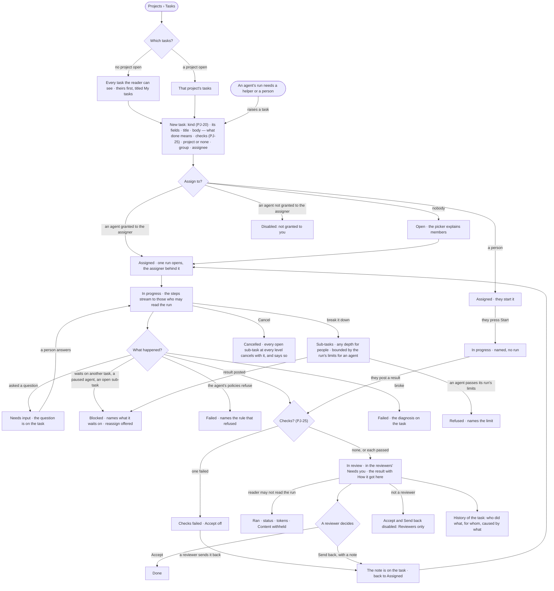

# PJ-12 · Write a task, hand it on and accept the result

**As** anyone with work to get done **I want** to write a task once, with or without a project, hand it to a person or
an agent granted to me, watch it run and have a reviewer accept the result **so that** one list tracks both and a stray task has a home
without a "misc" project. For an agent: *the agent proposes → the person decides.*

Tasks: [task.md](task.md) · Feature: [PJ-F01](../../feature.md)

## Who can

*Projects and tasks* is *Acts* for every role in the [role table](../../../../../../os/access/features/AC-F02-access-policies/feature.md#the-role-table),
within the projects the person's default agent may Read and the agents granted to them; a result is accepted by the
project's reviewers; a run's content follows [AC-31](../../../../../../os/access/features/AC-F09-what-left-the-platform/stories/AC-31-keep-a-runs-content-to-those-who-may-read-it/story.md).

| Lens | Can | Otherwise sees |
|---|---|---|
| Admin | Write a task of a kind the project uses, assign it to a person or an agent granted to them, start, answer an agent's question, cancel; accept or send back a result on a project they review | A task on a project their default agent may not Read: its head only, withheld. On a project they do not review: *Accept* and *Send back* disabled — *Reviewers only* |
| Operator | The same, on every task their default agent may Read, with the agents granted to them; read a task's run as [AC-31](../../../../../../os/access/features/AC-F09-what-left-the-platform/stories/AC-31-keep-a-runs-content-to-those-who-may-read-it/story.md) allows; a Modeller the same | An agent not granted to them is disabled in the picker — *Not granted to you*. *Accept* and *Send back* disabled when not a reviewer — *Reviewers only*. A run they may not read: that it ran, its status and its tokens — *How it got here* reads *Content withheld* |

## Flow

## Acceptance criteria

| # | Given | When | Then |
|---|---|---|---|
| PJ-12.1 | No task the reader can see | they open Projects with no project open | it reads *No tasks yet* with *New task* |
| PJ-12.2 | No project open | the Tasks list shows | it lists every task the reader can see, theirs first under *My tasks*; a task with no project is in this list, never lost |
| PJ-12.3 | A project open | the Tasks list shows | it narrows to that project's tasks while the projects list keeps its place above |
| PJ-12.4 | The Tasks list | counts are drawn | the count of the listed tasks and how many sit in each state come from the engine, not from rows on screen |
| PJ-12.5 | A person whose default agent may Read the project, or any person for a task with no project | they save a new task of a kind the project uses, with a title and a body saying what done means | it is created with or without a project, in state *Open*, its kind's fields and default checks with it |
| PJ-12.6 | A task with no assignee | its page opens | it reads *Open*, and the assignee picker explains that the project's members fill the picker and membership grants nothing |
| PJ-12.7 | A task | it is assigned to a person | it reads *Assigned* and names them; nothing runs |
| PJ-12.8 | A task | it is assigned to an agent granted to the assigner, a member of the project or not | exactly one run opens through that agent, the assigner behind it, and the task reads *In progress* |
| PJ-12.9 | A task whose run is going | a person who may read the run opens its page | the steps stream in `projects.task.thinking`, and *How it got here* shows the steps and sources so far |
| PJ-12.10 | A run asks a question | it is read | the task reads *Needs input* with the question on its thread; answering resumes the run |
| PJ-12.11 | A task waiting on an unmet dependency, a paused agent, an exhausted token budget or an open sub-task | its page opens | it reads *Blocked*, naming exactly what it waits on, with *Reassign* offered when the agent is paused |
| PJ-12.12 | A run that has posted a result on a task with no checks, or whose checks all passed | the task is read | it reads *In review* and shows the result; for a reader who may read the run, *How it got here* shows its steps, sources and assumptions |
| PJ-12.13 | A task in review | a reviewer of the project presses *Accept* — the author, for a task with no project | it reads *Done*, History records who accepted it, and nobody but a person can have done so |
| PJ-12.14 | An agent's result | it is posted | the agent cannot accept it; no screen or call offers an agent acceptance |
| PJ-12.15 | A task in review or with checks failed | a reviewer presses *Send back* and writes a note | the note is kept on the task, which returns to *Assigned* and may be started again |
| PJ-12.16 | A run that failed | the task is read | it reads *Failed* with the diagnosis on the task |
| PJ-12.17 | A task with open sub-tasks | its run settles | it stays *In progress*, listing them |
| PJ-12.18 | A task cancelled | its page is read | every open sub-task at every level below it is cancelled with it, and the page says so |
| PJ-12.27 | A person working a task | they add a sub-task to a sub-task, at any depth | it is created under its parent; no depth limit applies to people |
| PJ-12.28 | An agent's run making sub-tasks | one more would pass the run's limits — depth, count or tokens (CP-F04) | it is refused, naming the limit; the run carries on without it |
| PJ-12.29 | A task with any sub-task still open, at any level | the task is read | it reads *Blocked*, naming the open sub-tasks |
| PJ-12.30 | A task with sub-tasks | its counts are read | the engine gives the count by state for each level and a rolled-up total; Studio adds nothing up |
| PJ-12.19 | An archived project | its tasks are read | they are read only, each act disabled, saying it is archived; a run already going finishes |
| PJ-12.20 | A task's *Runs* tab | it opens | it shows the runs (CP-F10) filtered to this task, not a list of its own |
| PJ-12.21 | A task on a project the reader's default agent may not Read | they open it | its title, kind and state read; its body, result and thread read *Withheld — your agent may not read `project/{key}`* |
| PJ-12.22 | An agent not granted to the assigner | they open the assignee picker | the agent is disabled — *Not granted to you*; a call that assigns it is refused the same way |
| PJ-12.23 | A task assigned to a person | they press *Start* | it reads *In progress* and names them; no run opens |
| PJ-12.24 | A person working a task | they post a result | it reads *In review* with the result, waiting for a person to accept or send it back |
| PJ-12.25 | An agent's run that needs a helper or a person | it raises a task from inside the run | the task is created in the run's project or none, reads who raised it and from which run, and *How it got here* opens that run for those who may read it |
| PJ-12.26 | A task | its *History* opens | every act on the task and each run's attempts read as one tree — who did it, on whose behalf and caused by what — with a delegated run under the step that opened it; the *on behalf of* line comes from the run, never from the task's text, and a skill reads *offered* or *reported*, never *used* |
| PJ-12.31 | A task in review or with checks failed | Inbox › Needs you is read | the task is listed for the project's reviewers — its author, for a task with no project — and for the person behind its run, with what it is, its project and its age; it opens on the task ([CP-36](../../../../../../os/control/features/CP-F08-the-inbox/stories/CP-36-see-what-needs-me-in-one-inbox/story.md)) |
| PJ-12.32 | A task's run the reader may not read ([AC-31](../../../../../../os/access/features/AC-F09-what-left-the-platform/stories/AC-31-keep-a-runs-content-to-those-who-may-read-it/story.md)) | they open the task or *How it got here* | the task, its result and its state read; the run reads that it ran, its status and its tokens, and its steps read *Content withheld* |
| PJ-12.33 | A task's run the agent's Access Policies refuse | the run is checked | the task reads *Failed*, naming the rule that refused — a project or a task grants nothing beyond the agent's policies |
| PJ-12.34 | A task in review and a person who is not a reviewer of its project | they open it | the result reads; *Accept* and *Send back* are disabled — *Reviewers only*; a call is refused the same way |

## Screens

| Surface | Lens | First use | Empty after a filter | Loading | Has data | Failed | Agent working or proposing | No access |
|---|---|---|---|---|---|---|---|---|
| Tasks | Admin | projects.list · No tasks yet | projects.list · No tasks match | projects.list · Loading tasks | projects.list · Tasks | projects.list · Could not load tasks | projects.list · Tasks running | — |
| Tasks | Operator | projects.list · No tasks yet | projects.list · No tasks match | projects.list · Loading tasks | projects.list · Tasks | projects.list · Could not load tasks | projects.list · Tasks running | — |
| New task | Admin | projects.task · New | — | — | projects.task · Assign | projects.task · New refused | — | — |
| New task | Operator | projects.task · New | — | — | projects.task · Assign | projects.task · New refused | — | projects.task · Assign · Agent not granted |
| A task | Admin | projects.task · Open | — | projects.task · Loading | projects.task · In review | projects.task · Could not load | projects.task.thinking | — |
| A task | Operator | projects.task · Open | — | projects.task · Loading | projects.task · In review | projects.task · Could not load | projects.task.thinking | projects.task.thinking · Content withheld |
| A task that cannot go on | Admin | — | — | — | projects.task · Blocked | projects.task · Failed | projects.task · Needs input | projects.task · Withheld |
| A task that cannot go on | Operator | — | — | — | projects.task · Blocked | projects.task · Failed | projects.task · Needs input | projects.task · Archived |
| A closed task | Admin | — | — | — | projects.task · Done | — | — | projects.task · In review · Not a reviewer |
| A closed task | Operator | — | — | — | projects.task · Done | — | — | projects.task · In review · Not a reviewer |
| A result in Needs you | Admin | — | — | inbox · Loading | inbox · A result to accept | inbox · Could not load | — | — |
| A result in Needs you | Operator | — | — | inbox · Loading | inbox · A result to accept | inbox · Could not load | — | — |
| A task's History | Admin | projects.task · History · Nothing yet | — | projects.task · Loading | projects.task · History | projects.task · Could not load | projects.task · History | — |
| A task's History | Operator | projects.task · History · Nothing yet | — | projects.task · Loading | projects.task · History | projects.task · Could not load | projects.task · History | projects.task · History · Content withheld |
